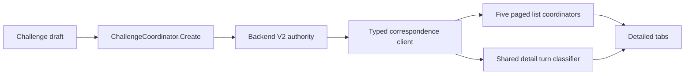
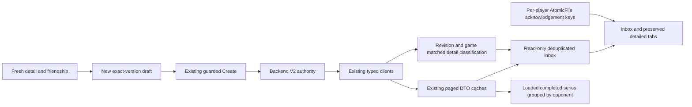

# Correspondence engagement — #265–#268

## Verified baseline (2026-10-14)

Fetched dev: Unity `361468742791799da44c6a9f1401cd37560086f5`; backend `a5dc81e28d5c23a0b64ea4a5071e02c808f51d2b`. Unity 6000.5.7f1. All four issues open; no open Unity PRs at initial audit. Backend is read-only for this work.

## Per-issue audit

- #265: Incoming/Outgoing/Your Turn/Active/Completed/History, typed paged queries and shared detail classification exist. No consolidated inbox. Load-more did not classify appended active rows; commands refreshed only their owner list. Concurrent refreshes could overwrite newer state.
- #266: No acknowledgement store. Revisions include invisible changes, so revision-based unread identities are unsafe. Existing AtomicFile supports validated backup recovery.
- #267: INotificationWriter and NotificationDraft express recipient/source/kind/copy/action/durable event key; PostgreSQL uniqueness and authenticated list/read exist. No correspondence producer. Only Social.SendFriendRequestUseCase calls this writer; Blood Money chat has separate policy work.
- #268: Backend detail and summaries contain public Challenger/Opponent identities; Unity omits them. Completed excludes Declined/Cancelled/Expired. No remote rivalry aggregate or current ruleset-discovery endpoint. ChallengeFormState retains retry IDs without binding them to the logical payload. Create lacks an async submission guard.

## Existing data flow



## Target data flow and ownership



Local versus repositories, RivalryRecord, scoring, remote submission and pending-result authority stay unchanged. No provider, database, bus, polling or domain state is added.

## Review pass 1 — correctness, before production edits

1. Overlapping lists: deduplicate by GUID and highest revision; suppress other terminal statuses and fail closed on equal-revision conflicts. Failed/loading source rows are unconfirmed, without actionable attention identity.
2. Summary-only and stale detail: require active detail matching series/revision/game/participant. Unknown remains unknown. Respect OpenTarget first-mover gating using public attempt status, never metrics. Reset invalidates callbacks; classify appended active pages.
3. Pagination: show loaded counts and partial/error scope; retain opaque cursors. Inbox reuses existing state. Switching to Inbox does not fetch identical pages; explicit Refresh refreshes sources.
4. Account changes: identity generation distinguishes logout/relogin from token refresh; discard stale coordinator responses; clear screen caches/drafts and reload acknowledgements on owner change.
5. Read state: challenge:<series>, turn:<series>:<game>, completed:<series>, only for confirmed visible categories. Rendering/refresh/revisions do not acknowledge. Validate schema and GUID owner; corrupt primary recovers valid backup, otherwise starts unread. Write failure leaves the event unread.
6. Rematch: fresh Completed detail and participant GUID, fresh accepted friendship. Require supported client ruleset/version and best-of-{1,3,5,7}; send explicit historic version/policy. Backend Create resolves its current catalog and rejects removed rules or friendship changes. No silent fallback. Single-flight Create, immutable request snapshot, payload-bound retry ID; uncertain outcomes retain identity.
7. Pending-result retry: preserve existing submitter/store/launcher and banner. Screen resume and explicit source refresh converge after completion.

## Review pass 2 — architecture, privacy and regressions, before production edits

1. Existing coordinators remain the only fetched caches. Rebuild inbox from snapshots, never persist competition state. Rivalry shows only loaded completed entries; no lifetime statistics or local RivalryRecord reuse.
2. Add only public identity DTO fields and optional challenge ruleset version. Preserve GUID/status/revision and command response compatibility.
3. Small presentation/read-state/rematch helpers live in Level5.BackendV2; runtime uGUI remains in Assembly-CSharp. No assembly moves, authored asset changes or new dependencies.
4. Reuse the notification intent boundary in documentation only. No Unity notification API integration because correspondence producers do not exist. No provider dependency enters VersusSeries.
5. No metrics enter inbox/acknowledgements/notification copy. Disable rich text for backend display names. Never persist identities or aggregates in acknowledgement files.
6. Focus regressions on contracts, races, identity, persistence and rematch, plus real correspondence scene/navigation. Isolate test data and preserve any existing persistence file families.

## #267 notification contract — design only

Reuse NotificationDraft and INotificationWriter in application use cases within the durable transition boundary. Future integration must prove atomicity with current IVersusSeriesStore save semantics; this Unity change adds no producer. Source is `level5-correspondence`; recipient is domain PlayerId, never a device or Unity local profile. Durable uniqueness is `(recipient, source, sourceEventKey)`, independent of read state. Keys do not use arbitrary revisions.

| Kind | Recipient and visibility | Identity / sourceEventKey | Safe title / body | Future trigger |
| --- | --- | --- | --- | --- |
| challenge-received | Opponent, after new PendingAcceptance challenge commits | series GUID / challenge:<series> | Challenge received / Open correspondence to respond. | CreateChallengeUseCase first insert, never replay |
| turn-available | Participant eligible to start/resume that game under frozen policy | series GUID + game + recipient / turn:<series>:<game> | Your turn / A correspondence turn is available. | AcceptChallengeUseCase or CompleteAttemptUseCase when committed transition first makes recipient eligible; OpenTarget responder waits for first mover completion |
| series-completed | Both participants, after actual Completed play commits | series GUID / completed:<series> | Series completed / Open correspondence to view the series. | CompleteAttemptUseCase Active-to-Completed, never replay or Declined/Cancelled/Expired |

ActionPath is null until a platform route is approved and tested. Future consumers reuse durable notification records and recheck access on navigation. No sealed metrics, opponent results, predictions, client-authoritative events, or push delivery claims. Producer serialization/uniqueness and rollback require tests in a separately scoped backend change before emission is claimed.

## Validation and acceptance

Validation results are recorded below. Platform notification delivery, all-time rivalry history, physical controller acceptance and Player/IL2CPP certification are not claimed. Live tests use newly registered disposable local accounts only.

## Live contract refinement

The first live Unity probe confirmed PendingAcceptance (the older client fixtures used Pending) and lazily created game rounds. Complete detail with Games=[] or no current round confirms an unstarted turn under the frozen policy; Games=null, conflicting rounds, stale revision/game or an unrecognized policy stays unknown. Added regressions for empty rounds, missing detail, OpenTarget responder gating and alternating first mover. No backend change was necessary.

## Exact implementation changes

| Slice | Files |
| --- | --- |
| #265 cache projection and refresh | `Assets/Scripts/backendv2/Level5BackendV2/UI/CorrespondenceInbox.cs`, `ListViewState.cs`, `SeriesListCoordinator.cs`, `ActiveSeriesTurnClassifier.cs`, `SeriesRowClassifier.cs`; `Session/BackendV2SessionStore.cs`; `Correspondence/RemoteAttemptResultSubmitter.cs` adds only owner-scoped presentation invalidation after settling |
| #266 acknowledgements | `Assets/Scripts/backendv2/Level5BackendV2/UI/CorrespondenceReadState.cs` |
| #267 existing boundary | This document; no backend source, schema or interface changes |
| #268 identities and rematch | `Assets/Scripts/backendv2/Level5BackendV2/Dtos/SeriesDtos.cs`; `UI/CorrespondenceRematch.cs`, `ChallengeFormState.cs`, `ChallengeCoordinator.cs` |
| Runtime integration | `Assets/Scripts/menu_multiplayer/CorrespondenceScreenController.cs`: default Inbox, shared refresh, per-owner clearing, explicit read actions, bounded completed history, View/Rematch, duplicate-command guards and public text with rich text disabled |
| EditMode | Added `Level5BackendV2InboxTests.cs`, `Level5BackendV2ReadStateTests.cs`, `Level5BackendV2RematchTests.cs`; updated `Level5BackendV2ActiveSeriesTurnClassifierTests.cs`, `Level5BackendV2SeriesRowClassifierTests.cs` in `Assets/Tests/Editor/` |
| PlayMode/live | Extended `Assets/Tests/PlayMode/Level5BackendV2CorrespondenceScenePlayModeTests.cs`; added opt-in `BackendV2LiveEngagementCertificationTests.cs` |
| Documentation | This file, `docs/README.md`, `docs/backend-v2-correspondence-ui.md`, `docs/persistence-boundaries.md` |

All new Unity C# assets include `.meta` GUIDs. No scenes, prefabs, packages, local-versus persistence, result payloads or result retry policy changed.

## Remaining boundaries

- Backend has no public current-ruleset discovery endpoint. Preparation checks the authenticated completed detail and client compatibility, then normal Create resolves the requested exact version against the server's current catalog. Unavailable historical rules are rejected, never replaced. A discovery endpoint would require separately approved backend scope; it is not needed for the verified exact-version command path.
- Completed/History pages are bounded and ordered by the backend query, not a lifetime rivalry aggregate. Entries show created time; selected detail shows authoritative completed time and winner. No win/streak aggregate is computed.
- No correspondence notification producer exists. A future backend implementation must prove transactional staging and replay/concurrency behavior before delivery can be claimed.
- Automated navigation reachability is not physical gamepad or human UX acceptance. No manual visual/device pass or Player/IL2CPP build was performed.
- Temporary local backend/container were started without setup, secret rotation or migrations. Only generated test accounts were challenged. Their refresh tokens are revoked in teardown; fixture accounts/series remain in the local development database because no public account-deletion endpoint exists.

## Final acceptance results (2026-10-14)

| Issue | Result | Evidence |
| --- | --- | --- |
| #265 | PASS | Current-server PendingAcceptance/Active/Completed mapping, deduplication, preserved tabs, shared pages/cursors, appended-turn classification, stale refresh/page rejection, account lifecycle, command and result-settled refresh |
| #266 | PASS | Meaningful event keys only, explicit Mark read, fresh/new-instance/reload behavior, validated corruption recovery, failed-write behavior, per-player isolation and sealed-result guards |
| #267 | PASS (boundary/documentation scope) | Existing writer/draft reused; recipient/event/key/copy/visibility/lifecycle/action contract defined. No provider dependencies or producers added. Live notification probe confirms correspondence emitted no notification |
| #268 | PASS | Additive identities, loaded completed history grouped by opposite GUID, no lifetime statistics, fresh friendship/detail preparation, exact-version normal Create, guarded duplicate sends, retry-stable identity, immutable completed revision and removed-friend refusal |

## Test commands and exact results

Pinned executable: `C:\Program Files\Unity\Hub\Editor\6000.5.7f1\Editor\Unity.exe`. Commands run from the Unity repository; output paths below are ignored local evidence. Each Unity run backed up/restored the complete `AppData/LocalLow/level5/level5` directory, including primary/backup/temp files. Scene fixtures also preserve session files and delete only their generated acknowledgement files.

- `powershell -NoProfile -File scripts/validate-repository.ps1`: PASS, wrapper exit 0.
- Unity `-batchmode -nographics -projectPath . -runTests -testPlatform EditMode -testFilter <editFilter> -testResults TestResults/engagement/editmode.xml -logFile TestResults/engagement/editmode.log`: **138 total, 138 passed, 0 failed, 0 skipped, 0 inconclusive; process exit 0**.
- Unity `-batchmode -force-d3d11 -projectPath . -runTests -testPlatform PlayMode -testFilter <playFilter> -testResults TestResults/engagement/playmode-final.xml -logFile TestResults/engagement/playmode-final.log`, with `LEVEL5_ENGAGEMENT_LIVE=1`: **9 total, 9 passed, 0 failed, 0 skipped, 0 inconclusive; process exit 0**. Six real-screen tests, two existing pending-result durability tests, one live Unity-client test. NUnit XML reports `asserts=0` for these Unity runs; counts above are the actual test-case results.
- Backend `dotnet test v2/tests/Level5.Application.Tests --no-restore --filter FullyQualifiedName~Notification --logger trx --results-directory ../level5/TestResults/engagement/backend-application`: **21/21 passed, 0 failed/skipped, exit 0**.
- Backend `dotnet test v2/tests/Level5.Domain.Tests --no-restore --filter FullyQualifiedName~Notification --logger trx --results-directory ../level5/TestResults/engagement/backend-domain`: **15/15 passed, 0 failed/skipped, exit 0**.

Exact editFilter:

```text
Level5BackendV2InboxTests;Level5BackendV2ReadStateTests;Level5BackendV2RematchTests;Level5BackendV2SeriesRowClassifierTests;Level5BackendV2ActiveSeriesTurnClassifierTests;Level5BackendV2SeriesListCoordinatorTests;Level5BackendV2ChallengeCoordinatorTests;Level5BackendV2CorrespondenceClientTests;Level5BackendV2RemoteAttemptSubmissionTests;Level5BackendV2RemoteAttemptLauncherTests;Level5BackendV2PendingRemoteAttemptResultStoreTests;Level5VersusCorrespondenceTests;Level5BackendV2ArchitectureTests
```

Exact playFilter:

```text
BackendV2LiveEngagementCertificationTests;Level5BackendV2CorrespondenceScenePlayModeTests;BackendV2RemoteAttemptResultDurabilityPlayModeTests
```

The live test used real UnityWebRequestTransport and existing typed clients against local current backend dev: two newly registered players, accepted friendship, current incoming/public identity shapes, initially empty round detail, sealed opponent metrics, best-of-one completion/history, fresh rematch preparation, exact-version Create and same-ID replay, unchanged completed revision, cancellation of the new rematch and removal of friendship. A direct test-only notification list probe found 0 notifications for challenger and exactly the expected platform/friend-request-received record for recipient. No correspondence delivery was emitted or claimed.

Earlier diagnostic runs: first EditMode 134/134 passed; initial PlayMode 4/8 passed (four fixed-frame timing assumptions), next 7/8 (ambiguous test button lookup), focused corrected acknowledgement 1/1. First live 0/1 exposed lazy-round semantics; corrected live 1/1. Final results above include all repairs and added real-contract regressions. No unresolved test failures remain. No physical/manual UX, full Unity suite, Player/IL2CPP or hosted CI result is implied.

Final pre-publication fetch: Unity and backend SHAs unchanged from baseline; both repositories had no open PRs. Diff reviewed; focused checks rerun after that fetch.

## PR #306 review corrections (2026-10-14)

The follow-up review reproduced two UI ordering defects at head `fd0f49c260b5b1064f71672001f50c8d86948638`: selecting a detailed tab during another refresh dropped the selected source refresh, and an earlier completed-detail response could replace the latest selection. Both original reproductions failed against that head (0/2, process exit 2).

Corrections in `CorrespondenceScreenController` use selection generations at the existing refresh boundary: the latest detailed tab waits for the current operation, superseded selections stop waiting, and selecting Inbox cancels queued reads without refetching its source pages. A separate completed-detail request generation rejects superseded responses and is invalidated when full refresh or account change clears the selection. No client, backend contract, competition, submission or acknowledgement behavior changed.

Added `Assets/Tests/PlayMode/Level5BackendV2CorrespondenceOrderingPlayModeTests.cs` and its `.meta`. Six real-screen fake-transport regressions cover reverse-order detail responses, selecting a tab during another refresh, two selections in one frame, coalescing queued tabs, cancellation by Inbox, and a pending detail response arriving after full refresh clears selection.

Final affected validation, Unity 6000.5.7f1: `-batchmode -force-d3d11 -projectPath . -runTests -testPlatform PlayMode -testFilter 'Level5BackendV2CorrespondenceOrderingPlayModeTests;Level5BackendV2CorrespondenceScenePlayModeTests' -testResults TestResults/engagement/ordering-fixes.xml -logFile TestResults/engagement/ordering-fixes.log`: **12 total, 12 passed, 0 failed, 0 skipped, 0 inconclusive; process exit 0**. Persistent data was backed up/restored and the temporary backup deleted. The preceding five-regression iteration also passed 11/11, exit 0.

Earlier 138/138 EditMode, 9/9 PlayMode/live and 36/36 backend notification results above remain evidence for unchanged feature contracts; they were not rerun for these UI-only corrections. Final dev refresh remains `361468742791799da44c6a9f1401cd37560086f5`, with PR #306 as the only open Unity PR.

Repository validation also passed after adding the ordering fixture and metadata (exit 0).
