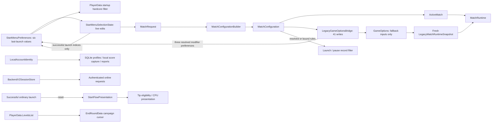

# `GameOptions` production ownership inventory

Status: **#275 PASS for A1/A2/C/B/D and focused integration. #274 D2/F and #276 remain blocked.**
Audited 2026-10-19 against freshly fetched `origin/dev 99c3024b7f9fee4ea492423a6b3bb9eb534ea62a`, Unity `6000.5.7f1`.
Branch: `refactor/275-non-match-ownership`; PR target: `dev`.
GitHub: #273 closed / PR #309 merged; #274 closed / PR #310 merged, despite its documented D2/F debt;
#275 and #276 open. No open PR overlap at preparation. Publication refresh is recorded below.
The [existing migration plan](game-options-match-system-overhaul-plan.md#275-pre-implementation-audit-and-two-review-passes-2026-10-19)
contains both reviews recorded before production changes. Historical #274 inventory remains available
[in dev at the audit baseline](https://github.com/sweat-this/level5/blob/99c3024b7f9fee4ea492423a6b3bb9eb534ea62a/docs/game-options-inventory.md).

## Scope and verified counts

Counts exclude comments/literals, tests, editor tools, Unity-ignored `~` backups and `Assets/Scripts/Dev`.
One access is one executable member expression. Retained release expressions are simple assignments;
the interpolation-aware architecture guard independently prevents hidden new accesses.

| Measure | Verified dev baseline | #275 source |
| --- | --- | --- |
| Public static stored fields | 49 | **41** |
| Identity forwarding properties | 2 | **0** |
| Methods | 12 | **12**, three public / nine private |
| Bridge GameOptions assignments | 41 | **41**, retained fallback inputs |
| Non-bridge release expressions | 48 / 45 lines / 13 files | **4 / 4 lines / 2 files** |
| Total external expressions including bridge | 89 / 14 files | **45 / 3 files** |
| Development-only direct accesses | 0 | **0** |
| Architecture consumer allowlist | 14 | **3**: bridge, ProgressionManager, EndRoundMenuManager |
| Field-count ratchet | 49 | **41** actual declarations |

All eight non-match fields and two identity forwarders are gone. The three modifier fields remain
as gameplay fallback inputs; the menu no longer reads them. The four external writes and 41 internal
fallback inputs remain real compatibility requirements, so #276 is not ready.

## Per-responsibility audit and acceptance

| Slice / previous responsibility | Current owner / behavior | Source acceptance |
| --- | --- | --- |
| A1 applicationVersion, operatingSystemVersion | Removed write-only fields and StartManager copies. Real consumers already use Application.version and SystemInfo.operatingSystem directly. | PASS source; no replacement store |
| A1 previousSceneName | Removed write-only mirror in StartManager, ProgressionManager, GameLevelManager. Existing transitions and scene names unchanged. | PASS source |
| A2 numOfLocalUsers | Removed redundant count. UserAccountManager derives status from its loaded profiles.Count; list/row content remains authoritative. | PASS source; populated-to-empty refresh regression |
| C userName / userid | AccountManager creation, UserAccountManager selection/guest/deletion, LocalAccount row selection, LoadManager SQLite lookup, both HighScoreModel factories, StartManager label and APIHelper reports use LocalAccountIdentity directly. Forwarders removed. | PASS source; capture timing and numeric IDs unchanged |
| B mode / level / friend indices | StartMenuSelectionState edits live values. StartMenuPreferences remembers three integers only at the existing successful StartManager launch save. Awake restores them; wrapping/eligibility and friend indexing unchanged. | PASS source; no disk persistence |
| B traffic / hardcore / obstacles | Three menu preference booleans remember resolved rules at the existing bridge ApplyModifiers boundary, including campaign/versus/remote publication. They never supply MatchRuntime. Requested options rejected by a mode/arena remain rejected on menu return. | PASS source; fallback fields and all one-way writes retained |
| B startup score filter | PlayerData.Start reads StartMenuSelectionState.ReadPersistedHardcorePreference without ActiveMatch. Configured launch and pause still pass explicit bound/resolved rule filters. | PASS source |
| B campaign and difficulty | PlayerData.LevelsList remains authored route; EndRoundData remains cursor. Menu level memory never advances with campaign. Difficulty resets to Normal during LoadPersistedPreferences. | PASS source |
| D tipDialogueLoadedOnStart | StartFlowPresentation owns one presentation bit. Tip Awake/OnEnable gate, Start marks; CPU select always acquires maps and only marks in Start. Successful ordinary launch resets eligibility. Authored start scene leaves both panels inactive; focused scene tests explicitly activate them without editing assets. | PASS source; PASS focused authored lifecycle and six-value menu re-entry test |
| New process / domain reload disabled | Both new menu owners reset via SubsystemRegistration. Scene transitions retain values. Existing identity and PlayerSelectionSession lifetimes unchanged. | PASS source; reset regression |

Fresh Assets/ProjectSettings/Packages member-name scans found no reflection or serialized consumer
of the deleted fields. The only excluded historical references are commented/Unity-ignored Legacy~
metadata writes. Public static storage is not Unity instance serialization. No scenes, prefabs,
GUIDs, schemas, migrations, authored IDs, route data, remote request contracts, scoring or XP changed.

## Authority and dependency flow



StartMenuPreferences is preference history, not gameplay configuration. There is no reverse sync
from it or GameOptions into ActiveMatch. It stores no character, roster, campaign position, authentication,
result, difficulty, enemy or sniper state. Its bridge notification must move to the supported launch
boundaries if #276 eventually removes the bridge; deleting it would change existing menu semantics.
StartFlowPresentation is independent of accounts and persistence. Local profile IDs are never Backend V2 PlayerIds.

## Risks, mitigations and review record

| Risk | Mitigation / focused evidence |
| --- | --- |
| Save highlighted options too early or retain requested instead of resolved flags | Keep launch-only index save; record resolved modifiers at existing bridge publication; ownership tests and real menu re-entry |
| Lose preferences on scene return, or retain them across a new editor session | Static menu memory plus SubsystemRegistration reset; lifetime regression |
| Reinterpret menu indices as campaign cursor / redesign catalogs | Keep current index wrapping and eligibility; use existing EndRoundData cursor; campaign adapter and authored round checks |
| Startup scores read stale ActiveMatch or fallback flags | Explicit menu hardcore reader; startup no-ActiveMatch and bound pause tests |
| Attribute local results to a later/online identity | In-place LocalAccountIdentity reads; both factories capture before profile switch; SQLite guest/deletion tests; online guards reject LocalAccountIdentity |
| Suppress CPU input when a tip has shown | Preserve unconditional CPU OnEnable and distinct tip gates; authored screen lifecycle/focus regression |
| Remove needed compatibility or serialized surface | Fresh references/asset scan; keep all 41 fallback inputs; bridge/fallback and retired-member guards |
| Add duplicate gameplay/global ownership | Two narrow owners only: six menu preferences and one presentation bit; no settings store, new asmdef or scene change |

Both adversarial passes and the twice-refined implementation sequence are recorded in the linked
existing plan. Review 1 corrected resolved-modifier timing and CPU/tip asymmetry; review 2 retained
all fallback dependencies, required new-process resets and tightened guards without extra authority.

## Remaining direct-scene input blockers

| Input group | Configured authority | Current direct-scene source / missing contract |
| --- | --- | --- |
| Rules, clock, shots, combat, sniper | MatchConfiguration.Rules | GameOptions live values. ArenaBootstrap consumes rules; it does not author replacements. Preserve combined flags, countdown precedence, timer-zero and sniper precedence. |
| Roster and local input slots | PlayerRoster | GameOptions count, per-slot CPU flags, names and input formula. LevelRuntimeContext/GameLevelManager already read MatchRuntime during early Awake; no earlier independent roster composition exists. |
| Lockdown implicit defender | Rules.AddsImplicitDefender / stable mode ID | Fallback mode 27 plus slot-two CPU flag. An arena alone cannot determine this mode-specific participant. |
| Arena identity/capabilities | Configuration.Level | GameOptions level identity/weather/time-of-day/seven-point flags. Scene geometry and menu catalog entries do not establish the existing arbitrary direct-entry values. |
| Primary character | Roster slot zero | Live character ID/display/object name and roster names. Menu session identity is not a validated scene participant or an incomplete configured character's missing datum. |
| Cheerleader | Configuration.Cheerleader | Live object/display names; no independent scene-owned selection. Preserve direct-entry zero bonuses. |
| Configured incomplete character / absent roster slot | MatchRuntime characterized fallback | Removing the reader based only on HasConfiguration would break these existing cases. Require explicit replacement answers, not a later ActiveMatch or highlighted selection guess. |

These are source-backed blockers, not authorization to introduce a static state bag, dictionary,
new settings manager or guessed scene defaults. Existing reader and snapshot interfaces are adequate;
the absent piece is the independently initialized scene input contract before consumers' Awake.

## Every remaining stored field

All declarations are in `Assets/Scripts/menu_start/GameOptions.cs`; B is the paired assignment line
in `Assets/Scripts/menu_start/LegacyGameOptionsBridge.cs`. All 41 fields participate in fallback.

| Field / type | Declaration | B | External access | Authority / retirement gate |
| --- | --- | --- | --- | --- |
| `numPlayers` (`int`) | 10 | 117 | 0W | Fallback roster/rule count; captured SQLite count now belongs to HighScoreModel.numPlayers. #274 F. |
| `player1IsCpu` (`bool`) | 11 | 118 | 0W | Roster control / fallback including out-of-roster edge; `PlayerSlot.ControlType / LocalInputSlot; Rules.AddsImplicitDefender`; #274 F; preserve implicit defender and formula |
| `player2IsCpu` (`bool`) | 12 | 119 | 0W | Roster control / fallback including out-of-roster edge; `PlayerSlot.ControlType / LocalInputSlot; Rules.AddsImplicitDefender`; #274 F; preserve implicit defender and formula |
| `player3IsCpu` (`bool`) | 13 | 120 | 0W | Roster control / fallback including out-of-roster edge; `PlayerSlot.ControlType / LocalInputSlot; Rules.AddsImplicitDefender`; #274 F; preserve implicit defender and formula |
| `player4IsCpu` (`bool`) | 14 | 121 | 0W | Roster control / fallback including out-of-roster edge; `PlayerSlot.ControlType / LocalInputSlot; Rules.AddsImplicitDefender`; #274 F; preserve implicit defender and formula |
| `characterDisplayName` (`string`) | 57 | 109 | 0W | Roster / fallback + configured edge; `PlayerRoster slot 0 Character.DisplayName`; #274 F |
| `cheerleaderDisplayName` (`string`) | 58 | 127 | 0W | Presentation identity / fallback; `MatchConfiguration.Cheerleader.DisplayName`; #274 F |
| `characterId` (`int`) | 59 | 108 | 0W | Fallback roster/primary identity; all progression now uses explicit captured IDs. #274 F. |
| `gameModeSelectedId` (`int`) | 60 | 43 | 0W | Match identity / fallback; `MatchConfiguration.ModeId / Mode.RawModeId`; #274 F; preserve numeric IDs and Lockdown mapping |
| `levelId` (`int`) | 61 | 70 | 1W | Arena identity / fallback; `MatchConfiguration.Level.LevelId`; #274 E/F; preserve unconfigured campaign transition |
| `characterObjectName` (`string`) | 63 | 107 | 1W | Roster / progression presentation / fallback + configured edge; `Configured: roster slot 0 Character.ObjectName; progression: PlayerSelectionSession + selected profile`; #274 D, then F; do not substitute old ActiveMatch in menu |
| `characterObjectNames` (`List<string>`) | 64 | 102 | 0W | Roster / fallback; `PlayerRoster.Players[*].Character.ObjectName`; #274 F |
| `cheerleaderObjectName` (`string`) | 65 | 126 | 0W | Presentation identity / fallback; `MatchConfiguration.Cheerleader.ObjectName`; #274 F |
| `levelDisplayName` (`string`) | 66 | 71 | 1W | Arena presentation / fallback; `MatchConfiguration.Level.DisplayName`; #274 E/F |
| `gameModeSelectedName` (`string`) | 67 | 44 | 0W | Mode presentation / fallback; `MatchConfiguration.Mode.DisplayName`; #274 F |
| `gameModeRequiresCounter` (`bool`) | 70 | 47 | 0W | Resolved clock / fallback; `ResolvedMatchRules.ClockMode`; #274 F; Countdown takes priority |
| `gameModeRequiresCountDown` (`bool`) | 71 | 46 | 0W | Resolved clock / fallback; `ResolvedMatchRules.ClockMode`; #274 F |
| `gameModeRequiresShotMarkers3s` (`bool`) | 74 | 49 | 0W | Resolved marker flags / fallback; `ResolvedMatchRules.ShotMarkers`; #274 F |
| `gameModeRequiresShotMarkers4s` (`bool`) | 75 | 50 | 0W | Resolved marker flags / fallback; `ResolvedMatchRules.ShotMarkers`; #274 F |
| `gameModeRequiresBasketball` (`bool`) | 76 | 60 | 0W | Resolved basketball rule / fallback; `ResolvedMatchRules.RequiresBasketball`; #274 F |
| `gameModeAllowsCpuShooters` (`bool`) | 77 | 61 | 0W | Resolved CPU rule / fallback; `ResolvedMatchRules.AllowsCpuShooters`; #274 F |
| `gameModeThreePointContest` (`bool`) | 79 | 53 | 0W | Resolved shot flags / fallback; `ResolvedMatchRules.ShotRule`; #274 F; preserve independent combined flags |
| `gameModeFourPointContest` (`bool`) | 80 | 54 | 0W | Resolved shot flags / fallback; `ResolvedMatchRules.ShotRule`; #274 F; preserve independent combined flags |
| `gameModeAllPointContest` (`bool`) | 81 | 56 | 0W | Resolved shot flags / fallback; `ResolvedMatchRules.ShotRule`; #274 F; preserve independent combined flags |
| `customTimer` (`float`) | 83 | 58 | 0W | Resolved clock / fallback; `ResolvedMatchRules.CustomTimerSeconds / MatchLengthSeconds`; #274 F; zero means no override |
| `trafficEnabled` (`bool`) | 86 | 83 | 0W | Fallback rule input only; menu history now belongs to StartMenuPreferences. Keep paired one-way bridge write until #274 F / #276. |
| `enemiesEnabled` (`bool`) | 87 | 82 | 0W | Resolved rule / fallback; `ResolvedMatchRules.EnemiesEnabled`; #274 F |
| `sniperEnabledBullet` (`bool`) | 89 | 89 | 0W | Resolved sniper variant / fallback; `ResolvedMatchRules.Sniper`; #274 F; Laser > MachineGun > Bullet precedence |
| `sniperEnabledBulletAuto` (`bool`) | 90 | 90 | 0W | Resolved sniper variant / fallback; `ResolvedMatchRules.Sniper`; #274 F; Laser > MachineGun > Bullet precedence |
| `sniperEnabledLaser` (`bool`) | 91 | 91 | 0W | Resolved sniper variant / fallback; `ResolvedMatchRules.Sniper`; #274 F; Laser > MachineGun > Bullet precedence |
| `difficultySelected` (`int`) | 93 | 86 | 0W | Resolved rule / fallback; `ResolvedMatchRules.Difficulty; menu resets Difficulty to Normal`; #274 F; preserve conversion |
| `hardcoreModeEnabled` (`bool`) | 95 | 87 | 0W | Fallback rule input only; menu history now belongs to StartMenuPreferences. Keep paired one-way bridge write until #274 F / #276. |
| `EnemiesOnlyEnabled` (`bool`) | 96 | 63 | 0W | Authored mode + resolved rule / fallback; `GameModeDefinition.EnemiesOnly; ResolvedMatchRules.EnemiesOnly`; #274 F |
| `levelRequiresTimeOfDay` (`bool`) | 98 | 72 | 0W | Authored arena / fallback; `LevelDefinition.RequiresTimeOfDay`; #274 F |
| `levelRequiresWeather` (`bool`) | 99 | 73 | 0W | Authored arena / fallback; `LevelDefinition.HasWeather`; #274 F |
| `levelHasSevenPointers` (`bool`) | 100 | 74 | 1W | Authored arena / fallback; `LevelDefinition.HasSevenPointers`; #274 E/F |
| `obstaclesEnabled` (`bool`) | 102 | 84 | 0W | Fallback rule input only; menu history now belongs to StartMenuPreferences. Keep paired one-way bridge write until #274 F / #276. |
| `battleRoyalEnabled` (`bool`) | 103 | 64 | 0W | Resolved combat flags / fallback; `ResolvedMatchRules.CombatMode / IsBattleRoyal`; #274 F; preserve combined Cage/BattleRoyal flags |
| `cageMatchEnabled` (`bool`) | 104 | 65 | 0W | Resolved combat flags / fallback; `ResolvedMatchRules.CombatMode / IsCageMatch`; #274 F |
| `gameModeRequiresShotMarkers7s` (`bool`) | 106 | 51 | 0W | Resolved marker flags / fallback; `ResolvedMatchRules.ShotMarkers`; #274 F |
| `gameModeSevenPointContest` (`bool`) | 107 | 55 | 0W | Resolved shot flags / fallback; `ResolvedMatchRules.ShotRule`; #274 F; preserve independent combined flags |

## Every method

The legacy reader, mapping helpers and public roster/input helpers are unchanged.

| Signature | GameOptions line |
| --- | --- |
| `void ConfigureSingleHumanRoster(int rosterPlayerCount, bool hasImplicitSecondCpu = false)` | 16 |
| `bool IsCpuPlayer(int playerId)` | 25 |
| `int GetHumanPlayerInputSlot(int playerId)` | 37 |
| `void InstallMatchRuntimeLegacyFallback()` | 117 |
| `LegacyMatchRuntimeSnapshot CaptureMatchRuntimeSnapshot()` | 133 |
| `ResolvedMatchRules BuildResolvedMatchRulesFromLegacyGlobals()` | 153 |
| `MatchClockMode LegacyClockMode()` | 176 |
| `CombatMode LegacyCombatMode()` | 186 |
| `ShotRule LegacyShotRule()` | 207 |
| `ShotMarkerRequirement LegacyShotMarkers()` | 233 |
| `SniperMode LegacySniperMode()` | 254 |
| `PlayerRoster BuildPlayerRosterFromLegacyGlobals()` | 269 |

## Non-bridge release-production expression ledger

| Path | Line | Expression |
| --- | --- | --- |
| `Assets/Scripts/menu_end_round/EndRoundMenuManager.cs` | 318 | `GameOptions.levelHasSevenPointers = level.LevelHasSevenPointers;` |
| `Assets/Scripts/menu_end_round/EndRoundMenuManager.cs` | 319 | `GameOptions.levelId = level.LevelId;` |
| `Assets/Scripts/menu_end_round/EndRoundMenuManager.cs` | 320 | `GameOptions.levelDisplayName = level.LevelDisplayName;` |
| `Assets/Scripts/menu_progression/ProgressionManager.cs` | 968 | `GameOptions.characterObjectName = playerSelectedData[playerSelectedIndex].PlayerObjectName;` |

ProgressionManager supplies the configured missing-ObjectName edge (#274 D2). EndRoundMenuManager
retains three writes for the unconfigured campaign path. Neither is non-match authority.

## Bridge write ledger

| Bridge line | Field | Assignment |
| --- | --- | --- |
| 43 | `gameModeSelectedId` | `GameOptions.gameModeSelectedId = mode.RawModeId;` |
| 44 | `gameModeSelectedName` | `GameOptions.gameModeSelectedName = mode.DisplayName;` |
| 46 | `gameModeRequiresCountDown` | `GameOptions.gameModeRequiresCountDown = rules.RequiresCountDown;` |
| 47 | `gameModeRequiresCounter` | `GameOptions.gameModeRequiresCounter = rules.RequiresCounter;` |
| 49 | `gameModeRequiresShotMarkers3s` | `GameOptions.gameModeRequiresShotMarkers3s = rules.RequiresShotMarkers3s;` |
| 50 | `gameModeRequiresShotMarkers4s` | `GameOptions.gameModeRequiresShotMarkers4s = rules.RequiresShotMarkers4s;` |
| 51 | `gameModeRequiresShotMarkers7s` | `GameOptions.gameModeRequiresShotMarkers7s = rules.RequiresShotMarkers7s;` |
| 53 | `gameModeThreePointContest` | `GameOptions.gameModeThreePointContest = rules.IsThreePointContest;` |
| 54 | `gameModeFourPointContest` | `GameOptions.gameModeFourPointContest = rules.IsFourPointContest;` |
| 55 | `gameModeSevenPointContest` | `GameOptions.gameModeSevenPointContest = rules.IsSevenPointContest;` |
| 56 | `gameModeAllPointContest` | `GameOptions.gameModeAllPointContest = rules.IsAllPointContest;` |
| 58 | `customTimer` | `GameOptions.customTimer = rules.CustomTimerSeconds;` |
| 60 | `gameModeRequiresBasketball` | `GameOptions.gameModeRequiresBasketball = rules.RequiresBasketball;` |
| 61 | `gameModeAllowsCpuShooters` | `GameOptions.gameModeAllowsCpuShooters = rules.AllowsCpuShooters;` |
| 63 | `EnemiesOnlyEnabled` | `GameOptions.EnemiesOnlyEnabled = mode.EnemiesOnly;` |
| 64 | `battleRoyalEnabled` | `GameOptions.battleRoyalEnabled = rules.IsBattleRoyal;` |
| 65 | `cageMatchEnabled` | `GameOptions.cageMatchEnabled = rules.IsCageMatch;` |
| 70 | `levelId` | `GameOptions.levelId = level.LevelId;` |
| 71 | `levelDisplayName` | `GameOptions.levelDisplayName = level.DisplayName;` |
| 72 | `levelRequiresTimeOfDay` | `GameOptions.levelRequiresTimeOfDay = level.RequiresTimeOfDay;` |
| 73 | `levelRequiresWeather` | `GameOptions.levelRequiresWeather = level.HasWeather;` |
| 74 | `levelHasSevenPointers` | `GameOptions.levelHasSevenPointers = level.HasSevenPointers;` |
| 82 | `enemiesEnabled` | `GameOptions.enemiesEnabled = rules.EnemiesEnabled;` |
| 83 | `trafficEnabled` | `GameOptions.trafficEnabled = rules.TrafficEnabled;` |
| 84 | `obstaclesEnabled` | `GameOptions.obstaclesEnabled = rules.ObstaclesEnabled;` |
| 86 | `difficultySelected` | `GameOptions.difficultySelected = MatchDifficulties.ToInt(rules.Difficulty);` |
| 87 | `hardcoreModeEnabled` | `GameOptions.hardcoreModeEnabled = rules.Hardcore;` |
| 89 | `sniperEnabledBullet` | `GameOptions.sniperEnabledBullet = rules.Sniper == SniperMode.Bullet;` |
| 90 | `sniperEnabledBulletAuto` | `GameOptions.sniperEnabledBulletAuto = rules.Sniper == SniperMode.MachineGun;` |
| 91 | `sniperEnabledLaser` | `GameOptions.sniperEnabledLaser = rules.Sniper == SniperMode.Laser;` |
| 102 | `characterObjectNames` | `GameOptions.characterObjectNames = objectNames;` |
| 107 | `characterObjectName` | `GameOptions.characterObjectName = primary.Character.ObjectName;` |
| 108 | `characterId` | `GameOptions.characterId = primary.Character.CharacterId;` |
| 109 | `characterDisplayName` | `GameOptions.characterDisplayName = primary.Character.DisplayName;` |
| 117 | `numPlayers` | `GameOptions.numPlayers = Mathf.Clamp(roster.Count, 1, PlayerRoster.MaxSlots);` |
| 118 | `player1IsCpu` | `GameOptions.player1IsCpu = IsCpu(roster, 0);` |
| 119 | `player2IsCpu` | `GameOptions.player2IsCpu = IsCpu(roster, 1) \|\| implicitDefender;` |
| 120 | `player3IsCpu` | `GameOptions.player3IsCpu = IsCpu(roster, 2);` |
| 121 | `player4IsCpu` | `GameOptions.player4IsCpu = IsCpu(roster, 3);` |
| 126 | `cheerleaderObjectName` | `GameOptions.cheerleaderObjectName = cheerleader.ObjectName;` |
| 127 | `cheerleaderDisplayName` | `GameOptions.cheerleaderDisplayName = cheerleader.DisplayName;` |

### Bridge callers retained for #276

StartManager ordinary launch, EndRoundMenuManager continuation, two VersusLauncher paths and
RemoteAttemptLauncher remain the five release Apply sites. Development LoadGame also retains Apply.
The bridge now additionally notifies StartMenuPreferences of three resolved modifier values at
the same publication boundary; no new GameOptions access was added.

## Changed files and rationale

| Exact path | Rationale |
| --- | --- |
| `Assets/Level5/Core/LocalAccountIdentity.cs` | Document direct ownership after forwarding properties retire. |
| `Assets/Scripts/Models/HighScoreModel.cs` | Read/write LocalAccountIdentity at unchanged account/profile/score/report boundary. |
| `Assets/Scripts/account/LocalAccount.cs` | Read/write LocalAccountIdentity at unchanged account/profile/score/report boundary. |
| `Assets/Scripts/account/UserAccountManager.cs` | Direct local selection/guest/deletion identity; derive profile state from loaded list. |
| `Assets/Scripts/game manager/GameLevelManager.cs` | Remove write-only navigation mirror; keep scene transitions and fallback publications. |
| `Assets/Scripts/menu_loading/LoadManager.cs` | Read/write LocalAccountIdentity at unchanged account/profile/score/report boundary. |
| `Assets/Scripts/menu_login/AccountManager.cs` | Read/write LocalAccountIdentity at unchanged account/profile/score/report boundary. |
| `Assets/Scripts/menu_progression/ProgressionManager.cs` | Remove write-only navigation mirror; keep scene transitions and fallback publications. |
| `Assets/Scripts/menu_start/GameOptions.cs` | Remove eight non-match fields and two forwarding properties; keep 41 fallback inputs. |
| `Assets/Scripts/menu_start/LegacyGameOptionsBridge.cs` | Remember the same three resolved menu modifier preferences at existing one-way publication. |
| `Assets/Scripts/menu_start/StartFlowPresentation.cs` | One start-flow presentation bit with successful-launch/new-process reset. |
| `Assets/Scripts/menu_start/StartFlowPresentation.cs.meta` | Stable GUID for new Unity script/test. |
| `Assets/Scripts/menu_start/StartManager.cs` | Remove unused copies, read local identity, and reset presentation at unchanged launch boundary. |
| `Assets/Scripts/menu_start/StartMenuPreferences.cs` | Small process-memory owner: three indices and three modifier booleans; reset per play process. |
| `Assets/Scripts/menu_start/StartMenuPreferences.cs.meta` | Stable GUID for new Unity script/test. |
| `Assets/Scripts/menu_start/StartMenuSelectionState.cs` | Restore/save through menu owner; preserve live editing, wrapping and Normal difficulty reset. |
| `Assets/Scripts/menu_start/StartScreenCpuSelectManager.cs` | Replace presentation flag access only; preserve lifecycle, callbacks, maps and focus. |
| `Assets/Scripts/menu_start/StartScreenTipDialogueManager.cs` | Replace presentation flag access only; preserve lifecycle, callbacks, maps and focus. |
| `Assets/Scripts/restapi/APIHelper.cs` | Read/write LocalAccountIdentity at unchanged account/profile/score/report boundary. |
| `Assets/Tests/Editor/GameOptionsSnapshot.cs` | Restore bridge-updated menu preference memory alongside fallback inputs. |
| `Assets/Tests/Editor/Level5BackendV2ArchitectureTests.cs` | Keep online result/account code independent of direct LocalAccountIdentity references. |
| `Assets/Tests/Editor/Level5MatchArchitectureTests.cs` | Reduce allowlist to three and field ratchet to 41; prohibit removed fields and identity forwarders. |
| `Assets/Tests/Editor/Level5RangeShotRecordTests.cs` | Use menu hardcore history at startup; test both score factories capture local identity. |
| `Assets/Tests/Editor/Level5SpawnCoordinatorCampaignCpuPrefabResolverTests.cs` | Assert campaign position remains independent of menu-owned remembered level. |
| `Assets/Tests/Editor/Level5SpotUpRecordEligibilityTests.cs` | Use existing LocalAccountIdentity directly in test setup and restoration. |
| `Assets/Tests/Editor/Level5StartMenuPreferencesTests.cs` | New-owner save timing, resolved bridge modifiers and process reset regressions. |
| `Assets/Tests/Editor/Level5StartMenuPreferencesTests.cs.meta` | Stable GUID for new Unity script/test. |
| `Assets/Tests/Editor/Level5UnlockSnapshotTests.cs` | Use existing LocalAccountIdentity directly in test setup and restoration. |
| `Assets/Tests/Editor/Level5UserAccountManagerProfileLoadingTests.cs` | Assert loaded-list authority and populated-to-empty refresh instead of count mirror. |
| `Assets/Tests/Editor/ProgressionServiceApplyMatchResultTests.cs` | Use existing LocalAccountIdentity directly in test setup and restoration. |
| `Assets/Tests/Editor/TipDialogueTextMeshProMigrationTests.cs` | Use presentation owner and explicitly supply required EventSystem lifecycle for callback/focus tests. |
| `Assets/Tests/PlayMode/CampaignRoundPlayModeTests.cs` | Reflect new owners; preserve campaign cursor checks; add actual start-scene presentation and preference re-entry regression. |
| `docs/game-options-inventory.md` | Update existing inventory/plan, review record, gates and validation. |
| `docs/game-options-match-system-overhaul-plan.md` | Update existing inventory/plan, review record, gates and validation. |

## Focused validation

Affected production and test assemblies compiled in Unity 6000.5.7f1. **172 unique focused EditMode cases are established passing across the final 160-case successful subset and repaired 12-case tip fixture.** The combined final-set invocation itself returned exit 2 because of that subsequently repaired fixture; it is not reported as an all-green single run. **Eight unique PlayMode paths are established passing** from the initial seven successful paths plus the presentation repair; the final re-entry assertion also passed.

All commands ran from `C:\Users\Patrick\Documents\github\level5` using:

```text
C:\PROGRA~1\Unity\Hub\Editor\6000.5.7f1\Editor\Unity.exe -batchmode -projectPath C:\Users\Patrick\Documents\github\level5 -runTests -testPlatform <platform> -testFilter <filter> -testResults C:\Users\Patrick\Documents\github\level5\TestResults\issue275\<run>.xml -logFile C:\Users\Patrick\Documents\github\level5\TestResults\issue275\<run>.log
```

Exact filter values (semicolon-delimited, passed as one argument):

- **E**: `Level5StartMenuPreferencesTests;Level5UserAccountManagerProfileLoadingTests;Level5LocalProfileDeletionTests;Level5CharacterProgressAccountIdTests;Level5PlayerSelectArchitectureTests;Level5RangeShotRecordTests;TipDialogueTextMeshProMigrationTests;Level5MatchArchitectureTests;Level5MatchRuntimeLegacyFallbackTests;Level5MatchBridgeParityTests;Level5SpawnCoordinatorCampaignCpuPrefabResolverTests;Level5BackendV2ArchitectureTests;Level5UnlockSnapshotTests;ProgressionServiceApplyMatchResultTests`
- **Repair**: `Level5StartMenuPreferencesTests;TipDialogueTextMeshProMigrationTests`
- **Tip**: `TipDialogueTextMeshProMigrationTests`
- **P**: `CampaignBoundaryPlayModeTests.FreshNormalCampaignStartsAtAuthoredFirstArenaAndResetsCursor;CampaignBoundaryPlayModeTests.FreshHardcoreCampaignStartsAtAuthoredFirstArenaWithoutContinues;CampaignBoundaryPlayModeTests.StartFlowRetainsPresentationWithinPassAndReopensAfterSuccessfulLaunch;CampaignBoundaryPlayModeTests.CocaineIslandVictoryLoadsDevAndFinalVictorySavesOnceBeforeBackendAndReturnsToMenu;Level5LocalProfileCertificationPlayModeTests`
- **S**: `CampaignBoundaryPlayModeTests.StartFlowRetainsPresentationWithinPassAndReopensAfterSuccessfulLaunch`

| Run / evidence stem under TestResults/issue275 | Platform / filter | Actual result | Process exit |
| --- | --- | --- | --- |
| editmode | EditMode / E | Compiler failure in new scene test: GetField<T> requires a reference type. Corrected to boxed int cast; no XML/test execution. | 1 |
| editmode-fixed | EditMode / E | 171 cases: 168 passed, 3 failed, 0 skipped. New test incorrectly assumed obstacles are arena-filtered; two existing tip callback tests lacked EventSystem. | 2 |
| editmode-repair | EditMode / Repair | 15 cases: 13 passed, 2 failed, 0 skipped. New preference tests passed; adding an EventSystem component alone did not register it in EditMode. | 2 |
| playmode | PlayMode / P | 8 paths: 7 passed, 1 failed, 0 skipped. New scene test assumed the tip panel starts active; serialized start scene overrides both tip/CPU panels inactive. | 2 |
| presentation | PlayMode / S | 1 passed, 0 failed/skipped. Explicitly activates actual authored dormant panels; lifecycle, callbacks, maps/focus, same-pass suppression and post-launch eligibility pass. | 0 |
| editmode-final | EditMode / E | 172 cases: 160 passed, 12 failed, 0 skipped. All 12 failures were tip fixture SetUp: setting EventSystem.current before its OnEnable registration is invalid in EditMode. | 2 |
| tip-final | EditMode / Tip | 12 passed, 0 failed/skipped. Explicit EventSystem.OnEnable/OnDisable setup/cleanup; production code unchanged. | 0 |
| presentation-final | PlayMode / S | 1 passed, 0 failed/skipped. All six preferences restore in actual StartManager.Awake; difficulty resets Normal. | 0 |

Logs/XML and actual exits are retained locally in `TestResults/issue275`; generated artifacts are ignored, not committed. Failures were diagnosed before the narrow repair runs; successful unrelated fixtures were reused. Unity CI capability was checked: repository variable UNITY_CI_ENABLED is absent, so broad Unity CI is not assumed.

SQLite scenarios use disposable DBHelperTestHarness / LocalProfileTestDatabase files. Campaign integration uses the existing CampaignBoundaryPersistenceIsolation for its guest queue, pending-result and session file families. Existing real-scene helpers suppress unrelated scene log noise; assertions inspect the changed boundary. Input uses EventSystem submit/callback activation, not physical devices. Campaign results are injected, not a human-played match. No standalone build, physical-device run, live backend delivery or unrelated full suite is claimed.

The authored start scene leaves confirm_tip and cpu_select inactive. Tests explicitly activate those existing scene objects to exercise their supported lifecycle; no scene default was changed or automatic panel reappearance invented. Tip prefab callback tests retain their listener-count assertions.

Publication refresh: fetched dev again on 2026-10-19, still `99c3024b7f9fee4ea492423a6b3bb9eb534ea62a`; #273/#274 closed, #275/#276 open, no overlapping open PRs before publication. Final diff inspected; Unity-generated solution ordering is excluded.


## Remaining acceptance gates

#275 acceptance: PASS for unused metadata/navigation/count removal, direct local identity and online independence, menu retention/modifiers/campaign separation, tip lifetime/input/focus, current guards/docs and fallback preservation. No generic replacement owner was introduced.
The explicit tests above establish focused acceptance; physical gameplay and broad certification were not performed.
#274 D2/F and #276 still require a separately approved current-source fallback input contract.
