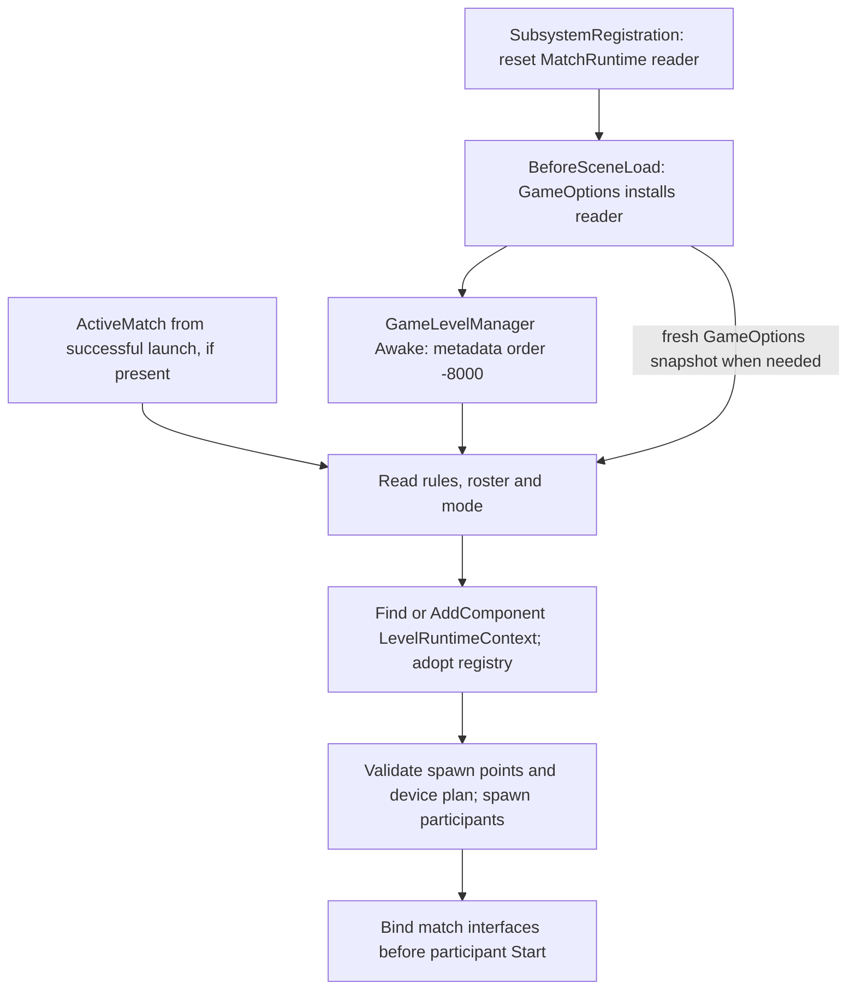
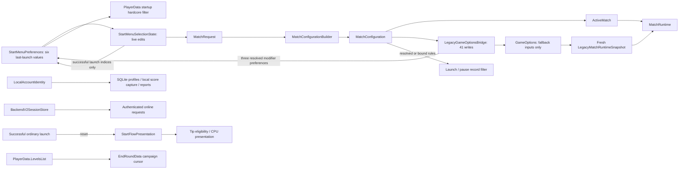

# `GameOptions` production ownership inventory

Status: **#276 DESIGN-BLOCKED overall. Bare Scrapyard contract approved and two real-scene reader proofs PASS; bridge and 41 fallback fields retained.**
Re-audited 2026-10-19 against freshly fetched `origin/dev ad18513f5db771cf2c5754aaab9e554793befde9`, Unity `6000.5.7f1`.
Branch: `docs/276-fallback-decision-gate`; PR target: `dev`.
GitHub: #273, #274 and #275 closed; #276 open. No open PRs at preparation.
Issue closure does not establish fallback-removal readiness. The #276 decision gate below supersedes
the older status snapshots; the #275 implementation and test evidence below remains historical.
The later [Scrapyard proof](#scrapyard-bare-entry-contract-and-scene-proof) records the user's
bare-entry choice, new PlayMode evidence and a concrete conditional production binding proposal.
The [existing migration plan](game-options-match-system-overhaul-plan.md#275-pre-implementation-audit-and-two-review-passes-2026-10-19)
contains both reviews recorded before production changes. Historical #274 inventory remains available
[in dev at the audit baseline](https://github.com/sweat-this/level5/blob/99c3024b7f9fee4ea492423a6b3bb9eb534ea62a/docs/game-options-inventory.md).

## #276 current-source decision gate (2026-10-19)

**Outcome: Phase A characterized; Phase B has insufficient independent inputs; Phases C–E stopped.**
This initial finding was documentation-only. The subsequent bare-entry characterization tests below
do not implement a production fallback replacement or establish overall gameplay certification.
The [two reviews and twice-refined plan](game-options-match-system-overhaul-plan.md#276-two-review-passes-and-decision-gate-2026-10-19)
record why a configured-only deletion is incompatible. #276 must remain open.

Fresh inspection confirms **41 public static stored fields, 41 paired bridge assignments, four other
release writes on four lines in two files, and three allowed external direct consumers**:
LegacyGameOptionsBridge, ProgressionManager and EndRoundMenuManager. GameOptions itself reconstructs
the fallback internally. There are no development-only direct member accesses or residual independent
non-match responsibilities. The complete per-field and expression ledgers below still match source;
no consumers or fields were removed in this audit. A source access count is not a count of runtime reads:
MatchRuntime's installed reader remains a transitive production dependency.

### Phase A: input / answer / consumer / characterization matrix

Source paths below are relative to `Assets/Scripts`; test names refer to `Assets/Tests/Editor` unless
stated otherwise. All 41 fields are covered by these groups and individually listed below.
`F` means `Level5MatchRuntimeLegacyFallbackTests`; `P` means `Level5MatchBridgeParityTests`.
Test references identify assertions inspected, not tests executed during #276.

| Input group (field count) | Current fallback mapping and runtime consumers | Contract / inspected evidence |
| --- | --- | --- |
| Mode identity (2): gameModeSelectedId/Name | GameOptions:138–140 → MatchRuntime.ModeId/RawModeId/ModeDisplayName. GameLevelManager:91, GameRules:261/422/453/505/514, Pause:447/527/546/576/585/620/632/708/734, HighScoreModel:100/200/290, AnaylticsManager:30/48/85/113 | Stable raw ID is retained, including Lockdown 27. F.LegacyFallbackReconstructsModeAndLevelIdentity; F.LegacyFallbackAddsTheLockdownImplicitDefenderWithoutTheModesClass. |
| Clock (3): gameModeRequiresCounter/CountDown, customTimer | GameOptions:153–184 → Rules; Timer:139, GameRules:84, scene context and rules consumers below | Countdown wins if both flags are set. Preserve raw customTimer zero; MatchClock.StartSeconds uses 180 seconds when timer is not positive. P.AModeWithoutACustomTimerWritesZeroNotTheDefaultLength and P.TheRuntimeReadsBackTheSameRulesTheBridgeWrote; dual-clock precedence is source-characterized here, not established by those tests. |
| Shots/basketball (9): three marker flags, four contest flags, gameModeRequiresBasketball/AllowsCpuShooters | GameOptions:155–173/207–251 → Rules; GameLevelManager:89 hands them to SpawnCoordinator and hoop; GameRules:84 binds markers | Independent shot and marker flags combine with bitwise OR, rather than choosing one contest. BasketballCount uses max(1, numPlayers). P.ModeFlagsReachTheOldGlobalsUnchanged and runtime round-trip; arbitrary combined fallback flags still require focused tests before migration. |
| Combat/modifiers/sniper (12): battleRoyalEnabled, cageMatchEnabled, EnemiesOnlyEnabled, enemiesEnabled, trafficEnabled, obstaclesEnabled, difficultySelected, hardcoreModeEnabled, three sniper flags, numPlayers | GameOptions:155–173/186–205/254–266 → Rules; GameLevelManager:89/877, LevelRuntimeContext:52, GameRules:84, EnemyController:145/471, EnemyDetection:64/68, EnemySpawner:33/57/72/78/86/90/205/218/259, ActorHealth:128, BodyGuardController:162, cameraUpdater:210–219, TouchInputController:146/183/236, RandomEvents:78, TrafficManager:56, EnemyProjectile:235, SniperManager:63/124/128/132, Pause:262, AnaylticsManager:33/51, HighScoreModel factories | BattleRoyal and Cage combine; EnemiesOnly adds Standard only if neither is set. Sniper precedence Laser > MachineGun > Bullet > None. Difficulty/hardcore/enemies are read independently; do not re-resolve through a catalog. P.CombatModeReachesTheOldBattleRoyalAndCageFlags / SniperVariantsReachTheirThreeSeparateBooleans / HardcoreDifficultyStillSetsTheHardcoreFlag cover bridge publication, not every simultaneous fallback combination. |
| CPU/roster names (5): player1–4IsCpu, characterObjectNames | GameOptions:25–54/269–292 plus numPlayers and primary ID/display below → Roster / ParticipantCount / LocalInputSlotFor. GameLevelManager:90/883, LevelRuntimeContext:53, CameraManager:122, cameraUpdater:152, HighScoreModel:164/289/304/317/329; SpawnCoordinator consumes roster | Clamp roster to 1–4; preserve per-slot CPU flags, per-index object names and human numbering past CPUs. Missing object names become empty; non-primary IDs are zero. F.LegacyFallbackReconstructsTheRosterFromGameOptions / LegacyFallbackClampsPlayerCountIntoRange. Lockdown defender is outside the roster; bridge also sets player2IsCpu. |
| Primary character (3): characterId, characterDisplayName, characterObjectName | GameOptions:146–148/280–285 → PrimaryCharacter*. MatchRuntime:78–166 prefers valid configured data, otherwise the corresponding raw fallback; unconfigured reads prefer reconstructed slot zero where populated. HighScoreModel:101–102/201–202, AnaylticsManager, GameRules:747, GameLevelManager:168/604, SpawnCoordinator:708, FanManager:50–51 | ID zero and empty display/object names can fall through even with ActiveMatch. F.PrimaryCharacterAccessorsFallBackToLegacyGlobalsEvenWithAConfigurationActive. ProgressionManager:968 still publishes only object name; menu session remembers IDs, not this complete fallback triple. |
| Arena (5): levelId, levelDisplayName, levelRequiresTimeOfDay/Weather, levelHasSevenPointers | GameOptions:141–145 → MatchRuntime arena answers; HighScoreModel:103–104/203–204, CameraManager:79, cameraUpdater:106, timeOfDay:53, GameLevelManager:881 | F.LegacyFallbackReconstructsModeAndLevelIdentity. Without configuration, Level stays null and CustomCamera stays false; do not silently grant a catalog camera capability. EndRoundMenuManager:318–320 changes only ID, display and seven-point flag for unconfigured continuation. |
| Cheerleader (2): cheerleaderObjectName/DisplayName | GameOptions:149 → CheerleaderSelection with ID zero/default bonuses; GameLevelManager:166 spawn, SpawnCoordinator:686 human profile context, AnaylticsManager:32/50/87/115 | F.LegacyFallbackReconstructsTheCheerleader asserts identity and zero three-point bonus. Constructor defaults supply zero bonuses; no independently selected scene cheerleader exists. |

The groups partition all 41 fields; `numPlayers` is in the combat/rules row and also feeds roster.
Configured authority always wins for rules, roster, mode, arena and cheerleader. A complete configured
primary plus in-roster slot needs no reader (F.ConfiguredMatchReadsSucceedWithNoFallbackReaderInstalled).
An absent roster slot still uses the live CPU formula even when configured
(F.LocalInputSlotForFallsBackToTheLegacyFormulaEvenWhenConfiguredButSlotIsOutsideTheRoster).

Fallback reads are fresh per accessor, not one cached scene result. F.LegacyFallbackReadsAreLiveNotSnapshottedForTheWholeScene
and Level5PlayerMatchRuntimeCompositionTests.RulesForwardsLiveToMatchRuntimeRatherThanASnapshot pin that
distinction. LevelRuntimeContext and GameLevelManager intentionally capture rules/roster at composition;
their captured values must not replace the separately live MatchRuntime interface.

### Phase B: independent sources and initialization evidence

| Candidate owner | What it actually supplies | Why it cannot yet replace fallback |
| --- | --- | --- |
| MatchConfiguration / ActiveMatch | Validated current mode, arena, resolved rules, roster, cheerleader | Absent for direct entry; incomplete primary properties and absent input slots still consult fallback. Do not duplicate or reverse-sync configuration. |
| Authored LevelSelected prefabs / LevelDefinitionFactory | Arena ID/name/scene descriptor, capabilities and campaign CPU prefab | Arena facts are independent authored data, not a selected mode, participant roster, modifiers or arbitrary raw fallback arena overrides. No current direct-scene reader binds them. |
| Authored StartScreenModeSelected prefabs / GameModeDefinitionFactory | Mode definitions, combined flags, numeric IDs and roster constraints | A definition catalog does not select the mode for the open gameplay scene or reconstruct arbitrary raw combinations/modifiers. |
| MatchCatalogs / LegacyMatchCatalogBootstrap | Converts/caches definition lists; StartManager:1137 builds from loaded menu data | No Resources/Match mode/level `.asset` definitions in this checkout. No BeforeSceneLoad direct-entry selection/roster composition is provided by either catalog. Keeping the conversion bootstrap is necessary for configured menu launches. |
| LevelRuntimeContext | Captures MatchRuntime answers; exposes/adopts PlayerRegistry | Only serialized field is MatchController. No authored instance found in scenes/prefabs/assets. It consumes inputs rather than authors them. |
| GameLevelManager / SpawnCoordinator / PlayerRegistry | Scene spawn points, instantiated participants and device plan | Manager reads MatchRuntime before creating context or discovering spawn points. Registry is filled from that roster, so deriving the roster back from it is circular and too late. Scene auto-player may occupy the next slot; it is not a complete authored match. Existing drblood prefab fallback does not establish primary ID/display, rules or input flags. |
| PlayerSelectionSession / selected profile | Menu primary/CPU stable IDs; progression screen can resolve its own highlighted profile | Process memory may be absent/stale on direct entry; no validated complete gameplay roster, device map, fallback display/object triple or scene initialization handoff. It has no automatic runtime-session reset. |
| StartMenuPreferences | Six last-launch menu values, three modifiers recorded from resolved rules | History is not gameplay authority and never supplies MatchRuntime. Using it for direct entry would introduce reverse synchronization. |
| PlayerData.LevelsList / EndRoundData | Authored campaign route/CPU prefabs and active/completed/next route positions | Neither publishes a complete unconfigured match. The existing end-round path deliberately retains old weather/time-of-day and changes only three arena fields. Deriving all capabilities from the next arena would change that behavior. |
| GameOptions installed reader | All characterized live fallback answers | Only complete current source; depends on the bridge and four non-bridge writes. Renaming or snapshotting this storage is not retirement. |

Serialized inspection covered **650 `.unity`/`.prefab`/`.asset` files**, including all 42 scenes:
zero GameOptions, bridge or LevelRuntimeContext MonoScript GUID references. Twenty-seven scenes
reference the GameManager prefab or the manager script; 26 have at least one GameManager prefab instance,
and Rumble Pit has a direct manager component. Aveb2 also contains a direct manager component;
Dev has two GameManager prefab instances. These are serialized observations, not a claim about which
instances are active at runtime. Duplicate ownership must be tested if composition is changed.
All 23 LevelSelected script references are menu-level prefabs; all 28 mode-script references are
catalog/menu authoring, not an independently selected gameplay match.

Current initialization flow (source and metadata, not a new runtime trace):



`GameLevelManager.cs.meta:7` explicitly sets **-8000**. LevelRuntimeContext declares -100, and is
created at GameLevelManager:100–102 after reads at 89–91. An authored context at -100 would still be
too late for the manager. Existing commentary in Level5LevelRuntimeContextTests describing it as the
only custom execution order must not be used as current ordering evidence. The reader's
SubsystemRegistration reset and BeforeSceneLoad install are independent of component order.
There is no other production InstallLegacyFallbackReader caller. MatchRuntime:244–255 throws
InvalidOperationException when an answer needs the reader and none is installed; null installation
throws ArgumentNullException. Reset is idempotent; reinstallation recovers the mapping. F's
MissingFallbackReaderProducesAnExplicitErrorRatherThanDefaultRules,
ResetIsIdempotentAndReinstallingRecoversTheRealMapping and InstallLegacyFallbackReaderRejectsANullReader
pin these contracts; the three counting-reader tests pin one reader invocation per accessor.
No production ActiveMatch.Clear
call or runtime reset attribute on ActiveMatch was found: do not claim that resetting the reader
also clears configured state or legacy values when domain reload is disabled.

Assembly boundary: MatchRuntime, LegacyMatchRuntimeSnapshot, ActiveMatch, LevelRuntimeContext,
ArenaBootstrap and SpawnCoordinator are in `Level5.Match`; GameOptions, bridge, menu publishers and
legacy catalog adapters are in Assembly-CSharp. Level5.Match cannot call those legacy owners directly.
Retain the installed callback / resolved-answer boundary; no new asmdef or service locator is justified.

### Decisions required before any dependent deletion

1. Identify an independently authored source and explicit pre-Awake handoff for direct-entry mode,
   all rule/modifier combinations, roster/CPU ordering, primary identity and cheerleader. Arena
   authoring alone is insufficient. Record which existing authoring actually supplies each value.
2. Establish who answers each missing configured primary datum and out-of-roster input query,
   including whether/how progression's live object-name publication remains observable.
3. Establish the supported producer/lifetime of live fallback changes, and the exact unconfigured
   campaign three-field update. Decide missing-data, reload, duplicate/partial composition and
   new-session behavior without replacing characterized values with guesses.
4. If independently sourced equivalents cannot exist, approve an explicit observable contract
   change first. The current request authorizes preservation, not removing these guarantees.

The smallest viable **contract shape** is already present: the existing reader returns transient
LegacyMatchRuntimeSnapshot resolved answers, with live rule/roster/input delegates. What remains
unestablished is input provenance and initialization, not a missing interface. The target architecture
in the migration plan remains conditional until these decisions have evidence.

### All launch publications that must move together after the input gate

| Source / Apply line | Existing successful publication order to preserve | Resolved preference notification |
| --- | --- | --- |
| StartManager:1719 | Build/preflight → ActiveMatch.Begin → bridge → menu/session preference saves and non-match state → scene load | configuration.Rules, at the current bridge position |
| EndRoundMenuManager:311 | Commit route cursor → ContinueInLevel → ActiveMatch.Begin → bridge → MatchSession.BeginNewMatch → scene load | nextRound.Rules; unconfigured branch has no bridge notification today |
| VersusLauncher:116 | Build → ActiveMatch.Begin → ActiveVersusAttempt.Begin → bridge → StartAttempt → scene transition | configuration.Rules, after attempt context publication |
| VersusLauncher:231 | Issue simultaneous attempts → ActiveMatch.Begin → BeginSimultaneous → bridge → StartSimultaneousAttempts → transition | configuration.Rules at the same point, including existing nonfatal start-record failure |
| RemoteAttemptLauncher:120 | Successful response/map → ActiveMatch.Begin → ActiveRemoteAttempt.Begin → bridge → transition → completion callback | mapResult.Configuration.Rules, after remote context publication |
| Utility/LoadGame:64 (editor/development only) | Build → ActiveMatch.Begin → bridge → realtime wait → pending-load gate → transition | configuration.Rules before the wait, including the existing pending-load behavior |

Bridge:80 currently calls StartMenuPreferences.RememberResolvedModifiers. Rehome that one call at
each existing publication position only in a complete supported migration; do not record requested
toggles, move it to general ActiveMatch.Begin, add a launcher manager, or change failure timing.

### #276 validation and acceptance

For the initial audit, Level 0 applied: only these two existing Markdown documents changed. Source/metadata/scene-reference
inspection and final diff/link/count checks are the evidence; Unity was not started. **NUnit executed:
0; pass/fail/skip totals: not applicable; Unity process exit: not applicable.** The earlier #275
NUnit totals below are inherited evidence, not newly executed #276 acceptance.

The source audit verifies counts, unique paired fields, launch lines, the sole reader installation,
script GUID references and serialized order. It does not simulate Unity callbacks, resolve active
duplicate objects, prove direct-scene playability or certify arbitrary fallback combinations.
Future implementation must run the named fallback/parity/architecture/context/assembly-boundary/
campaign CPU fixtures plus affected configured and real unconfigured scene PlayMode paths; configured
campaign tests that explicitly apply the bridge are not evidence for unconfigured continuation.
Use isolated profile/persistence state, report actual NUnit totals and process exits, and add the
missing combined-flag/precedence and real startup-order coverage before deleting their old owner.

| Final acceptance gate | #276 result at audited dev |
| --- | --- |
| No production launch requires bridge | BLOCKED: five release sites plus development LoadGame; retained transitive fallback and menu history dependency |
| Independent supported owner for every fallback input | BLOCKED: input provenance and pre-Awake composition unresolved |
| Configured gameplay unchanged | PASS for absence of runtime changes; execution UNVERIFIED in this audit |
| Direct-scene gameplay initializes correctly | UNVERIFIED: characterized source path retained; independent replacement BLOCKED |
| Incomplete character / out-of-roster behavior preserved | PASS for retained implementation and inspected assertions; execution UNVERIFIED |
| Unconfigured campaign continuation preserved | PASS for retained three-field publication; execution UNVERIFIED |
| Correct menu modifier history across launches | PASS for retained resolved bridge notification at all six sites; execution UNVERIFIED |
| No obsolete fields or bridge calls remain | BLOCKED: 41 fields / 41 bridge writes / six Apply sites retained intentionally |
| No replacement global match container | PASS: no production code or asset changes |
| Numeric / serialized / persistence contracts preserved | PASS: source, metadata and authored assets unchanged |
| Focused Unity runtime / architecture validation passes | NOT PERFORMED: Level 0 documentation decision gate, no replacement to validate |

Initial audit changed files: `docs/game-options-inventory.md` refreshes the dependency/initialization/acceptance
record; `docs/game-options-match-system-overhaul-plan.md` records both reviews and the gated next
sequence. No production/test/scene/prefab/meta changes. Do not close #276 or describe #274 D2/F as done.

Final refresh (2026-10-19, before delivery): `git fetch origin dev` exited **0**; HEAD and origin/dev
both remain `ad18513f5db771cf2c5754aaab9e554793befde9`. Each of
`gh issue view 273 --repo sweat-this/level5 --json number,state` (and 274, 275, 276) succeeded:
273–275 CLOSED, 276 OPEN. `gh pr list --repo sweat-this/level5 --state open --json number,title,headRefName,baseRefName,url`
exited **0**, returning `[]`. No new dev changes or open-PR overlap invalidated the audit.

Completed focused checks from the repository root:

| Command | Result / scope |
| --- | --- |
| `node TestResults/issue276-source-audit.cjs ad18513f5db771cf2c5754aaab9e554793befde9` | Exit **0**: 41 fields uniquely paired with 41 assignments; all 41 existing declaration/bridge line references match source; four remaining writes; six exact Apply lines; one production reader install; metadata order and read-before-context flow; 650 serialized files / 42 scenes / 27 manager-containing scenes; zero compatibility/context GUID references; no Resources/Match definition assets |
| `git diff --check` | Exit **0**: no whitespace errors |
| `git diff --name-only` / `git diff --stat` | Exit **0**: exactly the two existing migration documents; no production or asset diff |
| `node TestResults/issue276-doc-links.cjs` | Exit **0**: all 13 local links/anchors in the two documents resolve; repaired the pre-existing `#per-slice-acceptance` link to the current responsibility acceptance section |

Local source-check helper/output: ignored `TestResults/issue276-source-audit.cjs` and
`TestResults/issue276-source-audit.json`; neither is a new checked-in test. The helper counts simple
member expressions after stripping comments/literals; raw GameOptions hits were separately reviewed.
The existing interpolation-aware NUnit architecture guard was inspected, not executed. The first
helper invocation exited **1** on sandbox `spawnSync git EPERM`; its Git subprocess dependency was
removed, Git state was checked separately, and the corrected helper exited **0**. Initial restricted
fetch/GitHub access also required an elevated retry, which succeeded; no access blocker remains.
The first link inspection found the stale acceptance anchor; the final link check passed after repair.
These are source-check/setup outcomes, not NUnit failures or Unity process evidence.

Initial audit PR-ready summary (target `dev`): Document #276's current-source fallback input gate and both reviews.
Retain the bridge because direct entry, configured partial-primary/out-of-roster queries and
unconfigured continuation lack independent supported inputs; preserve resolved menu-history timing.
No runtime behavior, serialized data, tests or guards change; #276 remains open. Changes are local
on `docs/276-fallback-decision-gate`; no PR has been opened.

## Scrapyard bare-entry contract and scene proof

The user explicitly chose **Preserve the current bare direct-entry behavior**. The input decision
for this one clean-entry scenario is now resolved. It means no selected mode or character identity;
it does not mean launching a Total Points match or correcting the arena identity to authored ID 1.

### Exact independently constructible answers

| Dimension | Preserved bare value | Independent construction / provenance |
| --- | --- | --- |
| Mode | None / raw ID 0 / empty display | GameOptions declaration defaults; no mode definition is selected or inferred |
| Rules | Score; ClockMode.None; raw timer 0 / effective 180; no combat, shot or marker flags | Explicit ResolvedMatchRules(clockMode: None, requiresBasketball: false, allowsCpuShooters: false); remaining constructor values match clean fallback |
| Modifiers | Normal; traffic/enemies/obstacles/hardcore off; Sniper.None; no implicit defender, Arcade, money-ball, streak or survival requirements | Existing clean legacy declarations and fallback reconstruction, not requested menu preferences |
| Roster | One LocalHuman at slot/input 0; character ID 0 / empty object/display; IsShooter and IsFighter true | PlayerRoster.SingleLocalHuman(new CharacterSelection(0, "", "", true, true)); CharacterSelection.None has different capability flags and is not equivalent |
| Input beyond roster | Slot 1/2/3 → input 1/2/3; negative IDs → 0 | All four CPU flags false; exact bare specialization of the existing human-counting formula is max(0, slotId) |
| Arena answers | Level null; ID 0 / empty name; time-of-day true, weather/seven-point/custom-camera false | Clean runtime answers; keep authored Scrapyard facts separate |
| Cheerleader | ID 0 / empty names / all seven bonuses zero | CheerleaderSelection.None |
| Spawn result | One human Dr Blood, while selected primary identity remains empty | Existing SpawnCoordinator.ResolveObjectName fallback, not a new selection; slot zero still receives a basketball even though RequiresBasketball is false |

Authored Scrapyard source is `Resources/Prefabs/menu_start/level_selected_objects/level_selected_01_scrapyard`:
GUID `eff28c629a42c084d8696bc4ee35775a`, ID 1, display The Scrapyard, scene level_01_scrapyard,
time-of-day/traffic/seven-point/multiplayer capabilities on, weather/custom camera off, campaign CPU
Ian (`cpu_player_ian`, GUID `4142dc24ab94da440860dac2e3593d6f`, character ID 2). None of this selects
a mode or CPU for bare entry. The gameplay player_drblood prefab GUID is
`8bbcf66f791500b469e31ff0f1f71718`; its profile has ID 0 and Doctor Blood display, while the menu's
player_selected_01_drblood GUID `c71aea56186ba6d4bac8662f4d9ee69b` has selected ID 1/object drblood.
The proof preserves these distinctions. Using either selected ID 1 or arena ID 1 would be a behavior
change beyond the user's chosen bare contract.

### Executed real-scene proof

Added `Assets/Tests/PlayMode/Level5BareDirectEntryPlayModeTests.cs` and its `.meta` alongside existing
real-scene tests. Both paths load the actual unchanged Scrapyard scene, with ActiveMatch cleared:

- CleanProductionFallbackPreservesBareScrapyardEntry resets legacy inputs to their declared clean
  values and exercises the real GameOptions capture mapping.
- IndependentBareAnswersReachManagerAwakeWithoutReadingLegacyInputs installs a fixture-owned typed
  reader, with conflicting legacy roster/Lockdown/character/arena/clock/basketball/traffic inputs.
  The reader itself contains no GameOptions access or bridge call.

Both assert the manager remains enabled, captures expected rules/roster, adopts the exact registry
exposed by LevelRuntimeContext, spawns one human Doctor Blood, and keeps selected primary identity
empty. They also check bare rules, arena/cheerleader identity and input slots outside the roster.
The actual first consuming stack in both runs was:

```text
MatchRuntime.LegacyFallback > MatchRuntime.get_Rules > GameLevelManager.Awake
```

LevelRuntimeContext.Awake was absent from that first stack. The first snapshot's exact Rules object
was captured by the manager; its later context and registry were valid. Both paths recorded 55
reader calls. This proves real initialization through the existing seam, including the prior
read-before-context finding; it does not test a new early context bootstrap.

Executed Unity 6000.5.7f1 command from the repository root:

```text
C:\PROGRA~1\Unity\Hub\Editor\6000.5.7f1\Editor\Unity.exe -batchmode -projectPath C:\Users\Patrick\Documents\github\level5 -runTests -testPlatform PlayMode -testFilter Level5BareDirectEntryPlayModeTests -testResults C:\Users\Patrick\Documents\github\level5\TestResults\issue276\bare-entry.xml -logFile C:\Users\Patrick\Documents\github\level5\TestResults\issue276\bare-entry.log
```

**PASS: 2 total / 2 passed / 0 failed / 0 skipped; actual editor process exit 0.** Affected test
assembly compiled as part of this run. XML reports duration 4.2655303 seconds. Evidence is retained
locally in ignored `TestResults/issue276/bare-entry.xml`, `.log` and `bare-entry-evidence.json`, which
records exact command, process exit and source/result hashes. No test failures or repair reruns.
Existing scene support suppresses unrelated scene log noise; assertions establish this startup
boundary, not error-free execution of every scene system. SQLite is disposable; the existing
CampaignBoundaryPersistenceIsolation protects relevant file families. Reader, legacy values, local
identity/session and time scale are restored after scene teardown. Unity's generated solution-order
changes were inspected and excluded. No production script, scene, prefab or assembly definition changed.

### Concrete production binding proposal and remaining gate

The smallest prospective production owner is the existing **scene-owned LevelRuntimeContext**, with
an explicitly authored bare-entry opt-in on Scrapyard. It can construct the exact typed answers above
without storing another MatchConfiguration or 41 mutable raw fields. Keep the currently installed
reader interface and fresh transient snapshots; do not call ActiveMatch.Begin for bare entry or
use MatchConfigurationBuilder, whose normal resolution/validation changes these bare answers.

For a future complete patch, author a context in the scene and establish its input initialization
before the manager's -8000 Awake (for example, explicit -9000 ordering). Its duplicate check must
precede publication; attach lifetime to the winning scene component. Reader teardown must clear
only that owner's callback, never a newer owner's installation. Test scene reload and new runtime
sessions with domain reload disabled; RuntimeInitializeOnLoadMethod.BeforeSceneLoad alone does not
reinstall a per-scene owner on ordinary SceneManager transitions. Preserve explicit missing-reader
failure. These are concrete implementation obligations, not behavior verified by the current tests.

**Do not activate this opt-in merely because ActiveMatch is null.** That condition also covers
characterized non-bare legacy inputs and unconfigured campaign continuation. The fixture can select
the bare scenario explicitly; production still needs supported ownership/selection of those other
inputs before an unconditional scene provider can replace the current callback. Configured partial
primary data and out-of-roster mutable CPU flags likewise remain outside this bare proof. No such
behavior was waived by the user's choice. The original decision gate therefore remains open for
those cases; no generic scene settings system or global match container is proposed.

Current acceptance delta: bare values/one-human scene initialization and actual first-read order
**PASS for the two executed scenarios**; independently installed reader compatibility **PASS**;
production scene-owned binding, configured-edge/live input ownership, unconfigured continuation,
reload/domain-reload-disabled ownership and overall bridge removal **BLOCKED / NOT IMPLEMENTED**.
The two pre-implementation reviews and refined proof scope are in the migration plan's
[Scrapyard continuation](game-options-match-system-overhaul-plan.md#scrapyard-continuation--approved-bare-entry-contract-and-proof-plan).
Delivery refresh: dev remains `ad18513f5db771cf2c5754aaab9e554793befde9`, no open PRs, #276 OPEN;
fetch/queries exited 0. The documentation link check now resolves all 16 local links (exit 0),
final whitespace check passes, and all four source/meta/XML/log evidence hashes still match the
passing run. Changed paths are the two existing documents and the new test source/meta only.

## Scope and verified counts

Counts exclude comments/literals, tests, editor tools, Unity-ignored `~` backups and `Assets/Scripts/Dev`.
One access is one executable member expression. Retained release expressions are simple assignments;
the interpolation-aware architecture guard independently prevents hidden new accesses.

| Measure | Verified dev baseline | #275 source |
| --- | --- | --- |
| Public static stored fields | 49 | **41** |
| Identity forwarding properties | 2 | **0** |
| Methods | 12 | **12**, three public / nine private |
| Bridge GameOptions assignments | 41 | **41**, retained fallback inputs |
| Non-bridge release expressions | 48 / 45 lines / 13 files | **4 / 4 lines / 2 files** |
| Total external expressions including bridge | 89 / 14 files | **45 / 3 files** |
| Development-only direct accesses | 0 | **0** |
| Architecture consumer allowlist | 14 | **3**: bridge, ProgressionManager, EndRoundMenuManager |
| Field-count ratchet | 49 | **41** actual declarations |

All eight non-match fields and two identity forwarders are gone. The three modifier fields remain
as gameplay fallback inputs; the menu no longer reads them. The four external writes and 41 internal
fallback inputs remain real compatibility requirements, so #276 is not ready.

## Per-responsibility audit and acceptance

| Slice / previous responsibility | Current owner / behavior | Source acceptance |
| --- | --- | --- |
| A1 applicationVersion, operatingSystemVersion | Removed write-only fields and StartManager copies. Real consumers already use Application.version and SystemInfo.operatingSystem directly. | PASS source; no replacement store |
| A1 previousSceneName | Removed write-only mirror in StartManager, ProgressionManager, GameLevelManager. Existing transitions and scene names unchanged. | PASS source |
| A2 numOfLocalUsers | Removed redundant count. UserAccountManager derives status from its loaded profiles.Count; list/row content remains authoritative. | PASS source; populated-to-empty refresh regression |
| C userName / userid | AccountManager creation, UserAccountManager selection/guest/deletion, LocalAccount row selection, LoadManager SQLite lookup, both HighScoreModel factories, StartManager label and APIHelper reports use LocalAccountIdentity directly. Forwarders removed. | PASS source; capture timing and numeric IDs unchanged |
| B mode / level / friend indices | StartMenuSelectionState edits live values. StartMenuPreferences remembers three integers only at the existing successful StartManager launch save. Awake restores them; wrapping/eligibility and friend indexing unchanged. | PASS source; no disk persistence |
| B traffic / hardcore / obstacles | Three menu preference booleans remember resolved rules at the existing bridge ApplyModifiers boundary, including campaign/versus/remote publication. They never supply MatchRuntime. Requested options rejected by a mode/arena remain rejected on menu return. | PASS source; fallback fields and all one-way writes retained |
| B startup score filter | PlayerData.Start reads StartMenuSelectionState.ReadPersistedHardcorePreference without ActiveMatch. Configured launch and pause still pass explicit bound/resolved rule filters. | PASS source |
| B campaign and difficulty | PlayerData.LevelsList remains authored route; EndRoundData remains cursor. Menu level memory never advances with campaign. Difficulty resets to Normal during LoadPersistedPreferences. | PASS source |
| D tipDialogueLoadedOnStart | StartFlowPresentation owns one presentation bit. Tip Awake/OnEnable gate, Start marks; CPU select always acquires maps and only marks in Start. Successful ordinary launch resets eligibility. Authored start scene leaves both panels inactive; focused scene tests explicitly activate them without editing assets. | PASS source; PASS focused authored lifecycle and six-value menu re-entry test |
| New process / domain reload disabled | Both new menu owners reset via SubsystemRegistration. Scene transitions retain values. Existing identity and PlayerSelectionSession lifetimes unchanged. | PASS source; reset regression |

Fresh Assets/ProjectSettings/Packages member-name scans found no reflection or serialized consumer
of the deleted fields. The only excluded historical references are commented/Unity-ignored Legacy~
metadata writes. Public static storage is not Unity instance serialization. No scenes, prefabs,
GUIDs, schemas, migrations, authored IDs, route data, remote request contracts, scoring or XP changed.

## Authority and dependency flow



StartMenuPreferences is preference history, not gameplay configuration. There is no reverse sync
from it or GameOptions into ActiveMatch. It stores no character, roster, campaign position, authentication,
result, difficulty, enemy or sniper state. Its bridge notification must move to the supported launch
boundaries if #276 eventually removes the bridge; deleting it would change existing menu semantics.
StartFlowPresentation is independent of accounts and persistence. Local profile IDs are never Backend V2 PlayerIds.

## Risks, mitigations and review record

| Risk | Mitigation / focused evidence |
| --- | --- |
| Save highlighted options too early or retain requested instead of resolved flags | Keep launch-only index save; record resolved modifiers at existing bridge publication; ownership tests and real menu re-entry |
| Lose preferences on scene return, or retain them across a new editor session | Static menu memory plus SubsystemRegistration reset; lifetime regression |
| Reinterpret menu indices as campaign cursor / redesign catalogs | Keep current index wrapping and eligibility; use existing EndRoundData cursor; campaign adapter and authored round checks |
| Startup scores read stale ActiveMatch or fallback flags | Explicit menu hardcore reader; startup no-ActiveMatch and bound pause tests |
| Attribute local results to a later/online identity | In-place LocalAccountIdentity reads; both factories capture before profile switch; SQLite guest/deletion tests; online guards reject LocalAccountIdentity |
| Suppress CPU input when a tip has shown | Preserve unconditional CPU OnEnable and distinct tip gates; authored screen lifecycle/focus regression |
| Remove needed compatibility or serialized surface | Fresh references/asset scan; keep all 41 fallback inputs; bridge/fallback and retired-member guards |
| Add duplicate gameplay/global ownership | Two narrow owners only: six menu preferences and one presentation bit; no settings store, new asmdef or scene change |

Both adversarial passes and the twice-refined implementation sequence are recorded in the linked
existing plan. Review 1 corrected resolved-modifier timing and CPU/tip asymmetry; review 2 retained
all fallback dependencies, required new-process resets and tightened guards without extra authority.

## Remaining direct-scene input blockers

| Input group | Configured authority | Current direct-scene source / missing contract |
| --- | --- | --- |
| Rules, clock, shots, combat, sniper | MatchConfiguration.Rules | GameOptions live values. ArenaBootstrap consumes rules; it does not author replacements. Preserve combined flags, countdown precedence, timer-zero and sniper precedence. |
| Roster and local input slots | PlayerRoster | GameOptions count, per-slot CPU flags, names and input formula. LevelRuntimeContext/GameLevelManager already read MatchRuntime during early Awake; no earlier independent roster composition exists. |
| Lockdown implicit defender | Rules.AddsImplicitDefender / stable mode ID | Fallback mode 27 plus slot-two CPU flag. An arena alone cannot determine this mode-specific participant. |
| Arena identity/capabilities | Configuration.Level | GameOptions level identity/weather/time-of-day/seven-point flags. Scene geometry and menu catalog entries do not establish the existing arbitrary direct-entry values. |
| Primary character | Roster slot zero | Live character ID/display/object name and roster names. Menu session identity is not a validated scene participant or an incomplete configured character's missing datum. |
| Cheerleader | Configuration.Cheerleader | Live object/display names; no independent scene-owned selection. Preserve direct-entry zero bonuses. |
| Configured incomplete character / absent roster slot | MatchRuntime characterized fallback | Removing the reader based only on HasConfiguration would break these existing cases. Require explicit replacement answers, not a later ActiveMatch or highlighted selection guess. |

These are source-backed blockers, not authorization to introduce a static state bag, dictionary,
new settings manager or guessed scene defaults. Existing reader and snapshot interfaces are adequate;
the absent piece is the independently initialized scene input contract before consumers' Awake.

## Every remaining stored field

All declarations are in `Assets/Scripts/menu_start/GameOptions.cs`; B is the paired assignment line
in `Assets/Scripts/menu_start/LegacyGameOptionsBridge.cs`. All 41 fields participate in fallback.

| Field / type | Declaration | B | External access | Authority / retirement gate |
| --- | --- | --- | --- | --- |
| `numPlayers` (`int`) | 10 | 117 | 0W | Fallback roster/rule count; captured SQLite count now belongs to HighScoreModel.numPlayers. #274 F. |
| `player1IsCpu` (`bool`) | 11 | 118 | 0W | Roster control / fallback including out-of-roster edge; `PlayerSlot.ControlType / LocalInputSlot; Rules.AddsImplicitDefender`; #274 F; preserve implicit defender and formula |
| `player2IsCpu` (`bool`) | 12 | 119 | 0W | Roster control / fallback including out-of-roster edge; `PlayerSlot.ControlType / LocalInputSlot; Rules.AddsImplicitDefender`; #274 F; preserve implicit defender and formula |
| `player3IsCpu` (`bool`) | 13 | 120 | 0W | Roster control / fallback including out-of-roster edge; `PlayerSlot.ControlType / LocalInputSlot; Rules.AddsImplicitDefender`; #274 F; preserve implicit defender and formula |
| `player4IsCpu` (`bool`) | 14 | 121 | 0W | Roster control / fallback including out-of-roster edge; `PlayerSlot.ControlType / LocalInputSlot; Rules.AddsImplicitDefender`; #274 F; preserve implicit defender and formula |
| `characterDisplayName` (`string`) | 57 | 109 | 0W | Roster / fallback + configured edge; `PlayerRoster slot 0 Character.DisplayName`; #274 F |
| `cheerleaderDisplayName` (`string`) | 58 | 127 | 0W | Presentation identity / fallback; `MatchConfiguration.Cheerleader.DisplayName`; #274 F |
| `characterId` (`int`) | 59 | 108 | 0W | Fallback roster/primary identity; all progression now uses explicit captured IDs. #274 F. |
| `gameModeSelectedId` (`int`) | 60 | 43 | 0W | Match identity / fallback; `MatchConfiguration.ModeId / Mode.RawModeId`; #274 F; preserve numeric IDs and Lockdown mapping |
| `levelId` (`int`) | 61 | 70 | 1W | Arena identity / fallback; `MatchConfiguration.Level.LevelId`; #274 E/F; preserve unconfigured campaign transition |
| `characterObjectName` (`string`) | 63 | 107 | 1W | Roster / progression presentation / fallback + configured edge; `Configured: roster slot 0 Character.ObjectName; progression: PlayerSelectionSession + selected profile`; #274 D, then F; do not substitute old ActiveMatch in menu |
| `characterObjectNames` (`List<string>`) | 64 | 102 | 0W | Roster / fallback; `PlayerRoster.Players[*].Character.ObjectName`; #274 F |
| `cheerleaderObjectName` (`string`) | 65 | 126 | 0W | Presentation identity / fallback; `MatchConfiguration.Cheerleader.ObjectName`; #274 F |
| `levelDisplayName` (`string`) | 66 | 71 | 1W | Arena presentation / fallback; `MatchConfiguration.Level.DisplayName`; #274 E/F |
| `gameModeSelectedName` (`string`) | 67 | 44 | 0W | Mode presentation / fallback; `MatchConfiguration.Mode.DisplayName`; #274 F |
| `gameModeRequiresCounter` (`bool`) | 70 | 47 | 0W | Resolved clock / fallback; `ResolvedMatchRules.ClockMode`; #274 F; Countdown takes priority |
| `gameModeRequiresCountDown` (`bool`) | 71 | 46 | 0W | Resolved clock / fallback; `ResolvedMatchRules.ClockMode`; #274 F |
| `gameModeRequiresShotMarkers3s` (`bool`) | 74 | 49 | 0W | Resolved marker flags / fallback; `ResolvedMatchRules.ShotMarkers`; #274 F |
| `gameModeRequiresShotMarkers4s` (`bool`) | 75 | 50 | 0W | Resolved marker flags / fallback; `ResolvedMatchRules.ShotMarkers`; #274 F |
| `gameModeRequiresBasketball` (`bool`) | 76 | 60 | 0W | Resolved basketball rule / fallback; `ResolvedMatchRules.RequiresBasketball`; #274 F |
| `gameModeAllowsCpuShooters` (`bool`) | 77 | 61 | 0W | Resolved CPU rule / fallback; `ResolvedMatchRules.AllowsCpuShooters`; #274 F |
| `gameModeThreePointContest` (`bool`) | 79 | 53 | 0W | Resolved shot flags / fallback; `ResolvedMatchRules.ShotRule`; #274 F; preserve independent combined flags |
| `gameModeFourPointContest` (`bool`) | 80 | 54 | 0W | Resolved shot flags / fallback; `ResolvedMatchRules.ShotRule`; #274 F; preserve independent combined flags |
| `gameModeAllPointContest` (`bool`) | 81 | 56 | 0W | Resolved shot flags / fallback; `ResolvedMatchRules.ShotRule`; #274 F; preserve independent combined flags |
| `customTimer` (`float`) | 83 | 58 | 0W | Resolved clock / fallback; `ResolvedMatchRules.CustomTimerSeconds / MatchLengthSeconds`; #274 F; zero means no override |
| `trafficEnabled` (`bool`) | 86 | 83 | 0W | Fallback rule input only; menu history now belongs to StartMenuPreferences. Keep paired one-way bridge write until #274 F / #276. |
| `enemiesEnabled` (`bool`) | 87 | 82 | 0W | Resolved rule / fallback; `ResolvedMatchRules.EnemiesEnabled`; #274 F |
| `sniperEnabledBullet` (`bool`) | 89 | 89 | 0W | Resolved sniper variant / fallback; `ResolvedMatchRules.Sniper`; #274 F; Laser > MachineGun > Bullet precedence |
| `sniperEnabledBulletAuto` (`bool`) | 90 | 90 | 0W | Resolved sniper variant / fallback; `ResolvedMatchRules.Sniper`; #274 F; Laser > MachineGun > Bullet precedence |
| `sniperEnabledLaser` (`bool`) | 91 | 91 | 0W | Resolved sniper variant / fallback; `ResolvedMatchRules.Sniper`; #274 F; Laser > MachineGun > Bullet precedence |
| `difficultySelected` (`int`) | 93 | 86 | 0W | Resolved rule / fallback; `ResolvedMatchRules.Difficulty; menu resets Difficulty to Normal`; #274 F; preserve conversion |
| `hardcoreModeEnabled` (`bool`) | 95 | 87 | 0W | Fallback rule input only; menu history now belongs to StartMenuPreferences. Keep paired one-way bridge write until #274 F / #276. |
| `EnemiesOnlyEnabled` (`bool`) | 96 | 63 | 0W | Authored mode + resolved rule / fallback; `GameModeDefinition.EnemiesOnly; ResolvedMatchRules.EnemiesOnly`; #274 F |
| `levelRequiresTimeOfDay` (`bool`) | 98 | 72 | 0W | Authored arena / fallback; `LevelDefinition.RequiresTimeOfDay`; #274 F |
| `levelRequiresWeather` (`bool`) | 99 | 73 | 0W | Authored arena / fallback; `LevelDefinition.HasWeather`; #274 F |
| `levelHasSevenPointers` (`bool`) | 100 | 74 | 1W | Authored arena / fallback; `LevelDefinition.HasSevenPointers`; #274 E/F |
| `obstaclesEnabled` (`bool`) | 102 | 84 | 0W | Fallback rule input only; menu history now belongs to StartMenuPreferences. Keep paired one-way bridge write until #274 F / #276. |
| `battleRoyalEnabled` (`bool`) | 103 | 64 | 0W | Resolved combat flags / fallback; `ResolvedMatchRules.CombatMode / IsBattleRoyal`; #274 F; preserve combined Cage/BattleRoyal flags |
| `cageMatchEnabled` (`bool`) | 104 | 65 | 0W | Resolved combat flags / fallback; `ResolvedMatchRules.CombatMode / IsCageMatch`; #274 F |
| `gameModeRequiresShotMarkers7s` (`bool`) | 106 | 51 | 0W | Resolved marker flags / fallback; `ResolvedMatchRules.ShotMarkers`; #274 F |
| `gameModeSevenPointContest` (`bool`) | 107 | 55 | 0W | Resolved shot flags / fallback; `ResolvedMatchRules.ShotRule`; #274 F; preserve independent combined flags |

## Every method

The legacy reader, mapping helpers and public roster/input helpers are unchanged.

| Signature | GameOptions line |
| --- | --- |
| `void ConfigureSingleHumanRoster(int rosterPlayerCount, bool hasImplicitSecondCpu = false)` | 16 |
| `bool IsCpuPlayer(int playerId)` | 25 |
| `int GetHumanPlayerInputSlot(int playerId)` | 37 |
| `void InstallMatchRuntimeLegacyFallback()` | 117 |
| `LegacyMatchRuntimeSnapshot CaptureMatchRuntimeSnapshot()` | 133 |
| `ResolvedMatchRules BuildResolvedMatchRulesFromLegacyGlobals()` | 153 |
| `MatchClockMode LegacyClockMode()` | 176 |
| `CombatMode LegacyCombatMode()` | 186 |
| `ShotRule LegacyShotRule()` | 207 |
| `ShotMarkerRequirement LegacyShotMarkers()` | 233 |
| `SniperMode LegacySniperMode()` | 254 |
| `PlayerRoster BuildPlayerRosterFromLegacyGlobals()` | 269 |

## Non-bridge release-production expression ledger

| Path | Line | Expression |
| --- | --- | --- |
| `Assets/Scripts/menu_end_round/EndRoundMenuManager.cs` | 318 | `GameOptions.levelHasSevenPointers = level.LevelHasSevenPointers;` |
| `Assets/Scripts/menu_end_round/EndRoundMenuManager.cs` | 319 | `GameOptions.levelId = level.LevelId;` |
| `Assets/Scripts/menu_end_round/EndRoundMenuManager.cs` | 320 | `GameOptions.levelDisplayName = level.LevelDisplayName;` |
| `Assets/Scripts/menu_progression/ProgressionManager.cs` | 968 | `GameOptions.characterObjectName = playerSelectedData[playerSelectedIndex].PlayerObjectName;` |

ProgressionManager supplies the configured missing-ObjectName edge (#274 D2). EndRoundMenuManager
retains three writes for the unconfigured campaign path. Neither is non-match authority.

## Bridge write ledger

| Bridge line | Field | Assignment |
| --- | --- | --- |
| 43 | `gameModeSelectedId` | `GameOptions.gameModeSelectedId = mode.RawModeId;` |
| 44 | `gameModeSelectedName` | `GameOptions.gameModeSelectedName = mode.DisplayName;` |
| 46 | `gameModeRequiresCountDown` | `GameOptions.gameModeRequiresCountDown = rules.RequiresCountDown;` |
| 47 | `gameModeRequiresCounter` | `GameOptions.gameModeRequiresCounter = rules.RequiresCounter;` |
| 49 | `gameModeRequiresShotMarkers3s` | `GameOptions.gameModeRequiresShotMarkers3s = rules.RequiresShotMarkers3s;` |
| 50 | `gameModeRequiresShotMarkers4s` | `GameOptions.gameModeRequiresShotMarkers4s = rules.RequiresShotMarkers4s;` |
| 51 | `gameModeRequiresShotMarkers7s` | `GameOptions.gameModeRequiresShotMarkers7s = rules.RequiresShotMarkers7s;` |
| 53 | `gameModeThreePointContest` | `GameOptions.gameModeThreePointContest = rules.IsThreePointContest;` |
| 54 | `gameModeFourPointContest` | `GameOptions.gameModeFourPointContest = rules.IsFourPointContest;` |
| 55 | `gameModeSevenPointContest` | `GameOptions.gameModeSevenPointContest = rules.IsSevenPointContest;` |
| 56 | `gameModeAllPointContest` | `GameOptions.gameModeAllPointContest = rules.IsAllPointContest;` |
| 58 | `customTimer` | `GameOptions.customTimer = rules.CustomTimerSeconds;` |
| 60 | `gameModeRequiresBasketball` | `GameOptions.gameModeRequiresBasketball = rules.RequiresBasketball;` |
| 61 | `gameModeAllowsCpuShooters` | `GameOptions.gameModeAllowsCpuShooters = rules.AllowsCpuShooters;` |
| 63 | `EnemiesOnlyEnabled` | `GameOptions.EnemiesOnlyEnabled = mode.EnemiesOnly;` |
| 64 | `battleRoyalEnabled` | `GameOptions.battleRoyalEnabled = rules.IsBattleRoyal;` |
| 65 | `cageMatchEnabled` | `GameOptions.cageMatchEnabled = rules.IsCageMatch;` |
| 70 | `levelId` | `GameOptions.levelId = level.LevelId;` |
| 71 | `levelDisplayName` | `GameOptions.levelDisplayName = level.DisplayName;` |
| 72 | `levelRequiresTimeOfDay` | `GameOptions.levelRequiresTimeOfDay = level.RequiresTimeOfDay;` |
| 73 | `levelRequiresWeather` | `GameOptions.levelRequiresWeather = level.HasWeather;` |
| 74 | `levelHasSevenPointers` | `GameOptions.levelHasSevenPointers = level.HasSevenPointers;` |
| 82 | `enemiesEnabled` | `GameOptions.enemiesEnabled = rules.EnemiesEnabled;` |
| 83 | `trafficEnabled` | `GameOptions.trafficEnabled = rules.TrafficEnabled;` |
| 84 | `obstaclesEnabled` | `GameOptions.obstaclesEnabled = rules.ObstaclesEnabled;` |
| 86 | `difficultySelected` | `GameOptions.difficultySelected = MatchDifficulties.ToInt(rules.Difficulty);` |
| 87 | `hardcoreModeEnabled` | `GameOptions.hardcoreModeEnabled = rules.Hardcore;` |
| 89 | `sniperEnabledBullet` | `GameOptions.sniperEnabledBullet = rules.Sniper == SniperMode.Bullet;` |
| 90 | `sniperEnabledBulletAuto` | `GameOptions.sniperEnabledBulletAuto = rules.Sniper == SniperMode.MachineGun;` |
| 91 | `sniperEnabledLaser` | `GameOptions.sniperEnabledLaser = rules.Sniper == SniperMode.Laser;` |
| 102 | `characterObjectNames` | `GameOptions.characterObjectNames = objectNames;` |
| 107 | `characterObjectName` | `GameOptions.characterObjectName = primary.Character.ObjectName;` |
| 108 | `characterId` | `GameOptions.characterId = primary.Character.CharacterId;` |
| 109 | `characterDisplayName` | `GameOptions.characterDisplayName = primary.Character.DisplayName;` |
| 117 | `numPlayers` | `GameOptions.numPlayers = Mathf.Clamp(roster.Count, 1, PlayerRoster.MaxSlots);` |
| 118 | `player1IsCpu` | `GameOptions.player1IsCpu = IsCpu(roster, 0);` |
| 119 | `player2IsCpu` | `GameOptions.player2IsCpu = IsCpu(roster, 1) \|\| implicitDefender;` |
| 120 | `player3IsCpu` | `GameOptions.player3IsCpu = IsCpu(roster, 2);` |
| 121 | `player4IsCpu` | `GameOptions.player4IsCpu = IsCpu(roster, 3);` |
| 126 | `cheerleaderObjectName` | `GameOptions.cheerleaderObjectName = cheerleader.ObjectName;` |
| 127 | `cheerleaderDisplayName` | `GameOptions.cheerleaderDisplayName = cheerleader.DisplayName;` |

### Bridge callers retained for #276

StartManager ordinary launch, EndRoundMenuManager continuation, two VersusLauncher paths and
RemoteAttemptLauncher remain the five release Apply sites. Development LoadGame also retains Apply.
The bridge now additionally notifies StartMenuPreferences of three resolved modifier values at
the same publication boundary; no new GameOptions access was added.

## Changed files and rationale

| Exact path | Rationale |
| --- | --- |
| `Assets/Level5/Core/LocalAccountIdentity.cs` | Document direct ownership after forwarding properties retire. |
| `Assets/Scripts/Models/HighScoreModel.cs` | Read/write LocalAccountIdentity at unchanged account/profile/score/report boundary. |
| `Assets/Scripts/account/LocalAccount.cs` | Read/write LocalAccountIdentity at unchanged account/profile/score/report boundary. |
| `Assets/Scripts/account/UserAccountManager.cs` | Direct local selection/guest/deletion identity; derive profile state from loaded list. |
| `Assets/Scripts/game manager/GameLevelManager.cs` | Remove write-only navigation mirror; keep scene transitions and fallback publications. |
| `Assets/Scripts/menu_loading/LoadManager.cs` | Read/write LocalAccountIdentity at unchanged account/profile/score/report boundary. |
| `Assets/Scripts/menu_login/AccountManager.cs` | Read/write LocalAccountIdentity at unchanged account/profile/score/report boundary. |
| `Assets/Scripts/menu_progression/ProgressionManager.cs` | Remove write-only navigation mirror; keep scene transitions and fallback publications. |
| `Assets/Scripts/menu_start/GameOptions.cs` | Remove eight non-match fields and two forwarding properties; keep 41 fallback inputs. |
| `Assets/Scripts/menu_start/LegacyGameOptionsBridge.cs` | Remember the same three resolved menu modifier preferences at existing one-way publication. |
| `Assets/Scripts/menu_start/StartFlowPresentation.cs` | One start-flow presentation bit with successful-launch/new-process reset. |
| `Assets/Scripts/menu_start/StartFlowPresentation.cs.meta` | Stable GUID for new Unity script/test. |
| `Assets/Scripts/menu_start/StartManager.cs` | Remove unused copies, read local identity, and reset presentation at unchanged launch boundary. |
| `Assets/Scripts/menu_start/StartMenuPreferences.cs` | Small process-memory owner: three indices and three modifier booleans; reset per play process. |
| `Assets/Scripts/menu_start/StartMenuPreferences.cs.meta` | Stable GUID for new Unity script/test. |
| `Assets/Scripts/menu_start/StartMenuSelectionState.cs` | Restore/save through menu owner; preserve live editing, wrapping and Normal difficulty reset. |
| `Assets/Scripts/menu_start/StartScreenCpuSelectManager.cs` | Replace presentation flag access only; preserve lifecycle, callbacks, maps and focus. |
| `Assets/Scripts/menu_start/StartScreenTipDialogueManager.cs` | Replace presentation flag access only; preserve lifecycle, callbacks, maps and focus. |
| `Assets/Scripts/restapi/APIHelper.cs` | Read/write LocalAccountIdentity at unchanged account/profile/score/report boundary. |
| `Assets/Tests/Editor/GameOptionsSnapshot.cs` | Restore bridge-updated menu preference memory alongside fallback inputs. |
| `Assets/Tests/Editor/Level5BackendV2ArchitectureTests.cs` | Keep online result/account code independent of direct LocalAccountIdentity references. |
| `Assets/Tests/Editor/Level5MatchArchitectureTests.cs` | Reduce allowlist to three and field ratchet to 41; prohibit removed fields and identity forwarders. |
| `Assets/Tests/Editor/Level5RangeShotRecordTests.cs` | Use menu hardcore history at startup; test both score factories capture local identity. |
| `Assets/Tests/Editor/Level5SpawnCoordinatorCampaignCpuPrefabResolverTests.cs` | Assert campaign position remains independent of menu-owned remembered level. |
| `Assets/Tests/Editor/Level5SpotUpRecordEligibilityTests.cs` | Use existing LocalAccountIdentity directly in test setup and restoration. |
| `Assets/Tests/Editor/Level5StartMenuPreferencesTests.cs` | New-owner save timing, resolved bridge modifiers and process reset regressions. |
| `Assets/Tests/Editor/Level5StartMenuPreferencesTests.cs.meta` | Stable GUID for new Unity script/test. |
| `Assets/Tests/Editor/Level5UnlockSnapshotTests.cs` | Use existing LocalAccountIdentity directly in test setup and restoration. |
| `Assets/Tests/Editor/Level5UserAccountManagerProfileLoadingTests.cs` | Assert loaded-list authority and populated-to-empty refresh instead of count mirror. |
| `Assets/Tests/Editor/ProgressionServiceApplyMatchResultTests.cs` | Use existing LocalAccountIdentity directly in test setup and restoration. |
| `Assets/Tests/Editor/TipDialogueTextMeshProMigrationTests.cs` | Use presentation owner and explicitly supply required EventSystem lifecycle for callback/focus tests. |
| `Assets/Tests/PlayMode/CampaignRoundPlayModeTests.cs` | Reflect new owners; preserve campaign cursor checks; add actual start-scene presentation and preference re-entry regression. |
| `docs/game-options-inventory.md` | Update existing inventory/plan, review record, gates and validation. |
| `docs/game-options-match-system-overhaul-plan.md` | Update existing inventory/plan, review record, gates and validation. |

## Focused validation

Affected production and test assemblies compiled in Unity 6000.5.7f1. **172 unique focused EditMode cases are established passing across the final 160-case successful subset and repaired 12-case tip fixture.** The combined final-set invocation itself returned exit 2 because of that subsequently repaired fixture; it is not reported as an all-green single run. **Eight unique PlayMode paths are established passing** from the initial seven successful paths plus the presentation repair; the final re-entry assertion also passed.

All commands ran from `C:\Users\Patrick\Documents\github\level5` using:

```text
C:\PROGRA~1\Unity\Hub\Editor\6000.5.7f1\Editor\Unity.exe -batchmode -projectPath C:\Users\Patrick\Documents\github\level5 -runTests -testPlatform <platform> -testFilter <filter> -testResults C:\Users\Patrick\Documents\github\level5\TestResults\issue275\<run>.xml -logFile C:\Users\Patrick\Documents\github\level5\TestResults\issue275\<run>.log
```

Exact filter values (semicolon-delimited, passed as one argument):

- **E**: `Level5StartMenuPreferencesTests;Level5UserAccountManagerProfileLoadingTests;Level5LocalProfileDeletionTests;Level5CharacterProgressAccountIdTests;Level5PlayerSelectArchitectureTests;Level5RangeShotRecordTests;TipDialogueTextMeshProMigrationTests;Level5MatchArchitectureTests;Level5MatchRuntimeLegacyFallbackTests;Level5MatchBridgeParityTests;Level5SpawnCoordinatorCampaignCpuPrefabResolverTests;Level5BackendV2ArchitectureTests;Level5UnlockSnapshotTests;ProgressionServiceApplyMatchResultTests`
- **Repair**: `Level5StartMenuPreferencesTests;TipDialogueTextMeshProMigrationTests`
- **Tip**: `TipDialogueTextMeshProMigrationTests`
- **P**: `CampaignBoundaryPlayModeTests.FreshNormalCampaignStartsAtAuthoredFirstArenaAndResetsCursor;CampaignBoundaryPlayModeTests.FreshHardcoreCampaignStartsAtAuthoredFirstArenaWithoutContinues;CampaignBoundaryPlayModeTests.StartFlowRetainsPresentationWithinPassAndReopensAfterSuccessfulLaunch;CampaignBoundaryPlayModeTests.CocaineIslandVictoryLoadsDevAndFinalVictorySavesOnceBeforeBackendAndReturnsToMenu;Level5LocalProfileCertificationPlayModeTests`
- **S**: `CampaignBoundaryPlayModeTests.StartFlowRetainsPresentationWithinPassAndReopensAfterSuccessfulLaunch`

| Run / evidence stem under TestResults/issue275 | Platform / filter | Actual result | Process exit |
| --- | --- | --- | --- |
| editmode | EditMode / E | Compiler failure in new scene test: GetField<T> requires a reference type. Corrected to boxed int cast; no XML/test execution. | 1 |
| editmode-fixed | EditMode / E | 171 cases: 168 passed, 3 failed, 0 skipped. New test incorrectly assumed obstacles are arena-filtered; two existing tip callback tests lacked EventSystem. | 2 |
| editmode-repair | EditMode / Repair | 15 cases: 13 passed, 2 failed, 0 skipped. New preference tests passed; adding an EventSystem component alone did not register it in EditMode. | 2 |
| playmode | PlayMode / P | 8 paths: 7 passed, 1 failed, 0 skipped. New scene test assumed the tip panel starts active; serialized start scene overrides both tip/CPU panels inactive. | 2 |
| presentation | PlayMode / S | 1 passed, 0 failed/skipped. Explicitly activates actual authored dormant panels; lifecycle, callbacks, maps/focus, same-pass suppression and post-launch eligibility pass. | 0 |
| editmode-final | EditMode / E | 172 cases: 160 passed, 12 failed, 0 skipped. All 12 failures were tip fixture SetUp: setting EventSystem.current before its OnEnable registration is invalid in EditMode. | 2 |
| tip-final | EditMode / Tip | 12 passed, 0 failed/skipped. Explicit EventSystem.OnEnable/OnDisable setup/cleanup; production code unchanged. | 0 |
| presentation-final | PlayMode / S | 1 passed, 0 failed/skipped. All six preferences restore in actual StartManager.Awake; difficulty resets Normal. | 0 |

Logs/XML and actual exits are retained locally in `TestResults/issue275`; generated artifacts are ignored, not committed. Failures were diagnosed before the narrow repair runs; successful unrelated fixtures were reused. Unity CI capability was checked: repository variable UNITY_CI_ENABLED is absent, so broad Unity CI is not assumed.

SQLite scenarios use disposable DBHelperTestHarness / LocalProfileTestDatabase files. Campaign integration uses the existing CampaignBoundaryPersistenceIsolation for its guest queue, pending-result and session file families. Existing real-scene helpers suppress unrelated scene log noise; assertions inspect the changed boundary. Input uses EventSystem submit/callback activation, not physical devices. Campaign results are injected, not a human-played match. No standalone build, physical-device run, live backend delivery or unrelated full suite is claimed.

The authored start scene leaves confirm_tip and cpu_select inactive. Tests explicitly activate those existing scene objects to exercise their supported lifecycle; no scene default was changed or automatic panel reappearance invented. Tip prefab callback tests retain their listener-count assertions.

Publication refresh: fetched dev again on 2026-10-19, still `99c3024b7f9fee4ea492423a6b3bb9eb534ea62a`; #273/#274 closed, #275/#276 open, no overlapping open PRs before publication. Final diff inspected; Unity-generated solution ordering is excluded.


## Remaining acceptance gates

#275 acceptance: PASS for unused metadata/navigation/count removal, direct local identity and online independence, menu retention/modifiers/campaign separation, tip lifetime/input/focus, current guards/docs and fallback preservation. No generic replacement owner was introduced.
The explicit tests above establish focused acceptance; physical gameplay and broad certification were not performed.
#274 D2/F and #276 still require a separately approved current-source fallback input contract.
