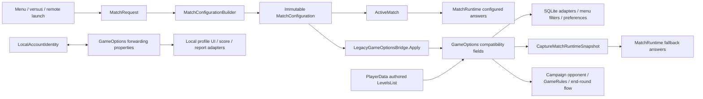

# `GameOptions` production ownership inventory

Status: issue #273 current-state audit; runtime, assets and guards unchanged.
Audited: **2026-10-14**, `origin/dev ca65435afeec75ddfbfa79dcd348f2a52cc36fe8`.
Unity: `6000.5.7f1`. Integration branch: `dev`.

This replaces the August inventory as the current source of truth. The [existing overhaul plan](game-options-match-system-overhaul-plan.md#14-migration-phases) contains the #274/#275 implementation slices and #276 deletion gates. Issues [#273](https://github.com/sweat-this/level5/issues/273), [#274](https://github.com/sweat-this/level5/issues/274), [#275](https://github.com/sweat-this/level5/issues/275) and [#276](https://github.com/sweat-this/level5/issues/276) were fetched open. No open PRs were returned before the audit. The historical SHA supplied with the request happens to remain latest dev.

## Scope and verified counts

One access is one executable member expression, not one matching line. Comments, literals, tests, editor tooling, Unity-ignored `~` backups, `Assets/Scripts/Dev` and development-only conditional branches are excluded from the release tally. Compiled compatibility methods are inventoried even when ordinary gameplay does not call them. Source locations below are fixed to the audited SHA.

| Measure | Verified result |
| --- | --- |
| Stored fields | **55 public static fields**, no private/instance storage |
| Forwarding properties | **2**: userName and userid; storage already belongs to LocalAccountIdentity |
| Methods | **12**: three public, nine private |
| Non-bridge release-production accesses | **68 expressions on 63 lines across 18 files** |
| Development-only direct access outside Dev | **1**, Utility/LoadGame.cs:65 |
| Bridge assignments | **45**; **41** feed fallback, **4** have no production reader |
| Release external accesses including bridge | **113 in 19 files**, excluding bare internal references in GameOptions |
| Guard allowlist | **19 basenames**, excluding GameOptions; includes dev-only LoadGame, misses live LoadManager |
| Field-count ratchet | Limit **59**, regex result **59**, not 59 stored fields |

The initial “63 accesses across 18 files” describes release **source lines**, not expressions. Including LoadGame gives 69 expressions on 64 lines across 19 non-bridge files. Repeated members on one line are separate entries in the ledger.

## Current authority and compatibility boundary

The bridge copies outward only; globals never synchronize back into configuration. ActiveMatch owns the configured match, MatchSession owns result identity, definitions own authoring, and PlayerData.LevelsList owns the authored campaign route. Campaign cursor, menu memory and account identity are separate responsibilities. Apply runs for each configured launch/round transition, not once for the application.

GameOptions installs CaptureMatchRuntimeSnapshot at BeforeSceneLoad (165–168). MatchRuntime resets the reader at SubsystemRegistration. Every fallback read builds a fresh LegacyMatchRuntimeSnapshot; rules/roster are lazy within that snapshot, never cached across reads. Missing reader throws. Fallback never mutates ActiveMatch.

Well-formed configured gameplay reads configuration. **Configured edge cases still use fallback**: PrimaryCharacterDisplayName/ObjectName/Id when slot zero lacks the requested datum, and LocalInputSlotFor when the requested slot is absent. Thus “no normal configured reader” does not mean “safe to remove.”

Direct-scene reconstruction preserves its existing limits: Score objective; no legacy money-ball/consecutive/survival/Arcade flags; no cheerleader bonuses; null Level and false CustomCamera. It is not full-mode parity. Keep these semantics unless a separate behavior change is approved.

## Every field and property

Declarations live in `Assets/Scripts/menu_start/GameOptions.cs`; the number after the type is its declaration line. **B W** is a write in `Assets/Scripts/menu_start/LegacyGameOptionsBridge.cs` at that line. **F R** is a fallback/helper read in GameOptions at those lines; named argument labels are not extra reads. **C W/R** refers to ConfigureSingleHumanRoster (19–26), which has no production caller. External counts exclude bridge and dev-only LoadGame and expand into the ledger below.

GameOptions stores every field in this table. The authority column names the existing semantic owner and current overlap; it does not imply retirement has happened. Properties forward to LocalAccountIdentity without independent storage. Slice labels refer to phase 10/11 in the overhaul plan.

| Declaration and line | Initial/default value | Current operations and locations | Responsibility and existing authority | Retirement prerequisite / slice |
| --- | --- | --- | --- | --- |
| `applicationVersion` : `string` (9) | null (implicit) | B —; F —; external 0R/1W | Application metadata / write-only; `UnityEngine.Application.version` | #275 A; remove redundant copy after fresh reference check |
| `operatingSystemVersion` : `string` (10) | null (implicit) | B —; F —; external 0R/1W | Application metadata / write-only; `UnityEngine.SystemInfo.operatingSystem` | #275 A; remove redundant copy |
| `numPlayers` : `int` (12) | 1 | B W:119; F R:212, 319; C W/R:21, 22, 24, 25, 26; external 1R/0W | Match roster / SQLite / fallback; `MatchConfiguration.Roster.Count; HighScoreModel.numPlayers for saved rows` | #274 B, then F |
| `numCpuPlayers` : `int` (13) | 0 (implicit) | B W:120; F —; C W/R:22; external 0R/0W | Compatibility / write-only; `PlayerRoster.CpuCount + Rules.AddsImplicitDefender` | #274 A; helper/test writes also retire |
| `player1IsCpu` : `bool` (14) | false (implicit) | B W:121; F R:33; C W/R:23; external 0R/0W | Roster control / fallback including out-of-roster edge; `PlayerSlot.ControlType / LocalInputSlot; Rules.AddsImplicitDefender` | #274 F; preserve implicit defender and formula |
| `player2IsCpu` : `bool` (15) | false (implicit) | B W:122; F R:34; C W/R:24; external 0R/0W | Roster control / fallback including out-of-roster edge; `PlayerSlot.ControlType / LocalInputSlot; Rules.AddsImplicitDefender` | #274 F; preserve implicit defender and formula |
| `player3IsCpu` : `bool` (16) | false (implicit) | B W:123; F R:35; C W/R:25; external 0R/0W | Roster control / fallback including out-of-roster edge; `PlayerSlot.ControlType / LocalInputSlot; Rules.AddsImplicitDefender` | #274 F; preserve implicit defender and formula |
| `player4IsCpu` : `bool` (17) | false (implicit) | B W:124; F R:36; C W/R:26; external 0R/0W | Roster control / fallback including out-of-roster edge; `PlayerSlot.ControlType / LocalInputSlot; Rules.AddsImplicitDefender` | #274 F; preserve implicit defender and formula |
| `characterDisplayName` : `string` (61) | null (implicit) | B W:111; F R:194, 331; external 0R/0W | Roster / fallback + configured edge; `PlayerRoster slot 0 Character.DisplayName` | #274 F |
| `cheerleaderDisplayName` : `string` (62) | null (implicit) | B W:130; F R:197; external 0R/0W | Presentation identity / fallback; `MatchConfiguration.Cheerleader.DisplayName` | #274 F |
| `characterId` : `int` (63) | 0 (implicit) | B W:110; F R:196, 329; external 3R/0W | Roster / progression / fallback + configured edge; `PlayerRoster slot 0 Character.CharacterId; MatchProgressionResult.CharacterId` | #274 C, then F |
| `levelSelected` : `string` (64) | null (implicit) | B W:73; F —; external 0R/1W | Arena identity / write-only; `MatchConfiguration.Level.ObjectName / SceneName` | #274 A; includes unconfigured campaign write |
| `gameModeSelectedId` : `int` (65) | 0 (implicit) | B W:46; F R:186, 187, 220; external 0R/0W | Match identity / fallback; `MatchConfiguration.ModeId / Mode.RawModeId` | #274 F; preserve numeric IDs and Lockdown mapping |
| `levelId` : `int` (66) | 0 (implicit) | B W:74; F R:190; external 0R/1W | Arena identity / fallback; `MatchConfiguration.Level.LevelId` | #274 E/F; preserve unconfigured campaign transition |
| `characterObjectName` : `string` (68) | null (implicit) | B W:109; F R:195; external 0R/1W | Roster / progression presentation / fallback + configured edge; `Configured: roster slot 0 Character.ObjectName; progression: PlayerSelectionSession + selected profile` | #274 D, then F; do not substitute old ActiveMatch in menu |
| `characterObjectNames` : `List<string>` (69) | null (implicit) | B W:104; F R:324, 325; external 0R/0W | Roster / fallback; `PlayerRoster.Players[*].Character.ObjectName` | #274 F |
| `cheerleaderObjectName` : `string` (70) | null (implicit) | B W:129; F R:197; external 0R/0W | Presentation identity / fallback; `MatchConfiguration.Cheerleader.ObjectName` | #274 F |
| `levelSelectedName` : `string` (71) | null (implicit) | B —; F —; external 2R/0W | Analytics / reader with no writer; `No current producer; intended event identifier unresolved` | #274 D; explicitly choose preserve-no-event vs separately approved telemetry repair |
| `levelDisplayName` : `string` (72) | null (implicit) | B W:75; F R:189; external 0R/1W | Arena presentation / fallback; `MatchConfiguration.Level.DisplayName` | #274 E/F |
| `gameModeSelectedName` : `string` (73) | null (implicit) | B W:47; F R:188; external 0R/0W | Mode presentation / fallback; `MatchConfiguration.Mode.DisplayName` | #274 F |
| `gameModeHasBeenSelected` : `bool` (77) | false (implicit) | B W:35; F —; external 0R/1W | Compatibility / write-only; `ActiveMatch.IsActive` | #274 A; remove menu reset and bridge write together |
| `gameModeRequiresCounter` : `bool` (78) | false (implicit) | B W:50; F R:231; external 0R/0W | Resolved clock / fallback; `ResolvedMatchRules.ClockMode` | #274 F; Countdown takes priority |
| `gameModeRequiresCountDown` : `bool` (79) | false (implicit) | B W:49; F R:226; external 0R/0W | Resolved clock / fallback; `ResolvedMatchRules.ClockMode` | #274 F |
| `gameModeRequiresShotMarkers3s` : `bool` (82) | false (implicit) | B W:52; F R:284; external 0R/0W | Resolved marker flags / fallback; `ResolvedMatchRules.ShotMarkers` | #274 F |
| `gameModeRequiresShotMarkers4s` : `bool` (83) | false (implicit) | B W:53; F R:289; external 0R/0W | Resolved marker flags / fallback; `ResolvedMatchRules.ShotMarkers` | #274 F |
| `gameModeRequiresBasketball` : `bool` (84) | false (implicit) | B W:63; F R:211; external 0R/0W | Resolved basketball rule / fallback; `ResolvedMatchRules.RequiresBasketball` | #274 F |
| `gameModeAllowsCpuShooters` : `bool` (85) | false (implicit) | B W:64; F R:213; external 0R/0W | Resolved CPU rule / fallback; `ResolvedMatchRules.AllowsCpuShooters` | #274 F |
| `gameModeThreePointContest` : `bool` (87) | false (implicit) | B W:56; F R:258; external 0R/0W | Resolved shot flags / fallback; `ResolvedMatchRules.ShotRule` | #274 F; preserve independent combined flags |
| `gameModeFourPointContest` : `bool` (88) | false (implicit) | B W:57; F R:263; external 0R/0W | Resolved shot flags / fallback; `ResolvedMatchRules.ShotRule` | #274 F; preserve independent combined flags |
| `gameModeAllPointContest` : `bool` (89) | false (implicit) | B W:59; F R:273; external 0R/0W | Resolved shot flags / fallback; `ResolvedMatchRules.ShotRule` | #274 F; preserve independent combined flags |
| `customTimer` : `float` (91) | 0f (implicit) | B W:61; F R:206, 207; external 0R/0W | Resolved clock / fallback; `ResolvedMatchRules.CustomTimerSeconds / MatchLengthSeconds` | #274 F; zero means no override |
| `levelSelectedIndex` : `int` (102) | 0 | B —; F —; external 3R/2W | Menu preference + campaign position; `StartMenuSelectionState.LevelIndex; current campaign cursor still shared GameOptions storage` | #274 E before #275 B; distinct menu and route indices |
| `modeSelectedIndex` : `int` (103) | 0 | B —; F —; external 1R/1W | Menu preference; `StartMenuSelectionState.ModeIndex (live); process-lifetime memory has no separate owner yet` | #275 B; retain across scene loads without adding disk persistence |
| `friendSelectedIndex` : `int` (104) | 0 | B —; F —; external 1R/1W | Menu preference; `StartMenuSelectionState.FriendIndex (live); process-lifetime memory has no separate owner yet` | #275 B |
| `trafficEnabled` : `bool` (106) | false | B W:84; F R:215; external 1R/0W | Menu preference + resolved rule / fallback; `StartMenuSelectionState.TrafficEnabled; ResolvedMatchRules.TrafficEnabled` | #274 D/F coordinated with #275 B |
| `enemiesEnabled` : `bool` (107) | false | B W:83; F R:214; external 0R/0W | Resolved rule / fallback; `ResolvedMatchRules.EnemiesEnabled` | #274 F |
| `sniperEnabled` : `bool` (109) | false | B W:90; F —; external 0R/0W | Compatibility / write-only; `ResolvedMatchRules.SniperEnabled (derived)` | #274 A; retain the three variant flags until F |
| `sniperEnabledBullet` : `bool` (110) | false | B W:91; F R:314; external 0R/0W | Resolved sniper variant / fallback; `ResolvedMatchRules.Sniper` | #274 F; Laser > MachineGun > Bullet precedence |
| `sniperEnabledBulletAuto` : `bool` (111) | false | B W:92; F R:309; external 0R/0W | Resolved sniper variant / fallback; `ResolvedMatchRules.Sniper` | #274 F; Laser > MachineGun > Bullet precedence |
| `sniperEnabledLaser` : `bool` (112) | false | B W:93; F R:304; external 0R/0W | Resolved sniper variant / fallback; `ResolvedMatchRules.Sniper` | #274 F; Laser > MachineGun > Bullet precedence |
| `difficultySelected` : `int` (114) | 1 | B W:87; F R:218; external 0R/0W | Resolved rule / fallback; `ResolvedMatchRules.Difficulty; menu resets Difficulty to Normal` | #274 F; preserve conversion |
| `previousSceneName` : `string` (116) | null (implicit) | B —; F —; external 0R/3W | Navigation / write-only; `No reader; SceneTransition loads scenes, LocalVersusNavigationState owns separate versus return flow` | #275 A; no new navigation service needed for an unused value |
| `hardcoreModeEnabled` : `bool` (118) | false | B W:88; F R:219; external 2R/0W | Menu preference + record filter + rule / fallback; `StartMenuSelectionState.HardcoreEnabled; Rules.Hardcore; PlayerData currently reads global filter` | #274 D/F with #275 B; pass explicit filter at startup, launch and pause refresh |
| `EnemiesOnlyEnabled` : `bool` (119) | false | B W:66; F R:221, 247; external 0R/0W | Authored mode + resolved rule / fallback; `GameModeDefinition.EnemiesOnly; ResolvedMatchRules.EnemiesOnly` | #274 F |
| `levelRequiresTimeOfDay` : `bool` (121) | true | B W:76; F R:191; external 0R/0W | Authored arena / fallback; `LevelDefinition.RequiresTimeOfDay` | #274 F |
| `levelRequiresWeather` : `bool` (122) | false | B W:77; F R:192; external 0R/0W | Authored arena / fallback; `LevelDefinition.HasWeather` | #274 F |
| `levelHasSevenPointers` : `bool` (123) | false | B W:78; F R:193; external 0R/1W | Authored arena / fallback; `LevelDefinition.HasSevenPointers` | #274 E/F |
| `userName` : `string` (128) | LocalAccountIdentity.UserName (initial null) | B —; F —; external 7R/6W | Local identity / forwarding property; `Level5.Core.LocalAccountIdentity.UserName` | #275 C; change callers, never create duplicate identity |
| `userid` : `int` (129) | LocalAccountIdentity.UserId (initial 0) | B —; F —; external 5R/6W | Local identity / forwarding property; `Level5.Core.LocalAccountIdentity.UserId` | #275 C; never substitute Backend V2 PlayerId |
| `numOfLocalUsers` : `int` (134) | 0 (implicit) | B —; F —; external 0R/1W | Account-list projection / write-only; `UserAccountManager.RefreshLocalProfiles local profiles.Count` | #275 A; tests currently assert mirror |
| `tipDialogueLoadedOnStart` : `bool` (136) | false (implicit) | B —; F —; external 2R/3W | Startup UI presentation; `StartScreenTipDialogueManager + StartScreenCpuSelectManager; process-lifetime flag reset by StartManager launch` | #275 D; minimally scoped start-flow lifetime owner required |
| `obstaclesEnabled` : `bool` (137) | false (implicit) | B W:85; F R:216; external 1R/0W | Menu preference + rule / fallback; `StartMenuSelectionState.ObstaclesEnabled; ResolvedMatchRules.ObstaclesEnabled` | #274 D/F with #275 B |
| `battleRoyalEnabled` : `bool` (138) | false (implicit) | B W:67; F R:237; external 0R/0W | Resolved combat flags / fallback; `ResolvedMatchRules.CombatMode / IsBattleRoyal` | #274 F; preserve combined Cage/BattleRoyal flags |
| `cageMatchEnabled` : `bool` (139) | false (implicit) | B W:68; F R:242; external 0R/0W | Resolved combat flags / fallback; `ResolvedMatchRules.CombatMode / IsCageMatch` | #274 F |
| `gameModeRequiresShotMarkers7s` : `bool` (141) | false (implicit) | B W:54; F R:294; external 0R/0W | Resolved marker flags / fallback; `ResolvedMatchRules.ShotMarkers` | #274 F |
| `gameModeSevenPointContest` : `bool` (142) | false (implicit) | B W:58; F R:268; external 0R/0W | Resolved shot flags / fallback; `ResolvedMatchRules.ShotRule` | #274 F; preserve independent combined flags |
| `levelsList` : `List<LevelSelected>` (146) | null (implicit) | B —; F —; external 7R/1W | Authored route + campaign session dependency; `PlayerData.LevelsList serialized route; runtime cursor/outcome split across GameOptions / EndRoundData` | #274 E; retain authored route, opponent and hidden finale; no persistence migration |

## Every method

All locations are in `Assets/Scripts/menu_start/GameOptions.cs`. Methods have no initial stored value. No external production code directly calls the three public methods; the input helpers remain live indirectly through fallback.

| Method / return type / line | Reads, writes, caller and context | Authority / prerequisite |
| --- | --- | --- |
| ConfigureSingleHumanRoster(int, bool = false) / void / 19 | Writes/clamps count and CPU flags, computes implicit defender; only callers Level5CoreTests:53,66 | PlayerRoster + Rules.AddsImplicitDefender; test-only compatibility helper candidate (#274 A/F) |
| IsCpuPlayer(int) / bool / 29 | Reads four CPU flags at 33–36; false outside 0–3; callers GetHumanPlayerInputSlot:43,51 and roster builder:337 | PlayerSlot.IsCpu; fallback remains live (#274 F) |
| GetHumanPlayerInputSlot(int) / int / 41 | Calls IsCpuPlayer; -1 for CPU, counts prior humans; delegate captured at 198 and called through MatchRuntime, including configured out-of-roster case | PlayerSlot.LocalInputSlot inside roster; preserve characterized formula outside it (#274 F) |
| InstallMatchRuntimeLegacyFallback() / void / 165 | Unity initialization attribute invokes it; installs capture delegate at 167 | Preserve bootstrap/reset ordering until replacement fallback (#274 F) |
| CaptureMatchRuntimeSnapshot() / LegacyMatchRuntimeSnapshot / 181 | Installed reader calls it; tests reflect it; captures mode/arena/character/cheerleader, supplies lazy rules/roster and input delegate | Existing reader seam; preserve configured edge cases (#274 F) |
| BuildResolvedMatchRulesFromLegacyGlobals() / ResolvedMatchRules / 201 | Lazy delegate at 184; reads timer, dimension helpers, count, modifiers, difficulty/hardcore, mode-27 defender and enemies-only | Configured Rules; replacement direct-scene inputs required (#274 F) |
| LegacyClockMode() / MatchClockMode / 224 | Called at 205; countdown wins over counter | Rules.ClockMode; preserve precedence (#274 F) |
| LegacyCombatMode() / CombatMode / 234 | Called at 208; combines BattleRoyal/Cage; Standard only when neither and enemies-only | Rules.CombatMode; preserve flags (#274 F) |
| LegacyShotRule() / ShotRule / 255 | Called at 209; combines four contest flags | Rules.ShotRule (#274 F) |
| LegacyShotMarkers() / ShotMarkerRequirement / 281 | Called at 210; combines 3/4/7 flags | Rules.ShotMarkers (#274 F) |
| LegacySniperMode() / SniperMode / 302 | Called at 217; Laser > MachineGun > Bullet > None; does not read sniperEnabled | Rules.Sniper; generic flag may retire independently (#274 A/F) |
| BuildPlayerRosterFromLegacyGlobals() / PlayerRoster / 317 | Lazy delegate at 185; clamps count, reads object list and slot-zero identity, calls IsCpuPlayer, builds roster | Configured roster; preserve unconfigured semantics (#274 F) |

## Special ownership findings

- **levelSelectedIndex crosses menu and campaign ownership.** StartMenuSelectionState loads/saves it; GameLevelManager uses it as PlayerData route position; GameRules captures completed/proposed indices into EndRoundData; EndRoundMenuManager commits retry/advance selection. StartManager.forceCampaignStartLevel (1736–1757) forces menu level ID 1 and resolveSceneName (1765–1769) forces Scrapyard. Menu catalog index, route position and stable ID differ. Current GameRules does **not** optimistically increment the shared index.
- **levelsList is authored route plus session dependency.** PlayerData.LevelsList is the serialized route copied at launch and read for opponent, round outcome and end-round selection. No single campaign cursor owner currently exists. EndRoundData owns outcome/continues; CampaignRoundDecision owns pure decision logic. Preserve the 21-round route, hidden Boneyard and approved Dev finale; see [campaign build audit](gp-001-f5-campaign-build-integrity.md).
- **Persistence still reads match globals.** DBHelper.InsertGameScore:410 uses GameOptions.numPlayers even though both HighScoreModel factories populate model.numPlayers from MatchRuntime (163,328). Use the captured model in a follow-up, so delayed/queued writes cannot observe a later match. DBConnector:519 and DBHelper:482 are implicit-character XP overloads with existing explicit-ID alternatives. ProgressionService:30 reads characterId only to construct a null-result diagnostic. Check caller reachability before deleting overloads; compiled debt remains in this inventory.
- **characterObjectName has a progression-menu writer.** ProgressionManager:969 publishes the highlighted character, which need not be the active match character. PlayerSelectionSession already remembers stable character IDs. Do not answer menu selection from a stale ActiveMatch.
- **hardcoreModeEnabled spans preference, rules and record filter.** StartMenuSelectionState loads the previous option; configured Rules own match hardcore; PlayerData:123 filters personal-best queries at startup (PlayerData:111), after launch (StartManager:1818), and through the pause reload adapter (GameLevelManager:556). Supply explicit filter values at all three contexts; do not require an active match in a loading/menu scene.
- **Local identity storage has already migrated.** userName/userid forward to LocalAccountIdentity:128–129. #275 changes dependencies, not storage. CharacterProgressAccountId owns SQLite/file scoping; BackendV2SessionStore owns independent authenticated online identity. Guest ID 74 remains 74; an online GUID is not a local profile ID. See [persistence boundaries](persistence-boundaries.md).
- **levelSelectedName has no producer.** GameLevelManager:635,637 reads it for analytics, but no production writer exists and default is null. The event is dormant under current initialization. levelSelected, levelDisplayName and configuration.SceneName differ; choosing a producer would be a telemetry behavior decision.
- **tipDialogueLoadedOnStart is live presentation state.** TipDialogueManager gates Awake/OnEnable wiring; both widgets set it true in Start; StartManager:1815 resets it at launch for the next pass. CpuSelectManager's guard at 57 is commented out. Preserve that timing; do not reset on every enable.

## Dead and potentially dead candidates (deferred, no removal in #273)

| Candidate | Verified production state | Follow-up |
| --- | --- | --- |
| gameModeHasBeenSelected | Bridge:35 true, StartManager:309 false; no reader, including fallback | #274 A; bridge comment claiming CharacterProfile reads it is stale |
| levelSelected | Bridge:73 and unconfigured EndRoundMenuManager:321 writes; no reader | #274 A; distinct from levelSelectedName and route index |
| numCpuPlayers | Bridge:120 and ConfigureSingleHumanRoster:22 writes; no reader | #274 A; actual CPU slot flags remain live |
| sniperEnabled | Bridge:90 write; no reader, including LegacySniperMode | #274 A; three variant flags remain live |
| applicationVersion, operatingSystemVersion | StartManager:1794–1795 writes; no reader | #275 A; direct Application/SystemInfo metadata APIs already exist |
| previousSceneName | StartManager:747, ProgressionManager:843, GameLevelManager:629 writes; no reader | #275 A; no new navigation service justified |
| numOfLocalUsers | UserAccountManager:235 writes; no production reader; tests assert mirror | #275 A; profile UI consumes actual profile list |
| levelSelectedName + guarded analytics | Two reads, no writer; null under current production initialization | #274 D; preserve dormant behavior or seek separate telemetry decision |
| ConfigureSingleHumanRoster | Only two test calls; writes live fallback inputs as well as unused numCpuPlayers | #274 A/F; does not make the input helpers dead |

No production typeof(GameOptions), string-selected GameOptions reflection, using-static/alias access or executable direct member use outside Assets/Scripts was found. Asset text searches found no GameOptions/bridge type-name references. GameOptions is static, so these fields are not serialized Unity instance data. GUID/reference validation is recorded below. Test reflection exists and must be updated deliberately. These are source-backed candidates, not permission to delete fallback or a claim about unknown external assemblies. Re-scan at each deletion SHA.

## Architecture guard reconciliation

Location: `Assets/Tests/Editor/Level5MatchArchitectureTests.cs`.

| Guard | Current evidence | Required handling |
| --- | --- | --- |
| NoNewFileReachesForGameOptions | Existing scanner sees the 19 permitted files. Literal-aware scan also finds unallowlisted LoadManager:321 | **False negative:** LoadManager:195 has `/*` inside a `//` comment; StripComments erases through real terminator at 339. Guard unchanged; #275 C migrates identity read rather than adding exception |
| TheAllowlistHasNoStaleEntries | All 19 entries still contain executable references in guard scope; LoadGame is dev-only but scanned | No stale entries; MatchRuntime and SpawnCoordinator already left allowlist |
| GameOptionsGrowsNoNewMatchFields | Limit 59, regex result 59, actual 55 fields + 2 properties | Regex also counts public static class and int-returning GetHumanPlayerInputSlot; subtracts void/bool methods. Never raise it; lower after deletions, parser correction is focused follow-up |
| NoNewModeIdentityBooleans | Static reproduction finds no offenders in existing scope | Retain typed-ID and independent flag semantics; parity tests still matter |
| Filename-based allowlist/exemption | Basenames permit all matching files; byName overwrites duplicates | No collisions for current permitted names; relative-path guard is separate focused hardening |
| Scan scope | Ignores ~ and Scripts/Dev, does not evaluate preprocessor directives, does not safely strip literals | Guard count is not release-production count; no allowlist expansion or weakening |

Static reproduction finds no new/stale entries **because of the false negative**; it is not a Unity test pass. The old “only boundary/tests mention it, therefore dead” rule is withdrawn: 41 fields have live fallback readers.

## Non-bridge release-production expression ledger

R = read, W = assignment. File heading plus line is the precise location at the audited SHA. Repeated members on one line are distinct expressions.

### `Assets/Scripts/account/LocalAccount.cs`

Local profile/guest selection.

| Line | Member | Operation | Source context |
| --- | --- | --- | --- |
| 70 | `userName` | W | `GameOptions.userName = user.UserName;` |
| 71 | `userid` | W | `GameOptions.userid = user.Userid;` |
| 84 | `userName` | W | `GameOptions.userName = UserAccountManager.GuestUsername;` |
| 85 | `userid` | W | `GameOptions.userid = UserAccountManager.GuestUserid;` |

### `Assets/Scripts/account/UserAccountManager.cs`

Local profile select/delete/list refresh.

| Line | Member | Operation | Source context |
| --- | --- | --- | --- |
| 94 | `userName` | W | `GameOptions.userName = user.UserName;` |
| 95 | `userid` | W | `GameOptions.userid = user.Userid;` |
| 107 | `userid` | W | `GameOptions.userid = guestUserid;` |
| 108 | `userName` | W | `GameOptions.userName = guestUsername;` |
| 180 | `userid` | R | `if (MatchesCurrentLocalIdentity(target, GameOptions.userid, GameOptions.userName))` |
| 180 | `userName` | R | `if (MatchesCurrentLocalIdentity(target, GameOptions.userid, GameOptions.userName))` |
| 186 | `userid` | W | `GameOptions.userid = 0;` |
| 187 | `userName` | W | `GameOptions.userName = null;` |
| 235 | `numOfLocalUsers` | W | `GameOptions.numOfLocalUsers = profiles.Count;` |

### `Assets/Scripts/database/DBConnector.cs`

Implicit-character compatibility XP overload.

| Line | Member | Operation | Source context |
| --- | --- | --- | --- |
| 519 | `characterId` | R | `return savePlayerProfileProgression(expGained, GameOptions.characterId);` |

### `Assets/Scripts/database/DBHelper.cs`

Score insert / compatibility XP overload.

| Line | Member | Operation | Source context |
| --- | --- | --- | --- |
| 410 | `numPlayers` | R | `dbcmd.Parameters.Add(new SqliteParameter("@numPlayers", GameOptions.numPlayers));` |
| 482 | `characterId` | R | `return UpdatePlayerProfileProgression(expGained, GameOptions.characterId);` |

### `Assets/Scripts/game manager/GameLevelManager.cs`

Campaign opponent adapter / navigation / analytics.

| Line | Member | Operation | Source context |
| --- | --- | --- | --- |
| 301 | `levelsList` | R | `List<LevelSelected> levels = GameOptions.levelsList;` |
| 302 | `levelSelectedIndex` | R | `int levelIndex = GameOptions.levelSelectedIndex;` |
| 629 | `previousSceneName` | W | `GameOptions.previousSceneName = Constants.SCENE_NAME_level_00_loading;` |
| 635 | `levelSelectedName` | R | `if (!String.IsNullOrEmpty(GameOptions.levelSelectedName))` |
| 637 | `levelSelectedName` | R | `AnaylticsManager.LevelLoaded(GameOptions.levelSelectedName);` |

### `Assets/Scripts/game manager/GameRules.cs`

Campaign result and next-round handoff.

| Line | Member | Operation | Source context |
| --- | --- | --- | --- |
| 798 | `levelsList` | R | `if (GameOptions.levelsList == null \|\| GameOptions.levelsList.Count == 0)` |
| 798 | `levelsList` | R | `if (GameOptions.levelsList == null \|\| GameOptions.levelsList.Count == 0)` |
| 805 | `levelSelectedIndex` | R | `int completedLevelIndex = Mathf.Clamp(GameOptions.levelSelectedIndex, 0, GameOptions.levelsList.Count - 1);` |
| 805 | `levelsList` | R | `int completedLevelIndex = Mathf.Clamp(GameOptions.levelSelectedIndex, 0, GameOptions.levelsList.Count - 1);` |
| 810 | `levelsList` | R | `if (completedLevelIndex < GameOptions.levelsList.Count - 1)` |
| 816 | `levelsList` | R | `LevelSelected completedLevel = GameOptions.levelsList[completedLevelIndex];` |

### `Assets/Scripts/menu_end_round/EndRoundMenuManager.cs`

Campaign route capture / round selection / unconfigured arena writes.

| Line | Member | Operation | Source context |
| --- | --- | --- | --- |
| 63 | `levelsList` | R | `levelsList = GameOptions.levelsList ?? new List<LevelSelected>();` |
| 306 | `levelSelectedIndex` | W | `GameOptions.levelSelectedIndex = levelIndex;` |
| 319 | `levelHasSevenPointers` | W | `GameOptions.levelHasSevenPointers = level.LevelHasSevenPointers;` |
| 320 | `levelId` | W | `GameOptions.levelId = level.LevelId;` |
| 321 | `levelSelected` | W | `GameOptions.levelSelected = level.LevelObjectName;` |
| 322 | `levelDisplayName` | W | `GameOptions.levelDisplayName = level.LevelDisplayName;` |

### `Assets/Scripts/menu_loading/LoadManager.cs`

SQLite character-profile load by local identity.

| Line | Member | Operation | Source context |
| --- | --- | --- | --- |
| 321 | `userid` | R | `List<CharacterProfileRecord> dbShootStatsList = DBHelper.instance.getCharacterProfileStats(GameOptions.userid)` |

### `Assets/Scripts/menu_login/AccountManager.cs`

Select newly created local profile.

| Line | Member | Operation | Source context |
| --- | --- | --- | --- |
| 394 | `userid` | W | `GameOptions.userid = createResult.Value.Userid;` |
| 395 | `userName` | W | `GameOptions.userName = createResult.Value.UserName;` |

### `Assets/Scripts/menu_progression/ProgressionManager.cs`

Menu navigation / selected-character presentation.

| Line | Member | Operation | Source context |
| --- | --- | --- | --- |
| 843 | `previousSceneName` | W | `GameOptions.previousSceneName = activeScene;` |
| 969 | `characterObjectName` | W | `GameOptions.characterObjectName = playerSelectedData[playerSelectedIndex].PlayerObjectName;` |

### `Assets/Scripts/menu_progression/ProgressionService.cs`

Null-result diagnostic compatibility path.

| Line | Member | Operation | Source context |
| --- | --- | --- | --- |
| 30 | `characterId` | R | `result = new MatchProgressionResult(CreateResultId("missing"), GameOptions.characterId, 0);` |

### `Assets/Scripts/menu_start/StartManager.cs`

Menu reset / profile label / launch metadata, route, UI reset.

| Line | Member | Operation | Source context |
| --- | --- | --- | --- |
| 309 | `gameModeHasBeenSelected` | W | `GameOptions.gameModeHasBeenSelected = false;` |
| 747 | `previousSceneName` | W | `GameOptions.previousSceneName = activeScene;` |
| 1207 | `userName` | R | `userNameText.text = "profile : " + GameOptions.userName;` |
| 1794 | `applicationVersion` | W | `GameOptions.applicationVersion = Application.version;` |
| 1795 | `operatingSystemVersion` | W | `GameOptions.operatingSystemVersion = SystemInfo.operatingSystem;` |
| 1796 | `levelsList` | W | `GameOptions.levelsList = PlayerData.instance.LevelsList;` |
| 1815 | `tipDialogueLoadedOnStart` | W | `GameOptions.tipDialogueLoadedOnStart = false;` |

### `Assets/Scripts/menu_start/StartMenuSelectionState.cs`

Load/save process-lifetime selection preferences.

| Line | Member | Operation | Source context |
| --- | --- | --- | --- |
| 48 | `friendSelectedIndex` | R | `FriendIndex = GameOptions.friendSelectedIndex;` |
| 49 | `levelSelectedIndex` | R | `LevelIndex = GameOptions.levelSelectedIndex;` |
| 50 | `modeSelectedIndex` | R | `ModeIndex = GameOptions.modeSelectedIndex;` |
| 51 | `trafficEnabled` | R | `TrafficEnabled = GameOptions.trafficEnabled;` |
| 52 | `hardcoreModeEnabled` | R | `HardcoreEnabled = GameOptions.hardcoreModeEnabled;` |
| 53 | `obstaclesEnabled` | R | `ObstaclesEnabled = GameOptions.obstaclesEnabled;` |
| 61 | `friendSelectedIndex` | W | `GameOptions.friendSelectedIndex = FriendIndex;` |
| 62 | `levelSelectedIndex` | W | `GameOptions.levelSelectedIndex = LevelIndex;` |
| 63 | `modeSelectedIndex` | W | `GameOptions.modeSelectedIndex = ModeIndex;` |

### `Assets/Scripts/menu_start/StartScreenCpuSelectManager.cs`

Startup presentation marked shown.

| Line | Member | Operation | Source context |
| --- | --- | --- | --- |
| 82 | `tipDialogueLoadedOnStart` | W | `GameOptions.tipDialogueLoadedOnStart = true;` |

### `Assets/Scripts/menu_start/StartScreenTipDialogueManager.cs`

Conditional startup wiring / presentation marked shown.

| Line | Member | Operation | Source context |
| --- | --- | --- | --- |
| 27 | `tipDialogueLoadedOnStart` | R | `if (!GameOptions.tipDialogueLoadedOnStart)` |
| 52 | `tipDialogueLoadedOnStart` | R | `if (!GameOptions.tipDialogueLoadedOnStart)` |
| 75 | `tipDialogueLoadedOnStart` | W | `GameOptions.tipDialogueLoadedOnStart = true;` |

### `Assets/Scripts/Models/HighScoreModel.cs`

Local result identity stamps.

| Line | Member | Operation | Source context |
| --- | --- | --- | --- |
| 133 | `userName` | R | `model.UserName = GameOptions.userName;` |
| 134 | `userid` | R | `model.Userid = GameOptions.userid;` |
| 242 | `userName` | R | `model.UserName = GameOptions.userName;` |
| 243 | `userid` | R | `model.Userid = GameOptions.userid;` |

### `Assets/Scripts/PlayerData.cs`

Hardcore record-query filter.

| Line | Member | Operation | Source context |
| --- | --- | --- | --- |
| 123 | `hardcoreModeEnabled` | R | `if (GameOptions.hardcoreModeEnabled)` |

### `Assets/Scripts/RESTApi/APIHelper.cs`

User bug-report local identity stamp.

| Line | Member | Operation | Source context |
| --- | --- | --- | --- |
| 80 | `userName` | R | `userReport.UserId = string.IsNullOrEmpty(GameOptions.userName) ? 999 : GameOptions.userid;` |
| 80 | `userid` | R | `userReport.UserId = string.IsNullOrEmpty(GameOptions.userName) ? 999 : GameOptions.userid;` |
| 81 | `userName` | R | `userReport.UserName = string.IsNullOrEmpty(GameOptions.userName) ? "not logged in" : GameOptions.userName;` |
| 81 | `userName` | R | `userReport.UserName = string.IsNullOrEmpty(GameOptions.userName) ? "not logged in" : GameOptions.userName;` |

## Bridge write ledger

Every row is in `Assets/Scripts/menu_start/LegacyGameOptionsBridge.cs`. All 45 accesses are assignments, with no GameOptions read.

| Line | Member | Operation | Source context |
| --- | --- | --- | --- |
| 35 | `gameModeHasBeenSelected` | W | `GameOptions.gameModeHasBeenSelected = true;` |
| 46 | `gameModeSelectedId` | W | `GameOptions.gameModeSelectedId = mode.RawModeId;` |
| 47 | `gameModeSelectedName` | W | `GameOptions.gameModeSelectedName = mode.DisplayName;` |
| 49 | `gameModeRequiresCountDown` | W | `GameOptions.gameModeRequiresCountDown = rules.RequiresCountDown;` |
| 50 | `gameModeRequiresCounter` | W | `GameOptions.gameModeRequiresCounter = rules.RequiresCounter;` |
| 52 | `gameModeRequiresShotMarkers3s` | W | `GameOptions.gameModeRequiresShotMarkers3s = rules.RequiresShotMarkers3s;` |
| 53 | `gameModeRequiresShotMarkers4s` | W | `GameOptions.gameModeRequiresShotMarkers4s = rules.RequiresShotMarkers4s;` |
| 54 | `gameModeRequiresShotMarkers7s` | W | `GameOptions.gameModeRequiresShotMarkers7s = rules.RequiresShotMarkers7s;` |
| 56 | `gameModeThreePointContest` | W | `GameOptions.gameModeThreePointContest = rules.IsThreePointContest;` |
| 57 | `gameModeFourPointContest` | W | `GameOptions.gameModeFourPointContest = rules.IsFourPointContest;` |
| 58 | `gameModeSevenPointContest` | W | `GameOptions.gameModeSevenPointContest = rules.IsSevenPointContest;` |
| 59 | `gameModeAllPointContest` | W | `GameOptions.gameModeAllPointContest = rules.IsAllPointContest;` |
| 61 | `customTimer` | W | `GameOptions.customTimer = rules.CustomTimerSeconds;` |
| 63 | `gameModeRequiresBasketball` | W | `GameOptions.gameModeRequiresBasketball = rules.RequiresBasketball;` |
| 64 | `gameModeAllowsCpuShooters` | W | `GameOptions.gameModeAllowsCpuShooters = rules.AllowsCpuShooters;` |
| 66 | `EnemiesOnlyEnabled` | W | `GameOptions.EnemiesOnlyEnabled = mode.EnemiesOnly;` |
| 67 | `battleRoyalEnabled` | W | `GameOptions.battleRoyalEnabled = rules.IsBattleRoyal;` |
| 68 | `cageMatchEnabled` | W | `GameOptions.cageMatchEnabled = rules.IsCageMatch;` |
| 73 | `levelSelected` | W | `GameOptions.levelSelected = level.ObjectName;` |
| 74 | `levelId` | W | `GameOptions.levelId = level.LevelId;` |
| 75 | `levelDisplayName` | W | `GameOptions.levelDisplayName = level.DisplayName;` |
| 76 | `levelRequiresTimeOfDay` | W | `GameOptions.levelRequiresTimeOfDay = level.RequiresTimeOfDay;` |
| 77 | `levelRequiresWeather` | W | `GameOptions.levelRequiresWeather = level.HasWeather;` |
| 78 | `levelHasSevenPointers` | W | `GameOptions.levelHasSevenPointers = level.HasSevenPointers;` |
| 83 | `enemiesEnabled` | W | `GameOptions.enemiesEnabled = rules.EnemiesEnabled;` |
| 84 | `trafficEnabled` | W | `GameOptions.trafficEnabled = rules.TrafficEnabled;` |
| 85 | `obstaclesEnabled` | W | `GameOptions.obstaclesEnabled = rules.ObstaclesEnabled;` |
| 87 | `difficultySelected` | W | `GameOptions.difficultySelected = MatchDifficulties.ToInt(rules.Difficulty);` |
| 88 | `hardcoreModeEnabled` | W | `GameOptions.hardcoreModeEnabled = rules.Hardcore;` |
| 90 | `sniperEnabled` | W | `GameOptions.sniperEnabled = rules.SniperEnabled;` |
| 91 | `sniperEnabledBullet` | W | `GameOptions.sniperEnabledBullet = rules.Sniper == SniperMode.Bullet;` |
| 92 | `sniperEnabledBulletAuto` | W | `GameOptions.sniperEnabledBulletAuto = rules.Sniper == SniperMode.MachineGun;` |
| 93 | `sniperEnabledLaser` | W | `GameOptions.sniperEnabledLaser = rules.Sniper == SniperMode.Laser;` |
| 104 | `characterObjectNames` | W | `GameOptions.characterObjectNames = objectNames;` |
| 109 | `characterObjectName` | W | `GameOptions.characterObjectName = primary.Character.ObjectName;` |
| 110 | `characterId` | W | `GameOptions.characterId = primary.Character.CharacterId;` |
| 111 | `characterDisplayName` | W | `GameOptions.characterDisplayName = primary.Character.DisplayName;` |
| 119 | `numPlayers` | W | `GameOptions.numPlayers = Mathf.Clamp(roster.Count, 1, PlayerRoster.MaxSlots);` |
| 120 | `numCpuPlayers` | W | `GameOptions.numCpuPlayers = roster.CpuCount + (implicitDefender ? 1 : 0);` |
| 121 | `player1IsCpu` | W | `GameOptions.player1IsCpu = IsCpu(roster, 0);` |
| 122 | `player2IsCpu` | W | `GameOptions.player2IsCpu = IsCpu(roster, 1) \|\| implicitDefender;` |
| 123 | `player3IsCpu` | W | `GameOptions.player3IsCpu = IsCpu(roster, 2);` |
| 124 | `player4IsCpu` | W | `GameOptions.player4IsCpu = IsCpu(roster, 3);` |
| 129 | `cheerleaderObjectName` | W | `GameOptions.cheerleaderObjectName = cheerleader.ObjectName;` |
| 130 | `cheerleaderDisplayName` | W | `GameOptions.cheerleaderDisplayName = cheerleader.DisplayName;` |

### Every release-production bridge caller

| Repository-relative file | Line | Context |
| --- | --- | --- |
| Assets/Scripts/menu_start/StartManager.cs | 1719 | Validated builder result, after ActiveMatch.Begin, before preference/launch side effects and scene load |
| Assets/Scripts/menu_end_round/EndRoundMenuManager.cs | 312 | ContinueInLevel + Begin for configured round; unconfigured branch instead writes arena fields at 319–322 |
| Assets/Scripts/versus/VersusLauncher.cs | 116 | Local alternating attempt after ActiveMatch/ActiveVersusAttempt publication |
| Assets/Scripts/versus/VersusLauncher.cs | 231 | Local simultaneous match before scene load |
| Assets/Scripts/versus/RemoteAttemptLauncher.cs | 120 | Remote mapping after ActiveMatch/ActiveRemoteAttempt publication |

CaptureMatchRuntimeSnapshot has no external release caller: Unity installs its delegate. Versus launchers remain production code even where some callers are dev tools.

## Development, backup and test usage

- `Assets/Scripts/Utility/LoadGame.cs:64` calls bridge; `:65` writes levelsList only under UNITY_EDITOR or DEVELOPMENT_BUILD. Release code logs dev loading unavailable and exits. It remains on the source guard list.
- Assets/Scripts/Dev has no executable direct GameOptions access; tooling can invoke production launchers indirectly.
- Unity-ignored ~ backups are historical, excluded code.
- `Assets/Level5/Editor/BackendV2LiveCertificationRunner.cs:351` is bridge flow text, not a call.

### Direct test member/type references

Counts include executable direct members and explicit typeof; multiple occurrences per line count separately. Comments, source-scan literals and reflective PlayMode calls are excluded from this table.

| Repository-relative test file | Occurrences | Source lines |
| --- | --- | --- |
| `Assets/Tests/Editor/GameOptionsSnapshot.cs` | 90 | 66, 67, 68, 69, 70, 71, 72, 73, 74, 75, 76, 77, 78, 79, 80, 81, 82, 83, 85, 86, 87, 88, 89, 90, 92, 93, 94, 95, 96, 97, 98, 99, 100, 102, 103, 104, 105, 106, 107, 108, 109, 110, 111, 113, 114, 120, 121, 122, 123, 124, 125, 126, 127, 128, 129, 130, 131, 132, 133, 134, 135, 136, 137, 139, 140, 141, 142, 143, 144, 146, 147, 148, 149, 150, 151, 152, 153, 154, 156, 157, 158, 159, 160, 161, 162, 163, 164, 165, 167, 168 |
| `Assets/Tests/Editor/Level5ActorHealthTests.cs` | 6 | 32, 33, 43, 61, 167, 191 |
| `Assets/Tests/Editor/Level5CoreTests.cs` | 31 | 17, 18, 19, 20, 21, 22, 28, 29, 30, 31, 32, 33, 39, 40, 41, 42, 44, 45, 46, 47, 53, 55, 56, 57, 58, 59, 60, 66, 68, 69, 70 |
| `Assets/Tests/Editor/Level5CpuBaselineInitializationTests.cs` | 8 | 22, 28, 57, 93, 105, 183, 196, 209 |
| `Assets/Tests/Editor/Level5LocalSimultaneousVersusTests.cs` | 2 | 150, 152 |
| `Assets/Tests/Editor/Level5MatchBridgeParityTests.cs` | 40 | 60, 61, 62, 63, 64, 65, 66, 67, 68, 69, 70, 71, 82, 96, 97, 98, 99, 115, 116, 117, 118, 119, 138, 139, 140, 141, 142, 143, 144, 145, 157, 158, 159, 160, 171, 172, 173, 174, 186, 187 |
| `Assets/Tests/Editor/Level5MatchHudPresenterCompositionTests.cs` | 3 | 787, 794, 808 |
| `Assets/Tests/Editor/Level5MatchRuntimeFallbackTestSupport.cs` | 1 | 15 |
| `Assets/Tests/Editor/Level5MatchRuntimeLegacyFallbackTests.cs` | 43 | 72, 73, 74, 128, 129, 130, 147, 148, 149, 150, 151, 152, 153, 173, 181, 182, 183, 184, 185, 186, 187, 205, 206, 221, 229, 230, 231, 232, 233, 238, 248, 249, 250, 251, 260, 269, 270, 286, 300, 328, 329, 333, 367 |
| `Assets/Tests/Editor/Level5PlayerMatchRuntimeCompositionTests.cs` | 2 | 89, 92 |
| `Assets/Tests/Editor/Level5RangeShotRecordTests.cs` | 4 | 93, 108, 134, 137 |
| `Assets/Tests/Editor/Level5SpawnCoordinatorCampaignCpuPrefabResolverTests.cs` | 14 | 36, 37, 43, 44, 231, 232, 244, 245, 257, 258, 272, 273, 286, 287 |
| `Assets/Tests/Editor/Level5SpotUpRecordEligibilityTests.cs` | 2 | 54, 55 |
| `Assets/Tests/Editor/Level5UnlockSnapshotTests.cs` | 12 | 29, 30, 53, 54, 92, 93, 138, 139, 155, 156, 212, 213 |
| `Assets/Tests/Editor/Level5UserAccountManagerProfileLoadingTests.cs` | 6 | 52, 72, 106, 178, 211, 217 |
| `Assets/Tests/Editor/ProgressionServiceApplyMatchResultTests.cs` | 6 | 43, 44, 46, 47, 53, 54 |
| `Assets/Tests/Editor/TipDialogueTextMeshProMigrationTests.cs` | 3 | 34, 35, 41 |

Reflective consumers under Assets/Tests/PlayMode: CampaignRoundPlayModeTests:58,152,153,255; Level5LongestShotRecordPlayModeTests:41; Level5RangeShotRecordPlayModeTests:41; Level5PostRemediationCertificationPlayModeTests:57; PlayerAudioSettingsPlayModeTests:83. Public-static-field snapshots do not capture forwarding properties automatically. GameOptionsSnapshot explicitly restores match fields. Level5MatchRuntimeFallbackTestSupport:15 reflects the private capture method and Level5MatchRuntimeFallbackTestBootstrap installs it.

Bridge test calls are separate from the direct-member table: Assets/Tests/Editor/Level5MatchBridgeParityTests.cs invokes Apply at 58,79,88,113,132,153,166,181,207 (nine calls).

### Affected tests for implementation slices

| Responsibility | Existing coverage to inspect/run when changed |
| --- | --- |
| Bridge/rules/IDs | Level5MatchBridgeParityTests, Level5MatchConfigurationTests, Level5MatchDomainTests, Level5AuthoredMatchDataTests, Level5MatchArchitectureTests |
| Fallback, configured edges, live reads, reader lifecycle | Level5MatchRuntimeLegacyFallbackTests, Level5PlayerMatchRuntimeCompositionTests, Level5ProductionAssemblyBoundaryTests |
| CPU/input formula | Level5CoreTests, Level5LocalSimultaneousVersusTests, Level5CpuBaselineInitializationTests |
| Campaign route/opponent/outcome | Level5CampaignRouteTests, Level5SpawnCoordinatorCampaignCpuPrefabResolverTests, CampaignRoundPlayModeTests and CampaignBoundaryPlayModeTests (both in CampaignRoundPlayModeTests.cs) |
| SQLite payload/hardcore/progression | Level5RangeShotRecordTests, Level5RangeShotRecordPlayModeTests, ProgressionServiceApplyMatchResultTests, Level5SpotUpRecordEligibilityTests |
| Local identity/account scope | Level5LocalProfileNetworkIndependenceTests, Level5LocalProfileAllocationTests, Level5LocalProfileDeletionTests, Level5UserAccountManagerProfileLoadingTests, Level5UnlockSnapshotTests |
| Startup UI | TipDialogueTextMeshProMigrationTests; focused tip/CPU-select re-entry runtime path when lifetime changes |

These are inspected evidence/proposed checks, **not test passes for #273**. Add focused regression cases where existing tests do not pin captured model.numPlayers against later-match mutation, explicit PlayerData filters, separated menu/route cursors, or scanner nested-comment false negatives.

## Retirement risks and concrete mitigations

| Risk | Severity | Concrete solution / evidence gate |
| --- | --- | --- |
| Delete fallback-only fields as dead | High | Retain all 41 inputs until #274 F supplies independent scene inputs; keep direct-entry and configured edge tests |
| Queued score observes later match roster | High | #274 B uses captured HighScoreModel.numPlayers, verified by mutating globals/current match before SQLite insert |
| Progression attributed to highlighted/newer character | High | #274 C uses explicit result/character ID; D2 preserves separate progression-menu selection |
| Menu catalog index used as route position | High | #274 E separates cursor from preference before #275 B; retain outcome-first retry/advance logic and authored opponent/hidden finale |
| Record UI requires configuration during startup | Medium | #274 D1 passes explicit filter at startup, launch and pause-refresh boundaries; test both hardcore states without ActiveMatch |
| Local identity mistaken for online authentication | High | #275 C reads LocalAccountIdentity and preserves CharacterProgressAccountId/guest scope; BackendV2SessionStore remains independent |
| Guard reports green while missing real source | Medium | Document LoadManager:195–339 erasure; migrate hidden reader before literal-aware guard hardening; never add exception to hide it |
| UI re-entry timing changes | Medium | #275 D preserves true-on-Start/reset-at-launch behavior; focused tip/CPU flow runtime check when lifetime owner changes |
| Dormant analytics starts emitting new/renamed payload | Medium | #274 D3 preserves current no-event behavior; a producer needs explicit separate policy |

## Two review passes

### Pass 1 — Completeness and correctness

Checked declarations, raw hits versus literal-aware executable hits, conditional compilation, bridge assignments, bare internal fallback reads, reflection and serialized exposure. Corrected 63 lines versus 68 expressions, found LoadManager missing from allowlist, separated 55 fields from 59-token ratchet, and retained all 41 fallback inputs. Rejected comment-only SpawnCoordinator/ArenaBootstrap references and retired bearer-token ownership. Established scanner erasure rather than inactive code as the missing guard hit's cause.

### Pass 2 — Architecture and scope

Challenged substitutions at real lifetime boundaries. Changed SQLite participant-count target to captured HighScoreModel rather than current match; kept progression-menu identity separate from active roster; required campaign cursor separation before menu-index retirement; retained configured fallback edge behavior. Rejected speculative global/account/navigation services, schema migrations, durable level progress and scoring cleanup. The existing roadmap orders bounded slices and keeps #276 blocked. No runtime implementation was performed.

## Validation performed (Level 0)

| Check | Result / limit |
| --- | --- |
| Fetch dev, issues #273–#276, open PRs | PASS; audited SHA/date above; no open PR overlap at start |
| Declaration/access reconciliation | PASS; 55 fields, 2 properties, 12 methods; 68 release external accesses + 45 bridge writes; development access separated |
| Literal-aware scan versus existing guard scanner | PASS audit; LoadManager false negative identified; guards unchanged |
| Reflection, asset-name and GUID scan | No production GameOptions reflection/name-selected access, asset type-name reference or non-meta asset reference to MonoScript GUID b050d289ae259fc47be5887ea83380a4 found; test reflection recorded |
| Final diff, Markdown table/local-link checks and pre-submit refresh | PASS; git diff --check clean; generated ledgers match source; local links resolve; re-fetched dev remains ca65435afeec75ddfbfa79dcd348f2a52cc36fe8; no open PR or other-worktree change overlaps these documents |
| Unity compile/EditMode/PlayMode/full repository validator | NOT RUN; documentation-only Level 0; AGENTS.md says not to start Unity solely for this change |

Unresolved follow-up decisions: minimally scoped owner/lifecycle for campaign cursor and start-flow presentation memory; whether dormant analytics remains dormant or receives a separately approved producer. These do not block this inventory; they block dependent behavioral migrations.
