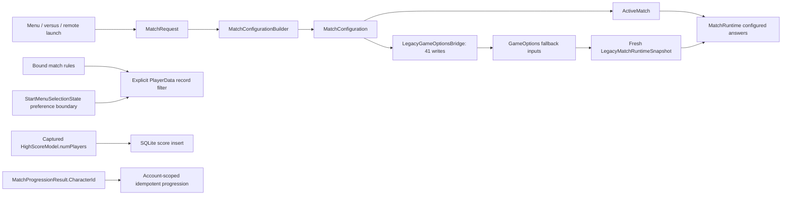
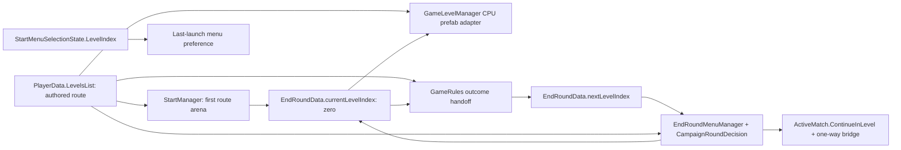

# `GameOptions` production ownership inventory

Status: **#274 partially implemented; D2/F remain blocked. Do not close #274 or remove the bridge.**
Audited: **2026-10-14**, latest fetched `origin/dev 8a93cb2a7d3b979c759196f0430d3aa4895b23a8`.
Unity: `6000.5.7f1`. Implementation branch: `refactor/274-legacy-match-retirement`; PR target: `dev`.
Locations below refer to the accompanying source changes. Historical #273 inventory is available
at [the baseline revision](https://github.com/sweat-this/level5/blob/8a93cb2a7d3b979c759196f0430d3aa4895b23a8/docs/game-options-inventory.md).

Live issue refresh: #273 closed (PR #309 merged); #274/#275/#276 open; no open PRs before implementation.
The [existing plan](game-options-match-system-overhaul-plan.md#phase-10--remaining-match-state-retirement-274)
records both pre-implementation review passes and the remaining deletion gates. Phases 0-9 are unchanged.

## Scope and verified counts

One access is one executable member expression. Comments, literals, tests, editor tooling,
Unity-ignored `~` backups and `Assets/Scripts/Dev` are excluded from the release tally. The former
development-only LoadGame route publication is removed. Baseline counts were reproduced from source.

| Measure | Verified baseline | After this change |
| --- | --- | --- |
| Stored public static fields | 55 | **49** |
| Identity forwarding properties | 2 | **2**, same LocalAccountIdentity storage |
| Methods | 12 | **12**, three public and nine private |
| Bridge assignments | 45 | **41**, all still feed fallback |
| Non-bridge release-production expressions | 68 on 63 lines in 18 files | **48 on 45 lines in 13 files** |
| Total external release expressions including bridge | 113 in 19 files | **89 in 14 files** |
| Development-only direct GameOptions accesses | 1 | **0** |
| Architecture allowlist basenames | 19 (missed LoadManager) | **14**, includes existing LoadManager identity access |
| Field ratchet | 59 modifier matches, actually 55 fields | **49 actual stored declarations**, properties/methods excluded |

The 48 remaining expressions comprise four compatibility match writes (ProgressionManager plus
unconfigured EndRoundMenuManager), nine menu-preference accesses in StartMenuSelectionState and
35 account/application/navigation/presentation accesses owned by #275. There are no remaining
direct match reads in SQLite/progression, PlayerData or GameRules. The installed fallback still
reads 41 bridge-written inputs inside GameOptions; those reads are not in the external tally.

## Authority and data flow

PlayerData remains the only authored route owner; EndRoundMenuManager borrows its existing list
reference. Both old static route copies are removed. Existing EndRoundData.currentLevelIndex now
serves the active round and its completed-round handoff; nextLevelIndex is the proposed next route
position. Menu indices never advance with the campaign. Campaign launch resolves the first route
entry by stable arena ID in the menu catalog and starts its cursor at zero. Return to menu retains
the last launch preference instead of interpreting a later campaign position as a menu catalog index.
No persistence schema, GUID, authored route order, mode/arena ID, CPU prefab, XP arithmetic or
continue/outcome policy changes.

The bridge remains one-way and still runs at configured launch/round transition. GameOptions
installs its reader at BeforeSceneLoad; MatchRuntime resets it at SubsystemRegistration. Reads
build fresh snapshots, with lazy rules/roster per snapshot; missing reader still throws and no
fallback mutates ActiveMatch. Configured missing primary-character data and out-of-roster local
input slots can still consult fallback. Direct-scene limits remain Score objective, no legacy
money-ball/consecutive/survival/Arcade flags or cheerleader bonuses, null Level and false CustomCamera.

## Per-slice acceptance

| Slice | Status | Evidence and retained boundary |
| --- | --- | --- |
| A | PASS | Removed gameModeHasBeenSelected, levelSelected, numCpuPlayers, sniperEnabled, paired bridge assignments, obsolete writes/snapshots/assertions. Word-boundary source/reflection/asset scan found no reader. CPU slot flags, Lockdown defender and sniper variants remain. |
| B | PASS | SQLite binds @numPlayers to HighScoreModel.numPlayers. Regression changes the global count in both directions after capture, inserts/retries and checks one row with the captured count. Schema and score ID unchanged. |
| C | PASS | No production/test/reflection/asset caller of either one-argument progression overload; both removed. Explicit overloads remain. Null result returns unapplied zero-identity/zero-XP diagnostic before account lookup or pending repair. Captured-character, duplicate and pending-repair regressions pass. |
| D1 | PASS | Explicit bool query argument. Startup uses existing last-launch preference boundary without ActiveMatch; launch uses configuration.Rules.Hardcore; pause passes the manager's captured _rules.Hardcore. #275 still owns preference storage retirement. |
| D2 | BLOCKED | ProgressionManager's selected-profile publication still supplies PrimaryCharacterObjectName when a configured primary has no ObjectName. PlayerSelectionSession identifies menu selection but is not the direct-scene/incomplete-match fallback owner. Retain this write until that contract has a supported replacement. |
| D3 | PASS | levelSelectedName has no production writer, reflective use or asset reference. Removed the dormant analytics branch and field. No replacement event or identifier was introduced. |
| E1/E2 | PASS | PlayerData route plus existing EndRoundData cursor replace global route/menu-index reads. Focused tests preserve CPU identity, null list, invalid index, valid-null prefab and malformed-entry exception, hidden route order and finale. Authored scenes validate fresh normal/hardcore launch, Boneyard continuation, victory/tie/CPU-loss/exhaustion, final aggregate persistence and menu return. |
| F1 | BLOCKED design gate | Existing scene composition has no independent authoritative direct-scene inputs for the 41 fallback fields or configured-incomplete identity cases. Specific input gaps below. |
| F2 | BLOCKED by F1 | No fallback-dependent field group was removed. All 41 paired bridge assignments remain. #276 final deletion remains blocked. |

## Remaining direct-scene input blockers

| Input group | Configured authority | Current direct-scene source / missing contract |
| --- | --- | --- |
| Rules, clock, shots, combat, sniper | MatchConfiguration.Rules | GameOptions live values. ArenaBootstrap consumes rules; it does not author replacements. Preserve combined flags, countdown precedence, timer-zero and sniper precedence. |
| Roster and local input slots | PlayerRoster | GameOptions count, per-slot CPU flags, names and input formula. LevelRuntimeContext/GameLevelManager already read MatchRuntime during early Awake; no earlier independent roster composition exists. |
| Lockdown implicit defender | Rules.AddsImplicitDefender / stable mode ID | Fallback mode 27 plus slot-two CPU flag. An arena alone cannot determine this mode-specific participant. |
| Arena identity/capabilities | Configuration.Level | GameOptions level identity/weather/time-of-day/seven-point flags. Scene geometry and menu catalog entries do not establish the existing arbitrary direct-entry values. |
| Primary character | Roster slot zero | Live character ID/display/object name and roster names. Menu session identity is not a validated scene participant or an incomplete configured character's missing datum. |
| Cheerleader | Configuration.Cheerleader | Live object/display names; no independent scene-owned selection. Preserve direct-entry zero bonuses. |
| Configured incomplete character / absent roster slot | MatchRuntime characterized fallback | Removing the reader based only on HasConfiguration would break these existing cases. Require explicit replacement answers, not a later ActiveMatch or highlighted selection guess. |

These are source-backed blockers, not authorization to introduce a static state bag, dictionary,
new settings manager or guessed scene defaults. Existing reader and snapshot interfaces are adequate;
the absent piece is the independently initialized scene input contract before consumers' Awake.

## Every stored field and forwarding property

Declarations are in `Assets/Scripts/menu_start/GameOptions.cs`. B is the paired bridge write line;
G lists other internal code lines (helper reads/writes or snapshot reconstruction), excluding named
argument labels. External R/W counts exclude the bridge and expand into the ledger below. Static
fields are not Unity serialized instance fields. The retained fields are not safe to delete solely
because ordinary configured gameplay bypasses them.

| Field/type/declaration line | Default | B write | G helper/fallback lines | External R/W | Authority and remaining retirement gate |
| --- | --- | --- | --- | --- | --- |
| `applicationVersion` : `string` (9) | null (implicit) | - | - | 0R/1W | Application metadata / write-only; `UnityEngine.Application.version`; #275 A; remove redundant copy after fresh reference check |
| `operatingSystemVersion` : `string` (10) | null (implicit) | - | - | 0R/1W | Application metadata / write-only; `UnityEngine.SystemInfo.operatingSystem`; #275 A; remove redundant copy |
| `numPlayers` : `int` (12) | 1 | 114 | 20, 22, 23, 24, 193, 300 | 0R/0W | Fallback roster/rule count; captured SQLite count now belongs to HighScoreModel.numPlayers. #274 F. |
| `player1IsCpu` : `bool` (13) | false (implicit) | 115 | 21, 31 | 0R/0W | Roster control / fallback including out-of-roster edge; `PlayerSlot.ControlType / LocalInputSlot; Rules.AddsImplicitDefender`; #274 F; preserve implicit defender and formula |
| `player2IsCpu` : `bool` (14) | false (implicit) | 116 | 22, 32 | 0R/0W | Roster control / fallback including out-of-roster edge; `PlayerSlot.ControlType / LocalInputSlot; Rules.AddsImplicitDefender`; #274 F; preserve implicit defender and formula |
| `player3IsCpu` : `bool` (15) | false (implicit) | 117 | 23, 33 | 0R/0W | Roster control / fallback including out-of-roster edge; `PlayerSlot.ControlType / LocalInputSlot; Rules.AddsImplicitDefender`; #274 F; preserve implicit defender and formula |
| `player4IsCpu` : `bool` (16) | false (implicit) | 118 | 24, 34 | 0R/0W | Roster control / fallback including out-of-roster edge; `PlayerSlot.ControlType / LocalInputSlot; Rules.AddsImplicitDefender`; #274 F; preserve implicit defender and formula |
| `characterDisplayName` : `string` (59) | null (implicit) | 106 | 175, 312 | 0R/0W | Roster / fallback + configured edge; `PlayerRoster slot 0 Character.DisplayName`; #274 F |
| `cheerleaderDisplayName` : `string` (60) | null (implicit) | 124 | 178 | 0R/0W | Presentation identity / fallback; `MatchConfiguration.Cheerleader.DisplayName`; #274 F |
| `characterId` : `int` (61) | 0 (implicit) | 105 | 177, 310 | 0R/0W | Fallback roster/primary identity; all progression now uses explicit captured IDs. #274 F. |
| `gameModeSelectedId` : `int` (62) | 0 (implicit) | 43 | 167, 168, 201 | 0R/0W | Match identity / fallback; `MatchConfiguration.ModeId / Mode.RawModeId`; #274 F; preserve numeric IDs and Lockdown mapping |
| `levelId` : `int` (63) | 0 (implicit) | 70 | 171 | 0R/1W | Arena identity / fallback; `MatchConfiguration.Level.LevelId`; #274 E/F; preserve unconfigured campaign transition |
| `characterObjectName` : `string` (65) | null (implicit) | 104 | 176 | 0R/1W | Roster / progression presentation / fallback + configured edge; `Configured: roster slot 0 Character.ObjectName; progression: PlayerSelectionSession + selected profile`; #274 D, then F; do not substitute old ActiveMatch in menu |
| `characterObjectNames` : `List<string>` (66) | null (implicit) | 99 | 305, 306 | 0R/0W | Roster / fallback; `PlayerRoster.Players[*].Character.ObjectName`; #274 F |
| `cheerleaderObjectName` : `string` (67) | null (implicit) | 123 | 178 | 0R/0W | Presentation identity / fallback; `MatchConfiguration.Cheerleader.ObjectName`; #274 F |
| `levelDisplayName` : `string` (68) | null (implicit) | 71 | 170 | 0R/1W | Arena presentation / fallback; `MatchConfiguration.Level.DisplayName`; #274 E/F |
| `gameModeSelectedName` : `string` (69) | null (implicit) | 44 | 169 | 0R/0W | Mode presentation / fallback; `MatchConfiguration.Mode.DisplayName`; #274 F |
| `gameModeRequiresCounter` : `bool` (73) | false (implicit) | 47 | 212 | 0R/0W | Resolved clock / fallback; `ResolvedMatchRules.ClockMode`; #274 F; Countdown takes priority |
| `gameModeRequiresCountDown` : `bool` (74) | false (implicit) | 46 | 207 | 0R/0W | Resolved clock / fallback; `ResolvedMatchRules.ClockMode`; #274 F |
| `gameModeRequiresShotMarkers3s` : `bool` (77) | false (implicit) | 49 | 265 | 0R/0W | Resolved marker flags / fallback; `ResolvedMatchRules.ShotMarkers`; #274 F |
| `gameModeRequiresShotMarkers4s` : `bool` (78) | false (implicit) | 50 | 270 | 0R/0W | Resolved marker flags / fallback; `ResolvedMatchRules.ShotMarkers`; #274 F |
| `gameModeRequiresBasketball` : `bool` (79) | false (implicit) | 60 | 192 | 0R/0W | Resolved basketball rule / fallback; `ResolvedMatchRules.RequiresBasketball`; #274 F |
| `gameModeAllowsCpuShooters` : `bool` (80) | false (implicit) | 61 | 194 | 0R/0W | Resolved CPU rule / fallback; `ResolvedMatchRules.AllowsCpuShooters`; #274 F |
| `gameModeThreePointContest` : `bool` (82) | false (implicit) | 53 | 239 | 0R/0W | Resolved shot flags / fallback; `ResolvedMatchRules.ShotRule`; #274 F; preserve independent combined flags |
| `gameModeFourPointContest` : `bool` (83) | false (implicit) | 54 | 244 | 0R/0W | Resolved shot flags / fallback; `ResolvedMatchRules.ShotRule`; #274 F; preserve independent combined flags |
| `gameModeAllPointContest` : `bool` (84) | false (implicit) | 56 | 254 | 0R/0W | Resolved shot flags / fallback; `ResolvedMatchRules.ShotRule`; #274 F; preserve independent combined flags |
| `customTimer` : `float` (86) | 0 (implicit) | 58 | 187, 188 | 0R/0W | Resolved clock / fallback; `ResolvedMatchRules.CustomTimerSeconds / MatchLengthSeconds`; #274 F; zero means no override |
| `levelSelectedIndex` : `int` (97) | 0 | - | - | 1R/1W | Last-launch menu preference only; active/completed campaign position belongs to EndRoundData.currentLevelIndex. #275 B. |
| `modeSelectedIndex` : `int` (98) | 0 | - | - | 1R/1W | Menu preference; `StartMenuSelectionState.ModeIndex (live); process-lifetime memory has no separate owner yet`; #275 B; retain across scene loads without adding disk persistence |
| `friendSelectedIndex` : `int` (99) | 0 | - | - | 1R/1W | Menu preference; `StartMenuSelectionState.FriendIndex (live); process-lifetime memory has no separate owner yet`; #275 B |
| `trafficEnabled` : `bool` (101) | false | 80 | 196 | 1R/0W | Menu preference + resolved rule / fallback; `StartMenuSelectionState.TrafficEnabled; ResolvedMatchRules.TrafficEnabled`; #274 D/F coordinated with #275 B |
| `enemiesEnabled` : `bool` (102) | false | 79 | 195 | 0R/0W | Resolved rule / fallback; `ResolvedMatchRules.EnemiesEnabled`; #274 F |
| `sniperEnabledBullet` : `bool` (104) | false | 86 | 295 | 0R/0W | Resolved sniper variant / fallback; `ResolvedMatchRules.Sniper`; #274 F; Laser > MachineGun > Bullet precedence |
| `sniperEnabledBulletAuto` : `bool` (105) | false | 87 | 290 | 0R/0W | Resolved sniper variant / fallback; `ResolvedMatchRules.Sniper`; #274 F; Laser > MachineGun > Bullet precedence |
| `sniperEnabledLaser` : `bool` (106) | false | 88 | 285 | 0R/0W | Resolved sniper variant / fallback; `ResolvedMatchRules.Sniper`; #274 F; Laser > MachineGun > Bullet precedence |
| `difficultySelected` : `int` (108) | 1 | 83 | 199 | 0R/0W | Resolved rule / fallback; `ResolvedMatchRules.Difficulty; menu resets Difficulty to Normal`; #274 F; preserve conversion |
| `previousSceneName` : `string` (110) | null (implicit) | - | - | 0R/3W | Navigation / write-only; `No reader; SceneTransition loads scenes, LocalVersusNavigationState owns separate versus return flow`; #275 A; no new navigation service needed for an unused value |
| `hardcoreModeEnabled` : `bool` (112) | false | 84 | 200 | 1R/0W | Fallback rules plus existing preference memory, read through StartMenuSelectionState. Record queries take explicit bool. #274 F / #275 B. |
| `EnemiesOnlyEnabled` : `bool` (113) | false | 63 | 202, 228 | 0R/0W | Authored mode + resolved rule / fallback; `GameModeDefinition.EnemiesOnly; ResolvedMatchRules.EnemiesOnly`; #274 F |
| `levelRequiresTimeOfDay` : `bool` (115) | true | 72 | 172 | 0R/0W | Authored arena / fallback; `LevelDefinition.RequiresTimeOfDay`; #274 F |
| `levelRequiresWeather` : `bool` (116) | false | 73 | 173 | 0R/0W | Authored arena / fallback; `LevelDefinition.HasWeather`; #274 F |
| `levelHasSevenPointers` : `bool` (117) | false | 74 | 174 | 0R/1W | Authored arena / fallback; `LevelDefinition.HasSevenPointers`; #274 E/F |
| `numOfLocalUsers` : `int` (128) | 0 (implicit) | - | - | 0R/1W | Account-list projection / write-only; `UserAccountManager.RefreshLocalProfiles local profiles.Count`; #275 A; tests currently assert mirror |
| `tipDialogueLoadedOnStart` : `bool` (130) | false (implicit) | - | - | 2R/3W | Startup UI presentation; `StartScreenTipDialogueManager + StartScreenCpuSelectManager; process-lifetime flag reset by StartManager launch`; #275 D; minimally scoped start-flow lifetime owner required |
| `obstaclesEnabled` : `bool` (131) | false (implicit) | 81 | 197 | 1R/0W | Menu preference + rule / fallback; `StartMenuSelectionState.ObstaclesEnabled; ResolvedMatchRules.ObstaclesEnabled`; #274 D/F with #275 B |
| `battleRoyalEnabled` : `bool` (132) | false (implicit) | 64 | 218 | 0R/0W | Resolved combat flags / fallback; `ResolvedMatchRules.CombatMode / IsBattleRoyal`; #274 F; preserve combined Cage/BattleRoyal flags |
| `cageMatchEnabled` : `bool` (133) | false (implicit) | 65 | 223 | 0R/0W | Resolved combat flags / fallback; `ResolvedMatchRules.CombatMode / IsCageMatch`; #274 F |
| `gameModeRequiresShotMarkers7s` : `bool` (135) | false (implicit) | 51 | 275 | 0R/0W | Resolved marker flags / fallback; `ResolvedMatchRules.ShotMarkers`; #274 F |
| `gameModeSevenPointContest` : `bool` (136) | false (implicit) | 55 | 249 | 0R/0W | Resolved shot flags / fallback; `ResolvedMatchRules.ShotRule`; #274 F; preserve independent combined flags |
| `userName` : `string` property (122) | LocalAccountIdentity | - | - | 7R/6W | Forwarding only; no storage. #275 C; preserve local scope, never substitute Backend PlayerId. |
| `userid` : `int` property (123) | LocalAccountIdentity | - | - | 5R/6W | Forwarding only; no storage. #275 C; preserve local scope, never substitute Backend PlayerId. |

## Every method

All methods remain in GameOptions; none is newly introduced. No external production caller directly
calls its three public helpers. Input helpers remain live through the installed fallback delegate.

| Method | Declaration line | Responsibility / gate |
| --- | --- | --- |
| `ConfigureSingleHumanRoster` | 18 | Test-only count/CPU-slot adapter; no unused CPU-count mirror. Retained live inputs are #274 F. |
| `IsCpuPlayer` | 27 | CPU flags; false outside slots 0-3. Used by roster and input reconstruction. |
| `GetHumanPlayerInputSlot` | 39 | CPU returns -1; counts preceding humans, including configured absent-slot fallback. |
| `InstallMatchRuntimeLegacyFallback` | 146 | BeforeSceneLoad install; preserve reader/reset ordering. |
| `CaptureMatchRuntimeSnapshot` | 162 | Fresh snapshot with lazy rule/roster delegates and identity/input answers. |
| `BuildResolvedMatchRulesFromLegacyGlobals` | 182 | Fallback dimensions, timer/count/modifiers, mode-27 implicit defender. |
| `LegacyClockMode` | 205 | Countdown precedes count-up. |
| `LegacyCombatMode` | 215 | Combine Cage/BattleRoyal; Standard only when neither and enemies-only. |
| `LegacyShotRule` | 236 | Combine the four independent contest flags. |
| `LegacyShotMarkers` | 262 | Combine 3/4/7 marker flags. |
| `LegacySniperMode` | 283 | Laser, then MachineGun, then Bullet, then None. |
| `BuildPlayerRosterFromLegacyGlobals` | 298 | Clamp count, preserve order/control/input and primary identity. |

## Non-bridge release-production expression ledger

R = read, W = assignment. Repeated members on one line are separate expressions.

### `Assets/Scripts/Models/HighScoreModel.cs`

| Line | Member | Operation | Source context |
| --- | --- | --- | --- |
| 133 | `userName` | R | `model.UserName = GameOptions.userName;` |
| 134 | `userid` | R | `model.Userid = GameOptions.userid;` |
| 242 | `userName` | R | `model.UserName = GameOptions.userName;` |
| 243 | `userid` | R | `model.Userid = GameOptions.userid;` |

### `Assets/Scripts/account/LocalAccount.cs`

| Line | Member | Operation | Source context |
| --- | --- | --- | --- |
| 70 | `userName` | W | `GameOptions.userName = user.UserName;` |
| 71 | `userid` | W | `GameOptions.userid = user.Userid;` |
| 84 | `userName` | W | `GameOptions.userName = UserAccountManager.GuestUsername;` |
| 85 | `userid` | W | `GameOptions.userid = UserAccountManager.GuestUserid;` |

### `Assets/Scripts/account/UserAccountManager.cs`

| Line | Member | Operation | Source context |
| --- | --- | --- | --- |
| 94 | `userName` | W | `GameOptions.userName = user.UserName;` |
| 95 | `userid` | W | `GameOptions.userid = user.Userid;` |
| 107 | `userid` | W | `GameOptions.userid = guestUserid;` |
| 108 | `userName` | W | `GameOptions.userName = guestUsername;` |
| 180 | `userid` | R | `if (MatchesCurrentLocalIdentity(target, GameOptions.userid, GameOptions.userName))` |
| 180 | `userName` | R | `if (MatchesCurrentLocalIdentity(target, GameOptions.userid, GameOptions.userName))` |
| 186 | `userid` | W | `GameOptions.userid = 0;` |
| 187 | `userName` | W | `GameOptions.userName = null;` |
| 235 | `numOfLocalUsers` | W | `GameOptions.numOfLocalUsers = profiles.Count;` |

### `Assets/Scripts/game manager/GameLevelManager.cs`

| Line | Member | Operation | Source context |
| --- | --- | --- | --- |
| 627 | `previousSceneName` | W | `GameOptions.previousSceneName = Constants.SCENE_NAME_level_00_loading;` |

### `Assets/Scripts/menu_end_round/EndRoundMenuManager.cs`

| Line | Member | Operation | Source context |
| --- | --- | --- | --- |
| 318 | `levelHasSevenPointers` | W | `GameOptions.levelHasSevenPointers = level.LevelHasSevenPointers;` |
| 319 | `levelId` | W | `GameOptions.levelId = level.LevelId;` |
| 320 | `levelDisplayName` | W | `GameOptions.levelDisplayName = level.LevelDisplayName;` |

### `Assets/Scripts/menu_loading/LoadManager.cs`

| Line | Member | Operation | Source context |
| --- | --- | --- | --- |
| 321 | `userid` | R | `List<CharacterProfileRecord> dbShootStatsList = DBHelper.instance.getCharacterProfileStats(GameOptions.userid)` |

### `Assets/Scripts/menu_login/AccountManager.cs`

| Line | Member | Operation | Source context |
| --- | --- | --- | --- |
| 394 | `userid` | W | `GameOptions.userid = createResult.Value.Userid;` |
| 395 | `userName` | W | `GameOptions.userName = createResult.Value.UserName;` |

### `Assets/Scripts/menu_progression/ProgressionManager.cs`

| Line | Member | Operation | Source context |
| --- | --- | --- | --- |
| 843 | `previousSceneName` | W | `GameOptions.previousSceneName = activeScene;` |
| 969 | `characterObjectName` | W | `GameOptions.characterObjectName = playerSelectedData[playerSelectedIndex].PlayerObjectName;` |

### `Assets/Scripts/menu_start/StartManager.cs`

| Line | Member | Operation | Source context |
| --- | --- | --- | --- |
| 744 | `previousSceneName` | W | `GameOptions.previousSceneName = activeScene;` |
| 1204 | `userName` | R | `userNameText.text = "profile : " + GameOptions.userName;` |
| 1792 | `applicationVersion` | W | `GameOptions.applicationVersion = Application.version;` |
| 1793 | `operatingSystemVersion` | W | `GameOptions.operatingSystemVersion = SystemInfo.operatingSystem;` |
| 1817 | `tipDialogueLoadedOnStart` | W | `GameOptions.tipDialogueLoadedOnStart = false;` |

### `Assets/Scripts/menu_start/StartMenuSelectionState.cs`

| Line | Member | Operation | Source context |
| --- | --- | --- | --- |
| 48 | `friendSelectedIndex` | R | `FriendIndex = GameOptions.friendSelectedIndex;` |
| 49 | `levelSelectedIndex` | R | `LevelIndex = GameOptions.levelSelectedIndex;` |
| 50 | `modeSelectedIndex` | R | `ModeIndex = GameOptions.modeSelectedIndex;` |
| 51 | `trafficEnabled` | R | `TrafficEnabled = GameOptions.trafficEnabled;` |
| 53 | `obstaclesEnabled` | R | `ObstaclesEnabled = GameOptions.obstaclesEnabled;` |
| 61 | `hardcoreModeEnabled` | R | `public static bool ReadPersistedHardcorePreference() => GameOptions.hardcoreModeEnabled;` |
| 65 | `friendSelectedIndex` | W | `GameOptions.friendSelectedIndex = FriendIndex;` |
| 66 | `levelSelectedIndex` | W | `GameOptions.levelSelectedIndex = LevelIndex;` |
| 67 | `modeSelectedIndex` | W | `GameOptions.modeSelectedIndex = ModeIndex;` |

### `Assets/Scripts/menu_start/StartScreenCpuSelectManager.cs`

| Line | Member | Operation | Source context |
| --- | --- | --- | --- |
| 82 | `tipDialogueLoadedOnStart` | W | `GameOptions.tipDialogueLoadedOnStart = true;` |

### `Assets/Scripts/menu_start/StartScreenTipDialogueManager.cs`

| Line | Member | Operation | Source context |
| --- | --- | --- | --- |
| 27 | `tipDialogueLoadedOnStart` | R | `if (!GameOptions.tipDialogueLoadedOnStart)` |
| 52 | `tipDialogueLoadedOnStart` | R | `if (!GameOptions.tipDialogueLoadedOnStart)` |
| 75 | `tipDialogueLoadedOnStart` | W | `GameOptions.tipDialogueLoadedOnStart = true;` |

### `Assets/Scripts/restapi/APIHelper.cs`

| Line | Member | Operation | Source context |
| --- | --- | --- | --- |
| 80 | `userName` | R | `userReport.UserId = string.IsNullOrEmpty(GameOptions.userName) ? 999 : GameOptions.userid;` |
| 80 | `userid` | R | `userReport.UserId = string.IsNullOrEmpty(GameOptions.userName) ? 999 : GameOptions.userid;` |
| 81 | `userName` | R | `userReport.UserName = string.IsNullOrEmpty(GameOptions.userName) ? "not logged in" : GameOptions.userName;` |
| 81 | `userName` | R | `userReport.UserName = string.IsNullOrEmpty(GameOptions.userName) ? "not logged in" : GameOptions.userName;` |

## Bridge write ledger

All 41 accesses in `Assets/Scripts/menu_start/LegacyGameOptionsBridge.cs` are assignments; no reverse read.

| Line | Member | Source context |
| --- | --- | --- |
| 43 | `gameModeSelectedId` | `GameOptions.gameModeSelectedId = mode.RawModeId;` |
| 44 | `gameModeSelectedName` | `GameOptions.gameModeSelectedName = mode.DisplayName;` |
| 46 | `gameModeRequiresCountDown` | `GameOptions.gameModeRequiresCountDown = rules.RequiresCountDown;` |
| 47 | `gameModeRequiresCounter` | `GameOptions.gameModeRequiresCounter = rules.RequiresCounter;` |
| 49 | `gameModeRequiresShotMarkers3s` | `GameOptions.gameModeRequiresShotMarkers3s = rules.RequiresShotMarkers3s;` |
| 50 | `gameModeRequiresShotMarkers4s` | `GameOptions.gameModeRequiresShotMarkers4s = rules.RequiresShotMarkers4s;` |
| 51 | `gameModeRequiresShotMarkers7s` | `GameOptions.gameModeRequiresShotMarkers7s = rules.RequiresShotMarkers7s;` |
| 53 | `gameModeThreePointContest` | `GameOptions.gameModeThreePointContest = rules.IsThreePointContest;` |
| 54 | `gameModeFourPointContest` | `GameOptions.gameModeFourPointContest = rules.IsFourPointContest;` |
| 55 | `gameModeSevenPointContest` | `GameOptions.gameModeSevenPointContest = rules.IsSevenPointContest;` |
| 56 | `gameModeAllPointContest` | `GameOptions.gameModeAllPointContest = rules.IsAllPointContest;` |
| 58 | `customTimer` | `GameOptions.customTimer = rules.CustomTimerSeconds;` |
| 60 | `gameModeRequiresBasketball` | `GameOptions.gameModeRequiresBasketball = rules.RequiresBasketball;` |
| 61 | `gameModeAllowsCpuShooters` | `GameOptions.gameModeAllowsCpuShooters = rules.AllowsCpuShooters;` |
| 63 | `EnemiesOnlyEnabled` | `GameOptions.EnemiesOnlyEnabled = mode.EnemiesOnly;` |
| 64 | `battleRoyalEnabled` | `GameOptions.battleRoyalEnabled = rules.IsBattleRoyal;` |
| 65 | `cageMatchEnabled` | `GameOptions.cageMatchEnabled = rules.IsCageMatch;` |
| 70 | `levelId` | `GameOptions.levelId = level.LevelId;` |
| 71 | `levelDisplayName` | `GameOptions.levelDisplayName = level.DisplayName;` |
| 72 | `levelRequiresTimeOfDay` | `GameOptions.levelRequiresTimeOfDay = level.RequiresTimeOfDay;` |
| 73 | `levelRequiresWeather` | `GameOptions.levelRequiresWeather = level.HasWeather;` |
| 74 | `levelHasSevenPointers` | `GameOptions.levelHasSevenPointers = level.HasSevenPointers;` |
| 79 | `enemiesEnabled` | `GameOptions.enemiesEnabled = rules.EnemiesEnabled;` |
| 80 | `trafficEnabled` | `GameOptions.trafficEnabled = rules.TrafficEnabled;` |
| 81 | `obstaclesEnabled` | `GameOptions.obstaclesEnabled = rules.ObstaclesEnabled;` |
| 83 | `difficultySelected` | `GameOptions.difficultySelected = MatchDifficulties.ToInt(rules.Difficulty);` |
| 84 | `hardcoreModeEnabled` | `GameOptions.hardcoreModeEnabled = rules.Hardcore;` |
| 86 | `sniperEnabledBullet` | `GameOptions.sniperEnabledBullet = rules.Sniper == SniperMode.Bullet;` |
| 87 | `sniperEnabledBulletAuto` | `GameOptions.sniperEnabledBulletAuto = rules.Sniper == SniperMode.MachineGun;` |
| 88 | `sniperEnabledLaser` | `GameOptions.sniperEnabledLaser = rules.Sniper == SniperMode.Laser;` |
| 99 | `characterObjectNames` | `GameOptions.characterObjectNames = objectNames;` |
| 104 | `characterObjectName` | `GameOptions.characterObjectName = primary.Character.ObjectName;` |
| 105 | `characterId` | `GameOptions.characterId = primary.Character.CharacterId;` |
| 106 | `characterDisplayName` | `GameOptions.characterDisplayName = primary.Character.DisplayName;` |
| 114 | `numPlayers` | `GameOptions.numPlayers = Mathf.Clamp(roster.Count, 1, PlayerRoster.MaxSlots);` |
| 115 | `player1IsCpu` | `GameOptions.player1IsCpu = IsCpu(roster, 0);` |
| 116 | `player2IsCpu` | `GameOptions.player2IsCpu = IsCpu(roster, 1) \|\| implicitDefender;` |
| 117 | `player3IsCpu` | `GameOptions.player3IsCpu = IsCpu(roster, 2);` |
| 118 | `player4IsCpu` | `GameOptions.player4IsCpu = IsCpu(roster, 3);` |
| 123 | `cheerleaderObjectName` | `GameOptions.cheerleaderObjectName = cheerleader.ObjectName;` |
| 124 | `cheerleaderDisplayName` | `GameOptions.cheerleaderDisplayName = cheerleader.DisplayName;` |

### Bridge callers retained for #276

| File | Line | Context |
| --- | --- | --- |
| `Assets/Scripts/Utility/LoadGame.cs` | 64 | Development-only launch |
| `Assets/Scripts/menu_end_round/EndRoundMenuManager.cs` | 311 | Configured launch / continuation |
| `Assets/Scripts/menu_start/StartManager.cs` | 1719 | Configured launch / continuation |
| `Assets/Scripts/versus/RemoteAttemptLauncher.cs` | 120 | Configured launch / continuation |
| `Assets/Scripts/versus/VersusLauncher.cs` | 116 | Configured launch / continuation |
| `Assets/Scripts/versus/VersusLauncher.cs` | 231 | Configured launch / continuation |

## Guards, risks and review record

Level5MatchArchitectureTests now counts actual public static declarations, ratcheted to 49,
and explicitly forbids all six retired members. SQLite/progression/PlayerData/GameRules/LoadGame
leave the allowlist. The existing literal-aware scanner prevents LoadManager's nested-comment
false negative; its pre-existing local identity access is explicitly accounted for until #275 C.
No new production dependency was permitted. The match guard opts into interpolation-aware scanning:
regular/verbatim interpolation expressions remain executable code, while escaped braces, literal
text, nested literals and format text are excluded. Other shared-helper callers retain their prior
literal-only policy. Basename matching remains a limitation; no current allowed-basename collision was found. The guard is
a migration ratchet, not a substitute for release/source and reflection/asset audits.

No production typeof(GameOptions), string-selected reflection, using-static/alias access or live
direct access outside Assets/Scripts was found for the retired members. Serialized asset searches
found no corresponding field/type use. Other sniperEnabled occurrences are SQLite/network numeric
contracts, StatsManager preference state or comments, and remain unchanged. Unity-ignored backups
are historical source, not consumers. Existing Unity GUIDs and authored assets are unchanged.

Review pass 1 rejected current-runtime persistence inputs, unsafe fallback deletion, implicit XP
identity and shared campaign/menu indices. Review pass 2 selected existing owners, retained D2/F,
kept #275 preference semantics, and rejected new global state/services, route copies and assembly
changes. The [pre-implementation record](game-options-match-system-overhaul-plan.md#2026-10-14-implementation-review-before-source-changes)
contains the revised design before any production edit.

Material risks and mitigations: delayed scores use captured count; XP uses explicit result identity
and unchanged idempotent local-account transactions; null results cannot repair/queue unrelated XP;
startup records do not need ActiveMatch; pause uses bound rules; campaign IDs are not route indices;
hidden Boneyard/Dev remain approved continuation destinations; invalid CPU adapter indices still
report unavailable and malformed null entries still throw; dormant analytics remains dormant;
all direct-scene/incomplete-character fallbacks and the one-way bridge remain intact.

## Changed files and rationale

- Compatibility: `Assets/Scripts/menu_start/GameOptions.cs`, `LegacyGameOptionsBridge.cs`,
  `StartManager.cs`, `Assets/Scripts/menu_end_round/EndRoundMenuManager.cs`; delete paired dead values/writes.
- Captured persistence: `Assets/Scripts/database/DBHelper.cs`, `DBConnector.cs`,
  `Assets/Scripts/menu_progression/ProgressionService.cs`; remove current-match inputs from saved results.
- Record composition: `Assets/Scripts/PlayerData.cs`, `Assets/Scripts/menu_start/StartMenuSelectionState.cs`,
  `StartManager.cs`, `Assets/Scripts/game manager/GameLevelManager.cs`; explicit startup/launch/pause filter.
- Campaign: `Assets/Scripts/game manager/GameRules.cs`, `GameLevelManager.cs`,
  `Assets/Scripts/menu_start/EndRoundData.cs`, `StartManager.cs`, `GameOptions.cs`,
  `Assets/Scripts/menu_end_round/EndRoundMenuManager.cs`, `Assets/Scripts/Utility/LoadGame.cs`;
  use the authored route and existing campaign cursor, remove both static route copies.
- Focused tests: `Assets/Tests/Editor/GameOptionsSnapshot.cs`, `Level5CoreTests.cs`,
  `Level5MatchBridgeParityTests.cs`, `Level5MatchArchitectureTests.cs`,
  `Level5TestSourceText.cs`, `Level5TestSourceTextTests.cs`,
  new `Level5CapturedScorePersistenceTests.cs` and `.meta`, `ProgressionServiceApplyMatchResultTests.cs`,
  `Level5RangeShotRecordTests.cs`, `Level5PauseCompositionTests.cs`,
  `Level5MatchHudPresenterCompositionTests.cs`, `Level5SpawnCoordinatorCampaignCpuPrefabResolverTests.cs`,
  `Assets/Tests/PlayMode/CampaignRoundPlayModeTests.cs`, `Level5LongestShotRecordPlayModeTests.cs`.
- Existing documentation: this inventory, `docs/game-options-match-system-overhaul-plan.md`,
  `docs/persistence-boundaries.md`; update current owners, evidence and blockers.

## Focused validation

Evidence is in ignored `TestResults/issue274`. The wrapper temporarily sets productName to
`level5-issue274-isolated`, then restores ProjectSettings byte-for-byte. SQLite harnesses use
throwaway databases; progression tests use random isolated accounts and cleanup. Campaign fixtures
also preserve queue/session/guest file families including .bak/.tmp. No real player data is used.
All commands use Unity `6000.5.7f1`, `-batchmode -projectPath <repo> -logFile <evidence>/<name>.log
-runTests -testPlatform <platform> -testFilter <filter> -testResults <evidence>/<name>.xml`.
EditMode adds `-nographics`; PlayMode adds `-force-d3d11`. Exact argument arrays and process exits
are saved in `<name>-command.json` and `<name>-exit.txt`.

| Check / filter | Result | Exit / evidence |
| --- | --- | --- |
| A: Level5MatchBridgeParityTests;Level5MatchRuntimeLegacyFallbackTests;Level5CoreTests | 41 passed, 0 failed/skipped | 0 / a.xml |
| B/C initial: Level5CapturedScorePersistenceTests;ProgressionServiceApplyMatchResultTests;Level5MatchArchitectureTests | 17 passed, 1 failed, 0 skipped; failure was existing comment-scanner defect hiding LoadManager, corrected | 2 / bc.xml |
| Corrected architecture guards only | 8 passed, 0 failed/skipped | 0 / bc-guard.xml |
| D: Level5RangeShotRecordTests;Level5MatchArchitectureTests;Level5PauseCompositionTests.ReloadPlayerDataForPause;Level5MatchHudPresenterCompositionTests.PlayerDataLoadsIndependentMode98And99HistoryFromSqlite | 38 passed, 0 failed/skipped | 0 / d.xml |
| E: Level5MatchArchitectureTests;Level5SpawnCoordinatorCampaignCpuPrefabResolverTests;Level5CampaignRouteTests;Level5MatchConfigurationTests;Level5ProductionAssemblyBoundaryTests | 95 passed, 0 failed/skipped | 0 / e.xml |
| Initial authored runtime: CampaignBoundaryPlayModeTests;Level5LongestShotRecordPlayModeTests | 6 passed, 2 failed, 0 skipped; new fresh-launch setup selected a non-shooter and production correctly rejected it | 2 / campaign.xml |
| Corrected fresh launch setup: CampaignBoundaryPlayModeTests.Fresh | 2 passed, 0 failed/skipped; choose capable participants through the existing coordinator | 0 / campaign-launch.xml |
| Expanded campaign assertions: CampaignBoundaryPlayModeTests | 5 passed, 2 failed, 0 skipped; new record-seeding fixture reflected model fields as properties, corrected | 2 / campaign-final.xml |
| Final fresh normal/hardcore launch and actual bound pause-record callback: CampaignBoundaryPlayModeTests.Fresh | 2 passed, 0 failed/skipped, including conflicting later global filter | 0 / record-launch-final.xml |
| Pre-review architecture guards, including nested-comment regression | 11 passed, 0 failed/skipped | 0 / guards-final.xml |
| Interpolation-aware scanner and final match guard: Level5TestSourceTextTests;Level5MatchArchitectureTests | 39 passed, 0 failed/skipped; includes regular/verbatim expressions, nested code/literals, escaped braces, format text and unchanged default scanner policy | 0 / interpolation-fix.xml |

Final per-test runtime evidence covers seven campaign cases (five unchanged cases passed in
campaign-final.xml; the two corrected cases passed in record-launch-final.xml) plus the unchanged
Arcade/Free Play record fixture passed in campaign.xml. This is reused per-test evidence, not a
claim that either earlier failed run was green. The score-seeding and selection corrections only
change the two new fresh-launch tests. Player-selection session memory is saved/restored too.

Unity test runs compile affected production and test assemblies. A/B/C/D evidence is reused where
later changes do not touch the validated behavior. Broad suites, standalone player, physical input,
live Backend and release certification are NOT RUN; focused authored scene assertions are not those claims.
Repository CI owns its normal checks; Unity CI capability must be read from the actual run.

Before publication, `git fetch origin dev` again returned
`8a93cb2a7d3b979c759196f0430d3aa4895b23a8`; the open-PR overlap query again returned none.
Final source/diff inspection and `git diff --check` passed. Unity-generated solution ordering and
temporary project/test state are excluded from the commits; ProjectSettings was restored.

## Remaining acceptance gates

- Remaining direct match consumers are accounted for, not all retired: D2's publication,
  unconfigured arena transition writes, preference/fallback overlap and all 41 fallback inputs remain.
- Captured score count and progression identity are explicit; campaign route and cursor have existing owners.
- No replacement global container, duplicate route collection, new package or asmdef dependency exists.
- Numeric, serialized and persistence contracts remain stable; final bridge deletion belongs to #276.
- **#274 is not complete.** D2/F1/F2 need independent scene-input and incomplete-character contracts.
