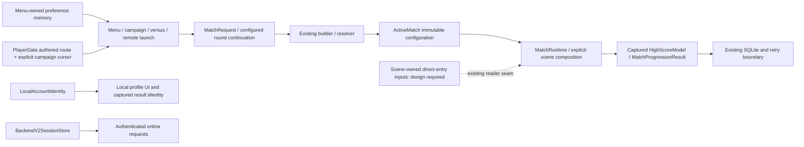
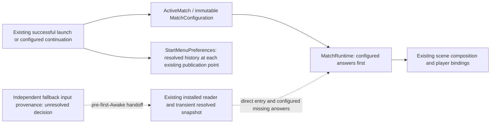

# Game Options and Match System Overhaul Plan

Status: Phases 0-9 implemented; #275 closed; #274 D2/F and #276 DESIGN-BLOCKED after current-source input audit
Continuation: user approved preserving bare Scrapyard entry; two focused real-scene reader proofs passed. Production binding/removal remains gated.
Project: Level 5
Branch target: `dev`
Primary scope: `GameOptions`, `StartManager`, `StartScreenModeSelected`, `Modes`, `GameLevelManager`, `GameRules`, mode/level compatibility, roster configuration, and gameplay scene bootstrap
Last reviewed: 2026-10-19
Audited dev: `a336a35b45236b522dd20b8e8f1af5ab32581fc8` (fresh fetch 2026-10-19, Unity `6000.5.7f1`; merged PR #312).
Issues #273–#275 are closed; #276 is open; no open PRs at preparation. Historical implementation
snapshots below are not current issue status. See the [#276 decision gate](#276-two-review-passes-and-decision-gate-2026-10-19)
and [production entry contract revalidation](game-options-inventory.md#276-production-entry-contract-revalidation-after-pr-312).

## #276 next implementation review after PR #312

**Final decision: DESIGN-BLOCKED at production selection/ownership, not at the bare answer shape.**
Fresh dev equals the #312 merge SHA above. Issue #276 remains open, no PRs are open, and no source
or behavior changed since #312. Reuse its two real-Scrapyard tests; they explicitly install fixture
readers and do not supply a production entry-intent owner. The inventory's new revalidation section
contains the confirmed ownership/lifetime matrix, data-flow diagram and all acceptance statuses.

### Initial proposal

Evaluate the previously proposed early scene-owned LevelRuntimeContext on Scrapyard, constructing
only the approved bare resolved answers through the existing MatchRuntime callback. Preserve
configured-match precedence and retain legacy fallback for every other supported case. Bind only
if an independent production selector and owner are established. No new global settings, second
MatchConfiguration, reverse menu synchronization, assembly migration or bridge deletion is in scope.

### Review pass 1 — gameplay correctness

| Finding | Refinement before any production edit |
| --- | --- |
| Null ActiveMatch also covers non-bare direct entry and unconfigured campaign. Scene identity is shared by bare and later entries. | Reject activation from configuration absence or scene opt-in alone. Require an explicit producer and pre-Awake handoff distinguishing those cases. |
| Bare selected mode/arena/primary identities are zero/empty. Catalog Scrapyard ID 1 and the spawned Doctor Blood profile differ from those answers. | Preserve the exact approved constants, no menu/catalog configuration synthesis. Effective timer remains 180 with raw timer 0 and clock None. |
| Configured missing primary fields still use independent live fallback values; slots absent from a configured roster still count legacy CPU flags. | Do not derive all fallback from configuration or the spawned registry. Preserve CPU/local ordering and Lockdown's implicit defender. |
| Live flags support combined combat/shot/marker values, countdown precedence and Laser > MachineGun > Bullet sniper precedence. | A bare constant reader must not take ownership of those inputs. Preserve fresh-per-access semantics in remaining legacy paths. |
| Unconfigured campaign changes only three arena fields, retaining previous capabilities and other inputs. | Do not rebuild from the next arena or reset to bare values. Require an explicit continuation contract before retirement. |
| Multiple readers, reloads and disabled domain reload can preserve stale configuration or legacy inputs. Missing reader currently throws explicitly. | Do not use new-session assumptions as selection. Keep existing failure/reset behavior; future ownership changes need real transition and disabled-domain-reload evidence. |

**Refined plan 1:** the narrow provider is conditional on source selection. No producer currently
establishes that selection without reading compatibility state or inventing behavior. Continue the
ownership review and stop dependent production binding if that remains true.

### Review pass 2 — architecture and scope

| Finding | Final refinement |
| --- | --- |
| Immutable MatchConfiguration remains the configured authority. StartMenuPreferences is last-launch history; PlayerSelectionSession holds menu IDs, not gameplay inputs. | Keep these owners; no reverse synchronization, new global dictionary or renamed compatibility container. |
| Manager -8000 reads before finding/creating context -100. The context serializes only MatchController; no context is authored in the 650 scanned serialized assets. | Earlier execution alone cannot supply a contract. Do not edit execution metadata or scenes until explicit input provenance exists. |
| MatchRuntime installs a callback but offers only unconditional reset, not release conditional on the installing owner. Duplicate context checks only manage the singleton. | A future scene reader must win duplicate composition before publication and relinquish only its own callback; older teardown must not clear a newer owner or discard needed fallback. No lifetime seam is implemented now. |
| Level5.Match cannot reference Assembly-CSharp. Existing callback/snapshot and architecture guards already express the permitted boundary. | Keep the interface and 41-field/three-consumer ratchets unchanged. No service locator or assembly relaxation. |
| Moving only RememberResolvedModifiers would not resolve any blocked input. Six successful-launch positions and resolved values already remain intact. | Retain publication in the bridge for this slice. When moving it, preserve each existing ActiveMatch/attempt/transition ordering and test affected launches with isolated state. |
| #312 source and assets are unchanged. Test source/meta differ locally only through CRLF checkout; normalized hashes and exact XML/log hashes match. | Reuse the recorded 2/0/0 run and exit 0; report no newly executed Unity checks. Documentation-only Level 0 is sufficient. |

**Refined plan 2 / executed scope:** update these two existing documents with the verified baseline,
entry/lifetime findings, evidence reuse and acceptance status. No production source or asset edits.
This follows the requested stop condition when Phase B cannot establish a valid source.

### Next gate and PR-ready summary

The next implementable step needs an explicit decision identifying the existing producer that
selects **clean bare entry rather than other unconfigured entry**, how it passes that intent before
GameLevelManager.Awake, and how transitions revoke it. An authored scene flag alone cannot
distinguish later unconfigured campaign entry into the same scene. Configured incomplete-primary,
absent-slot, non-bare/live and campaign input owners remain separate gates, even if bare selection
is resolved. No deletion depends solely on the bare proof passing.

Once supported, implement only that scoped provider and owner-safe lifecycle; prove actual Scrapyard
production startup, configured precedence, non-bare passthrough, duplicate ownership, scene reload
and disabled-domain-reload behavior. Run the affected named fixtures only when the change exists.
CampaignBoundaryPlayModeTests lives in `Assets/Tests/PlayMode/CampaignRoundPlayModeTests.cs`.
Move resolved publication at all six existing launch sites only as part of its supported slice;
delete bridge/fields/helpers and update observable parity/guards only after every input gate passes.

Suggested PR title: **Document #276 production entry selection and reader ownership blockers**.
Summary: revalidate merged #312 against latest dev, retain its unchanged bare-Scrapyard evidence,
and record why no independent production selector or pre-consumer scene reader can yet preserve
all supported fallback cases. Keep all 41 inputs, six bridge sites and issue #276 open. Validation:
source/serialized audit and inherited artifact integrity; no newly run Unity tests. Changed files
are this plan and the existing inventory only; no runtime behavior change.

## Implementation status

| Phase | State | Notes |
| --- | --- | --- |
| 0 - baseline and freeze | done | [`docs/game-options-inventory.md`](game-options-inventory.md); characterization matrix exported by `Level 5 > Match > Export Mode Characterization Matrix` |
| 1 - typed identity and catalogs | done | `GameModeId`, `GameModeCatalog`, `LevelDefinitionCatalog`; `Modes` unchanged and asserted equal |
| 2 - authored `GameModeDefinition` | done | ScriptableObject + `GameModeDefinitionFactory` seam + parity validator over the shipping prefab |
| 3 - capabilities and compatibility | done | `ArenaCapability`, `GameModeCompatibility`; the recursive menu cycling is gone |
| 4 - request and immutable configuration | done | `MatchRequest`, `MatchConfigurationBuilder`, `ResolvedMatchRules`, `MatchConfiguration` |
| 5 - legacy bridge | done | `LegacyGameOptionsBridge`, one-way, with parity tests |
| 6 - player roster | done | `PlayerRoster` / `PlayerSlot` / `PlayerControlType` |
| 7 - `LevelRuntimeContext` | done | plus `MatchRuntime` for scenes entered without a launch |
| 8 - decompose `GameLevelManager` | done | `PlayerRegistry`, `SpawnCoordinator`, `ArenaBootstrap`; the manager is a facade |
| 9 - refocus `GameRules` | done | `MatchController` owns the lifecycle, `MatchHudPresenter` owns presentation, `MatchEndConditions` owns the "is it over?" rules, and `GameRules` reads the configuration rather than copying it |
| 10 - remove legacy match fields | partial (#274); D2/F blocked | Current #275 inventory: 41 stored fields, no forwarding properties; 41 bridge-written fallback inputs; four non-bridge release writes in two files. Captured persistence and campaign ownership migrated; all supported fallback inputs retained |
| 11 - split remaining global state | implemented (#275), focused acceptance PASS | Direct LocalAccountIdentity consumers; six last-launch values in StartMenuPreferences; one start-flow presentation bit; unused metadata/navigation/count copies removed. MatchSession and BackendV2SessionStore unchanged |
| Bridge retirement (#276) | DESIGN-BLOCKED | Current source still needs 41 fallback inputs, four non-bridge writes, five release Apply sites plus development LoadGame, and resolved menu history publication. No independent complete pre-Awake input owner is established; retain implementation |

Three behaviour changes were made deliberately rather than preserved:

- an invalid combination refuses to launch with a stated reason instead of loading a scene (§6.3);
- a mode needing seven point markers now requires an arena with a seven point line (§6.1). Every
  authored arena currently has one, so this excludes nothing today - see the characterization
  matrix;
- **a scene with an incomplete HUD now still finishes and saves its match** (§11.3). `GameRules`
  used one flag both to switch off the score display and to gate the durable end-of-match work,
  while logging "Match results are still saved." They were not: a renamed HUD object meant the
  match never ended, no score was written and no experience was applied. Presentation moved to
  `MatchHudPresenter` and cannot gate any of that.

One oddity was preserved rather than fixed, and is marked in the code: the basketball goal is hidden
for a battle royal only in a scene entered without a launch, because the old condition also required
that no mode had been selected.

Two of the plan's proposed rule dimensions had to be flag sets rather than single values, because
the parity validator found the shipping data using them that way and gameplay reading each flag
separately:

- `ShotRule` - the authored all point contest is also marked a three point and a four point contest;
- `CombatMode` - the authored Cage Match is also marked a battle royal, which is why a cage match
  needs a battle-royal arena today.

A single value would have dropped those flags silently. Sections 5.2 and 4.2 assumed exclusivity
that the data does not have.

## Executive Summary

The configured match migration is already implemented: `MatchRequest → MatchConfigurationBuilder → MatchConfiguration → ActiveMatch → MatchRuntime` supplies validated immutable rules, roster and arena data. LegacyGameOptionsBridge is a one-way compatibility copy. Gameplay systems have moved to resolved configuration or explicit composition; this work does not restart phases 0–9.

The [current inventory](game-options-inventory.md) verifies 41 stored fallback fields, no identity forwarders, four non-bridge release writes and 41 bridge assignments. #275 removes eight non-match fields and two properties from dev 99c3024b7. All 41 bridge-written fields still feed the live fallback, including configured missing-character and out-of-roster cases. Six safe fields retired in #274; captured persistence and campaign route/cursor now use existing explicit owners.

LocalAccountIdentity already owns local profile identity, BackendV2SessionStore owns authenticated online identity, and MatchSession owns result identity. No new generic state manager, account system, persistence schema or navigation framework is needed. The interpolation-aware guard now permits only LegacyGameOptionsBridge, ProgressionManager and EndRoundMenuManager. LoadManager reads LocalAccountIdentity directly. Retired fields and identity properties cannot return.

Issue #273 supplied the documentation-only baseline. Phase 10/#274 implements the independent slices below; phase 11/#275 retains its own responsibility boundaries. #276 remains blocked until all production consumers, direct-scene needs and bridge-dependent launch paths are resolved. Existing numeric IDs, authored route/GUIDs, save contracts, scoring behavior and input ownership remain unchanged.

## 1. Current Retirement Constraints

### 1.1 Ownership is already split, compatibility storage is not

MatchConfiguration owns match facts; GameOptions still mirrors fallback inputs. Persistence uses captured models and explicit result identities. userName/userid forwarding properties have been removed; consumers read LocalAccountIdentity directly. LevelSelected and mode components remain authored compatibility inputs. Existing EndRoundData owns campaign position; StartMenuPreferences retains six process-lifetime menu preferences. Neither belongs in immutable configuration.

### 1.2 Fallback is a supported consumer

GameOptions.CaptureMatchRuntimeSnapshot supplies 41 fields through the existing MatchRuntime reader seam. It reconstructs live rules/roster on demand for direct scene entry and supplies primary-character/out-of-roster edge answers even when configured. Removing every normally unread flag would break this boundary. Fallback is read-only with respect to ActiveMatch, not dead code.

### 1.3 Persistence needs captured values

DBHelper.InsertGameScore now binds the captured HighScoreModel.numPlayers. Unused implicit-character progression overloads are removed, and a null result returns an unapplied diagnostic before identity lookup or pending repair. Existing explicit-ID/idempotent progression boundaries remain. Querying a newer ActiveMatch during delayed persistence would regress this ownership repair.

### 1.4 Campaign and menu positions are different identities

PlayerData.LevelsList is the authored route. EndRoundData.currentLevelIndex is now its active/completed route position; nextLevelIndex remains the proposed outcome handoff. GameLevelManager, GameRules and EndRoundMenuManager use these existing owners, while StartMenuPreferences retains only the last-launch menu level index. CampaignRoundDecision remains pure policy. Fresh launch resets cursor zero and resolves the authored first arena by stable ID; hidden Boneyard/Dev continuation remains permitted. #275 retires the legacy menu indices independently of the campaign cursor.

### 1.5 Residual values do not justify speculative services

#275 removed the write-only previousSceneName, applicationVersion, operatingSystemVersion and numOfLocalUsers fields. #274 removed producer-less levelSelectedName and its dormant analytics branch without emitting replacement events. StartFlowPresentation now owns tip eligibility; StartMenuPreferences owns last-launch history. Both reset at SubsystemRegistration and retain state across ordinary scene loads.

### 1.6 Historical design versus current work

Sections 2–13 retain the implemented architecture's design rationale; phases 0–9 below describe completed migration steps, not new work. Section 15 retains the original three design reviews; the two fresh #273 review passes are recorded in the inventory. Sections 16–18 retain historical target/file/issue proposals and must not be used to create duplicate existing types or services. Phase 10/11 and section 22 define current next work.

---

## 2. Goals

The overhaul must produce a system where one authoritative object describes the selected match, invalid combinations are rejected before scene load, gameplay systems depend on typed concepts rather than global booleans, and new modes can be added without modifying a long chain of unrelated managers.

Specific goals:

1. Give each category of state one owner.
2. Preserve current gameplay behavior during migration.
3. Preserve existing numeric mode IDs and any persistence/backend contracts that depend on them.
4. Make authored mode and level data inspectable and editable in Unity without duplicating runtime state.
5. Make match configuration immutable after validation.
6. Make level/mode compatibility testable without loading UI scenes.
7. Model participants in a way that supports local human, CPU, remote human, replay/ghost, and asynchronous challenge use cases.
8. Reduce direct reads of `GameOptions` and broad manager singletons in new code.
9. Separate match lifecycle from specialized game rules.
10. Permit one mode to compose legitimate independent rule dimensions without boolean identity explosions.
11. Create migration checkpoints where the project remains playable and reversible.
12. Add architecture validation so new global mode flags do not creep back into the system.

---

## 3. Non-Goals

This plan does not authorize a full rewrite of gameplay. It does not redesign scoring behavior, player physics, AI, combat feel, persistence semantics, UI appearance, scene layout, or backend contracts unless required to preserve compatibility with the new configuration boundary.

It also does not require a third-party dependency-injection framework, an ECS conversion, addressables migration, scene-system rewrite, or a general event-bus architecture.

The plan should remain understandable with ordinary C# classes, Unity MonoBehaviours, ScriptableObjects, explicit serialized references, and small interfaces only where a real system boundary benefits from one.

---

## 4. Architecture Principles for This Overhaul

### 4.1 Authored data, user selection, resolved configuration, and runtime state are different things

They must not share one mutable object.

Authored data is what designers define in Unity. User selection is what a menu or service requests. Resolved configuration is the validated immutable match specification. Runtime state is what changes while the match is being played.

### 4.2 Identity should use a single typed value

Mutually exclusive identity should not be represented as several booleans.

Examples:

- one `GameModeId` identifies the mode;
- `CombatMode` is a flag set: authored Cage and BattleRoyal can coexist;
- one `MatchClockMode` identifies the clock behavior;
- one `MatchObjective` identifies the primary completion objective.

### 4.3 Independent capabilities may use flags

Flags are appropriate when several capabilities may legitimately coexist, such as an arena supporting basketball, combat, multiplayer, a seven-point line, and weather.

### 4.4 A resolved match is immutable

Once the menu/configuration service validates a match and begins a scene transition, gameplay systems may read configuration but may not mutate it.

Runtime changes belong in runtime state objects.

### 4.5 The scene has an explicit composition root

A `LevelRuntimeContext` owns or references the scene-level services needed for gameplay and makes scene requirements explicit.

### 4.6 Migration is one-way

During transition, new configuration may populate legacy `GameOptions` fields for old consumers. Old consumers must not write back and become authoritative again.

### 4.7 Tests precede destructive migration

Each current mode needs characterization coverage sufficient to prove its existing configuration before old flags are removed.

---

## 5. Target Domain Model

### 5.1 `GameModeId`

Replace raw mode integers at new API boundaries with a typed enum while preserving the existing numeric values exactly.

Example:

```csharp
public enum GameModeId
{
    TotalPoints = 1,
    Total3Pointers = 2,
    Total4Pointers = 3,
    Total7Pointers = 4,
    TotalDistance = 6,
    SpotUp3s = 7,
    SpotUp4s = 8,
    SpotUpAll = 9,
    ConsecutiveShots = 14,
    InThePocket = 15,
    ThreePointContest = 16,
    FourPointContest = 17,
    AllPointContest = 18,
    PointsByDistance = 19,
    BashUpSomeNerds = 20,
    BattleRoyal = 21,
    CageMatch = 22,
    VersusCpu = 23,
    SevenPointContest = 24,
    SpotUp7s = 25,
    BeatThaComputahs = 26,
    Lockdown = 27,
    Arcade = 98,
    FreePlay = 99
}
```

A compatibility layer may temporarily preserve `Modes` constants so callers can migrate gradually.

### 5.2 Rule dimensions

Do not create a giant enum containing every possible combination. Instead model the small number of dimensions that are actually mutually exclusive.

Proposed initial dimensions:

```csharp
public enum MatchObjective
{
    Score,
    MakeCount,
    Distance,
    ConsecutiveShots,
    ContestCompletion,
    Survival,
    LastPlayerStanding,
    CampaignProgression
}

public enum MatchClockMode
{
    None,
    Countdown,
    CountUp
}

public enum CombatMode
{
    None,
    Standard,
    Cage,
    BattleRoyal
}

public enum ShotRule
{
    Any,
    ThreePointOnly,
    FourPointOnly,
    SevenPointOnly,
    AllContestRanges
}
```

Only introduce a new dimension when existing behavior proves it is necessary. Do not pre-model hypothetical features.

### 5.3 `GameModeDefinition`

Create a ScriptableObject as the authored source of truth for a mode.

Recommended responsibilities:

- stable `GameModeId`;
- display name and description;
- primary objective;
- clock definition;
- scoring definition/reference;
- combat rule family;
- shot rule;
- basketball requirement;
- survival requirement where not already implied by objective;
- CPU-shooter policy;
- roster constraints;
- arena capability requirements;
- optional mode-specific tuning references.

The definition should describe rules, not hold runtime score/time/player state.

### 5.4 `LevelDefinition`

Converge current level metadata toward a ScriptableObject-backed definition rather than parallel level data models.

Recommended contents:

- stable level ID;
- scene identifier;
- display name and description;
- arena capabilities;
- time-of-day support/requirement;
- weather support/requirement;
- spawn profile/reference;
- optional mode-specific arena metadata;
- seven-point-line capability rather than a free-floating boolean in global state.

Do not migrate unrelated visual/environment tuning in the first slice.

### 5.5 `ArenaCapability`

Use flags for legitimate combinable capabilities.

Example:

```csharp
[Flags]
public enum ArenaCapability
{
    None = 0,
    Basketball = 1 << 0,
    Combat = 1 << 1,
    Cage = 1 << 2,
    BattleRoyal = 1 << 3,
    ThreePointLine = 1 << 4,
    FourPointLine = 1 << 5,
    SevenPointLine = 1 << 6,
    Multiplayer = 1 << 7
}
```

The exact capability list should be derived from real existing scenes during implementation, not guessed beyond current needs.

### 5.6 `PlayerRoster`

Replace the combination of `numPlayers`, `numCpuPlayers`, `player1IsCpu` through `player4IsCpu`, parallel selected-character arrays, and inferred input slots with an explicit roster.

Proposed model:

```csharp
public enum PlayerControlType
{
    LocalHuman,
    Cpu,
    RemoteHuman,
    ReplayGhost
}

public sealed class PlayerSlot
{
    public int SlotId { get; }
    public PlayerControlType ControlType { get; }
    public int? LocalInputSlot { get; }
    public CharacterSelection Character { get; }
    public string ParticipantId { get; }
}

public sealed class PlayerRoster
{
    public IReadOnlyList<PlayerSlot> Players { get; }
}
```

`ParticipantId` must not automatically be assumed to equal a save-data account ID. Online/asynchronous identity should remain a separate boundary.

This model is deliberately capable of future local-versus and asynchronous challenge participants without requiring those networking systems to be implemented now.

### 5.7 `MatchModifiers`

Represent legitimate player-selected orthogonal options in one narrow object, for example:

- difficulty;
- traffic;
- optional enemies where the mode permits it;
- obstacle toggle;
- sniper variant;
- hardcore modifier.

The builder/validator determines whether a modifier is legal for a mode/level. Gameplay does not infer legality by silently correcting configuration.

### 5.8 `MatchRequest`

The start menu should create a request, not mutate runtime globals.

Example concept:

```csharp
public sealed class MatchRequest
{
    public GameModeId ModeId { get; init; }
    public int LevelId { get; init; }
    public PlayerRoster Roster { get; init; }
    public MatchModifiers Modifiers { get; init; }
    public CheerleaderSelection Cheerleader { get; init; }
}
```

### 5.9 `MatchConfiguration`

`MatchConfigurationBuilder` resolves a valid request against authored catalogs and produces the immutable authoritative configuration.

Example concept:

```csharp
public sealed class MatchConfiguration
{
    public GameModeDefinition Mode { get; }
    public LevelDefinition Level { get; }
    public PlayerRoster Roster { get; }
    public MatchModifiers Modifiers { get; }
    public ResolvedMatchRules Rules { get; }
}
```

All constructor inputs should be validated. Runtime code gets references/read-only properties, not public setters.

### 5.10 `ResolvedMatchRules`

Some authored rules may need resolution based on level, difficulty, roster, or modifiers. That resolved result belongs in a compact immutable object.

Possible contents:

- final clock duration/mode;
- final objective;
- final combat mode;
- final shot rule;
- basketball count/policy;
- marker requirements;
- survival requirement;
- CPU shooter policy;
- scoring strategy/reference.

Do not expose dozens of legacy booleans simply to mirror `GameOptions`. Prefer semantic types and derived read-only helper properties when necessary.

---

## 6. Compatibility and Validation System

### 6.1 `GameModeCompatibility`

Create one pure/testable service responsible for determining whether a mode, level, roster, and modifier combination is valid.

Suggested API shape:

```csharp
public ValidationResult Validate(MatchRequest request);
public bool CanPlay(GameModeDefinition mode, LevelDefinition level);
```

A validation result should identify specific reasons such as:

- arena lacks required basketball capability;
- Battle Royal arena support missing;
- Cage capability missing;
- seven-point line missing;
- roster size outside mode bounds;
- CPU participants forbidden;
- local multiplayer unsupported by arena/mode;
- modifier not permitted.

### 6.2 Menu behavior after compatibility extraction

The UI may ask the compatibility service for valid levels/modes and skip or disable invalid choices, but the UI must not own the rules.

Preferred behavior is to construct a filtered list or disable unavailable entries rather than recursive self-calls such as `changeSelectedLevelUp()` calling itself repeatedly.

### 6.3 Validation must run again at match launch

UI filtering is convenience, not authority. `MatchConfigurationBuilder` must validate again before scene load so non-menu launch paths, tests, campaign flows, deep links, future online invites, and asynchronous challenge launches cannot bypass compatibility.

---

## 7. Runtime Architecture

### 7.1 `LevelRuntimeContext`

Create a scene-owned MonoBehaviour that acts as the explicit gameplay composition root.

Initial responsibilities should be small:

- expose the immutable `MatchConfiguration`;
- expose player registry;
- expose basketball registry if present;
- expose `MatchController`;
- expose spawn coordinator/bootstrap services;
- validate required scene references early.

Do not turn it into another manager containing gameplay logic.

### 7.2 `PlayerRegistry`

Own runtime participant/actor lookup and replace broad dependence on `GameLevelManager.Player1`, `Player2`, etc. over time.

Recommended API concepts:

- read-only collection of participant runtimes;
- lookup by slot ID;
- lookup of primary local human when a legacy flow specifically requires it;
- no direct mutation of underlying list by arbitrary callers.

### 7.3 `SpawnCoordinator`

Extract player, CPU player, basketball, and optional companion spawning from `GameLevelManager` incrementally.

The coordinator consumes `MatchConfiguration` and explicit spawn references. It should not inspect mutable global flags.

Subcomponents may emerge only where useful, e.g. `PlayerSpawner` and `BasketballSpawner`. Do not prematurely create many tiny classes before tests prove the boundary.

### 7.4 `ArenaBootstrap`

Own level-specific setup such as enabling/disabling basketball goal elements or combat-specific arena objects based on resolved configuration.

This replaces scattered scene-start checks and prevents general managers from silently mutating match rules.

### 7.5 `MatchController`

Focus `GameRules` toward an explicit lifecycle owner.

Proposed state machine:

```text
Preparing -> Countdown -> Playing -> Ending -> Completed
```

`MatchController` owns:

- current match phase;
- accepting a match-end request;
- enforcing idempotent transition to Ending/Completed;
- coordinating durable match-end work through explicit services;
- publishing lifecycle events.

It should not itself contain every scoring rule, marker implementation, or UI formatting function.

### 7.6 Win-condition policies

Extract mode-specific completion behavior behind small policies only after characterization tests exist.

Likely real policies include:

- time expiration;
- marker/contest completion;
- survival/death;
- last-player-standing;
- campaign round completion.

They all request match termination through one method such as:

```csharp
matchController.RequestEnd(new MatchEndReason(...));
```

Existing `GameRules.RequestGameOver()` is a useful compatibility seam and should be retained as a wrapper during migration.

### 7.7 Match clock

`GameRules` should remain the owner of legacy timer behavior until tests pin it. Then move clock semantics to a small `MatchClock`/`MatchClockController` that consumes resolved clock configuration.

Do not let `Timer` and `GameRules` become competing authorities again.

### 7.8 Scoring

Do not redesign the basketball scoring pipeline as part of the initial overhaul. Instead expose the resolved mode/rules to current scoring systems through the new configuration boundary.

A later slice may use a shared scoring policy/result event, aligned with the existing basketball architecture plan, but that should remain separately testable.

---

## 8. `GameOptions` Replacement Strategy

`GameOptions` should not be deleted first. It should be reduced category by category.

### 8.1 One-way `LegacyGameOptionsBridge`

During migration, after a `MatchConfiguration` is successfully built, a bridge writes the required values into legacy `GameOptions` fields exactly once for old consumers.

Flow:

```text
StartManager / launch source
        |
        v
    MatchRequest
        |
        v
MatchConfigurationBuilder
        |
        v
immutable MatchConfiguration  <-- authoritative
        |
        +--> MatchSession / scene bootstrap
        |
        +--> LegacyGameOptionsBridge --> old consumers
```

The bridge is temporary and should be clearly marked obsolete/deprecated.

### 8.2 Add a rule against reverse synchronization

Legacy runtime systems may not update the new configuration from `GameOptions`.

If an old system needs changing runtime state, that state must move to a runtime owner instead.

### 8.3 Residual ownership (after independent #274 slices)

| Responsibility | Existing owner / remaining boundary |
| --- | --- |
| Configured rules/roster/arena | MatchConfiguration through ActiveMatch and explicit scene composition |
| Direct scene entry / configured fallback edges | MatchRuntime reader seam; GameOptions still supplies inputs. Independent scene-owned inputs required before deletion |
| Live menu selection | StartMenuSelectionState (live); StartMenuPreferences (three indices and three resolved modifier preferences), independent of campaign cursor |
| Local profile identity | LocalAccountIdentity directly; GameOptions forwarding properties removed |
| Online authentication | BackendV2SessionStore; no GameOptions bearer token remains |
| Application metadata | Direct Application/SystemInfo APIs; unused GameOptions copies removed |
| Navigation | Existing scene loading and specialized LocalVersusNavigationState where used; unused previousSceneName copy removed |
| Match result ID | MatchSession; old GameOptions.matchResultId already removed |
| Campaign | PlayerData authored route; existing EndRoundData active/completed cursor, proposed next position, outcomes and continues; no GameOptions route/cursor dependency |
| Startup presentation | StartFlowPresentation; same tip/CPU-select lifecycle and successful ordinary launch reset |

See phase 10/11 for exact files and exits. These are dependency retirements, not a general account, navigation or earned-progression rewrite.

---

## 9. `StartManager` Overhaul

### 9.1 Keep it as a UI controller initially

Do not rewrite the entire menu while changing the domain model.

First separate the concerns:

- `StartManager` manages interaction and presentation;
- a selection model stores current selections;
- compatibility service answers allowed combinations;
- builder creates the final match configuration;
- navigation service/scene loader loads the target scene.

### 9.2 Replace immediate writes to `GameOptions`

Methods such as player/mode/level display initialization should not have side effects that mutate gameplay configuration simply because an item is highlighted or rendered.

The menu should mutate only its local selection model until Start is chosen.

### 9.3 Replace recursive compatibility cycling

Build valid candidate lists or use a bounded loop over the mode/level collection. Never recursively call selection methods to find a compatible entry.

### 9.4 Launch path

At `loadGame()`:

1. gather current menu selection into `MatchRequest`;
2. validate/build configuration;
3. display a clear launch error if invalid;
4. begin a new match/session ID;
5. make configuration available to scene bootstrap;
6. populate legacy bridge values;
7. load scene.

Scene selection special cases such as the campaign scrapyard should move to a launch policy or mode definition only when safely characterized.

---

## 10. `GameLevelManager` Overhaul

### 10.1 Freeze feature additions to the manager

No new unrelated responsibilities should be added while the extraction is underway.

### 10.2 Preserve it temporarily as a facade

Existing callers can continue using `GameLevelManager.instance` while internal responsibility moves into focused collaborators.

Example:

```csharp
public PlayerIdentifier Player1 => playerRegistry.GetBySlot(0)?.Identifier;
```

This allows old code to remain stable while ownership changes underneath.

### 10.3 Extraction order

Recommended order because it minimizes behavioral risk:

1. runtime player registry/list ownership;
2. spawn-point reference validation;
3. player spawning;
4. basketball spawning;
5. cheerleader spawning;
6. arena bootstrap/mode setup;
7. NPC/vehicle duplicate-character disabling;
8. analytics calls;
9. remaining input/UI conveniences.

Each extraction should leave compatibility forwarding methods/properties where current callers need them.

### 10.4 Remove configuration mutation

Any code that currently changes `GameOptions` based on scene/mode state must become either:

- configuration validation/resolution before launch; or
- runtime state in a dedicated owner.

`GameLevelManager` must not repair invalid match definitions by mutating global configuration.

---

## 11. `GameRules` Overhaul

### 11.1 Preserve current end-match hardening

The existing idempotent `RequestGameOver()`/`HandleMatchEnded()` work should be treated as a migration asset, not discarded.

### 11.2 Replace flag copying with configuration reference

Instead of copying a dozen `GameOptions` flags in `Start()`, inject or resolve the current `MatchConfiguration` and derive the few required properties from `ResolvedMatchRules`.

### 11.3 Extract presentation from lifecycle

Current HUD formatting and required scene-name lookups should migrate to a `MatchHudPresenter` or equivalent after lifecycle behavior is characterized.

Gameplay ending should not depend on all HUD objects existing.

### 11.4 Extract durable result processing

Persistence/progression/campaign work should eventually be coordinated by a match result service invoked once from match completion. The controller provides the result; services decide how to persist/apply it.

Do not redesign persistence semantics in the first migration phase.

### 11.5 Consolidate mode dispatch after rule definitions exist

The existing duplicated score display/end-display mode dispatch should be replaced only after mode characterization coverage exists. Avoid combining this with the first configuration migration because it changes too many behavior surfaces at once.

---

## 12. Serialization and Unity Asset Safety

This overhaul touches serialized data and must respect Unity's asset model.

### 12.1 Do not delete serialized fields immediately

When `StartScreenModeSelected` begins using `GameModeDefinition`, keep old serialized fields long enough to migrate and validate existing scene/prefab data.

Possible migration paths:

- editor migration utility that creates ScriptableObjects from existing components;
- temporary adapter that reads legacy serialized fields and compares against the new definition;
- validation test that reports any mismatch.

### 12.2 Stable asset identity

`GameModeDefinition` and `LevelDefinition` assets must use stable IDs independent of asset file names. Existing numeric IDs remain canonical for persistence/backend interoperability.

### 12.3 Scene references

When extracting `GameLevelManager` scene searches, prefer serialized references or a single scene bootstrap object. Keep validation errors descriptive so missing legacy object names do not become silent null behavior.

### 12.4 ScriptableObjects are definitions, not runtime state

Never write match score, time, selected player, current winner, or mutable session values into ScriptableObject assets at runtime.

---

## 13. Testing Strategy

The overhaul needs a behavior safety net before destructive cleanup.

### 13.1 Mode characterization matrix

For every current `GameModeId`, record and test at least:

- objective;
- clock mode and duration;
- counter/countdown semantics;
- basketball requirement;
- shot marker requirements;
- allowed shot ranges;
- money-ball requirement;
- consecutive-shot behavior;
- contest variant;
- CPU-shooter behavior;
- enemy/combat mode;
- player survival requirement;
- roster constraints;
- permitted arena capabilities;
- score persistence behavior where mode-specific.

The initial characterization should describe current behavior, including weird behavior, rather than silently fixing it.

### 13.2 Configuration builder tests

Cover:

- valid mode/level pair;
- missing required arena capability;
- invalid roster size;
- forbidden CPU/player type;
- incompatible modifier;
- stable numeric mode ID mapping;
- resolved timer defaults/custom timers;
- null/missing catalog entries;
- deterministic errors.

### 13.3 Legacy bridge parity tests

For every mode, compare the new resolved configuration against the values the existing menu would previously write into `GameOptions`.

The bridge should reproduce legacy values until each consumer migrates.

### 13.4 Scene bootstrap tests

Add edit-mode validation and targeted play-mode smoke tests for:

- required scene context references;
- spawn locations required by roster;
- basketball/non-basketball scenes;
- Cage/Battle Royal arena setup;
- one-, two-, three-, and four-slot rosters;
- human/CPU mixtures.

### 13.5 Match lifecycle tests

Pin:

- only one transition to ending;
- repeated end requests are harmless;
- timer/marker/death triggers converge on the same end API;
- persistence/progression result work is not duplicated;
- missing HUD does not prevent durable match completion.

### 13.6 Architecture guard tests

These guards already exist; preserve them as consumers retire (see the current inventory for limitations):

- prevent new public mutable static match fields;
- prevent new `GameOptions.*` usages outside approved legacy/bridge files;
- prevent new mode identity booleans such as `isXMode` when `GameModeId`/rule dimensions already represent the concept;
- ensure each mode definition has a unique ID;
- ensure every level definition has a unique ID;
- ensure compatibility requirements reference known capabilities.

---

## 14. Migration Phases

### Phase 0 — Baseline and Freeze

Goal: make the current system measurable before changing ownership.

Work:

- inventory every `GameOptions` field by category and consumer count;
- inventory mode/level serialized fields;
- generate current mode characterization table;
- identify backend/database use of numeric mode IDs;
- identify scene/prefab references to `StartScreenModeSelected`;
- add a policy: no new game-mode identity booleans in `GameOptions`;
- document approved migration boundaries.

Exit criteria:

- all current modes mapped;
- all current global fields categorized;
- numeric IDs confirmed stable;
- enough tests exist to compare old/new configuration.

### Phase 1 — Typed Identity and Catalogs

Goal: introduce new domain vocabulary without changing behavior.

Work:

- add `GameModeId` enum with exact existing values;
- preserve `Modes` as compatibility constants/wrappers;
- create `GameModeCatalog` abstraction;
- create `LevelCatalog` abstraction if the existing one cannot serve the needed boundary cleanly;
- add unit tests for mappings and uniqueness.

Exit criteria:

- new code no longer requires raw integer mode values;
- old code still compiles unchanged.

### Phase 2 — Authored `GameModeDefinition`

Goal: establish one authored source of truth for mode rules.

Work:

- define minimal rule dimensions based only on current modes;
- create ScriptableObject definitions;
- migrate existing mode data into assets;
- build a parity validator comparing legacy `StartScreenModeSelected` values to new assets;
- keep legacy component fields intact.

Exit criteria:

- every current mode has a definition;
- parity validator reports no unexplained differences;
- menu still uses legacy path if necessary.

### Phase 3 — Level Capabilities and Compatibility Service

Goal: remove domain compatibility logic from menu recursion.

Work:

- define arena capabilities based on actual existing level flags;
- create/extend `LevelDefinition`;
- implement `GameModeCompatibility`;
- add compatibility tests;
- change menu selection to ask compatibility service;
- add final validation at launch.

Exit criteria:

- `StartManager` no longer contains Battle Royal/Cage/shooting/fighting compatibility condition chains;
- invalid match combinations cannot launch.

### Phase 4 — `MatchRequest` and Immutable `MatchConfiguration`

Goal: create the new authoritative configuration boundary.

Work:

- create `MatchRequest`;
- create `MatchConfigurationBuilder`;
- create `ResolvedMatchRules`;
- create immutable `MatchConfiguration`;
- update launch flow to build configuration;
- store the active configuration in a match/session bootstrap owner;
- write parity tests.

Exit criteria:

- every menu-launched match produces exactly one validated configuration;
- runtime cannot mutate configuration.

### Phase 5 — Legacy Bridge

Goal: keep all old consumers operational while changing the authority.

Work:

- implement `LegacyGameOptionsBridge`;
- populate old match-related fields from `MatchConfiguration` exactly once;
- add diagnostic comparison in development/editor builds;
- mark direct legacy match fields obsolete where safe;
- stop `StartManager` from individually assigning legacy mode booleans.

Exit criteria:

- new configuration is authoritative;
- current scenes play through legacy consumers with parity;
- no reverse synchronization exists.

### Phase 6 — Player Roster Model

Goal: replace slot booleans and prepare for robust versus architecture.

Work:

- create `PlayerRoster`/`PlayerSlot`/`PlayerControlType`;
- migrate menu CPU selection into roster construction;
- derive legacy `numPlayers`/CPU flags in the bridge;
- migrate spawn logic to consume roster;
- preserve current local input mapping behavior;
- add 1-4 player combination tests.

Exit criteria:

- new runtime code never asks `player2IsCpu` etc.;
- roster can represent local human and CPU combinations explicitly;
- model can later represent remote/asynchronous participants without changing the existing local semantics.

### Phase 7 — `LevelRuntimeContext`

Goal: make gameplay scene dependencies explicit.

Work:

- create context component;
- attach/validate configuration at scene bootstrap;
- create runtime player registry;
- expose only necessary services;
- begin migrating new code away from static global access.

Exit criteria:

- new scene-owned systems receive configuration/runtime references through context or serialized dependencies;
- no new broad singleton dependencies are added.

### Phase 8 — Decompose `GameLevelManager`

Goal: reduce manager responsibility without breaking callers.

Work in vertical slices:

- extract registry;
- extract spawn-point validation;
- extract player spawn;
- extract basketball spawn;
- extract arena setup;
- migrate character/NPC/vehicle replacement behavior;
- retain facade properties/methods until callers move.

Exit criteria:

- `GameLevelManager` is a facade or can be retired;
- it does not own domain configuration;
- it does not mutate match configuration.

### Phase 9 — Refocus `GameRules` into `MatchController`

Goal: separate lifecycle from rule-specific and presentation responsibilities.

Work:

- consume `MatchConfiguration` directly;
- preserve existing `RequestGameOver` compatibility seam;
- introduce explicit match phases;
- extract clock controller when covered;
- extract win-condition policies one at a time;
- extract HUD presentation;
- route durable result work through a match-result boundary.

Exit criteria:

- match lifecycle has one owner;
- individual game modes plug in through resolved rules/policies rather than large flag chains;
- UI failure does not block game completion.

### Phase 10 — Remaining match-state retirement (#274)

#### 2026-10-14 implementation review (before source changes)

Baseline: `origin/dev 8a93cb2a7d3b979c759196f0430d3aa4895b23a8`, Unity `6000.5.7f1`.
Fetched #273 (closed, PR #309 merged), #274/#275/#276 (open); no open PR overlap.
Source confirms 55 stored fields, two identity forwarding properties and 45 bridge assignments;
41 assignments remain inputs to the installed fallback reader. Use the current inventory's
release-expression accounting (68 expressions, not 63 expressions).

**Review pass 1: gameplay and data integrity.** Deleting bridge writes just because configured
gameplay ignores them would break live direct-scene rules, combined shot/combat flags, timer-zero,
CPU/input ordering, Lockdown's out-of-roster defender and incomplete configured characters. Keep
all 41 fallback inputs. A's four candidates have only writes, declarations and test snapshots;
asset/reflection searches reveal no consumer. B must bind SQLite `@numPlayers` to the captured
score model, including retry after a later launch. C's one-argument progression overloads have
no consumers; null results must fail without attributing XP to the current selection, applying
anything, or repairing unrelated pending results. D1 needs separate startup preference and
bound-match filters; use the existing menu preference boundary at startup, resolved configuration
at launch, and the manager's captured rules on pause refresh. D2's object-name write still
supplies configured-incomplete fallback and cannot yet retire. D3 has no arena-name producer;
remove the dormant branch without emitting replacement events. E must migrate route and cursor
together: use the serialized PlayerData route and existing EndRoundData.currentLevelIndex for
the active/completed round. Keep nextLevelIndex as the outcome handoff; do not convert level IDs
to route positions. Preserve retry/continue decisions, hidden destinations, adapter null/index
semantics and the menu preference's last-launch behavior on return.

**Review pass 2: architecture and scope.** No new service, static state bag, route collection,
asmdef edge or persistence schema is needed for A-E. MatchConfiguration and MatchRuntime remain
authoritative and the bridge stays one-way. PlayerSelectionSession remains the menu character
owner, with D2's explicitly retained compatibility publication. Reuse EndRoundData's existing
cursor instead of adding a new global, and remove its unused route copy alongside GameOptions'
copy. Campaign launch selects the authored route's first arena through its stable ID in the
ordinary catalog; cursor zero is a route position, independent of that catalog's menu index.
Keep #275 preference storage until its own migration; expose only the existing hardcore
preference read at StartMenuSelectionState, with no second stored value. Tighten architecture
guards to count declarations (excluding methods/properties), prohibit retired members, and
remove migrated consumers; account for the pre-existing missing LoadManager allowlist entry.
F1 remains blocked: ArenaBootstrap consumes resolved rules, LevelRuntimeContext consumes
MatchRuntime, and neither authors independent rules/roster/identity inputs before early Awake.
Catalogs and PlayerSelectionSession cannot reconstruct arbitrary live direct-scene flags or
configured-incomplete character fallback. Keep the installed reader/reset lifecycle unchanged;
F2 and bridge deletion (#276) depend on a separately established scene-input contract.

Implementation order: A (dead compatibility), B/C (captured persistence identities), D1/D3
(explicit records and dormant telemetry), E1/E2 (one campaign responsibility change), then
document D2/F blockers. Use separate reviewable commits. Validate compilation and focused
bridge/fallback/architecture, SQLite/progression/record tests; validate E through the existing
authored CampaignBoundaryPlayModeTests with isolated persistence. Do not claim issue completion
while D2/F still require GameOptions.

Current acceptance and validation are in the [updated inventory](game-options-inventory.md#per-responsibility-audit-and-acceptance). A/B/C/D1/D3/E are implemented; D2/F1/F2 remain blocked. The following sequence retains the pre-implementation source locations from #273 for traceability; use the current inventory for live locations. Each row is a separate responsibility, not permission to delete all fields together. Re-scan before further retirement and retain bridge writes until normal, fallback and edge readers are gone.

| Slice | Concrete source boundary and solution | Exit / focused evidence when implemented |
| --- | --- | --- |
| A — write-only compatibility values | GameOptions, LegacyGameOptionsBridge, StartManager:309, EndRoundMenuManager:321: retire gameModeHasBeenSelected, levelSelected, numCpuPlayers and sniperEnabled after fresh reflection/asset/caller check. Remove stale CharacterProfile comment. Retain CPU flags and sniper variants. Treat ConfigureSingleHumanRoster separately if removing its test-only compatibility surface | Zero reads confirmed for each deleted field, paired assignment/test snapshot cleanup, ratchet lowered; smallest affected Level5MatchBridgeParityTests / Level5CoreTests and architecture guards |
| B — captured score participant count | DBHelper.InsertGameScore:410 consumes HighScoreModel.numPlayers, already captured by both factories at 163/328; no SQLite column or serialization change | Queue/capture model with one roster, change globals/current match before insert, verify persisted numPlayers still matches model; focused SQLite record test and compile |
| C — explicit progression character | DBConnector:517–524 and DBHelper:480–485 already offer explicit characterId. Audit/remove unused one-argument adapters or pass explicit IDs from actual callers. ProgressionService:30 null-result diagnostic must have a defined no-result ID behavior, without silently choosing a newer active match | No GameOptions.characterId read outside fallback; focused ProgressionServiceApplyMatchResultTests plus null-result/adapter case; preserve account scope, result idempotency, XP and SQL schema |
| D1 — explicit record-query filter | PlayerData.loadStatsFromDatabase:123 takes an explicit hardcore filter; startup/menu callers use the existing preference meaning, configured launch passes configuration.Rules.Hardcore, and GameLevelManager.ReloadPlayerDataForPause:556 passes the appropriate bound match filter without changing Pause callback ownership | Startup without ActiveMatch, launched and pause-refreshed hardcore/non-hardcore queries preserved; focused Level5RangeShotRecordTests; preference handoff coordinated with #275 B |
| D2 — progression selection publication | ProgressionManager:969 currently writes characterObjectName for highlighted selection. Reuse existing PlayerSelectionSession stable ID and the screen's selected CharacterProfile; remove unused compatibility publication only after fallback edge review | Menu character selection remains independent of old active roster; smallest player-selection/session composition test; no new global character owner |
| D3 — dormant arena telemetry | GameLevelManager:635,637 reads levelSelectedName, which has no producer. Smallest behavior-preserving slice removes dormant branch/field after fresh scan. Adding a SceneName/ObjectName/DisplayName producer needs a separate explicit telemetry decision | No accidental new analytics event or renamed event payload; source guard/compile, focused event assertion only if telemetry behavior is approved |
| E1 — authored route handoff | Keep PlayerData.LevelsList as the serialized route owner; replace GameOptions route reads in GameLevelManager campaign-prefab adapter, GameRules outcome handoff and EndRoundMenuManager with explicit route references at their existing composition boundaries; replace StartManager/LoadGame copies only after all readers move | Same route order, CPU prefabs, null/invalid-index adapter behavior and hidden Boneyard/Dev finale; Level5CampaignRouteTests + affected campaign integration path |
| E2 — campaign cursor separation | Split current menu LevelIndex from active route position; choose the narrow owner by extending the existing campaign/end-round boundary only after lifecycle/reset responsibilities are recorded. Preserve EndRoundData completed/proposed indices and CampaignRoundDecision tie/retry/advance/final behavior; update GameLevelManager adapter and EndRoundMenuManager commit together | New run starts at Scrapyard, ties retry, losses consume continues as before, victories advance authored route, return menu remains coherent; Level5SpawnCoordinatorCampaignCpuPrefabResolverTests and configured CampaignBoundaryPlayModeTests / affected round tests |
| F1 — establish independent direct-scene inputs | Existing MatchRuntime.InstallLegacyFallbackReader and LegacyMatchRuntimeSnapshot are sufficient seams. Characterize the 41 fallback inputs and configured missing-character/out-of-roster cases before choosing scene-owned initialization. No approved independent fallback input owner exists today; resolve this design at the scene composition boundary before field deletion | No global compatibility replacement, no reverse sync, no reader installation gap; Level5MatchRuntimeLegacyFallbackTests and Level5ProductionAssemblyBoundaryTests; preserve missing-reader error and live-read semantics |
| F2 — retire fallback fields in groups | After F1 and earlier readers migrate: rules/clock/shot/combat/sniper; roster/input/primary-character; arena identity/capabilities; cheerleader identity. Each group is a separate change, deleting paired bridge assignments only after an explicit replacement supplies its answers | Focused fallback + affected bridge parity tests and compile for each group; required affected scene integration for ownership changes; keep IDs, flags, Lockdown defender, timer-zero signal and direct-scene limitations |

F1 is a **deletion blocker**, not a request to invent a fallback global. A configured-only replacement cannot satisfy #274 while direct scene entry still uses GameOptions. Preserve configured primary-character and out-of-roster fallback as well as unconfigured scenes. Existing MatchRuntime itself has no direct GameOptions dependency, but its installed reader does.

Phase 10 exit: no production gameplay/persistence path reads or writes legacy match state; no compatibility helper or direct-scene reader requires those fields. Reduce the allowlist and ratchet alongside actual retirement. Do not claim completion just because normal configured gameplay has zero direct rule reads.

### Phase 11 — Residual non-match ownership (#275)

Implementation baseline: freshly fetched `origin/dev 99c3024b7f9fee4ea492423a6b3bb9eb534ea62a` (2026-10-19).
#273 closed / #309 merged; #274 closed / #310 merged but D2/F remain blocked; #275 and #276 open.
No overlapping open PRs before edits. See the [current inventory](game-options-inventory.md) for
exact changed files, per-field consumers, authority diagram, risks, validation and acceptance.

| Slice | Implementation and preserved boundary | Acceptance evidence |
| --- | --- | --- |
| A1 | Removed applicationVersion, operatingSystemVersion, previousSceneName and write sites. Actual metadata consumers use Application/SystemInfo; existing transitions unchanged. | Fresh production/reflection/asset scans; retired-field guard; compile |
| A2 | Removed numOfLocalUsers. Loaded profiles.Count and row content remain the only count authority. | Real SQLite populated/repeated/populated-to-empty refresh tests |
| C | AccountManager, UserAccountManager, LocalAccount, LoadManager, HighScoreModel, StartManager and APIHelper use LocalAccountIdentity directly. Removed both forwarding properties. | Local selection/guest/deletion/account-scope regressions and both score factories capture before profile switch; independent Backend V2 guard |
| B | StartMenuSelectionState remains live editor. StartMenuPreferences retains three launch-only indices plus three resolved modifier preferences at existing bridge publication. Awake restore and successful-launch index save unchanged; difficulty resets Normal; existing wrapping/eligibility retained. | Menu lifetime / bridge resolution tests; startup no-ActiveMatch filter; campaign/menu separation and bound pause filter |
| D | StartFlowPresentation owns one presentation bit. Tip and CPU screens retain their different gates and original callback/map/focus ordering; successful ordinary launch opens next pass. | Actual authored start scene tip/CPU lifecycle/input/focus and later reappearance; prefab callback regressions |

New owners are in Assembly-CSharp beside existing menu code. They reset at SubsystemRegistration
to avoid stale editor play-session state with domain reload disabled; no disk, cloud, settings,
generic state manager, new assembly, scene or prefab change. PlayerSelectionSession, PlayerData route,
EndRoundData cursor and online/local identity authorities are reused rather than migrated again.

All 41 gameplay fallback inputs and bridge writes remain. The bridge additionally records the same
three resolved modifier values for menu re-entry; this notification is preference history, never a
source of gameplay configuration. #276 must preserve that notification at supported launch boundaries
if it eventually removes the bridge. #275 does not establish independent direct-scene inputs.

## Bridge deletion gate (#276)

Keep #276 blocked until current dev establishes all of the following. Bridge call sites can remain until the deletion patch, but must be proven unnecessary and removed in that patch.

- #274 and #275 responsibility slices are complete; the fresh release-production direct GameOptions consumer ledger reaches **zero**, including SQLite, menu, account and campaign adapters.
- The 41 fallback inputs and configured missing-character/out-of-roster cases have independent supported answers. No installed reader or direct-scene bootstrap still needs GameOptions or values populated by the bridge.
- All five current release Apply sites (StartManager, EndRoundMenuManager, two VersusLauncher sites, RemoteAttemptLauncher) and development LoadGame can launch/continue correctly without the copy. No replacement global compatibility object is introduced.
- Remove bridge, paired dead fields/methods and remaining calls together; inspect static initialization hooks, reflection, MonoScript GUID/serialized references, UnityEvents and development launch tooling at the deletion SHA.
- Update bridge-specific parity/snapshot/architecture tests deliberately, keeping configuration, typed numeric-ID, resolved-rule, roster and scene-bootstrap coverage. Do not delete useful behavioral assertions just because their old fixture named the bridge.
- Compile and run the smallest affected architecture/fallback/configuration tests and required configured/direct-scene/campaign/versus launch integration paths. Preserve local account/result contracts and report actual process/XML evidence; follow repository domain rules without rerunning unrelated certification suites.
- Re-fetch dev, inspect open-PR/worktree overlap, review final diff and document any unresolved ownership/lifetime question. A remaining real consumer keeps #276 open.

Deleting the bridge and deleting all of GameOptions are related gates, not synonyms. Today both are blocked; leaving a narrow legacy fallback bag under another name would not complete retirement.

### Target flow after approved retirement



Menu-memory lifetime and campaign cursor placement are implemented as described above. Independent direct-entry inputs still require a supported design; the dashed fallback edge is a deletion gate, not implemented replacement ownership.

---

## 15. Three Review Passes

The initial plan was deliberately challenged three times before this version was finalized.

### Review Pass 1 — Behavior, Persistence, and Backward Compatibility

Questions asked:

- Does the plan accidentally change existing mode behavior while restructuring it?
- Could converting integer constants to enums break database/API/save compatibility?
- Could removing booleans early make legacy scenes impossible to run?
- Could ScriptableObject migration lose inspector-authored values?
- Does the builder become a second source of truth instead of replacing the first?

Problems found:

1. A naive replacement of `Modes` with an enum could break consumers that serialize or transmit raw numeric values if numbers changed.
2. Deleting `GameOptions` early would create a high-risk all-at-once migration across many gameplay scripts.
3. Recreating mode configuration manually in new ScriptableObjects could introduce silent parity errors.
4. If both `StartManager` and the new builder continued writing configuration independently, shadow state would remain.
5. A mode-rule refactor combined with scoring behavior cleanup would make regressions hard to attribute.

Updates made:

- preserve every existing numeric mode ID exactly;
- keep `Modes` compatibility surface during migration;
- introduce a one-way legacy bridge rather than immediate deletion;
- require characterization/parity tests before deleting legacy fields;
- require migration/validation of existing serialized mode data;
- make `MatchConfiguration` authoritative once the builder lands;
- explicitly exclude scoring/AI/combat feel changes from the initial system overhaul.

Conclusion: the overhaul is viable if it behaves as a strangler migration rather than a rewrite.

### Review Pass 2 — Unity Lifecycle, Serialization, and Scene Safety

Questions asked:

- Will ScriptableObjects accidentally become mutable runtime state?
- What happens to prefab/scene references when legacy components are replaced?
- Is `LevelRuntimeContext` at risk of becoming another singleton God object?
- Are scene searches being replaced too aggressively before inspector references exist?
- Could initialization order between menu/session/scene bootstrap create missing configuration?

Problems found:

1. ScriptableObjects are easy to misuse as session state if runtime fields are added to them.
2. Immediate removal of serialized fields/components risks prefab/scene data loss.
3. A broad `LevelRuntimeContext` could reproduce `GameLevelManager` under a new name.
4. Replacing all `GameObject.Find` calls at once creates a large scene-edit migration and reference risk.
5. Runtime configuration needs a deterministic handoff across scene loading.

Updates made:

- definitions are explicitly immutable authored data; runtime state is prohibited in them;
- legacy serialized fields remain through a verified migration period;
- `LevelRuntimeContext` is constrained to references/composition, not gameplay logic;
- scene search cleanup is phased behind validation/facade boundaries;
- launch flow explicitly stores/attaches the active configuration before scene load;
- bootstrap validation is an acceptance criterion for each migrated scene.

Conclusion: the Unity-specific risks are manageable if serialized migration and scene bootstrap are treated as first-class work rather than cleanup.

### Review Pass 3 — Scalability, Versus, Networking, and Long-Term Maintainability

Questions asked:

- Does the design actually support local versus without special-case booleans?
- Will asynchronous challenges require another rewrite?
- Are rule dimensions too abstract or too rigid?
- Could a giant `MatchConfiguration` simply become a new `GameOptions`?
- Does compatibility scale when new modes and arenas are added?
- Does the design introduce speculative networking abstractions before they are needed?

Problems found:

1. A roster modeled only as human/CPU booleans would fail as soon as remote/asynchronous participants arrive.
2. A giant enum of every possible game-mode combination would recreate combinatorial growth.
3. A giant mutable `MatchConfiguration` would simply replace one global bag with another.
4. Prebuilding networking interfaces now would be speculative and likely wrong.
5. Capability flags alone are insufficient for constraints such as roster-size limits or mutually exclusive participant policies.

Updates made:

- roster slots use a typed `PlayerControlType` extensible to remote/ghost without implementing networking now;
- mode identity and independent rule dimensions are separate;
- `MatchConfiguration` is immutable and composed of narrow objects;
- networking transport/session concepts remain outside this overhaul;
- compatibility combines capability checks with explicit constraints/validation;
- async challenge support is treated as a future launch source that can build a `MatchRequest`, not a responsibility of the match core.

Conclusion: the final model can support the planned versus direction without embedding networking complexity prematurely.

---

## 16. Final Updated Plan After Reviews

The final recommended architecture is:

```text
                 Launch Source
       (Start Menu / Campaign / Future Invite)
                         |
                         v
                    MatchRequest
                         |
                         v
              MatchConfigurationBuilder
                         |
          +--------------+--------------+
          |                             |
          v                             v
 GameModeDefinition              LevelDefinition
          |                             |
          +--------------+--------------+
                         |
                         v
              GameModeCompatibility
                         |
                         v
             immutable MatchConfiguration
                         |
             +-----------+-----------+
             |                       |
             v                       v
       MatchSession          LegacyGameOptionsBridge
             |                       |
             v                       v
       Scene Bootstrap            Old Consumers
             |
             v
       LevelRuntimeContext
             |
     +-------+--------+----------------+
     |                |                |
     v                v                v
PlayerRegistry  SpawnCoordinator  MatchController
                                      |
                           +----------+----------+
                           |          |          |
                           v          v          v
                         Clock     Scoring   Win Conditions
```

The most important sequencing rule is that the new configuration authority lands before old globals are removed. The second most important rule is that old behavior must be characterized before mode rules are consolidated. The third is that new versus work should be built on `PlayerRoster` and `MatchConfiguration`, not by adding more slot/mode booleans to `GameOptions`.

---

## 17. Concrete File/Type Proposal

Exact folder placement should follow the project's existing Core/runtime conventions, but a reasonable target structure is:

```text
Assets/Level5/Core/Match/
    GameModeId.cs
    MatchObjective.cs
    MatchClockMode.cs
    CombatMode.cs
    ShotRule.cs
    ArenaCapability.cs
    MatchRequest.cs
    MatchConfiguration.cs
    ResolvedMatchRules.cs
    MatchModifiers.cs
    PlayerRoster.cs
    PlayerSlot.cs
    PlayerControlType.cs
    MatchConfigurationBuilder.cs
    GameModeCompatibility.cs

Assets/Level5/Definitions/Match/
    GameModeDefinition.cs
    GameModeCatalog.cs
    LevelDefinition.cs

Assets/Scripts/game manager/
    LevelRuntimeContext.cs
    MatchController.cs
    PlayerRegistry.cs
    SpawnCoordinator.cs
    ArenaBootstrap.cs

Assets/Scripts/menu_start/
    StartMenuSelectionState.cs
    LegacyGameOptionsBridge.cs   // temporary
```

Do not create every proposed class in one issue. The file layout is a destination map, not a mandate for one large PR.

---

## 18. Suggested Epic and Issue Breakdown

### Epic: Match Configuration and Game Manager Overhaul

#### Issue A — Characterize current mode configuration

Deliverables:

- test/table for every mode;
- map legacy booleans to semantic concepts;
- document anomalies without fixing them.

#### Issue B — Add typed `GameModeId`

Deliverables:

- enum with stable existing values;
- compatibility with `Modes`;
- mapping tests.

#### Issue C — Add authored `GameModeDefinition`

Deliverables:

- minimal definition fields;
- assets for current modes;
- parity validator.

#### Issue D — Add arena capabilities and compatibility service

Deliverables:

- level capability mapping;
- pure validator;
- tests;
- remove recursive mode/level compatibility logic from menu.

#### Issue E — Add `MatchRequest` and `MatchConfigurationBuilder`

Deliverables:

- immutable configuration;
- validation result/error model;
- builder tests.

#### Issue F — Add legacy bridge and switch authority

Deliverables:

- menu builds new configuration;
- bridge populates old fields;
- parity diagnostics;
- no independent legacy assignment chain.

#### Issue G — Introduce `PlayerRoster`

Deliverables:

- typed participant slots;
- CPU/human migration;
- input-slot parity;
- spawn compatibility.

#### Issue H — Introduce `LevelRuntimeContext` and player registry

Deliverables:

- explicit configuration handoff;
- runtime registry;
- scene validation;
- no new singleton dependency.

#### Issue I — Extract spawning from `GameLevelManager`

Deliverables:

- player spawn coordinator;
- basketball spawn coordinator/slice;
- facade compatibility;
- tests/smoke validation.

#### Issue J — Refocus `GameRules` into match lifecycle

Deliverables:

- configuration consumption;
- explicit phases;
- end-request compatibility;
- first extracted win-condition/clock slice.

#### Issue K — Remove legacy match fields from `GameOptions`

Deliverables:

- zero consumers for targeted fields;
- architecture guard;
- bridge shrink/removal.

#### Issue L — Retire remaining `GameOptions` categories

Separate, lower-risk follow-up work for menu preferences, navigation, account/session boundaries, and application metadata.

---

## 19. Acceptance Criteria for the Overall Overhaul

The overhaul is complete when:

- every gameplay launch path produces or consumes a validated immutable `MatchConfiguration`;
- no runtime system mutates match configuration;
- no game mode requires an independent identity boolean such as `battleRoyalEnabled` or `cageMatchEnabled`;
- level/mode compatibility has one testable owner;
- `StartManager` renders/selects configuration but does not own gameplay domain rules;
- roster ownership no longer depends on `player1IsCpu` through `player4IsCpu`;
- new local-versus modes can be expressed by mode definition + roster + rules without adding global flags;
- `GameLevelManager` no longer owns configuration and has been reduced to a facade or retired;
- match lifecycle has one owner and all completion triggers converge on it;
- old numeric mode IDs remain compatible;
- legacy serialized mode data has been migrated and verified;
- automated tests detect duplicate mode IDs, invalid definitions, and new prohibited legacy usages;
- the project remains playable at each migration checkpoint.

---

## 20. Risks and Mitigations

| Risk | Severity | Mitigation |
| --- | --- | --- |
| behavior changes hidden inside architecture refactor | High | characterization and parity tests first; separate behavior fixes into distinct issues |
| serialized mode data loss | High | keep legacy fields; migration utility/parity validator; do not delete fields until verified |
| save/API mode ID break | High | preserve exact numeric values; test mappings |
| huge PR with scene conflicts | High | vertical slices; facade/bridge approach; one responsibility migration per PR |
| new configuration becomes another global bag | High | immutable composed model; narrow types; no runtime state inside definitions |
| `LevelRuntimeContext` becomes another God object | Medium | context exposes references only; gameplay logic remains in owned services |
| invalid configuration corrected silently at runtime | Medium | builder validation before launch; runtime fails clearly rather than mutating configuration |
| menu and future online launch disagree on validity | Medium | shared compatibility/builder used by all launch sources |
| old/new state divergence | High during migration | one-way legacy bridge; development parity diagnostics; prohibit reverse sync |
| overengineering future networking | Medium | represent participant type only; networking/session transport remains separate future work |

---

## 21. Decisions Locked by This Plan

Unless deliberately revisited in a later architecture decision:

- `GameOptions` is a legacy compatibility surface, not the future match architecture.
- Existing numeric game-mode IDs remain stable.
- New game-mode identity booleans should not be added.
- New match systems consume typed immutable configuration.
- ScriptableObjects define authored mode/level data but do not store mutable session state.
- Compatibility belongs outside menu presentation.
- Runtime systems do not silently repair configuration.
- `GameLevelManager` is decomposed incrementally rather than replaced with a new giant `GameManager`.
- `GameRules` evolves toward lifecycle coordination while specialized rules move outward incrementally.
- `PlayerRoster` is the foundation for future local/CPU/remote/asynchronous participant representation.
- The migration preserves behavior first; cleanup and rule simplification follow after parity is demonstrated.

---

## 22. Recommended Immediate Next Work

Issue #273 supplied the documentation-only baseline; independent #274 slices are now implemented and validated in [the existing inventory](game-options-inventory.md). Do not repeat completed retirements or recreate GameModeId, definitions, builder, roster, runtime context or bridge.

1. Re-fetch dev and inspect overlapping PRs/worktrees at each implementation slice.
2. #275 A1/A2/C/B/D are implemented; preserve the new menu/start-flow owners and direct local identity boundary.
3. #274 A/B/C/D1/D3/E are implemented. Preserve their captured result, explicit filter and campaign cursor contracts with #275 menu memory. D2 is blocked by incomplete-character fallback, not an invitation to replace menu selection from ActiveMatch.
4. Keep #275 acceptance evidence current; do not infer fallback retirement from its completed non-match ownership migration.
5. Establish independent supported direct-scene inputs through the existing seam in #274 F before deleting any of the 41 fallback fields.
6. Evaluate #276 only after all bridge deletion gates above are satisfied; a real remaining consumer keeps it open.

The remaining design question is independent fallback initialization/character identity; #275 establishes narrow start-flow memory ownership. Campaign cursor lifetime is resolved using EndRoundData; dormant analytics is retired without replacement. Do not guess the remaining choices or introduce replacement global state.

### Historical #273 validation and review record

Fetched origin/dev and issues #273–#276; inspected open PRs/worktrees; reconciled every current field/property/method and source expression; traced fallback, bridge callers, campaign, local identity and SQLite paths. Static source checks reproduce the 59-token ratchet and expose the LoadManager false negative. Both review passes and final source/diff evidence are recorded in the inventory/PR.

That historical patch changed only the two existing documents and used Level 0 inspection, with no Unity execution. Current #275 compilation, focused NUnit counts, real-scene evidence, corrected failures and remaining limits are recorded in the [updated inventory](game-options-inventory.md#focused-validation).

### #275 pre-implementation audit and two review passes (2026-10-19)

Baseline: freshly fetched origin/dev `99c3024b7f9fee4ea492423a6b3bb9eb534ea62a`, Unity 6000.5.7f1. #273 closed/PR #309 merged; #274 closed/PR #310 merged but D2/F remain blocked in source; #275 and #276 open. No open PRs targeting dev. This refresh supersedes issue-state prose from the #274 audit.

Initial plan: A1 remove write-only application/navigation copies; A2 derive profile count from the loaded list; C replace identity forwarding accesses with LocalAccountIdentity; B retain live StartMenuSelectionState and add six menu-specific process-memory values; D move one presentation bit to start-flow memory. Preserve assets, persistence, input callbacks and the 41 fallback bridge assignments.

Review pass 1 - behavioral correctness (before production edits):

- Preference timing: indices save only after a validated launch in StartManager; modifier memory currently comes from resolved bridge writes, including campaign, local-versus and remote launches. Saving highlighted requested modifiers would change forced/unsupported options. Revised plan: remember the three resolved modifier preferences at the existing ApplyModifiers publication boundary; retain index save and Awake restore ordering. Browsing and rejected launches do not save.
- Menu re-entry/catalogs: keep existing integer wrapping/eligibility and friend-list indexing; no demonstrated reorder defect justifies catalog redesign. Campaign cursor already belongs to EndRoundData, and authored route to PlayerData; never restore either from menu memory. Difficulty still resets to Normal.
- Startup records: PlayerData.Start must read menu hardcore memory without ActiveMatch. Configured launch/pause continue passing explicit rules filters.
- Identity: all forwarding properties share LocalAccountIdentity today. Replace direct callers in place, at identical capture points; keep guest 74, deletion cleanup, CharacterProgressAccountId scoping, report 999 / "not logged in", and Backend V2 identity independent.
- Presentation: tip Awake and OnEnable gate eligibility, Start marks shown; CPU select is unconditionally enabled and only marks shown in Start. Preserve the different ordering, callbacks, maps and focus. Reset only at successful ordinary launch as today.
- Deletion safety: fresh Assets/ProjectSettings/Packages scan finds no production reader, reflection string or serialized reference for metadata/navigation/count fields; ignored Legacy~ contains historical metadata writes only. Static fields are not Unity instance serialization.
- Domain reload disabled: new menu and presentation memories reset with SubsystemRegistration to emulate a new process, while scene loads retain them. Do not reset unrelated identity/player-session owners.

Review pass 2 - architecture and regression (before production edits):

- Reuse LocalAccountIdentity, StartMenuSelectionState, PlayerData and EndRoundData. PlayerSelectionSession establishes the narrow process-memory pattern; its character state remains separate. No settings/disk/cloud owner or generic global bag.
- Keep new owners beside menu code in Assembly-CSharp: Core stays Unity-free and asmdef dependencies unchanged. No scene/prefab/GUID changes are necessary.
- The menu modifier copy is preference history only; it never feeds MatchRuntime or replaces configuration. The bridge continues its one-way gameplay writes and additionally records the same resolved values for menu re-entry. Future #276 removal must keep that menu notification at supported launch boundaries.
- Preserve all 41 fallback fields/assignments, fresh snapshots, missing configured character/out-of-roster fallback, and ProgressionManager's retained character-name publication. These remain #274 D2/F and #276 blockers.
- Lower the public field ratchet from 49 to 41; remove migrated allowlist entries and prohibit returning fields/properties. Migrate test setup to actual owners and observable profile-list assertions.
- Focused evidence: affected identity/SQLite/record/campaign/menu/bridge/architecture EditMode fixtures, plus actual start-scene lifecycle/focus/menu-retention and disposable-profile PlayMode paths. Record actual exits and omissions; no unrelated full suite.

Refined implementation sequence: focused commits A1, A2, C, B, D, then integrated regression/docs. Acceptance requires no non-match GameOptions fields/properties and unchanged gameplay fallback. Any unresolved compatibility requirement stays documented rather than deleted.

### #275 implementation and validation outcome

A1/A2/C/B/D: **PASS**. Eight non-match fields and two identity forwarders removed; 41 fallback fields/bridge writes retained; architecture allowlist 14 to 3. Baseline/publication refresh stays at dev 99c3024b7f9fee4ea492423a6b3bb9eb534ea62a, with no open-PR overlap before publication.

172 distinct focused EditMode cases established passing across the final 160-case subset and repaired 12-case tip fixture; eight distinct authored-scene PlayMode paths established passing across the original seven and repaired presentation path. Final menu re-entry checks restore all six values and Normal difficulty. The combined EditMode invocation returned exit 2 before the tip fixture repair; it is not an all-green single run. Successful narrow repair processes exited 0. Exact commands, every failure, skips, process exits and artifacts are in the [existing inventory](game-options-inventory.md#focused-validation).

Scene verification corrected an assumption: confirm_tip and cpu_select are authored inactive in level_00_start. The regression explicitly activates those real scene objects to verify eligibility, callbacks, focus and input balance; assets/default activation are unchanged. Two tip EditMode callback tests needed explicit EventSystem.OnEnable/OnDisable lifecycle setup. No production UI lifecycle fix was needed.

#276 remains **BLOCKED**: no independent direct-scene/configured-edge input contract replaces the retained 41 fields, and four non-bridge writes remain in ProgressionManager/EndRoundMenuManager. Future bridge deletion must also preserve its resolved menu-preference publication at the supported launch boundaries. No physical-device, standalone-build, live-backend or broad playability certification is claimed.

### #276 two review passes and decision gate (2026-10-19)

Baseline: freshly fetched `origin/dev ad18513f5db771cf2c5754aaab9e554793befde9`, identical to checkout
HEAD before the documentation branch. Issues #273, #274 and #275 are closed; #276 is open. No open
PRs at preparation. Other local worktrees were inventoried and left untouched. The complete fresh
field/write/launch ledgers, all 16 requested fallback guarantees, source ownership candidates and
initialization data flow are in the [existing inventory](game-options-inventory.md#276-current-source-decision-gate-2026-10-19).

#### Initial proposal and Phase A/B result

The initial candidate was to reuse immutable MatchConfiguration for configured gameplay and the
existing scene context / installed-reader seam for direct entry, then move the resolved menu-history
notification to each current launch boundary before deleting paired bridge writes and fields.
It was conditional on proving independent inputs; no production edits were made.

Phase A confirms the reader is also required for configured missing primary data and absent input
slots. It reconstructs rules/roster from live legacy values and supplies separate primary, arena,
mode and cheerleader answers. Phase B finds definitions, menu memory and post-spawn registry data,
but no complete independent direct-entry input source before consuming Awake. Consequently the
candidate has no supported concrete input implementation. The following passes challenge that
candidate independently for gameplay and architecture; both precede any runtime implementation.

#### Review pass 1 — gameplay correctness

| Challenge | Concrete failure in the candidate | First refinement |
| --- | --- | --- |
| Direct Play-from-Scene / missing scene data | No active match or independently selected mode/roster/modifiers; deriving them from scene name or arena invents gameplay choices. Existing drblood spawn fallback supplies neither ID/display nor rules. | Require independently authored inputs and a missing-data contract; retain current fallback until established. |
| Incomplete configured primary | Returning roster CharacterSelection.None loses raw ID/name/object answers. Progression's object-name write can still be the raw source. | Audit all three accessors separately; do not gate the reader only on HasConfiguration. |
| Out-of-roster local input / CPU-human ordering | Clamping/rejecting slots or assuming all later slots are CPU changes legacy human counting past CPU slots; a configured roster does not model every queried slot. | Preserve the live formula and independent CPU flags for such queries, not a guessed device index. |
| Lockdown defender | Treating every CPU as a roster entry changes participant count and slot mapping; mode 27 adds a defender outside the roster and bridge marks slot two CPU. | Retain both implicit-defender and out-of-roster semantics; arena capability cannot choose Lockdown. |
| Combined rule flags / sniper precedence | Rebuilding one enum/default from a catalog can lose combined contests or Cage+BattleRoyal; changing simultaneous sniper precedence changes hazards. | Preserve independent bit combinations, Standard fallback, and Laser > MachineGun > Bullet precedence; add dedicated parity cases before migration. |
| Clock / zero custom timer | Substituting effective 180 for raw zero destroys the override signal; simultaneous count-up/down currently chooses countdown. | Carry raw and effective clock meanings separately using existing answers; preserve positive-only timer override. |
| Mutable reads | Caching one snapshot in LevelRuntimeContext freezes MatchRuntime / IPlayerMatchRuntime answers that are deliberately live, despite the manager's own captured rules/roster. | Keep fresh reader semantics and distinguish captured scene composition from live forwarding. Identify supported live producers before replacing them. |
| Unconfigured campaign continuation | Building a next-level config without prior mode/roster/modifiers invents them. Copying all next-level capabilities also changes the existing three-field update, which retains prior weather/time-of-day. | Keep current branch and cursor/route ownership; require explicit equivalent answers before removing its writes. |
| Reload / domain reload disabled | Reader reset clears only the callback. ActiveMatch and GameOptions do not have matching runtime reset hooks in inspected source; PlayerSelectionSession has explicit Clear, no automatic session reset. A context can retain/dereference stale state if its lifetime is assumed. | Test new-session versus scene-reload lifetimes separately; do not claim existing reset coverage for unrelated statics or silently introduce a behavior change. |
| Duplicate managers / partial composition | Re-installing a reader in each manager could let a duplicate own or clear another scene's source. Spawn or device validation can fail after rules were already read. Dev has two serialized manager prefab instances; Aveb2 has prefab and direct script references. | Specify idempotent installation/teardown and failure ownership before runtime work; do not infer active duplicate behavior from YAML alone. |

**Refined plan 1:** retain bridge/fallback and both non-bridge publishers. Resolve input authorship,
missing-data and lifetime decisions first; only then compose those inputs before any read and prove
configured/unconfigured startup separately. Do not use a new global bag, scene-name mode inference,
menu preferences or spawn results as substitute authority.

#### Review pass 2 — architecture and scope

| Boundary | Finding after refinement 1 | Second refinement |
| --- | --- | --- |
| MatchConfiguration authority / MatchRuntime interface | Complete configured answers already work without the reader; incomplete-character/absent-slot cases intentionally cross the seam. | Keep configured precedence; do not mirror/re-resolve configuration or remove those characterized edge reads. |
| LegacyMatchRuntimeSnapshot | Already carries resolved answers with lazy rules/roster and a formula delegate; transient per read. It is not a durable container. | Reuse its existing contract if independent inputs become available. No replacement global or generalized dependency framework is needed. |
| LevelRuntimeContext initialization / serialized references | No authored context GUID reference among 650 serialized files. It serializes only MatchController and consumes MatchRuntime. GameLevelManager reads at 89–91, then adds context at 100–102. | Context-first ownership is not implemented. Any proposed handoff must precede these reads; component existence alone cannot establish data. |
| Unity execution ordering | GameLevelManager.cs.meta sets -8000; context's DefaultExecutionOrder is -100. A source/test comment claiming no other custom order is stale. | Treat metadata as implementation. Verify actual callback order in a real unconfigured scene before accepting a changed bootstrap. Do not change ordering merely to mask absent inputs. |
| GameLevelManager / SpawnCoordinator / registry | Rules/roster drive spawn validation, device planning and registry population, not the reverse. ArenaBootstrap consumes rules and scene objects. | Preserve current composition; no lifecycle rebuild or scene-wide discovery to invent a roster/mode. |
| Menu/session boundaries | StartMenuPreferences is last-launch history; PlayerSelectionSession is a menu ID draft. Neither is an initialized complete scene match. | Keep lifetimes and authorities distinct; never make history the direct-entry match store. |
| Resolved modifier publication / launch failures | Bridge:80 currently updates three resolved preferences at all five release and one development call sites. ActiveMatch.Begin can also be called independently of those paths. | Move the single notification to each exact existing publication position only after the input gate. Preserve result/attempt/cursor publication and development wait/pending-load ordering; no generic launcher abstraction. |
| Campaign / EndRoundData / persistence | Authored route and round cursor have established owners. They do not define the rest of an unconfigured match; result capture and Backend V2 contracts are unrelated. | Retain the three arena writes and independent campaign CPU adapter. Do not migrate persistence, route data, IDs or result state. |
| Assembly boundaries and guards | Level5.Match cannot reference Assembly-CSharp GameOptions/menu/session types. The three-consumer allowlist and 41-field ratchet reflect real remaining debt. | Keep callback injection from the legacy/composition side. Do not add reverse references or weaken guards while consumers remain. |
| Smallest reviewable change | Input provenance is still missing. Moving only menu history now would not make deletion safe and would split an otherwise stable publication boundary. | Deliver only the decision gate in these two documents. No production, test, asmdef, scene, prefab or metadata edits. |

**Refined plan 2 / final decision:** **DESIGN-BLOCKED**. The current contract shape is sufficient;
the missing piece is supported input provenance before Awake, including configured fallback edges
and mutable/unconfigured continuation behavior. Do not execute Phases C–E or close #276. No alternate
scene configuration system or global compatibility object is approved by this audit.

#### Conditional target and ordered next steps



The dashed path is a design gate, not a newly implemented owner. There is no concrete replacement
type to approve until the four input/lifetime decisions in the inventory have evidence.

1. **REQUIRED:** establish an independent source for every matrix answer, including arbitrary
   characterized inputs, missing configured data, CPU input flags, cheerleader/default bonuses,
   live updates and unconfigured campaign arena publication. If equivalents require a behavior
   change, obtain that explicit decision before deleting the current source.
2. **REQUIRED, dependent on 1:** compose through existing match/scene boundaries before the first
   consuming Awake; preserve reader reset/install/error and fresh-read semantics. Cover duplicate,
   missing/partial composition and reload/domain-reload-disabled lifetime. No code is authorized
   merely by the conditional diagram.
3. **REQUIRED, dependent on 2:** compile affected assemblies and execute fallback/parity,
   architecture, LevelRuntimeContext, production-boundary and campaign CPU fixtures. Execute a
   real unconfigured gameplay scene and a configured scene separately, asserting initialization
   order; cover incomplete primary/out-of-roster, combined flags, clock/sniper precedence and
   unconfigured campaign continuation. Add affected local-versus/remote/campaign launch tests
   with disposable persistence state when publications move.
4. **REQUIRED, dependent on 3:** remove progression and end-round legacy writes only when equivalent
   supported answers exist. Rehome resolved modifier notification at the six exact current launch
   positions. Remove paired bridge calls/fields/obsolete helpers only when no reader needs them;
   retain needed catalog conversion and snapshot contracts. Update guards without widening them.
5. **REQUIRED:** refresh dev/issues/open PRs, reconcile overlaps, inspect source/asset/GUID diff,
   rerun only invalidated checks, update this plan and inventory with actual commands/NUnit/process
   exits and per-gate status before proposing closure.

New global storage, mode/player guesses, reverse synchronization, new launcher frameworks and
adjacent persistence/input/lifecycle migrations are **REJECT**. No optional modernization slice is
part of this decision artifact.

#### Change and validation record

The initial audit changed only `docs/game-options-inventory.md` and this document: current SHA/issue status, remaining
dependency matrix, existing/conditional-target flow, two reviews, necessary decisions and per-gate
acceptance. No consumer was removed. Runtime and serialized compatibility are preserved by leaving
implementation untouched, not established by new execution.

The initial audit used Level 0 source/metadata/diff validation only; **zero NUnit cases executed**, pass/fail/skip totals and
Unity process exit **not applicable**. No Unity compile, PlayMode, build, physical-device or backend
certification performed. Exact source-check and final refresh results are recorded in the
[inventory](game-options-inventory.md#276-validation-and-acceptance). Historical #275 tests are not
promoted to #276 acceptance. The blocking design decisions, rather than test infrastructure, prevent
bridge deletion.

#### Scrapyard continuation — approved bare-entry contract and proof plan

The user selected **Preserve the current bare direct-entry behavior**. This resolves the initial
Scrapyard mode/roster choice; it does not approve Total Points, arena-identity correction, selected
Dr Blood ID 1, or replacement of live/configured-edge/campaign inputs with bare constants.

Concrete independent bare answers: GameModeId.None/raw 0/empty mode name; Score objective, no clock
mode, raw timer 0/effective 180 seconds; no combat/shot/marker flags; RequiresBasketball=false but
BasketballCount=1, AllowsCpuShooters=false; Normal difficulty; all hazards/modifiers false; one
LocalHuman with input 0, character ID 0 and empty selected names, IsShooter/IsFighter both true;
arena ID 0/empty name/time-of-day=true/weather=false/seven-pointers=false; Level=null and
CustomCamera=false; cheerleader ID 0/empty names/all bonuses zero. For absent slots the all-human
legacy formula returns max(0, slotId). Spawning still falls through to player_drblood; that prefab's
Doctor Blood display does not become the selected identity.

Pre-implementation review 1 (gameplay): bare rules differ from new ResolvedMatchRules defaults
(Countdown, basketball and CPU shooters are normally enabled), CharacterSelection.None differs in
shooter/fighter flags, and authored Scrapyard facts differ from bare runtime identity/capabilities.
Therefore construct explicit independent answers and compare them with the production clean reader
in the actual unchanged scene. Poison legacy fields in the independent case to catch accidental
dependence. Preserve selected-versus-spawned identity and the slot-zero basketball oddity.

Pre-implementation review 2 (architecture/lifetime): a fixture-supplied reader can prove the existing
seam and actual manager/context order without introducing a production state store or partially
wiring a new scene component. Save/restore the prior reader and legacy fields, use disposable SQLite
and existing persistence isolation, and unload the scene before restoring callbacks. Do not label
fixture-owned input as production-authored ownership. Do not use BeforeSceneLoad as an ordinary
per-scene callback; initial startup and subsequent scene transitions need distinct lifecycle proof.

Refined action: add two narrowly scoped PlayMode characterization paths for real Scrapyard—current
clean production fallback and independent typed bare answers installed before scene load. Assert
manager Awake is the first consuming stack, its captured rules/roster and adopted registry are valid,
and all observable bare answers match. Keep every production source, scene, prefab and bridge call
unchanged while the broader lifetime/input gates remain open. Record actual compilation/test exits
and distinguish a passing scene seam proof from a production fallback migration.

Scrapyard proof outcome: **PASS, 2/2 PlayMode paths, zero failed/skipped, actual editor exit 0** in
Unity 6000.5.7f1. The current production fallback and independently supplied typed answers both
initialized the unchanged scene and its one human. The first consuming stack was
MatchRuntime.LegacyFallback → MatchRuntime.get_Rules → GameLevelManager.Awake, with no context Awake
in that stack. Manager rules, roster, registry adoption, selected/spawned identity and absent input
slots matched the approved bare contract even with conflicting legacy fields in the independent run.

The [inventory continuation](game-options-inventory.md#scrapyard-bare-entry-contract-and-scene-proof)
contains exact independent answers, authored prefab GUIDs and identity differences, command/XML/
process evidence, limits, and the concrete conditional LevelRuntimeContext binding proposal.
The next production patch must supply an explicit source-selection and lifetime contract: an absent
ActiveMatch alone does not distinguish approved bare entry from supported mutable legacy inputs or
unconfigured campaign continuation. An early scene component cannot infer that distinction from
arena data. Keep configured incomplete-character/out-of-roster behavior and menu modifier history
at their existing owners until those inputs have supported replacements.

Continuation changed files: the two existing documents plus
`Assets/Tests/PlayMode/Level5BareDirectEntryPlayModeTests.cs` and `.cs.meta`. Production code, assets,
numeric IDs and persistence contracts are unchanged; no guard was weakened and no global owner added.
The first user decision and bare seam proof are complete. Overall #276 remains open; fixture-owned
input is not presented as an implemented production scene owner or as certification of the other gates.
