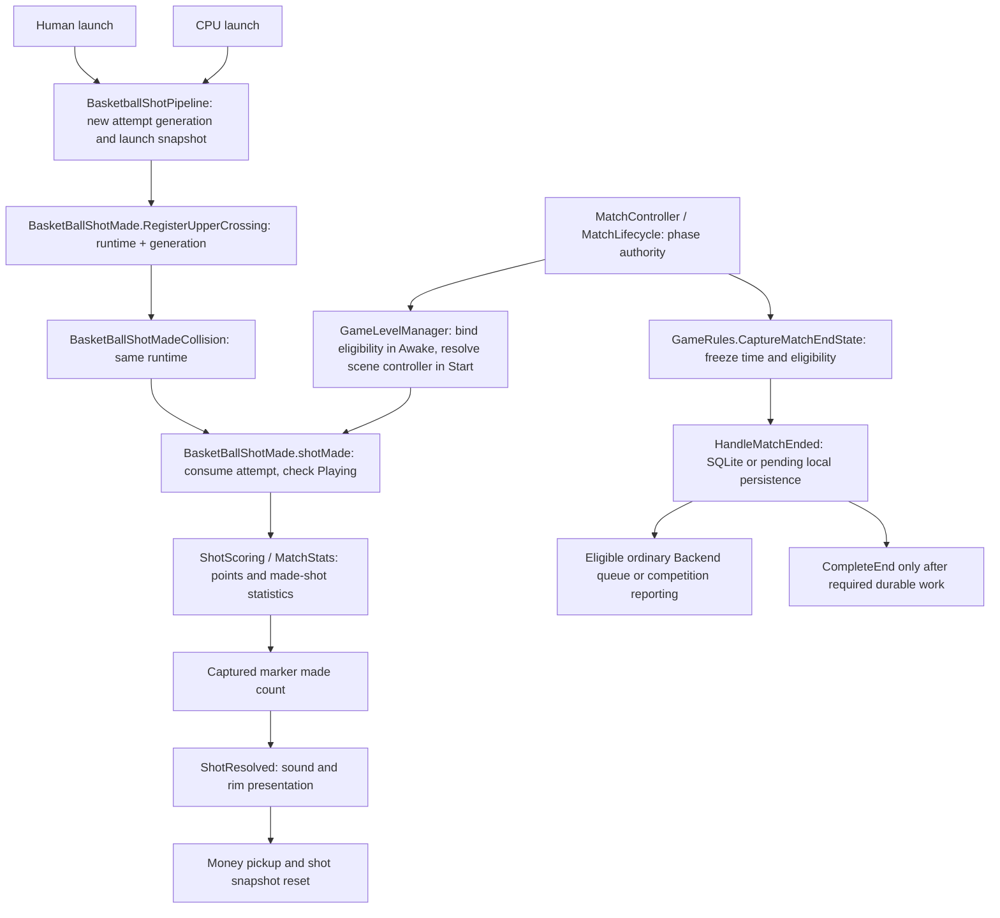

# GP-001: made-shot finality

Audited 2026-10-13 against fetched `dev` **`e6ce1d9be4519bb6a801eb2b6db727ea9de0b401`**.
`git ls-remote origin refs/heads/dev` confirmed the same baseline immediately before implementation.
Unity **6000.5.7f1** (`017862109af0`).

## Baseline and overlap

The starting worktree was clean. Existing worktrees were inventoried and left untouched.
Open PR inventory returned none. All-state `finality` and `GP-001` issue searches returned none;
the complete open-issue inventory contains broader audit (#277), multiplayer certification
(#235, #243–#245, #264), and hosted validation (#232/#233) work, not an overlapping finality fix.
[PR #299](https://github.com/sweat-this/level5/pull/299) is the baseline's merge commit;
there are no subsequent dev changes. Its pre-zero human/CPU flight policy is preserved.

Read the documentation index, architecture baseline/audit/remediation guidance, AI presets,
two-pass planning workflow, [mode-16 audit](gp-001-mode16-cpu-timeout-audit.md),
[shot lifecycle](shot-lifecycle.md), [shared-hoop repair](gp-001-f4-shared-hoop-fix.md),
and [persistence boundaries](persistence-boundaries.md), then traced the affected sources/tests.
This is a scoped correction, not gameplay or release certification.

## Root cause and ownership

`BasketBallShotMade.shotMade` checks runtime identity, attempt generation, paired crossing,
duplicate consumption and immutable-rule binding, but never checks the authoritative phase.
`MatchLifecycle.RequestEnd` changes phase to `Ending` before publishing phase/ending events.
`GameRules.CaptureMatchEndState` freezes elapsed time and ordinary-result eligibility, not
made-shot statistics. `HandleMatchEnded` subsequently creates a result from live statistics;
failed durable work leaves the controller in `Ending` for retry. Consequently a make in that
window can enter the saved score, and a make after `Completed` can diverge live and saved scores.
Both human and CPU runtime bindings reach this same defect.



Before `ShotResolved`, an accepted make changes total distance, longest shot, made/line counters,
streak/current-best state (through `MatchStats.ApplyMadeShot`), points, money-ball made count and
the captured marker's made count (including money-ball quota completion). `ShotResolved` then
drives swish/rim presentation. Money pickup instantiation and shot-snapshot reset occur afterward.
All are downstream of the new guard. Attempt counters and money-ball launch spending belong to
launch, outside this made-shot boundary; this change does not freeze unrelated gameplay writers.

No approved shot needs acceptance after `Ending`. Mode-16 grace delays the timer's end request
while an eligible pre-zero flight exists, so its make still occurs in `Playing`. Marker completion
also waits for the captured final attempt's flight to resolve. An accepted make may synchronously
trigger an ending through an event subscriber; its already-accepted tail remains valid, while any
reentrant make must recheck the phase.

Ordinary local-first persistence, primary-player ownership, Spot-Up completion eligibility,
Free Play/campaign exclusions, Backend session eligibility and simultaneous competition-only
reporting remain with their existing owners. No result schema, formula or quota policy changes.

## Review pass 1: correctness (before implementation)

Initial plan: check eligibility before made-shot mutations using an injected phase predicate.
Review found that returning before consumption could re-arm a rejected crossing after another
callback or hoop disable/enable. Refined plan: preserve runtime/generation matching, clear the
upper crossing, then consume the attempt before checking eligibility, just as accepted attempts
are consumed before publishing events. Both accepted and rejected attempts become terminal for
that hoop/generation. New generations remain independently deduplicated and phase-checked.

Check only at acceptance, before distance/stat/marker changes. Do not add a second gate midway
through the accepted make: reentrant endings must not truncate an already-accepted money/presentation
tail. Test a reentrant end followed by another participant's callback, repeated rejected callbacks,
Ending/Completed, pending upper crossings, new generations, and money/longest-shot/marker state.
Keep timer grace, marker final-attempt ownership and frozen time/result identity unchanged.

## Review pass 2: architecture and regression (before implementation)

Capturing `MatchController.instance` in `GameLevelManager.Awake` would capture null: its execution
order is -8000, while `GameRules.Awake` creates the controller later. Refined plan: bind a method
delegate in Awake, resolve/cache the scene controller in Start after all Awake calls, and query
that cached controller's `IsPlaying` at acceptance. Missing/destroyed composition fails closed;
never follow a later scene's singleton from an old hoop. No per-shot scene search or duplicate
lifecycle state is needed. Basketball receives only `Func<bool>` and adds no assembly reference.

Extend `BindMatchContext` with an optional eligibility argument to retain source compatibility.
Old two-argument callers remain callable but fail closed for scoring until they supply eligibility;
the only production caller is updated. Existing isolated scoring fixtures explicitly supply a
real `MatchLifecycle` in Playing. Bind-once/null-rule behavior remains intact, and replacement hoops
still discard pending crossings. Production-scene tests prove actual controller transitions and
initialization rather than relying solely on a boolean stub.

## Refined implementation plan

1. Reproduce both baseline windows in the disposable production-scene harness before changing
   production; retain characterization output separately from conformance checks.
2. Add the acceptance guard in `BasketBallShotMade`, consuming rejected attempts before return.
   Compose its eligibility through `GameLevelManager` using the initialized scene controller.
3. Extend existing shared-hoop/made-shot fixtures for phase/reentrancy/money/marker failures and
   update their explicit lifecycle binding. Extend the production-scene fixture for finality,
   accepted-score durability, failed persistence retry and stable match/result identity.
4. Run repository validation, focused EditMode and graphics-enabled production-scene PlayMode
   checks in the pinned editor with disposable SQLite and existing session/pending-file isolation.
   Include the existing pre-zero grace, course completion, solo and competition regressions.
5. Inspect the final diff, refresh dev/open-PR overlap, and publish a focused PR targeting dev.

No scoring manager, global lock, stat snapshot, physics/CPU tuning, marker-policy migration,
serialized asset, package or persistence-schema change is in scope.

## Validation and final changes

Local evidence lives under ignored `TestResults/gp001-finality/`; the disposable project uses
company `level5-audit-20261012-14b2cdc`, product `level5-gp001-f4-tests`, disposable SQLite and
`CampaignBoundaryPersistenceIsolation` for primary/`.bak`/`.tmp` game files. Normal project
settings and player saves are untouched. A SHA-256 manifest confirms all six modified source/test
files match the tested disposable copies byte for byte.

The corrected baseline characterization passed **1/1**, process **0**, reproducing **3 live/saved
points during Ending**, then **6 live versus 3 saved points after Completed**, with identical saved
ID, end cause and frozen duration. These assertions characterize the defect; they are not conformance
passes. The first probe exited **2** because it called the controller directly without setting the
legacy `GameOver` flag; corrected to use the production `GameRules.RequestEnd` seam before proceeding.

| Run | Actual cases / process exit | Meaning |
| --- | --- | --- |
| `FocusedEdit` | Compilation failed, **1**, no XML | New fixture initially assigned read-only `MaxShotMade`; corrected to arrange its existing serialized backing field. |
| `FocusedEditFinal.xml` | **237 passed**, 0 failed/skipped, **0** | Scoring, marker ownership/session, runtime crossing/deduplication, lifecycle, grace timer, dependency guards and Backend adapter. |
| `FinalEditDelta.xml` | **56 passed**, 0 failed/skipped, **0** | Final versions of the two edited fixtures, including new Preparing/Countdown coverage, bind-once eligibility retention and accepted reentrant money tail. Replaces the earlier 55 cases in those fixtures, yielding **238 distinct EditMode cases**. |
| `FocusedPlay.xml` | **22 passed**, 0 failed/skipped, **0** | Graphics-enabled production-scene callbacks/physics, human/CPU finality, forced persistence failures, grace, initialization/reload, Spot-Up 7s, solo and simultaneous competition. |
| `DurabilityPlayFinal.xml` | **1 passed / 1 failed**, **2** | Completed-course assertions passed. Retry fixture's empty-path assumption failed because startup repair can create an empty queue; corrected to verify/clear that isolated empty file family before injection. |
| `DurabilityRetryFinal.xml` | **1 passed**, 0 failed/skipped, **0** | Corrected retry/fallback/repair case. These two final cases replace their earlier versions in the 22 distinct PlayMode cases; unchanged cases reuse the successful run. |
| Repository validator | **PASS**, **0** | `scripts/validate-repository.ps1`. |
| Final diff/scope | `git diff --check` **0** | Only the nine files below; no serialized asset/schema/package change. |
| Hosted CI | **NOT RUN** | Live workflow inventory reports Repository Quality `disabled_manually`. |

The retry case makes SQLite unavailable and blocks the pending file with a fixture-owned empty
directory. Two unsuccessful end-work attempts leave the real controller in Ending while late
makes cannot change the accepted score or elapsed time. It then restores only fallback storage,
accepts one locally durable queued result, restores SQLite and repairs twice: one saved row must
retain the queued score, duration and result ID. Cleanup restores the connector and removes only
the temporary empty directory even if assertions fail. Expected injected I/O errors are captured
under the existing scene-noise policy, not treated as production diagnostic cleanliness.

Identity boundary: `MatchSession` is stable throughout failed end-work attempts. Existing
`HighScoreModel` conversion generates a GUID until a result first becomes durable; this change
does not redefine IDs of never-persisted models. Once locally accepted, pending repair preserves
the exact result ID. No new identity or persistence policy is introduced.

The existing arena emits known negative-scale collider, legacy animation and CPU-role diagnostics;
the harness retains its existing noise policy. Passing controlled callbacks/engine physics do not
certify physical input, natural aiming, every arena/modifier, Player/IL2CPP, live authenticated
Backend delivery, or complete Unity suites. Those checks were **NOT RUN**.

### Commands

Exact executable/argument arrays, logs, XML and process codes are retained as `*-command.json`,
`*.log`, `*.xml` and `*-exit.json` in the evidence directory. Test invocations use:

```text
<Unity 6000.5.7f1>/Editor/Unity.exe -batchmode
  -projectPath <repo>/TestResults/gp001-post-2026-10-12/project
  -runTests -testPlatform <EditMode|PlayMode> -testFilter <filter>
  -testResults <repo>/TestResults/gp001-finality/<run>.xml
  -logFile <repo>/TestResults/gp001-finality/<run>.log
```

EditMode adds `-nographics`; PlayMode adds `-force-d3d11` with graphics enabled.

```text
FocusedEditFinal:
Level5SharedHoopTests;Level5BasketBallShotMadeTests;Level5BasketballShotPipelineTests;Level5MatchStatsTests;Level5ShotScoringTests;Level5BasketballMarkerOwnershipTests;Level5BasketballShotMarkerSessionTests;Level5BasketBallShotMadeDependencyGuardTests;Level5BasketballGameRulesFacadeGuardTests;Level5TimerMatchEndContextTests;Level5MatchLifecycleTests;Level5BackendV2MatchResultAdapterTests

FinalEditDelta:
Level5SharedHoopTests;Level5BasketBallShotMadeTests

FocusedPlay:
Level5PostRemediationCertificationPlayModeTests.Mode16;Level5PostRemediationCertificationPlayModeTests.SoloHumanRetainsProductionOverlayToggleBehavior;Level5BasketBallShotMadeCompositionPlayModeTests;Level5SharedHoopPhysicsPlayModeTests;LocalSimultaneousVersusProductionPlayModeTests;Level5SpotUp7sPlayModeTests;Level5BasketballShotAttemptAndLaunchConvergencePlayModeTests

DurabilityPlayFinal:
Level5PostRemediationCertificationPlayModeTests.Mode16FailedPersistenceRetryKeepsAcceptedScoreTimeAndMatchIdentity;Level5PostRemediationCertificationPlayModeTests.Mode16SharedCourseStillWaitsForCapturedCpuFinalAttemptAndCompletesOnce

DurabilityRetryFinal:
Level5PostRemediationCertificationPlayModeTests.Mode16FailedPersistenceRetryKeepsAcceptedScoreTimeAndMatchIdentity

Validator:
powershell.exe -NoProfile -ExecutionPolicy Bypass -File scripts/validate-repository.ps1
```

The temporary baseline method was injected only into the disposable fixture, then removed by
syncing the permanent fixture before conformance runs. It is retained in the ignored runner for
reproduction against the exact original baseline, not shipped as a conforming-behavior test.

### Modified files

| File | Rationale |
| --- | --- |
| `Assets/Scripts/basketball/BasketBallShotMade.cs` | Inject eligibility and reject before all made-shot effects while consuming the attempt. |
| `Assets/Scripts/game manager/GameLevelManager.cs` | Compose eligibility through the initialized, cached scene controller. |
| `Assets/Tests/Editor/Level5SharedHoopTests.cs` | Bind a real lifecycle and cover terminal phases, pending/repeated/new generations, reentrancy, disable/enable and adversarial re-eligibility. |
| `Assets/Tests/Editor/Level5BasketBallShotMadeTests.cs` | Explicit lifecycle binding; no late stat/longest-shot/marker/money/event/snapshot mutation; preserve the accepted reentrant money tail and bind-once API. |
| `Assets/Tests/PlayMode/Level5PostRemediationCertificationPlayModeTests.cs` | Actual Ending/Completed score finality, failed persistence retries, local-first queue repair identity and completed-course regression. |
| `Assets/Tests/PlayMode/Level5BasketBallShotMadeCompositionPlayModeTests.cs` | Prove real initialization and reject a retained old-scene eligibility dependency after reload. |
| `docs/gp-001-made-shot-finality.md` | Audit, ownership diagram, risk/review/plan, validation, limitations and PR-ready summary. |
| `docs/shot-lifecycle.md` | Document the acceptance boundary and binding extension. |
| `docs/README.md` | Index this correction and connect the preceding timeout audit. |

### Acceptance evidence

| Requirement | Evidence |
| --- | --- |
| No makes during Ending/Completed; no resulting live/saved divergence | Shared-hoop terminal matrix and production mode-16 late-make case. |
| Playing human/CPU score once with independent attribution | Existing shared-hoop interleaving, real physics and mode-16 cases. |
| Pre-zero grace remains correct | Existing configured mode-16 physical hoop/ground case, final CPU attempt and timer tests. |
| Crossing/generation/reentrant rejection retained | Existing crossing suite plus terminal/reentrant/adversarial-provider cases. |
| No rejected marker/money/presentation effects | Whole serialized stats equality, marker quota/snapshot/event/pickup assertions; completed-course runtime case. |
| Accepted score and local-first durability/idempotency retained | Actual SQLite assertions and failure -> fallback -> repeated repair case. |
| Ordinary/contest/competition-only behavior preserved | Scoring fixtures, Spot-Up 7s and four simultaneous production-series cases. |
| Focused Unity validation and bounded scope | Results above and final reviewed nine-file diff. |

## PR-ready summary

**Reject basketball makes after an accepted match ending.** Both human and CPU makes previously
mutated live statistics during Ending and Completed, allowing saved-score contamination or later
live/saved divergence. Consume the crossing attempt and check injected Playing eligibility before
any stats, marker, event or money effects. Resolve the scene lifecycle after Awake initialization
and retain its identity across callbacks. Preserve pre-zero grace, shot math, shared marker quotas,
scoring attribution and all persistence contracts. Focused validation and limitations are above.

Final pre-publication fetch still resolved `origin/dev` to
`e6ce1d9be4519bb6a801eb2b6db727ea9de0b401`; open PR inventory was still empty. The final repository
validator exited 0 after the source/test/docs changes. Publication branch:
`fix/gp001-made-shot-finality`, targeting `dev`.
