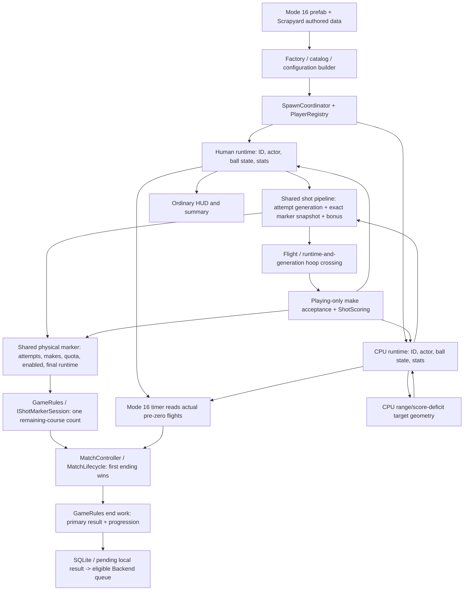

# GP-001: ordinary mode 16 CPU marker-course ownership

Audit date: **2026-10-13** (America/Chicago). Fetched `origin/dev` and clean local `dev`:
**`4a16eec7cbda45f3c684e1ea3624a5d5c7c511d7`**. Pinned and executed editor:
**Unity 6000.5.7f1 (017862109af0)**.

**Outcome: decision-blocked; no gameplay correction authorized by the available requirements.**
Current human/CPU mode 16 has one shared marker course, independent scores, and a primary-human
ordinary result. This audit proves that behavior, including CPU-owned course completion. It does
not establish that the behavior is approved cooperative play or defective competitive play.
No production source, permanent tests, scenes, prefabs, GUIDs, schemas or packages were changed.

## Baseline, requirements and overlap

Read `AGENTS.md`, `docs/README.md`, `docs/shot-lifecycle.md`, the mode-16 countdown audit,
final-marker bonus report, relevant architecture/persistence/versus documentation, current sources,
authored mode/scene/prefabs and focused fixtures. Applied the repository debug, runtime-validation
and two-pass planning workflows sequentially, with the requested correctness pass first.

The starting worktree was clean. Existing worktrees were inventoried and left untouched. Live
open-PR inventory targeting `dev` was empty. The latest 15 merged PRs and all-state issue searches
for `contest`, `GP-001` and `"mode 16"`, plus marker PR searches, found no later ordinary-course
policy or superseding correction. The current head is the historical SHA supplied in the request.
The final fetch after runtime validation still resolved `origin/dev` to the same full SHA; the
final open-PR inventory remained empty and `git diff --check` exited 0.

| Item inspected | Current relevance |
| --- | --- |
| [#284](https://github.com/sweat-this/level5/pull/284), merge `bbf548d14bbeddf5c79e418a015d48bcb0b21dab` | Hoop crossings/deduplication belong to runtime plus attempt generation; preserves marker policy. |
| [#299](https://github.com/sweat-this/level5/pull/299), merge `e6ce1d9be4519bb6a801eb2b6db727ea9de0b401` | Approved human/CPU pre-zero release grace; explicitly leaves course ownership undecided. |
| [#300](https://github.com/sweat-this/level5/pull/300), merge `d330e23703df5d65edc25cbd7cfb49352f9b42ee` | Makes accepted only while Playing; closes the historical late-score finding. |
| [#301](https://github.com/sweat-this/level5/pull/301), merge `4a16eec7cbda45f3c684e1ea3624a5d5c7c511d7` | Final-attempt bonus captured per shot, rather than read from the later shared count. Shared completion remains unchanged. |
| Open [#245](https://github.com/sweat-this/level5/issues/245), dependency [#244](https://github.com/sweat-this/level5/issues/244), epic [#222](https://github.com/sweat-this/level5/issues/222) | Future two-human simultaneous contest/Spot-Up certification. #245 prohibits advancing the other human's course and requires points/completion-time comparison. Neither issue has comments or an ordinary human/CPU policy. |
| Open [#277](https://github.com/sweat-this/level5/issues/277) | Audit roadmap; supplies no ordinary-mode gameplay approval. |
| [#232](https://github.com/sweat-this/level5/issues/232), [#233](https://github.com/sweat-this/level5/issues/233) | Hosted validation authority; no hosted run is claimed here. Local checks below were executed. |

The mode title, optional CPU capacity, historical implementation and approved future two-human
requirements cannot decide the ordinary-mode contract. Older architecture text describing timer
and marker ending as paths for different modes is not accurate for current mode 16: both are live.
Current code and configured runtime evidence take precedence.

## Authored data and ownership

`Assets/Resources/Prefabs/menu_start/mode_selected_objects/mode_selected_16.prefab:47` authors
ID 16, countdown 70, three-point markers and contest scoring, basketball required, optional CPU
shooters, and `totalPoints` records. Its description is only "70 seconds to get a high score."
`GameModeDefinitionFactory` copies these flags and maps the objective to `ContestCompletion`.
`MatchConfigurationBuilder` validates compatibility and resolves one ball per roster participant;
neither defines cooperative/competitive course policy.

Scrapyard is authored arena 1. Its production scene `Assets/Scenes/level_01_scrapyard.unity`
references `basketball_goal.prefab` GUID `303a3ee97d40b31408ebaffa49026b63`, including nested
marker prefabs. Runtime loading is authoritative for effective nested quotas: **five active
three-point markers, each MaxShotAttempt=5 and MaxShotMade=5**, initially zero attempts/makes,
for **25 shared attempts**. Four-attempt values elsewhere in the goal prefab belong to other
marker authoring; they do not justify changing this effective course.

| State/decision | Authoritative owner and trace |
| --- | --- |
| Participant identity and actual roster | `PlayerRoster`/configuration describe the roster; `SpawnCoordinator` registers actors in `PlayerRegistry`. `GiveBall` binds existing `owner.pid`, CPU/primary role and exact actor once. This runtime ID is not a durable account ID. |
| Ball and shooter statistics | Separate `BasketBall` and `BasketBallAuto` implement `IBasketballRuntime`; each has its own `BasketBallState`, `GameStats` and actor. Both shooting paths use `BasketballShotPipeline`. |
| Shot attempt identity | `BasketBallState.BeginShotAttempt` advances generation and clears the previous snapshot/flight. Statistical attempt count is not identity. |
| Marker occupancy | Each ball state's `CurrentShotMarker`, resolved from its exact hitbox through `IBasketballParticipantStateProvider`. Marker-local human/CPU collider sets are presentation occupancy, not quotas. Both roles can occupy the same physical marker. |
| Launch-time marker and bonus | `CaptureShotMarkerForAttempt` retains the exact marker reference. The shared pipeline registers on it, then captures `IsFinalMarkerAttempt == (ShotAttempt == MaxShotAttempt)` without yielding. This is the existing attempt snapshot, not completion state. |
| Marker attempts/makes/quota | One `BasketBallShotMarker` owns shared `ShotAttempt`, `ShotMade`, `MaxShotAttempt`/`MaxShotMade` and `MarkerEnabled`. No per-participant quota exists. |
| Marker completion readiness | `RegisterAttempt` captures the first quota-reaching runtime. `Update` waits for that actor to have no ball and not be airborne, and its ball not to be airborne. A later extra attempt does not replace the captured runtime. |
| Marker completion notification | `CompleteMarker` flips `MarkerEnabled` false before decrementing, hides the sprite, updates text, then conditionally requests end. Repeated Update does not decrement again. |
| Course count and end routing | `GameRules.SetPositionMarkers` filters authored markers and initializes one count. Its explicit `IShotMarkerSession` implementation decrements that count and routes final completion through `RequestGameOver` (`Unknown`). The interface has no participant argument. |
| Make acceptance and score | `BasketBallShotMade` matches exact runtime/generation crossings, consumes once and checks injected Playing eligibility before mutation. `ShotScoring` supplies points to that runtime's stats. Marker makes remain shared. |
| Countdown | Mode-16-only timer composition reads actual registry flights and strictly pre-zero `ShotReleasedAt` against one frozen deadline. Ground/fence/retrieval end grace; new at/after-zero releases cannot renew it. |
| Accepted ending | `MatchController` wraps `MatchLifecycle`: first request wins, cause is retained, durable end work completes once. Timer grace does not override an already accepted course ending. |
| Presentation | `MatchHudPresenter` uses primary stats for ordinary mode-16 score/summary; no mode-16 winner/tie-break UI is defined. Marker text shows primary human points alongside shared attempts/makes. |
| Ordinary persistence/progression | `HighScoreModel.convertBasketBallStatsToModel` resolves the primary participant for `TotalPoints` and shot metrics. Ranked participant point/name fields also exist; they are not independent course/completion-time results. `GameRules` saves SQLite or pending local results, queues Backend only after local durability under existing authenticated identity, and applies primary progression. |
| Competition boundary | Simultaneous versus suppresses ordinary primary-only persistence/progression and reports both slots through its existing series boundary. That separate capability is not enabled or imported into ordinary mode 16 by this audit. |

Relevant source seams: `SpawnCoordinator.GiveBall` line 1012; `BasketballState.cs:196`;
`BasketballShotPipeline.cs:61`; `BasketBallShotMarker.cs:162,232,247,383`;
`GameRules.cs:443,463,620,872,1149`; `BasketBallShotMade.cs:190,391`;
`Timer.cs:265`; `MatchHudPresenter.cs:915,1092`; `HighScoreModel.cs:171`.



The CPU target path `getClosestPositionMarker -> SelectShotKind -> BuildShotTarget` does not
enumerate the course or inspect incomplete-marker eligibility. Stable participant/shot ownership
therefore coexists with shared progress; correcting one does not imply the other is approved.

## Fresh runtime reproduction

All configured runs used real authored mode 16 and Scrapyard, Johnny B plus CPU Ian where stated.
Two diagnostic methods were injected only into the disposable copy of the existing fixture.
They were not added to the production test source. Natural observation used normal controller,
shooting, navigation and physics; the human remained idle. No attempt, occupancy, make, movement,
marker Update or timer-expiry calls were injected during that observation.

| Requested observation | Fresh evidence and limits |
| --- | --- |
| Initialization/actual quotas | `left_corner`, `left_wing`, `right_corner`, `right_wing`, `top_key`: 0/5 attempts, 0/5 makes; five enabled markers. |
| Both roles on the same marker | Controlled hitbox `OnTriggerEnter` calls put runtime IDs human 0 / CPU 1 on `top_key`; both exact state references and both presentation flags were asserted. Physical simultaneous human navigation is not certified. |
| Shared attempts | Four controlled human registrations plus one CPU registration produce marker count 5, human attempts 4 and CPU attempts 1. They do not each get five. |
| Shared completion and final readiness | The quota-reaching CPU owns readiness; the marker stays enabled while its ball is airborne. Clearing CPU readiness completes it despite the human ball being airborne. Repeated Update leaves the course count unchanged. |
| CPU final marker and ending | Other markers were explicitly completed under controlled readiness. CPU-owned last completion moves remaining 1 -> 0 and accepts `Unknown`. This is controlled full-course evidence, not natural course certification. |
| Independent scores/primary persistence | Controlled human fourth make=3, CPU fifth=6; shared marker makes=2. SQLite records human 3 with stable result `7caa1cc4e6264e9c9be1a2c600368f4d`, match `match-d163234df9c442eb957eb6054a32fc88`, frozen duration 0.0290913. The short duration reflects controlled completion. |
| Natural CPU after disable | Ian naturally took **23 shots**, scored **3 points**, and displaced **3.650166 units**. `left_corner` completed after its fifth attempt. At countdown 18.6812 its sixth attempt registered on that disabled marker; it stayed there through attempt 23. Course remaining stayed four. |
| Natural shared counters after disable | Final `left_corner` counters were **23 attempts / 8 makes**, disabled; the other four stayed 0/0 and enabled. Disabled-marker callbacks still update shared makes while contest scoring awards zero. Counter growth does not imply extra course completion or CPU points. |
| Natural countdown/persistence | `TimeExpired` accepted at timer **70.36058**; human/CPU points **0/3**, four markers left. SQLite primary score **0**, frozen duration **70.36003**, result `7a8abd52ca1942b5a80c5f4de0b4959e`, match `match-2c937b0760bb45b994288b06463d1770`. The slight overrun is compatible with pending-flight grace; it is not proof that a whole CPU course can finish. |
| Pre-zero grace and race | Existing configured test retained Playing for both pre-zero flights, then drove actual authored hoop/ground callbacks and saved human 3 / CPU 3 once. Exact-zero solo release expires; final-course completion retains `Unknown` against a subsequent timer request. Deadline boundaries also pass EditMode. |
| #301 overlap/#300 finality/retry | Both fourth/fifth make orders yield human 3 / CPU 6. Sixth registration does not revoke the fifth bonus. Late makes after Ending/Completed cannot change scores or saved identity; forced persistence failure/retry retains score, time and identity. |

The natural CPU did not traverse the other four incomplete markers. A natural full-course
completion was **NOT VERIFIED**. Scores/flight outcomes vary with the existing random AI; the
observed three points do not contradict the earlier audit's six-point run. Existing negative-scale
collider, animation/D3 diagnostics and queued-progression warnings remain visible and out of scope.
Passing guarded tests do not assert a warning-free scene or successful durable XP application.

## Product-policy gate: exact unresolved decisions

No authoritative requirement found in this audit selects A or B. Owner clarification was
requested during the audit; absent an approved decision, implementation must not proceed.

1. **A: cooperative shared course, or B: independent competitive courses?** Does a CPU have
   permission to consume the human's available marker attempts and complete the entire session?
2. **If A:** explicitly approve the shared five-attempt quotas and any-participant final completion.
   Are CPU points excluded from the recorded primary result as today, or aggregated? If aggregated,
   define corresponding attempts/makes, high-score/XP ownership and Backend result semantics.
   Does the CPU need to traverse incomplete markers, and must outstanding other-participant shots
   resolve before shared completion hides a marker or ends the match?
3. **If B:** specify each participant's quota, marker availability to an unfinished opponent, CPU
   incomplete-marker selection/order, and whether first finish, both finish, countdown, or another
   rule ends play. Define how pre-zero pending shots interact with completion.
4. **If B:** define winner/tie-break rules (including ties, incomplete courses and completion times),
   human/CPU HUD/end presentation, recorded result owner and metrics, and whether the existing
   ordinary result/progression contracts suffice. Future #245 comparison keys are not approval here.

Approved requirements already established by #299/#300/#301 remain binding: pre-zero release
grace, Playing-only make acceptance, and shot-specific final-attempt bonuses. They do not resolve
the course policy. Existing ordinary persistence is sufficient for retaining today's primary-human
score. It does not prove sufficiency for a team result or two independently timed competitive runs.

## Problems, risks and bounded solutions

| Classification | Evidence/risk | Resolution |
| --- | --- | --- |
| REQUIRED decision | CPU consumes shared quota and can end the human's session. | Establish A/B and result ownership; retain current gameplay pending that decision. |
| REQUIRED if course traversal is approved | Natural CPU remains on a completed marker, taking zero-point shots. | Add incomplete-marker targeting to the existing CPU target seam for mode 16 only; preserve shot AI generally. |
| Policy-dependent | Completion disables a shared marker while another participant may have a shot pending. Live enabled-marker scoring and accepted-ending finality can exclude that shot. | Define outstanding-shot/finish behavior before changing these existing gates. |
| Existing readiness limitation | Completion captures a runtime, not an attempt generation; a later flight on that same runtime can affect readiness. | Preserve current owner now; compare generation-aware completion only if approved finish rules require it. Do not reuse completion runtime as bonus identity. |
| Malformed-content source risk | Empty course has no marker to request completion. Nonpositive attempt quota cannot capture its final runtime normally. Session decrements have no participant/completion identity. | No malformed production course was reproduced. Validate/refuse malformed courses if implementing new progress; avoid vacuous completion and unchecked duplicate decrements. |
| Preserved implementation behavior | Disabled markers accept later registrations/made-counter updates; they do not decrement twice or score contest points. | Decide eligibility/counter behavior with course navigation policy; do not silently change other marker modes. |
| REJECT | Dictionary-only attempts retain shared disable/end behavior; duplicate prefabs/managers create competing authorities. | Any independent-course implementation must cover attempts, eligibility, completion, visuals, AI, ending and results together. |
| LATER | Physical devices, full natural course, all arenas/CPU types, Player/IL2CPP and authenticated Backend delivery. | Separate certification if required; current probes establish none of these. |

## Review pass 1: correctness, completed

Reviewed the initial alternatives (retain sharing after approval; otherwise participant-specific
progress on the same physical markers) against quota consumption, premature completion, bonus
ownership, shared disable, duplicates, CPU targeting, malformed courses, overlap/out-of-order makes,
countdown races, score attribution and winner/persistence semantics.

Corrections to the proposal: reject the assumption that two actors imply independent courses;
reject changing attempt counts alone; distinguish per-shot final bonus from captured-runtime
completion readiness; include other airborne shots when defining completion; retain first-ending
semantics rather than reopen a completed lifecycle. Natural navigation and controlled completion
must be separate evidence. Zero/malformed courses require explicit validation rather than automatic
success. No winner/tie-break or score aggregation can be chosen by the implementation.

Refined proposal after pass 1: produce the decision record and current-state reproduction now;
implement only an approved complete policy with focused cases at the existing ownership seams.

## Review pass 2: architecture and regression, completed

Reviewed that refinement against existing participant IDs, state lifetime, scene/prefab compatibility,
GUIDs, shot snapshots, `IShotMarkerSession`, collider occupancy, #299/#300/#301, result/Backend
boundaries, #244/#245, isolation, allocations and scope.

Corrections: keep authored physical markers and launch-time references; do not key progress by
display name or sorted leaderboard position; keep occupancy sets purely presentational; preserve
non-mode-16 paths and existing session interface compatibility. Course state must reset with the
match, not persist in definition assets. Result IDs/account identity remain with existing persistence
owners. Bounded participant/marker storage needs no per-frame allocation, scene scan, new manager
or general framework. Isolate SQLite and all session/pending-file families, not just score storage.

Final refinement: no production patch until the gate is resolved. Future implementation must prove
one-participant completion leaves the opponent eligible if B requires it, plus final bonus, grace,
finality, CPU retargeting, frozen result identity and solo/adjacent-mode preservation. Existing broad
passing evidence is reused; do not repeatedly launch full Unity suites.

## Conditional minimal implementation plan

1. Record approved A/B, score/result ownership, finish and CPU-navigation semantics in this document.
   Refresh `dev` and overlap before editing. Stop if another change supersedes the finding.
2. **If A approves existing behavior:** retain shared marker/session authorities. A no-code outcome
   is valid. Fix only a reproduced inconsistency with the approved contract; CPU retargeting or
   aggregate result changes require their specific approval.
3. **If B is approved:** compare these bounded options before choosing:

   | Storage option | Fit and cost |
   | --- | --- |
   | Participant progress records inside each existing marker, aggregated by existing `GameRules` | Closest to current local quota/completion logic; must stop shared `MarkerEnabled` from disabling an unfinished opponent and add participant-aware session completion without breaking old callers. |
   | Progress owned by existing session, keyed by stable participant ID plus exact marker reference | Centralizes independent remaining-course/finish decisions; markers become readers/adapters for mode 16. More marker/session calls, but no new manager or duplicated prefab is needed. |

   Choose based on the approved finish/presentation rules and actual call-site impact. Neither option
   is authorized yet. Keep one owner for each logical progress record; do not maintain both copies.
4. Implement independent registration, per-shot final eligibility, once-only per-participant marker
   completion and remaining counts, eligibility/visuals, CPU target selection and approved ending
   as one coherent mode-16 slice. Keep solo and other-mode paths compatible. Preserve the exact
   attempt's marker reference and all generation/finality/grace rules.
5. Change HUD/results only to meet approved semantics. Reuse primary ordinary storage when
   sufficient; do not introduce a save/network schema or competition capability speculatively.
6. Extend existing focused fixtures and run an affected configured production-scene test. Verify
   overlap, late callbacks, duplicate completion, deadline/finish races, frozen scores and durable
   identity using disposable persistence. Natural traversal must be observed separately.
7. Re-fetch `dev`, inspect exact diff/serialized scope and overlap, then prepare a PR targeting `dev`
   only if requested/authorized. Do not publish a fabricated gameplay fix while the policy is blocked.

## Executed validation and reproduction commands

Local evidence: ignored `TestResults/gp001-course-ownership/`, including source SHA-256 manifest,
argument arrays, NUnit XML, logs, exit JSON, runner and two diagnostic methods in `natural-probe.txt`.
The retained disposable project is `TestResults/gp001-post-2026-10-12/project`, refreshed from
tracked current dev. Production/assets/packages/settings bytes were compared before injection,
except the deliberate disposable company/product values:
`level5-audit-20261012-14b2cdc` / `level5-gp001-f4-tests`.

`LocalProfileTestDatabase` supplies GUID-temporary SQLite. The existing
`CampaignBoundaryPersistenceIsolation` snapshots/restores session, pending Backend/local results
and account-74 pending progression, including primary/`.bak`/`.tmp`; authenticated session state
is cleared inside isolation and restored in teardown. Normal player saves were not used.

| Check | Actual outcome | Process exit |
| --- | --- | --- |
| Repository validator | PASS | 0 |
| Initial sandbox EditMode startup | BLOCKED before tests: licensing/UPM IPC access; no NUnit XML | 1 |
| Elevated focused EditMode | **232 passed, 0 failed, 0 skipped** | 0 |
| Graphics-enabled focused PlayMode | **16 passed, 0 failed, 0 skipped** | 0 |
| Natural full-course completion | NOT VERIFIED; CPU completed only one marker | Not a separate test run |
| Hosted CI, Player/IL2CPP, physical devices, live authenticated Backend | NOT RUN | None |

EditMode breakdown: marker ownership 62; marker session 8; shot pipeline 26; shared hoop 50;
pure scoring 17; lifecycle 19; timer context 19; made-shot 23; Backend adapter 8.
PlayMode: ten executed mode-16 cases (eight existing plus two disposable diagnostics), five existing
launch/startup cases and one actual shared-hoop physics case. The XML fixture discovery count is
not the executed-case count; totals above count actual `test-case` elements.

The failed sandbox attempt was diagnosed before retrying with elevated process access. Its stdout
and command were retained; the log path was reused by the successful retry after a log-file sharing
error prevented renaming it. The initial failure details are recorded here rather than presented as
an independently retained full log. No licensing configuration or credentials were changed.

Run from the repository root; exact argument arrays are in `*-command.json`:

```text
python TestResults/gp001-course-ownership/run.py prepare
python TestResults/gp001-course-ownership/run.py FocusedEdit
python TestResults/gp001-course-ownership/run.py inject
python TestResults/gp001-course-ownership/run.py FocusedPlay
python TestResults/gp001-course-ownership/run.py validator

Unity.exe -batchmode -projectPath <disposable-project> -runTests
  -testPlatform <EditMode|PlayMode> -testFilter <filter>
  -testResults <evidence>/<run>.xml -logFile <evidence>/<run>.log
EditMode: -nographics. PlayMode: -force-d3d11.

EditMode filter:
Level5BasketballMarkerOwnershipTests;Level5BasketballShotMarkerSessionTests;Level5BasketballShotPipelineTests;Level5SharedHoopTests;Level5ShotScoringTests;Level5MatchLifecycleTests;Level5TimerMatchEndContextTests;Level5BasketBallShotMadeTests;BackendV2MatchResultAdapterTests

PlayMode filter:
Level5PostRemediationCertificationPlayModeTests.Mode16;Level5BasketballShotAttemptAndLaunchConvergencePlayModeTests;Level5SharedHoopPhysicsPlayModeTests

Validator:
powershell.exe -NoProfile -ExecutionPolicy Bypass -File scripts/validate-repository.ps1
```

No full Unity suite was run. The previously stalled legacy marker-session menu harness was not
retried; marker-session EditMode and correctly configured production-scene probes passed instead.
No changes to adjacent modes were made; prior Spot-Up evidence is not claimed as a fresh run.

## Acceptance and PR-ready summary

**Verified:** current dev, current authored course, exact participant/snapshot ownership, actual CPU
participation and disabled-marker behavior, shared completion once, independent bonus/score
attribution, first-ending semantics, #299 grace, #300 finality, #301 overlap, solo timeout and stable
primary score/result ID/duration under retry. No unrelated architecture changes.

**Decision-blocked:** approved cooperative/competitive contract, whether CPU completion is
authorized, whether progress should be participant-independent, result aggregation/winner rules,
and any required gameplay correction. Passing characterization tests do not close these gates.

Changed deliverable files: `docs/gp-001-mode16-course-ownership-audit.md` and its entry in
`docs/README.md`. Diagnostic scripts/evidence remain ignored under `TestResults`; the injected
fixture is restored to the tracked source after validation. The subsequent senior review found
no material findings. On **2026-10-14**, the owner authorized committing and publishing these
documentation changes through a PR targeting `dev`; gameplay implementation remains decision-blocked.
The publication refresh still resolved `origin/dev` to the audited SHA, with no open PR overlap.
Publication branch: `docs/gp001-mode16-course-ownership`.

Suggested documentation PR title: **Document mode-16 CPU course-ownership decision gate**.
Suggested description: Verified current ordinary mode 16 on dev, including configured shared
human/CPU occupancy, CPU-owned final-course completion, independent scoring, primary-only
persistence and natural CPU shooting after marker disable. Requirements do not approve either
shared cooperative or independent competitive courses. Record exact product decisions, ownership
flow, two review passes and conditional minimal implementation options. Validation: repository
check, 232 EditMode and 16 PlayMode cases passed, successful processes exit 0; an initial sandbox
startup failure and natural full-course/physical/backend limits are recorded separately.
