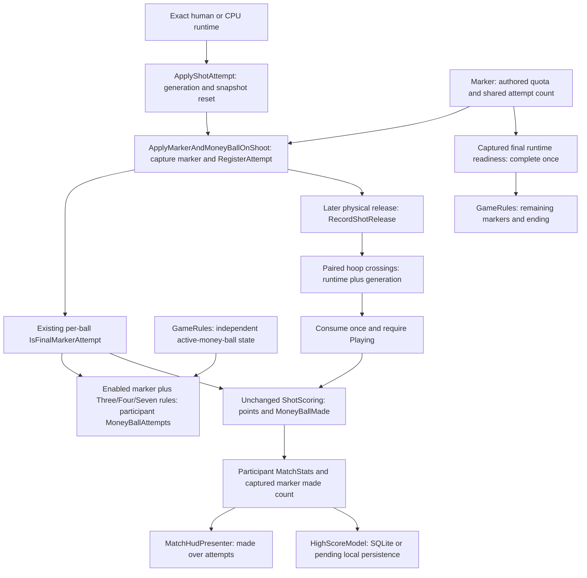

# GP-001: money-ball attempts follow authored marker quotas

Audited and corrected 2026-10-14 on fetched `origin/dev`
**`55c3188d17cb3140fc924bcecb4d211dd3ab774e`**. The same SHA was fetched again immediately
before the production edit. Unity **6000.5.7f1** (`017862109af0`).

## Decision and baseline inventory

The owner explicitly approved: **“Count the enabled marker’s quota-reaching attempt.”**
This is the authority for the accounting change. Source inconsistency alone was insufficient:
[PR #301](https://github.com/sweat-this/level5/pull/301), its
[report](gp-001-final-marker-bonus.md), and the lifecycle document explicitly preserved literal
fifth-registration accounting during the previous scoring repair. The pure scorer calls the final
attempt the money-ball shot and credits its make by authored quota, but this did not by itself
authorize changing attempt statistics. There is no remaining policy blocker for this correction.

The starting worktree was clean; existing worktrees were inventoried and left untouched. Live open
PR inventory returned **none**. Open issues and all-state money-related issues/PRs were inspected;
no competing accounting correction was found. #244/#245 retain future simultaneous Spot-Up/contest
certification and shared-course policy. #232/#233 retain hosted validation ownership. Repository
Quality remains **`disabled_manually`**, verified through the live workflow API.

Current dev includes #295 (Spot-Up instructions), #299 (pre-zero flight grace), #300 (made-shot
finality), #301 (attempt-specific final bonuses), and #302 (course-ownership decision gate).
There were no subsequent dev commits after the supplied baseline. No Backend repository change
is needed. Read `AGENTS.md`, the documentation index, AI presets, shot lifecycle, final-marker and
made-shot-finality reports, persistence boundaries, affected sources/tests and authored data;
applied the repository debug and two-pass planning workflows without delegation.

## Source and effective-scene audit

Mode 24's `mode_selected_24.prefab` authors SevenPoint contest rules, seven-point markers, a
90-second countdown, basketball required, and `AllowsCpuShooters=false`; it does not require active
money ball. `GameModeDefinitionFactory` maps those flags and requires the SevenPointLine arena
capability. Scrapyard (arena 1) is selectable, unlocked, shooting-capable and has seven-pointers.
The production configuration builder accepted the solo shooter roster and loaded
`level_01_scrapyard`. Human/CPU attribution is additionally tested with concrete runtime components
in the existing EditMode fixture and with the supported mode-16 production configuration.

Scrapyard's actual loaded scene contains **16 marker components**: **six active seven-point
markers with attempt quota 4 and make quota 4**, and ten inactive other-range markers with quota 5.
The active names are `left_corner`, `right_corner`, `top_key`, `top_key.1`, `left_wing.2`, and
`left_wing.3`. These are runtime observations, not an inference from the base goal prefab alone.
The goal prefab also authors four-attempt seven-point markers; no scene or prefab quota was edited.

`GameRules.Awake` binds marker rules/session and each ball's live money-ball provider.
`SetPositionMarkers` filters authored marker types, assigns IDs and initializes remaining markers.
`BasketBallShotMarker.Start` resets counters, checks bindings, enables required markers and derives
range flags from rim distance. Contest completion waits for `ShotAttempt >= MaxShotAttempt` and
the originally captured final runtime's actor/ball readiness, then records completion once.

Registration and physical release are distinct. Human and CPU `shootBasketBall` call
`ApplyShotAttempt` to advance generation/reset the snapshot/classify the attempt, then
`ApplyMarkerAndMoneyBallOnShoot` to capture the participant's marker and register its attempt.
The shot-meter coroutine later launches the Rigidbody and `RecordShotRelease` timestamps release.
This correction counts registration, preserving the existing accounting boundary; it does not move
statistics to release or make detection. A final miss therefore still counts as an attempt.



`IsFinalMarkerAttempt` is captured immediately after registration reaches `MaxShotAttempt`.
`BeginShotAttempt` and accepted-make cleanup reset it; terminal-rejected makes stay consumed under
#300. Another runtime's later registration cannot change this snapshot. `BasketBallShotMade`
supplies it to unchanged `ShotScoring`, whose enabled-marker and Three/Four/Seven doubling gates
produce the existing points and `MoneyBallMade`. Mode 18's Three/Four/AllRanges combination is
eligible through its specific flags; AllRanges alone and ordinary modes remain ineligible.

`MatchStats` owns participant attempt/made counters. HUD totals use those exact counts and
`getPercentageFloat` (zero attempts displays zero percent). `HighScoreModel` copies both counts;
`DBHelper` binds them to existing `moneyBallAtt`/`moneyBallMade` SQLite columns. Pending local
persistence stores that model and existing all-time snapshots, preserving counts on repair.
The Backend V2 adapter maps six existing ranking metrics; it does not submit money-ball counters.
No payload, schema, durable identity, historical row or result-eligibility policy changed.

## Actual baseline reproduction

Before editing production, extended existing fixtures ran real registration, captured snapshots
and paired controlled make callbacks against unchanged dev production files. `A/M` means money-ball
attempts/makes. Five-attempt comparison cases passed on baseline; four-attempt cases exposed the
missing denominator. Synthetic quotas 3 and 7 also exposed literal-five attribution.

| Mode-24 controlled step | Baseline | Corrected |
| --- | --- | --- |
| First marker registrations 1–3 | A=0 | A=0 |
| Fourth registration, before make | final snapshot=true; A=0 | final snapshot=true; A=1 |
| Valid fourth make | 14 points; A/M=0/1; marker attempts/makes=4/1 | Same points and marker counts; A/M=1/1 |
| Another marker's fourth attempt misses and completes | cumulative A=0; no additional make | cumulative A=2; no additional make |
| Completed marker receives fifth/sixth registrations | spurious cumulative A=1 | cumulative A stays 2 |
| End summary and SQLite | 14 points; A/M=1/1; HUD 100.0% | 14 points; A/M=2/1; HUD 50.0% |

Both completed markers left **four remaining**; duplicate hoop callbacks added no makes or points.
Baseline saved result ID: `2e0d92f9829f4cea80ad3d6ef5e64c39`; corrected:
`b04ca676a95c4173adb34bba6f0e8ed0`. Each run uses its own match, so IDs differ by design. The fixture
asserts one SQLite row, exact live/saved counts and stable ID on terminal callback verification.
The requested ending is controlled; these runs do not certify a natural 90-second countdown.

## Root cause, reviews and implemented plan

Root cause: attempt eligibility used `marker.ShotAttempt == 5`, while final scoring used the
per-attempt authored-quota snapshot. It undercounted short quotas, credited five prematurely for
larger quotas, and could credit a disabled marker's later fifth registration.

**Review 1 — correctness, before production edit.** Reviewed quotas 3/4/5/7, final misses,
overlapping human/CPU registrations, both make orders, extra attempts, enabled-state changes,
snapshot resets, mode 18, duplicate crossings and independent active credits. Refinement: require
`MarkerEnabled` at registration, retain equality-based final eligibility and the separate active
increment. A marker disabled after a legitimately registered attempt does not refund that attempt;
existing live scoring gates still determine whether a later make counts.

**Review 2 — architecture/regression, before production edit.** Keep quota authority on the marker
and attempt identity on the existing ball snapshot. Preserve marker registration/completion,
#299 release grace, #300 finality, #301 ownership, public signatures, GUIDs and persistence. Refinement:
explicitly enable the older synthetic pipeline fixture's marker when testing eligible credit; its
default disabled state is no longer a valid eligible arrangement. Reuse existing fixtures and the
disposable project, without a new snapshot property, manager or test framework.

Implemented sequence: fetch/inventory and inspect requirements -> obtain explicit accounting-policy
approval -> reproduce unchanged production in EditMode and configured PlayMode -> complete both
reviews -> fetch unchanged dev -> replace the literal-five predicate -> run focused validation and
inspect the final diff. Production changes **one condition** in the existing accounting method.

| Changed file | Reason |
| --- | --- |
| `BasketballShotPipeline.cs` | Use enabled marker plus `State.IsFinalMarkerAttempt` for existing contest credit. |
| `Level5BasketballShotPipelineTests.cs` | Quota/rule matrix, every registration's denominator, explicit enabled arrangement. |
| `Level5SharedHoopTests.cs` | Four/five overlap and order, nonstandard quotas, final misses, disabled/completed markers, active additive credit and mode gates. |
| `Level5PostRemediationCertificationPlayModeTests.cs` | Actual mode-24 composition, controlled make/miss/extra callbacks, completion, HUD and SQLite counts. |
| This report, index, lifecycle and historical #301 report | Record approval, current contract, evidence and superseded historical accounting scope. |

## Validation

Evidence: ignored `TestResults/gp001-money-quota/`, containing exact argument arrays, logs, NUnit XML,
process-exit JSON and a source/test SHA-256 manifest. The disposable project was refreshed from all
tracked current project files and uses company `level5-audit-20261012-14b2cdc`, product
`level5-gp001-f4-tests`. Normal project settings and player data were not used. Existing
`LocalProfileTestDatabase` redirects SQLite; `CampaignBoundaryPersistenceIsolation` snapshots and
restores session, local/Backend pending files and account-74 progression, including `.bak`/`.tmp`.

| Run | Actual NUnit result | Process exit |
| --- | --- | --- |
| Initial sandbox launch | NOT RUN: Package Manager IPC/system-access failure; no XML | 1 |
| First launch outside sandbox | NOT RUN: no valid Editor license; no XML | 198 |
| Owner-requested retry | NOT RUN: new probe used unsupported NUnit `Assert.Multiple`; removed it; no XML | 1 |
| `BaselineEditCompiled` | 60 passed, 28 failed, 0 skipped; failures reproduce accounting discrepancies | 2 |
| `BaselinePlay` | 0 passed, 1 failed, 0 skipped; mode-24 composition/statistics/save observed before final expected-policy assertion | 2 |
| `FocusedEdit` | 256 passed, 0 failed/skipped; quoting omitted the first/last fixture filters | 0 |
| `FinalEdit` | **305 passed**, 0 failed/skipped; corrected complete selection and final fixture refinements | **0** |
| `FocusedPlay` | **19 passed**, 0 failed/skipped; graphics enabled | **0** |
| `PublishEdit` | **305 passed**, 0 failed/skipped; final pre-publication rerun | **0** |
| `PublishPlay` | **19 passed**, 0 failed/skipped; final graphics-enabled pre-publication rerun | **0** |
| Repository validator | PASS | 0 |

Commands (exact arrays are also retained locally):

```text
Unity.exe -batchmode -projectPath <disposable-project>
  -runTests -testPlatform <EditMode|PlayMode> -testFilter <filter>
  -testResults <evidence>/<run>.xml -logFile <evidence>/<run>.log
EditMode: add -nographics. PlayMode: add -force-d3d11.

FinalEdit / PublishEdit:
Level5BasketballShotPipelineTests;Level5BasketBallShotMadeTests;Level5SharedHoopTests;Level5ShotScoringTests;Level5BasketballMarkerOwnershipTests;Level5TimerMatchEndContextTests;Level5MatchLifecycleTests;Level5MatchStatsTests;Level5BackendV2MatchResultAdapterTests

FocusedPlay / PublishPlay:
Level5PostRemediationCertificationPlayModeTests.Mode16;Level5PostRemediationCertificationPlayModeTests.Mode24;Level5BasketballShotAttemptAndLaunchConvergencePlayModeTests;Level5SharedHoopPhysicsPlayModeTests;Level5SpotUp7sPlayModeTests;Level5BasketBallShotMadeCompositionPlayModeTests

powershell.exe -NoProfile -ExecutionPolicy Bypass -File scripts/validate-repository.ps1
git diff --check
```

The 19 PlayMode cases include mode-24 accounting/completion/HUD/save, mode-16 human/CPU overlap,
pre-zero grace, terminal rejection and pending-local repair, shot-attempt/launch convergence,
actual shared-hoop trigger physics, Spot-Up and lifecycle composition. Final file hashes match the
tested disposable copies. Initial infrastructure and probe failures above are not gameplay failures
and are not represented as passing checks.

## Risks, limits and PR-ready summary

Registration still advances the shared marker counter, including legacy extra/disabled registrations;
this correction gates only contest money-ball attempt credit. Paired crossing callbacks do not call
registration/accounting; their existing generation consumption prevents duplicate makes. Every new
shoot invocation still registers an attempt. No separate callback-idempotency authority was added.
Disabled-marker made-count side effects and active-money-ball `MaxShotMade` assignment are preserved.
Independent active credits remain additive, including two credits when both branches qualify.
Historical statistics retain their old values; this correction affects future registrations only.

The new scene probe controls callbacks/readiness. Physical input, natural aiming/overlapping flight,
every arena/CPU/modifier, standalone Player/IL2CPP and live authenticated Backend delivery were
**NOT RUN**. Existing scene animation/collider diagnostics use the existing fixture noise policy;
they were not repaired or certified clean. Hosted CI was **NOT RUN**, because the workflow is disabled.
No full Unity suite was requested or run.

PR-ready summary: contest money-ball attempts previously assumed five registrations, producing a
missing denominator for mode-24's four-attempt markers and a spurious credit after completion.
With owner approval, use the already captured quota-reaching status and enabled-marker gate at
the existing accounting boundary. Preserve scoring, made credits, active additive behavior, shared
completion, grace, finality, assets and persistence contracts. Final validation: 305 EditMode and
19 graphics-enabled PlayMode cases passed, both processes exit 0; repository validation passed.

Senior review found no material findings. Before publication, refreshed dev and open-PR inventory:
the base remains `55c3188d17cb3140fc924bcecb4d211dd3ab774e`, with no open PR overlap. Inspected
the final eight-file change, verified tested source hashes, and reran the full affected selections
as `PublishEdit` and `PublishPlay` above. No additional gameplay correction was needed after review.
