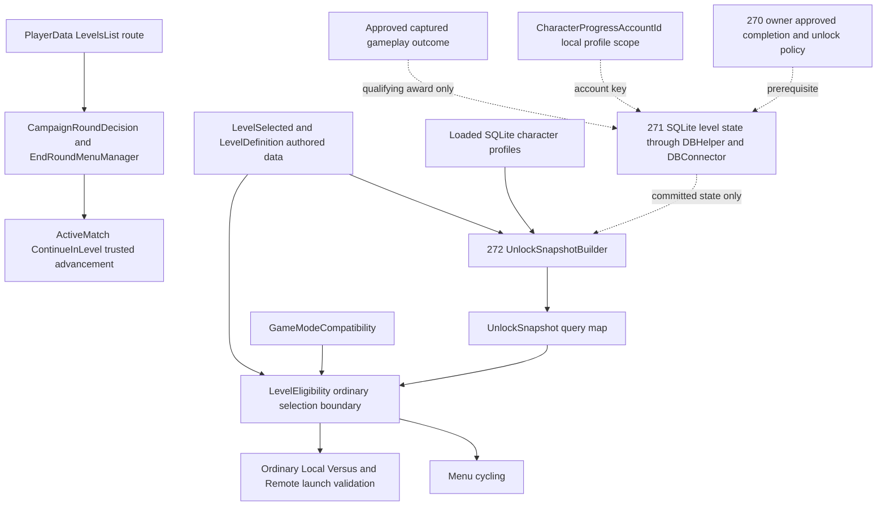

# Level progression policy audit and decision record

**2026-10-14 — POLICY BLOCKED.** Issues [#270](https://github.com/sweat-this/level5/issues/270), [#271](https://github.com/sweat-this/level5/issues/271), and [#272](https://github.com/sweat-this/level5/issues/272) depend on an owner-approved definition of earned completion and its unlock effect. No such approval appears in their current bodies or comments, or in parent [#230](https://github.com/sweat-this/level5/issues/230). This audit supplies the current behavior, proposed decisions, two review passes, and a conditional implementation plan. Recommendations below are **not approved**. No production implementation or schema change is authorized by this record.

## Verified baseline and coordination

| Item | Current evidence |
| --- | --- |
| Repository and target | `sweat-this/level5`, `dev`; the initial shell directory was Level5Backend, but all project work uses the Unity repository |
| Ref refresh | `git fetch origin dev` succeeded, exit 0 |
| Final coordination refresh | Fetch and open-PR listing repeated after drafting; both exit 0, same dev SHA, still no open PRs |
| HEAD and origin/dev | Both `4f04e4cbe3da7ec5bc5c7755b404ddb0adcef714` |
| Latest merge | #307, correspondence engagement documentation; it does not approve level progression |
| Unity | `6000.5.7f1`, revision `017862109af0`, from `ProjectSettings/ProjectVersion.txt` |
| Issues | #270, #271, #272 and #230 OPEN; all four have zero comments; their child acceptance checkboxes are unchecked |
| Open PR overlap | `gh pr list --repo sweat-this/level5 --state open --limit 100 --json number,title,headRefName,baseRefName,url,updatedAt` returned `[]`, exit 0 |
| Checkout | Initially clean on `dev`; other existing worktrees were inventoried and left alone |
| Deliverable changes | This report and its documentation-index link only; inspection helpers and asset evidence are under ignored `TestResults/level-progression/` |

Read `AGENTS.md`, `docs/ai/PRESETS.md`, `docs/README.md`, `docs/persistence-boundaries.md`, the campaign finale/build report, and relevant versus/progression documentation. Followed the requested gameplay review then architecture/data review; the request's policy stop takes precedence over the conditional implementation steps.

## Current state by issue

### Issue 270 completion semantics

There is no earned level-completion policy. `MatchLifecycle.CompleteEnd()` moves Ending to Completed after end work reports finished; it does not inspect a winner, mode, death, or unlock entitlement. `GameRules.HandleMatchEnded()` combines score persistence, character progression, starting a campaign transition, and local versus reporting. It also starts remote submission without waiting for acknowledgement. Some persistence paths count a durable retry queue as handled, and character progression eventually releases its end-work gate after repeated save failures with a warning. Consequently neither Completed nor `MatchProgressionResult.Applied` proves that level completion was earned and committed.

`CampaignRoundDecision.Decide(final, winnerIsCpu, tie, continues)` implements run navigation: ties retry; a non-tie human victory advances or completes the final round; CPU wins retry while continues remain, otherwise end the run. It has no death, abandonment, account, or storage input. `GameRules.LoadNextCampaignLevel()` obtains sorted scores and winner identity after a five-second delay and writes mutable `EndRoundData`. Those are navigation evidence, not a durable completion receipt. A future award must use an approved outcome captured for the completed round, rather than reconstructing entitlement from a later menu or callback.

### Issue 271 durable authority

No production level-progress table, save file, award operation, or per-account level-completion set exists. `CharacterProfile` and SQLite `ProgressionResultLedger` own character XP. `DBHelper.ApplyProgressionResult` updates the character and inserts its globally unique result ID in one transaction, returns Applied only after commit, rolls back duplicates, and releases `DatabaseLocked` in `finally`. `DBConnector` delegates to this owner. `MatchSession` supplies existing match result IDs; campaign advancement begins a new round session.

`ProgressionService` resolves `CharacterProgressAccountId.GetCurrent()` when applying XP. `Applied = true` can mean that `PendingProgressionStore` accepted a retry request, rather than that SQLite changed. `LoadManager` repairs pending XP once the database is ready. Retired character JSON and JSON result-ledger artifacts supply no live earned-level authority and must not be revived.

Identity is local: positive `LocalAccountIdentity.UserId` becomes invariant decimal text; otherwise a nonblank username, otherwise `guest`. Normal guest selection sets user ID 74 and name `guest`, so its established durable scope is **`74`**, not the literal fallback `guest`. These scopes must not be silently aliased. Backend V2 identity and authentication remain separate.

`DBHelper.DeleteLocalProfile` owns its lock and transaction, deletes only the target account's CharacterProfile and existing ProgressionResultLedger rows, then requires exactly one matching User deletion before commit. It rejects reserved guest ID 74. `UserAccountManager` removes that account's retired/retry JSON families after commit, including backup/temp files. Local profile IDs are never reused. A future level table must join this same transactional deletion boundary; any future pending award must not recreate deleted-account state after partial file cleanup.

### Issue 272 selection and launch

`LevelSelected` holds authored stable IDs, Selectable, Locked, and arena capabilities. `LevelPreset`/`LevelDefinitionFactory` project these into `LevelDefinition`; `LevelCatalog` and `LevelDefinitionCatalog` provide lookups. `MatchCatalogs` prefers authored `Resources/Match/Levels` assets, then fallback definitions. No such authored definition assets currently exist. `LoadManager.loadLevelSelectDataList()` filters legacy prefabs by IsSelectable, sorts by stable level ID, and supplies the ordinary fallback catalog.

`UnlockSnapshotBuilder.Build` allocates fresh maps. Character answers use loaded SQLite profiles, primary roster taking precedence over CPU fallback; missing characters are locked. Level answers are only `!LevelDefinition.Locked`. `UnlockSnapshot` exposes query methods and no mutation API, but stores the supplied dictionary references without defensive copies; the builder currently retains no writable alias. Preserve this ownership when adding earned state.

| Path | Verified source behavior | Consequence for future earned progress |
| --- | --- | --- |
| Start menu | `InitializeDisplay()` builds the snapshot after data/experience loading; level/mode cycling delegates to LevelEligibility; `loadGame()` passes the held snapshot to the builder | Refresh after committed progress and account reload; validate the account and current committed state at launch |
| Ordinary builder | Compatibility validates existence, arena fit, and roster. With a nonnull snapshot, LevelEligibility additionally rejects nonselectable or locked levels | Keep authored compatibility, selectability, initial availability, and earned state distinct |
| Local Versus | Launch and simultaneous launch reject null snapshots and preflight level/character eligibility before issuing an attempt; final BuildMatch passes the same snapshot to the builder | Keep the gates before attempt consumption; check account continuity at final launch |
| Local Versus production selection | LocalVersusController supplies UnlockSnapshotBuilder through the screen model's provider. Refresh filters through LocalVersusFlow.EligibleLevels/LevelEligibility, with the Multiplayer arena capability for simultaneous play. PlayTurn/PlayGame obtain a fresh provider snapshot before launching | Keep filtering and launch on the existing shared path; a fresh projection still needs the correct account's loaded inputs |
| Local alternating compatibility | A selectable, unlocked but incompatible arena can issue an attempt before final mode/arena validation; it stays outstanding for retry | Preserve this deliberate behavior rather than broadening the preflight |
| Remote correspondence | The production screen uses fixed DefaultLevelId 1, with no remote level picker. Current-primary resolver builds a snapshot from LoadedData; launcher rejects null/unknown/nonselectable/locked before StartAttempt; descriptor mapper passes the same snapshot to the final builder after the network yield | Same-snapshot revalidation does not establish freshness or account ownership across that yield; check the captured local account before accepting the response |
| Local profile switch | `LocalAccount` writes the local identity and enters the loading scene; StartManager rebuilds on initialization | There is no owner ID in UnlockSnapshot. Arbitrary retained snapshots cannot prove which profile they belong to |
| Legacy/direct scene | Builder with null snapshot skips both unlock and selectable revalidation; LevelEligibility with null skips the account gate but still checks selectability when invoked | Preserve deliberate legacy behavior and prevent new ordinary production paths from opting into it |
| Campaign advancement | EndRoundMenuManager converts the actual route destination, calls `ActiveMatch.ContinueInLevel`, begins the new configuration, and applies the legacy bridge; no ordinary eligibility gate runs | Hidden destinations remain legal; do not replace this with an ordinary catalog lookup or menu-selectability check |

Existing tests cover authored unlock flags, unknown IDs, locked menu cycling, stale persisted indices, null-builder compatibility, local/remote preflight rejection, authored campaign ordering, and profile deletion. They do not establish an implementation of durable earned levels or account freshness for that future state. They were inspected, not executed for this documentation-only package.

The correspondence screen's nearby comment still says local versus has no production caller/picker. The current LocalVersusController/ScreenModel/Flow code above supersedes that comment; its stale wording is not evidence that local-versus selection is absent.

## Authored availability and route

The read-only prefab/GUID inventory found **23 LevelSelected prefabs, 21 selectable, and zero authored locked prefabs**. All 21 ordinary selectable arenas are initially accessible subject to mode/arena compatibility. Boneyard (24) and Dev (23) are nonselectable and unlocked in authored data. Every campaign destination scene exists and is enabled in build settings.

`PlayerData.LevelsList` is the campaign route authority. Its stable IDs, in order, are:

```text
1 -> 3 -> 2 -> 8 -> 6 -> 13 -> 19 -> 14 -> 20 -> 7 -> 21
  -> 9 -> 16 -> 5 -> 24 -> 4 -> 10 -> 11 -> 22 -> 15 -> 23
```

Thus Scrapyard (1) leads to Avenue B (3), not level 2; The Slab (5) leads to hidden Boneyard (24); Cocaine Island (15) leads to hidden Dev (23), the final round. IDs 17 and 18 are ordinary selectable arenas outside this campaign route. Level ID, prefab filename, scene number, route index, and menu index are different identities.

`StartManager.forceCampaignStartLevel()` replaces the menu selection with level ID 1. Independently, `resolveSceneName()` forces campaign launch to Scrapyard. **Later campaign entry requires addressing both overrides**, synchronizing the actual route index and opponent, and defining new-run stats/continues. It is not achieved by unlocking a level or changing only its scene.

## Dependency and authority diagram



Solid edges describe existing ownership; dashed edges require approved new policy/implementation. Character XP retains its independent SQLite transaction/result identity. Backend V2 owns no local level-progress decision. A future campaign-entry entitlement must not be confused with ordinary menu eligibility.

## Issue 270 decision and blocker matrix

**Owner approval: absent.** The following recommendations make a narrow proposal reviewable; they do not settle product rules. Every proposed rule must be accepted or replaced before #271 production work. Required preservation rules come from the supplied request and remain in force now.

| Decision | Current behavior | Recommendation, not approved | What approval determines |
| --- | --- | --- | --- |
| D1 Completion | No earned concept | A successfully finalized, non-tie human campaign victory with the player alive; require a valid configured round and captured outcome | Qualifying predicate, treatment of timed wins and unknown end causes |
| D2 Awarding modes | No level-awarding modes | Only BeatThaComputahs (26), one local human versus authored CPU; exclude ordinary/free play/endless modes | Whether mode ID belongs in the persistent key |
| D3 Campaign relationship | Campaign navigation and ordinary selection differ | Track campaign completion separately from ordinary arena availability | Whether one level completion set is sufficient |
| D4 Unlock effect | No runtime unlock; all ordinary arenas already unlocked | Preserve current access. Owner must identify whether earned completion grants later campaign entry, named future ordinary content, or only completion history | **Hard blocker: no actual new entitlement or target is approved** |
| D5 Graph | Authored campaign route above | If campaign-related, use the actual next route destination, never ID + 1; final Dev has no successor | Exact grant mapping; handling of future route changes |
| D6 Initial access | 21 ordinary arenas; campaign starts at Scrapyard and advances in-run | Preserve all 21; preserve first-round campaign entry unless D4/D8 explicitly change it | Fresh-profile defaults and any future initially locked IDs |
| D7 Existing players | Same authored access as new players; no completion history | Preserve all previously available content; do not infer completion from XP or HighScores | Grandfather policy if any new locks are requested |
| D8 Future campaign entry | Always forced to Scrapyard | Keep current entry for the smallest slice. Approve later-round entry separately if that is the intended unlock effect | Changes to campaign selection, both launch overrides, opponents, aggregates, and continues |
| D9 Ranks and statistics | Existing score/XP authorities only | No level stars, ranks, medals, best result, or completion counter | Whether set-based idempotency suffices or event/result state is necessary |
| D10 Replay | Existing ordinary XP/results behavior | Set insertion becomes a no-op for an already completed level; existing character XP rules remain independent | Whether replay has additional rewards or progress changes |
| D11 Nonwins and save failure | Navigation retries ties/losses; storage can queue or fail | No grant for ties, losses, death, abandonment, unknown/invalid outcomes. A failed level commit grants nothing; retry the same captured award | Whether failed awards must survive application restart, and how navigation behaves during a failed/pending save |
| D12 Lifetime and reset | No level-progress state | Monotonic until explicit local-profile deletion; no reset UI or revocation in this slice | Deletion/reset and route-migration obligations |
| D13 Profiles and guest | Numeric local scopes; normal guest is 74; literal guest fallback also exists | Use the established scope unchanged; guest progress persists on this installation; no guest-to-profile merge | Whether guest instead remains ephemeral and whether a clear-guest operation is required |
| D14 Competitive/remote | Local simultaneous is competition-only; alternating/remote can still reach ordinary XP paths | Exclude all active local versus and remote attempts from level awards, regardless of their XP behavior | Award exclusions and account attribution; no Backend authentication dependency |

### Material design conflict to resolve

`UnlockSnapshot.IsLevelUnlocked(levelId)` has no mode or campaign-entry dimension. A single boolean cannot say that an arena is ordinarily available but locked as the starting round of a campaign. Setting it false would revoke current ordinary access; setting Selectable true on Boneyard/Dev would expose hidden content. Neither is authorized.

The owner must choose an observable unlock effect before implementation. Completion-history-only fits the smallest proposed state but supplies **no newly unlocked current arena**, so it must not be represented as satisfying #272's earned-unlock goal. Later campaign entry is a larger, explicit campaign-entry requirement and must preserve the ordinary snapshot contract. New ordinary unlock targets require named content and initial/migration rules. This audit chooses none of those product outcomes on the owner's behalf.

### Proposed outcome matrix

Every durable-award cell below is an **unapproved recommendation** under D1/D2/D11; current production awards no durable level completion in every row.

| Outcome | Existing campaign navigation | Proposed completion after successful level commit | Proposed access effect |
| --- | --- | --- | --- |
| Valid campaign human win, alive, nonfinal | Advance | Insert completed level ID once | Only the exact D4/D5 grant, once approved |
| Valid campaign human win, alive, Dev finale | Complete | Insert Dev completion once | No successor; no fabricated level 24 grant |
| Timed campaign end with valid human victory | Uses scores/winner | Qualify only if owner approves a timed victory as D1 completion | Timeout itself never grants access |
| Tie, including final round | Retry, no continue consumed | None | None |
| CPU win with continue | Retry; pressing Next consumes a continue | None | None |
| CPU win without continue | EndRun | None | None |
| Player dies, even if ahead on score | Death reaches the campaign result path; Decide itself sees scores, not death | None | None |
| Abandonment, manual stop, invalid/missing composition, unknown outcome | No earned-completion policy | None | None |
| Ordinary arena win/objective/timeout | Not campaign navigation | None under campaign-only proposal | Existing availability unchanged |
| Arcade, Free Play, endless survival exit | Existing mode-specific result rules | None | None |
| Any local versus or remote correspondence result | Competition-owned result path | None | None |
| Replay of an already recorded qualifying completion | Existing navigation | No additional level state/reward | Existing grants retained |
| Level write fails or transaction rolls back | Approved navigation/retry behavior still required | None until a later successful commit | Never project queued work as unlocked |
| Duplicate callback or crash after commit before acknowledgement | Existing end-work retry mechanisms | Same set insertion is a no-op | Same grant, no duplicate XP invocation |

### Initial availability and migration semantics

For the preservation proposal, a missing level-progress table or an existing account without rows means **no recorded completions**, while the same 21 ordinary arenas remain available. Lack of completions does not mean lack of initial entitlement. Historical scores and character levels are insufficient evidence for backfilling completion. Unknown/stale completion IDs cannot create catalog entries, ordinary selectability, compatibility, or grants to unrelated content.

If later campaign entry is approved, explicitly define which completed/unlocked rounds may start a new run, including hidden rounds, and whether a new run resets score/continues. Restoring an unfinished run is a separate state requirement, not implied by an unlocked entry round. If new ordinary locks are approved, define exact stable IDs, new-account defaults, and preserved existing-account grants before selecting a migration.

## Review pass 1 gameplay correctness

Initial plan: derive a completion predicate, store one completion per account/level, then feed earned availability into the existing snapshot/eligibility flow. Challenged that plan against current gameplay and refined it as follows.

| Concrete problem found | Required refinement |
| --- | --- |
| Completed includes nonwins and finished/queued end work | No lifecycle-event-only award; approve a separate outcome predicate |
| CampaignRoundDecision has no death or abandonment input | Inspect approved end reason and survival as well as victory; do not permanently award from Advance alone |
| Time expiration can be normal round finalization or failure | Define mode-specific timed-win semantics; do not award every timeout or reject all time-limited victories implicitly |
| Numeric IDs are not the campaign graph | Resolve the authored successor; test 1 to 3, 5 to 24, and 15 to 23 |
| Boneyard/Dev are hidden; 17/18 are outside the route | Keep route membership separate from ordinary catalog membership and mode support |
| All 21 ordinary choices already unlock initially | Reject the proposed implicit next-arena lock ladder; require D4's actual product effect |
| Later campaign entry is forced back to Scrapyard in two places | Flag D8 as a separate launch/index/opponent requirement, not a snapshot-only fix |
| A competitive mode can use an otherwise ordinary result path | Explicitly exclude both local competitive contexts and remote attempts if the campaign-only proposal is approved |
| Guest and multiple local profiles have different stable scopes | Specify guest lifetime and account attribution; no shared mutable global unlock map |
| Replays, reset, and old accounts could silently change access | Approve monotonicity, no historical inference, and migration before any locking |

**Revised plan:** retain existing ordinary/campaign access; leave unlock effect and resume policy as explicit blockers; do not start persistence based on the initial tentative completion definition.

## Review pass 2 architecture and data integrity

Reviewed the revised plan independently for ownership, storage, compatibility, and failure behavior.

| Concrete problem or constraint | Final refinement |
| --- | --- |
| SQLite already owns live local progression | Use DBHelper/DBConnector transactions and locking; no CharacterProfile arena fields, JSON projection, cloud dependency, or replacement XP service |
| A monotonic completion set does not require event history | Investigate a unique `(accountId, levelId)` key and insert-or-ignore before copying the XP result ledger |
| XP Applied may mean queued; repeated failures can release Completed | Read only committed level state; neither XP success flags nor phase finality authorize a grant |
| Current XP resolves the account when applied | Capture the intended local account for a level award at match launch; verify it at finalization and retry rather than crediting whichever profile is now selected |
| Profile deletion has transactional and postcommit file boundaries | Add account-scoped level deletion to the same SQL transaction; prevent stale pending requests from restoring deleted profiles, while preserving non-reused IDs and guest rejection |
| Remote final build reuses an earlier snapshot across a network yield | Add caller-owned account-continuity/freshness checks without changing the public snapshot contract or creating a global mutable cache |
| Snapshot is query-only but aliases constructor maps | Keep writable maps private to their builder; never mutate a returned snapshot to simulate earned progress |
| Null snapshot has deliberately permissive legacy behavior | Preserve legacy/direct-scene compatibility; require nonnull current snapshots on ordinary production launchers |
| Campaign advance constructs configuration directly | Preserve that trusted route path and GUIDs; do not force hidden destinations through LevelEligibility or the ordinary catalog |
| Mode-specific campaign-entry locks cannot share ordinary boolean meaning | Resolve D4/D8 before designing any extra campaign-entry policy; do not add a speculative manager |
| Failed-save restart recovery can require durable pending intent | Approve that requirement before choosing recovery storage; pending intent is not an earned projection. Keep character retry/result identity separate |
| Route edits can change a grant derived from a completion set | Approve the grant mapping and permanence contract. Preserve grants through explicit migrations if that mapping later changes |

**Final plan:** policy-blocked; only this audit and the index entry change now. No table, service, gameplay hook, asset edit, GUID change, ledger, or migration has been introduced.

## Conditional minimal state and implementation plan

If the owner approves campaign-only, mode-independent, monotonic completions without replay rewards or result statistics, the smallest candidate durable state is:

```text
CompletedLevel(accountId TEXT NOT NULL, levelId INTEGER NOT NULL)
UNIQUE(accountId, levelId)
```

This is a design candidate, **not executed DDL**. Missing rows mean no earned completion. Initial access remains policy/authored input, separate from completion rows. Investigate transactional `INSERT OR IGNORE` plus postcommit reads. A result ledger, timestamp, completion count, rank, best score, redundant unlock flag, or JSON mirror is unnecessary for that candidate. If unlocks cannot be derived without losing approved permanent grants, or modes/replay matter, revisit the keys/state explicitly instead of forcing this model.

An award intent must retain account ID, stable level ID, and the qualifying captured outcome across retries. Add a result/event key only when approved semantics need it. A restart-safe failed-save promise may require a bounded durable retry record; its format and cleanup follow that approved promise, not a speculative storage design.

| Step and issue | Likely changed files and reason | Acceptance evidence |
| --- | --- | --- |
| 1, #270 | Approve/replace D1–D14 and outcome matrix; name concrete unlock targets and campaign-entry behavior | A pure predicate and expected grants can be written without guessing |
| 2, #270 | Add only the approved plain policy and focused Editor tests in existing Core/Tests organization | Win/nonwin, timeout, death, final round, replay, excluded modes, authored successor |
| 3, #271 | DBHelper/DBConnector own separate account-scoped storage/read/update and lock recovery; a small level-specific adapter only if the call sites justify it | Disposable SQLite: defaults, two-account isolation, duplicate insert, rollback/retry, reopen |
| 4, #271 | Existing match launch/end owner captures account and qualifying round outcome; keep ProgressionService's XP award unchanged | Duplicate callbacks and level retries never apply XP again; account switch cannot redirect a grant |
| 5, #271 | DeleteLocalProfile transaction and, only if needed, owned pending cleanup; consider allocation high-water behavior if new orphan numeric scopes can exist before sequence initialization | Deletion rollback/isolation; stale retry cannot restore deleted-profile progress; guest policy |
| 6, #272 | UnlockSnapshotBuilder reads approved committed state and constructs one privately owned map; retain public UnlockSnapshot query API | Builder tests cover initial versus earned availability, absent state, stale/unknown IDs, and legacy JSON exclusion |
| 7, #272 | StartManager, current-primary resolver, and affected versus/remote callers refresh/revalidate account-scoped context at selection/launch boundaries | Same account/menu/launch answers; account change while awaiting remote response fails safely |
| 8, #272, only if D8 approved | Both campaign-entry overrides, actual route-index/opponent initialization, and a narrow explicit campaign-entry policy/UI; preserve ContinueInLevel advancement | Configured PlayMode entry and hidden-destination transitions; fresh aggregate/continues per approved rule |
| 9, publication | Refresh dev, issues, PR overlap, and diff again; inspect all schema/source/asset changes; use issue-aligned commits and a focused PR targeting dev | #271/#272 acceptance gates complete before a combined implementation PR; do not close dependencies early |

No scene, prefab, GUID, serialized field, network payload, Backend contract, or character XP redesign is currently needed. Changes to these require a concrete approved rule, not architectural cleanup. A completion-only policy may need #271, but cannot be claimed to deliver a new unlock effect for #272.

## Validation evidence and next execution gates

This is Level 0 documentation/static-audit work. No Unity process or player database was opened. Asset inventory is source evidence, not a Unity test pass.

| Check and exact command/tool | Actual result |
| --- | --- |
| `git fetch origin dev` in the Unity repo | PASS, exit 0; initial sandbox FETCH_HEAD write denial was resolved through reviewed escalation |
| `git rev-parse HEAD origin/dev` | PASS, exit 0; both refs equal the baseline above |
| `git status --short --branch` and `git worktree list` | PASS, exit 0; clean starting dev, existing worktrees inventoried |
| `gh pr list --repo sweat-this/level5 --state open --limit 100 --json number,title,headRefName,baseRefName,url,updatedAt` | PASS, exit 0; no open PRs; network-restricted first attempt was replaced with reviewed read-only access |
| GitHub connector `fetch_issue` and `fetch_issue_comments` for 270, 271, 272, 230 | PASS; open issues, empty comment lists; connector calls have no process exit code |
| `python TestResults/level-progression/audit_assets.py` | PASS, exit 0; 23 prefabs, 21 selectable/unlocked, actual GUID route matches, all route scene files enabled/existing; `asset-inventory.json` retained locally |
| First asset-inventory execution | FAIL, exit 1 in the audit helper: it initially assumed generated LevelDefinition assets existed. Corrected to inspect all Resources locations and verify their actual absence; no production failure or edit |
| `python TestResults/level-progression/inspect.py state`, `db`, `campaign`, `menu`, `launch`, `catalog`, `outcomes` | Source excerpts inspected, exit 0; helper reported missing guessed paths explicitly and those were resolved through repository search |
| `python TestResults/level-progression/inspect.py ui` | Local-versus filtering/fresh launch projection and fixed remote default inspected; helper itself exit 0 |
| `git diff --check` | PASS, exit 0 |
| `python TestResults/level-progression/check_report.py` | PASS, exit 0; all 33 local source links resolve and both Markdown files have no trailing whitespace |
| `git diff --exit-code -- Assets Packages ProjectSettings` | PASS, exit 0; no production source, asset, package, or project-setting changes |
| Unity EditMode/PlayMode, build, physical gameplay | NOT RUN; no runtime implementation and #270 policy gate prevents meaningful new policy certification |
| Hosted CI | NOT RUN for this local documentation package; no current hosted test result is claimed |

After approval, use the pinned editor and disposable fixtures. Run the smallest affected EditMode subset: the new policy/storage tests plus `Level5UnlockSnapshotTests`, `Level5LevelEligibilityTests`, relevant `Level5MatchConfigurationTests`, `Level5VersusLauncherTests`, `Level5LocalVersusTests`, `Level5LocalSimultaneousVersusTests`, `Level5BackendV2RemoteAttemptLauncherTests`, `Level5CharacterProgressAccountIdTests`, `Level5LocalProfileDeletionTests`, and `Level5CampaignRouteTests` as changes warrant. Existing `ProgressionServiceApplyMatchResultTests` and `ProgressionPersistenceRecoveryTests` protect XP independence. Do not run the entire list by habit.

If campaign runtime changes, run the affected configured `CampaignBoundaryPlayModeTests` path in addition to any pure `CampaignRoundPlayModeTests` decision seam. Isolate the full project/data path or protect every startup-consumed file family, including root score/result/session queues, account-scoped pending XP, and each primary/`.bak`/`.tmp`. A disposable SQLite connection alone does not protect normal player files. Do not treat old report XML or managed-only runs as fresh Unity evidence. Record expanded commands, process exit and XML assertion counts separately when those checks actually run.

## Acceptance and PR ready summary

| Issue | Status | Remaining acceptance gate |
| --- | --- | --- |
| #270 | **BLOCKED — audit and draft decision record complete, semantics not approved** | D1–D14 acceptance/replacement, especially actual unlock effect, campaign entry, initial/migration policy, and failure/replay behavior |
| #271 | **BLOCKED by #270 — production NOT STARTED** | Approved state requirements, durable account ownership, idempotency, failure/restart/deletion evidence, independent XP |
| #272 | **BLOCKED by #270/#271 — production NOT STARTED** | Approved earned grant targets, snapshot integration/freshness, ordinary and alternate launch agreement, preserved campaign route |

Suggested documentation PR title: `Document level progression policy blockers and current ownership`.

Suggested body: Current dev has no approved definition of level completion and all 21 ordinary selectable arenas are already unlocked. Record the verified route, persistence and launch authorities, a draft outcome/decision matrix, two review passes, and conditional minimal implementation steps for #270–#272. Production changes remain gated on owner approval. Validation is read-only asset/source inspection plus documentation checks; Unity tests were not run. References #270, #271, #272 and #230; closes none.

Publishing this record does not approve the recommended gameplay policy or close any progression issue. The next product decision is the precise unlock effect: later campaign entry, named ordinary content, or completion history only, followed by explicit acceptance/replacement of the remaining decision rows.

## Source pointers at the verified SHA

Paths below are relative to this document; method names and line numbers refer to the baseline above.

| Source | Relevant evidence |
| --- | --- |
| [LevelSelected](../Assets/Scripts/menu_start/LevelSelected.cs), [factory](../Assets/Scripts/menu_start/LevelDefinitionFactory.cs), [LevelDefinition](../Assets/Level5/Core/Match/LevelDefinition.cs) | Authored stable ID, Selectable, Locked, and capabilities |
| [LoadManager](../Assets/Scripts/menu_loading/LoadManager.cs) | 190–245 account startup/repair; 590–616 ordinary level filter |
| [UnlockSnapshotBuilder](../Assets/Scripts/menu_start/UnlockSnapshotBuilder.cs), [UnlockSnapshot](../Assets/Level5/Core/Progression/UnlockSnapshot.cs) | Fresh builder maps, authored level unlock source, unknown-ID default, constructor dictionary ownership |
| [LevelEligibility](../Assets/Level5/Core/Match/LevelEligibility.cs), [MatchConfigurationBuilder](../Assets/Level5/Core/Match/MatchConfigurationBuilder.cs) | Shared ordinary validation; nonnull versus legacy-null behavior |
| [StartManager](../Assets/Scripts/menu_start/StartManager.cs) | 1150–1179 snapshot initialization; 1675–1769 ordinary launch and both campaign-entry overrides |
| [CharacterProgressAccountId](../Assets/Scripts/player/Level5Player/CharacterProgressAccountId.cs), [LocalAccount](../Assets/Scripts/account/LocalAccount.cs) | Local scope mapping and normal profile/guest selection |
| [DBHelper](../Assets/Scripts/database/DBHelper.cs), [DBConnector](../Assets/Scripts/database/DBConnector.cs) | 571–734 XP transaction; 1338–1454 allocation invariant; 2396–2493 deletion; connector 527–542 delegation |
| [ProgressionService](../Assets/Scripts/menu_progression/ProgressionService.cs), [MatchProgressionResult](../Assets/Scripts/menu_progression/Level5MenuProgression/MatchProgressionResult.cs) | XP result identity, queue versus commit meaning, account resolution |
| [MatchLifecycle](../Assets/Level5/Core/Match/MatchLifecycle.cs), [MatchController](<../Assets/Scripts/game manager/Level5Match/MatchController.cs>), [GameRules](<../Assets/Scripts/game manager/GameRules.cs>) | Finality, end-work/retries, competition-only latch, XP, delayed campaign outcome extraction |
| [CampaignRoundDecision](../Assets/Level5/Core/CampaignRoundDecision.cs), [EndRoundMenuManager](../Assets/Scripts/menu_end_round/EndRoundMenuManager.cs), [ActiveMatch](<../Assets/Scripts/game manager/Level5Match/ActiveMatch.cs>) | Run decisions, terminal aggregate save/queue, trusted hidden-destination advancement |
| [PlayerData prefab](../Assets/Resources/Prefabs/critical/player_data.prefab), [campaign build report](gp-001-f5-campaign-build-integrity.md) | Actual ordered GUID references and prior finale ownership decision |
| [VersusLauncher](../Assets/Scripts/versus/VersusLauncher.cs), [RemoteAttemptLauncher](../Assets/Scripts/versus/RemoteAttemptLauncher.cs), [descriptor mapper](../Assets/Scripts/backendv2/Level5BackendV2/Correspondence/RemoteAttemptDescriptorMapper.cs), [current-primary resolver](../Assets/Scripts/menu_start/player_select/RemoteCharacterSelectionResolver.cs) | Preflight, final builder, network-yield and account/snapshot ownership boundaries |
| [LocalVersusFlow](../Assets/Scripts/menu_local_versus/LocalVersusFlow.cs), [screen model](../Assets/Scripts/menu_local_versus/LocalVersusScreenModel.cs), [controller](../Assets/Scripts/menu_local_versus/LocalVersusController.cs), [correspondence screen](../Assets/Scripts/menu_multiplayer/CorrespondenceScreenController.cs) | Actual production selection/launch paths and fixed remote default |
| [Persistence boundaries](persistence-boundaries.md), [versus architecture](versus-architecture.md) | Existing SQLite/retired JSON/local identity/competition ownership contracts |
