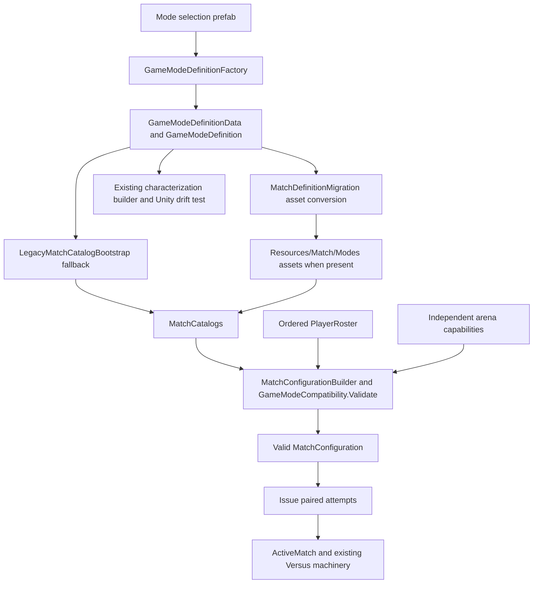

# Explicit two-local-human mode capability

Implementation evidence for #234, #235 and #278, 2026-10-14.

## Baseline and current findings

Fetched `origin/dev`: `014c82afd03dcc403470765f08b9dcf5b2568eff` (Unity `6000.5.7f1`). All three issues are open. PR #280 merged as `c4353a905d845f65e83b0a1c253168e7264d4b8b`; its arena correction and existing Unity characterization drift test are retained. No open PRs were returned by the preparation overlap check. Existing local simultaneous/input/camera branches are historical work already incorporated into dev; unrelated worktrees are left alone.

#234 remains unimplemented: total roster capacity and arena capability currently suffice for two humans. #235 has existing Total Points gameplay coverage but no explicit mode authorization. #278 already has correct arena rows and a deterministic Unity drift test; only mode capability output and snapshot refresh remain.

Production definitions come from `StartScreenModeSelected -> GameModeDefinitionFactory -> GameModeDefinitionData -> GameModeDefinition.Create/Apply`. `LegacyMatchCatalogBootstrap` supplies these as fallbacks to `MatchCatalogs`; authored `Resources/Match/Modes` assets take precedence when present (none are checked in). `MatchDefinitionMigration.ToData` copies freshly converted definitions into existing assets in place, preserving GUIDs. `LoadGame` separately creates a synthetic one-human/CPU definition for its legacy fallback; this retains default-deny authoring.

## Existing and target flow



The target keeps this graph. The prefab adds default-false `supportsTwoLocalHumans`; conversion and migration carry it unchanged. Compatibility adds one independent mode refusal. Total roster bounds keep their existing meaning. Total Points alone authors true; the flag is never inferred from its ID. `CanPlay(mode, level)` remains a mode/arena query.

## Review pass 1: gameplay correctness

The initial Boolean-only check was insufficient: it could authorize three/four humans or two humans plus CPUs. Correction: for more than one human, require a known mode, the opt-in, exactly two local humans and exactly two roster participants, with neither a required CPU opponent nor an implicit defender. A single typed mode refusal covers unsupported local-human composition. Keep the arena refusal separate and preserve total participant bounds.

Solo and one-human/CPU requests do not enter this new gate, including required-CPU and Lockdown behavior. Existing remote/replay rejection remains. Missing catalogs/modes/levels keep their existing early failures. The builder returns no configuration after refusal. The existing simultaneous launcher already loads and checks the series, validates level/characters, performs device preflight, builds the configuration, then issues the pair and begins the match; no duplicate validation or mode-ID exception belongs there. Participant IDs, input-slot order, statistics, HUD, result atomicity and persistence retain their existing owners.

## Review pass 2: architecture and integration

Correction: conversion alone is insufficient because migration's existing-asset copy must include the field too. Add it to `GameModeDefinitionData`, `Create/Apply` and `MatchDefinitionMigration.ToData`, and verify both true and false through the copy. Unmigrated serialized definitions and synthetic factory defaults must remain false. Synthetic approved two-human fixtures explicitly opt in; the general fixture default stays false.

Use the existing authored-data validator to enforce every prefab's effective flag and exactly one shipping opt-in. Reuse `BuildCharacterizationMatrix` and `CheckedInModeCharacterizationMatchesCurrentAuthoredSources`; add a clearly labeled capability column beside the preserved total-roster column. Refresh Markdown and JSON with their owning Unity entry points, then export again and compare bytes. No second generator, catalog, capability framework, arena change, versus ruleset change or Backend/persistence change is needed. Preserve serialized names, GUIDs, stable IDs, sorting, invariant formatting and exporter encoding.

## Final implementation plan

1. #234: add the default-deny field through prefab source, factory, data/definition and migration copy; append the typed refusal and validate exact supported roster topology. Extend focused compatibility, builder, default/conversion/migration tests. Explicitly mark only approved two-human synthetic fixtures.
2. #235: author Total Points true; validate every shipping mode, positive Scrapyard build, negative uncertified arena/mode builds, and launcher refusal before attempts. Reuse production virtual-device PlayMode tests for slot order, distinct stats/HUD, atomic result retry and durable Best-of-three history.
3. #278: add the mode-level column, refresh both generated artifacts through Unity, retain the drift authority and verify repeat-export determinism.
4. Run the requested repository validator and affected EditMode/PlayMode filters in an isolated full-project worktree with disposable persistence. Record NUnit results separately from process exits. Refresh dev/overlap immediately before publication and review the final diff. Publish the cohesive package together to dev; do not merge or close issues without completed acceptance evidence.

## Validation and acceptance

Final acceptance: **#234 PASS**, **#235 PASS for the requested virtual-device runtime gates**, **#278 PASS**. No requested implementation or automated acceptance gate remains blocked. Physical-device and built-Player certification were not run and are not implied by these results.

| Issue | Evidence |
| --- | --- |
| #234 | Default/new/unmigrated/synthetic mode authoring stays false; conversion and migration both set and clear the flag; total capacity does not grant it; distinct typed refusal; exact two-human topology; required CPU/implicit defender and remote/replay refusal; solo/CPU compatibility preserved. |
| #235 | All 24 mode prefabs checked: Total Points alone true. Builder and runtime fallback catalog accept it only on The Scrapyard; other modes and all other selectable arenas refuse. Unsupported/missing mode fails before either attempt is issued. Four production PlayMode tests pass for virtual gamepads, series-order slots, independent actors/stats/input/HUD, same-character players, atomic save failure/recovery and durable Best-of-three history. |
| #278 | Existing arena output preserved; existing Unity drift test passes; both artifacts refreshed with owning exporters; new JSON parity checks all 24 mode fields; repeated exports are byte-identical. |

### Executed checks

| Check | NUnit passed / total | Failed / skipped | Process exit |
| --- | --- | --- | --- |
| Unchanged-source baseline production two-human launch | 1 / 1 | 0 / 0 | Unity logged 0; direct GUI launch did not retain an OS exit handle |
| Initial affected EditMode run | 225 / 227 | 2 / 0 | 2 |
| Repaired simultaneous fixture + asynchronous launcher | 61 / 61 | 0 / 0 | 0 |
| Final affected EditMode run | 255 / 255 | 0 / 0 | 0 |
| Graphics-enabled production simultaneous PlayMode fixture | 4 / 4 | 0 / 0 | 0 |
| Characterization export and repeat | n/a | n/a | 0, 0 |
| Authored JSON export and repeat | n/a | n/a | 0, 0 |
| Repository validator (initial and final) | n/a | n/a | 0, 0 |
| Final whitespace / diff inspection | n/a | n/a | 0 |

The initial failures were new test log expectations: `ValidationResult.ToString()` logs messages, not typed enum names. Both refusal/zero-attempt assertions succeeded. Expectations were corrected, the focused fixture passed, and the final affected run passed. Initial/focused commands also included obsolete mapper filter names which matched no tests; the final command uses the actual `Level5BackendV2AttemptMappingTests` and executes all 16 mapping tests.

Final EditMode fixture counts (all passed, zero skipped):

| Fixture | Count |
| --- | --- |
| `Level5MatchCompatibilityTests` | 11 |
| `Level5TwoHumanLocalRosterTests` | 24 |
| `Level5ArenaMultiplayerCapabilityTests` | 8 |
| `Level5MatchConfigurationTests` | 10 |
| `Level5AuthoredMatchDataTests` | 28 |
| `Level5DocumentationExporterTests` | 17 |
| `Level5LocalSimultaneousVersusTests` | 49 |
| `Level5VersusLauncherTests` | 12 |
| `Level5MatchBridgeParityTests` | 9 |
| `Level5MatchDomainTests` | 11 |
| `Level5MatchArchitectureTests` | 4 |
| `Level5LocalVersusTests` | 44 |
| `Level5BackendV2RemoteAttemptLauncherTests` | 12 |
| `Level5BackendV2AttemptMappingTests` | 16 |

The four production tests are `ABestOf3SimultaneousSeriesIsPlayedToCompletionThroughTheProductionScreens`, `AFinishedGameIsCompetitionOnlyAndItsPairIsSavedAtomically`, `ALaunchedGameSeatsTwoHumansInSeriesOrderAndShowsBothScores`, and `TwoHumansMayPlayTheSameCharacterAndStillGetSeparateActorsAndResults`. Scores are supplied by these existing tests; they exercise real scenes and the existing match-end/result machinery, not physical shooting.

### Commands and isolation

All runs use Unity `6000.5.7f1` and this isolated full-project worktree. For validation only, its product name was temporarily changed to `level5-localhuman-validation-20261014`, giving `Application.persistentDataPath` a disposable location. This protects session/JSON/SQLite data in addition to the fixture's existing throwaway series repository. That ProjectSettings change and incidental SDK/editor-generated files are excluded from the final patch. The original working checkout and normal player persistence are untouched.

```powershell
$unity = 'C:\Program Files\Unity\Hub\Editor\6000.5.7f1\Editor\Unity.exe'
$project = 'C:\Users\Patrick\Documents\github\level5\TestResults\localhuman-worktree'
$results = "$project\TestResults"

# Baseline, before production edits (Unity's own log records the completed exit).
& $unity -batchmode -projectPath $project -runTests -testPlatform PlayMode `
  -testFilter LocalSimultaneousVersusProductionPlayModeTests.ALaunchedGameSeatsTwoHumansInSeriesOrderAndShowsBothScores `
  -testResults "$results\baseline-playmode.xml" -logFile "$results\baseline-playmode.log"

# All subsequent Unity commands use this process wrapper to retain the OS exit code.
function Invoke-PackageUnity([string[]] $arguments) {
  $run = Start-Process -FilePath $unity -ArgumentList $arguments -WindowStyle Hidden -PassThru -Wait
  if ($run.ExitCode -ne 0) { throw "Unity exit code $($run.ExitCode)" }
}

$editFilter = 'Level5MatchCompatibilityTests;Level5TwoHumanLocalRosterTests;Level5ArenaMultiplayerCapabilityTests;Level5MatchConfigurationTests;Level5AuthoredMatchDataTests;Level5DocumentationExporterTests;Level5LocalSimultaneousVersusTests;Level5VersusLauncherTests;Level5MatchBridgeParityTests;Level5MatchDomainTests;Level5MatchArchitectureTests;Level5LocalVersusTests;Level5BackendV2RemoteAttemptLauncherTests;Level5BackendV2AttemptMappingTests'
Invoke-PackageUnity @('-batchmode', '-projectPath', $project, '-runTests', '-testPlatform', 'EditMode',
  '-testFilter', $editFilter, '-testResults', "$results\editmode-final.xml", '-logFile', "$results\editmode-final.log")

# Graphics enabled: no -nographics flag.
Invoke-PackageUnity @('-batchmode', '-projectPath', $project, '-runTests', '-testPlatform', 'PlayMode',
  '-testFilter', 'LocalSimultaneousVersusProductionPlayModeTests',
  '-testResults', "$results\playmode.xml", '-logFile', "$results\playmode.log")

# Each exporter was executed twice, with first-run and -repeat log/exit files.
Invoke-PackageUnity @('-batchmode', '-quit', '-projectPath', $project, '-executeMethod',
  'MatchDefinitionMigration.ExportCharacterizationFromCommandLine', '-logFile', "$results\export-characterization.log")
Invoke-PackageUnity @('-batchmode', '-quit', '-projectPath', $project, '-executeMethod',
  'Level5DocumentationExporter.ExportFromCommandLine', '-logFile', "$results\export-authored.log")

Set-Location $project
./scripts/validate-repository.ps1
git diff --check
```

The initial EditMode command used the final filter's first twelve fixtures plus `Level5RemoteAttemptDescriptorMapperTests`, with `editmode.xml/.log`. The repaired run used `Level5LocalSimultaneousVersusTests;Level5BackendV2RemoteAttemptLauncherTests;Level5BackendV2DescriptorMapperTests`, with `editmode-focused.xml/.log`. All other arguments match the final command.

### Generated diff and determinism

Markdown adds one clearly labeled mode column to 24 rows. Total Points is `yes`, the other 23 are `no`. Removing only the new column reproduces every previous cell and the complete arena section exactly: The Scrapyard remains the sole selectable multiplayer arena.

JSON adds `supportsTwoLocalHumans` to the 24 serialized mode records: one `true`, 23 `false`. Removing only those fields produces a structurally identical document to baseline; all source paths, stable IDs and unrelated values are unchanged. Both exporters retain invariant formatting, sorting and UTF-8 without BOM/LF normalization. Repeat-export SHA-256 values matched the first export:

- `level5-game-mode-characterization.md`: `FCFCEB0192A70961AA0AF7986D073C620A1D1A9C39D858C2B5F0005867537BFA`
- `level5-authored-game-data.json`: `DD0253F7CA0C19D1464274CD2403FE52F842835A0D854333B17C971C27E1389A`

### Exact changed files

- Authority: `Assets/Level5/Core/Match/GameModeDefinition.cs`, `GameModeCompatibility.cs`, `ValidationResult.cs`.
- Authoring/conversion: `Assets/Scripts/menu_start/StartScreenModeSelected.cs`, `GameModeDefinitionFactory.cs`, `Assets/Level5/Editor/MatchDefinitionMigration.cs`, `Assets/Resources/Prefabs/menu_start/mode_selected_objects/mode_selected_01.prefab`.
- Focused coverage: `Assets/Tests/Editor/TestDefinitions.cs`, `Level5TwoHumanLocalRosterTests.cs`, `Level5ArenaMultiplayerCapabilityTests.cs`, `Level5AuthoredMatchDataTests.cs`, `Level5LocalSimultaneousVersusTests.cs`, `Level5DocumentationExporterTests.cs`.
- Evidence/architecture: `docs/README.md`, `docs/player-input-architecture.md`, `docs/versus-architecture.md`, `docs/local-human-capability-package.md`, `docs/generated/README.md`.
- Owning-exporter output: `docs/generated/level5-game-mode-characterization.md`, `docs/generated/level5-authored-game-data.json`.

Immediately before final validation/publication, fetched dev again: unchanged at `014c82afd03dcc403470765f08b9dcf5b2568eff`; open PR overlap remained empty. The final diff contains no new mode/arena grants beyond Total Points, no launcher/result/persistence/Backend changes, no new assets or GUID changes and no ProjectSettings changes. Hosted CI is a separate post-publication result; no hosted-CI recovery is bundled.
