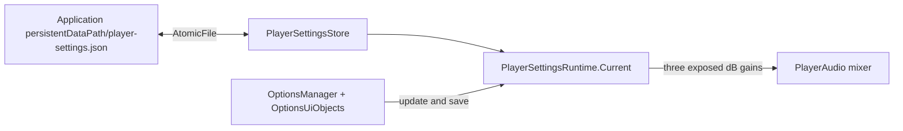
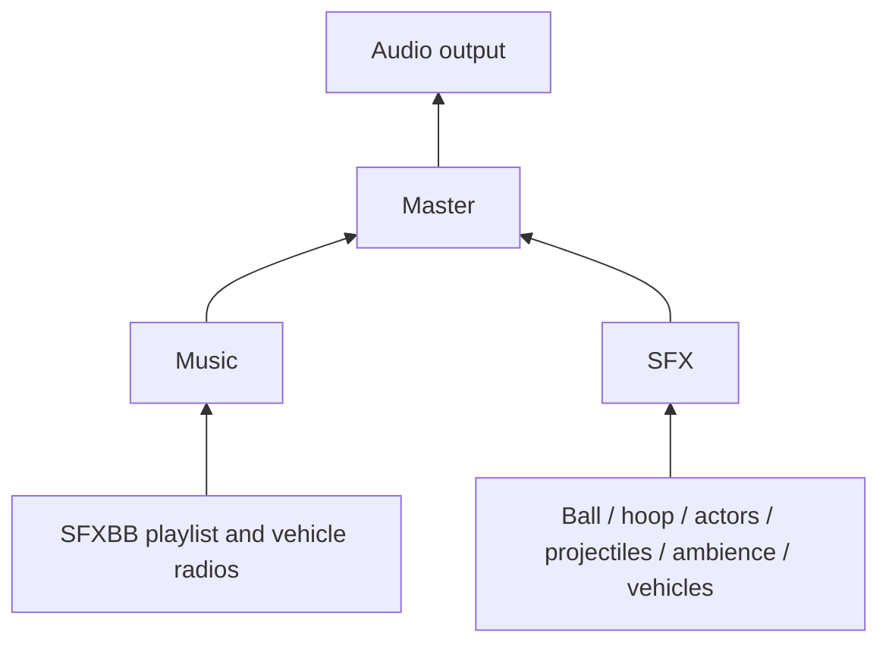

# Player settings and audio implementation audit

Baseline: freshly fetched `dev` `e594eaa07190cb766adce9ec47a28b886aad6523`, 2026-10-14. Unity 6000.5.7f1. Issues #249, #279, #250 and parents #224/#277 are open. No open repository PRs; existing worktrees have other branches and are untouched.

## Current state

#249: AtomicFile already owns primary/backup validation and atomic writes. No application-wide settings store. Keep local preferences separate from SQLite progression, account identity, Backend sessions, GameOptions and MatchConfiguration.

#279: No tracked mixer asset. 401 directly serialized AudioSources: 397 in build scenes, Resources, or their prefab dependency closure; four outside that closure. No production AddComponent<AudioSource>/PlayClipAtPoint paths found; dynamic/pooled effects inherit Resources prefab sources. SFXBB's private GetComponent source mixes playlist and PlayOneShot; critical prefab uses 0.7 gain, enabled music and looping. Dome overrides its volume to 0.893. Pause discovers sources and calls Pause/UnPause while timeScale is zero. All authored source properties must survive routing.

#250: OptionsManager/OptionsUiObjects own validated serialized references, input module, controls panels, callback lifecycle and footer. Extend these owners and OptionManager.prefab.

## Initial proposal

Immutable three-gain model; JSON store using AtomicFile; one Resources mixer with Master > Music/SFX; load/apply at startup; split SFXBB into two explicit serialized sources; route reviewed serialized sources; add three sliders through OptionsUiObjects/OptionsManager. Preserve public fields/playSFX/instance, clip lists, pause discovery and scene composition.

## Review pass 1 - correctness, before implementation

1. Shared music/effects cannot satisfy independent attenuation: retain old source as music and serialize a distinct effects source. Concurrent one-shots must not affect playlist isPlaying. Disabled music keeps effects working.
2. Blind GetComponent after duplication is ambiguous: remove it in SFXBB, reject missing/duplicate references loudly; resolve in Awake before early call sites.
3. SetFloat in Awake/BeforeSceneLoad risks Unity mixer initialization failure: load preferences before scene load, apply in an early-execution Start before ordinary Start playback. PlayOnAwake audio may precede Start; record and test startup limitation. No source is required for mixer application.
4. Pause makes isPlaying false and previously restarts music: prevent playlist advancement at timeScale zero; existing Pause/UnPause sees both sources. Do not replace pause ownership.
5. Gain multiplication belongs in mixer hierarchy; 20*log10(linear), clamped [-80,0] dB, zero=-80. Full gain=0. Practical attenuation requires audio-engine evidence, not GUID checks.
6. Missing/malformed/unsupported JSON must not deserialize omitted fields as mute: explicit version and required numeric fields, finite/range validation, whole-document rejection to valid backup then full-gain defaults. Runtime updates normalize finite values. No automatic startup write.
7. A save after backup recovery can replace the good backup with corrupt primary: discard an invalid primary only when a valid backup exists before invoking AtomicFile. Catch filesystem failures, retain runtime preference, report failed durability and retry on lifecycle flush.
8. Slider initialization uses SetValueWithoutNotify; register/unregister named callbacks symmetrically, refresh on re-enable, reject duplicate control references. Use percentage steps to limit synchronous writes; each real change saves immediately. No debounce loss window.
9. Explicit vertical navigation through all sliders and existing controls/footer; horizontal moves adjust a slider. Preserve pointer/touch and input module. Validate required labels, sliders, unique sources and targets.
10. Reset static runtime ownership at SubsystemRegistration; clear destroyed singleton. Tests isolate file families and restore mixer values and static state.

## Review pass 2 - architecture/regression, before implementation

1. Keep AtomicFile unchanged. Model in Level5.Core; store in Level5.Utility; runtime mixer/application owner in Level5.Audio referencing these existing leaves. Newtonsoft already installed; use explicit JObject primitives rather than reflection-only DTO restoration (Player stripping risk).
2. One immutable Current projection; UI never owns settings or source volumes. No account key/cloud state/events/service locator/new generalized audio manager.
3. Keep old SFX source fileID/GUID as Music. Effects clones authored acoustic properties, but removes playlist clip/autoplay/loop. Migrate original source scene acoustic overrides to effects too (Dome 0.893); its old clip override stays on original music source where playlist already superseded it. Splitting removes incidental effect-driven playlist delays, an unavoidable intentional difference.
4. Inventory classification follows actual clips/owners: vehicle radio songs (muffled techno and van song) Music; lawnmower sound is SFX despite music folder; all basketball/hoop/animation/combat/projectile/weather/crowd/vehicle machinery sources SFX. No filename-only default classification of unknown live content.
5. Route build-scene + Resources dependency closure only. Four nonshipping demo/test sources are deferred with exact paths. No common gameplay bypass is acceptable. Persisted mixer state survives scenes; do not re-enumerate volumes.
6. Author UI in existing prefab using Unity serialization, retain all controls-reference panels/footer, explicit navigation, project TMP font. Avoid screen replacement or source changes beyond routing/separation.
7. Validate store failures/recovery, mixer names/hierarchy, inventory routing and source-relative volumes, serialized UI and callback lifecycle in focused EditMode. Graphics PlayMode exercises Options, actual scene routing, independent playback, pause, transitions and simulated fresh runtime with isolated paths. No broad suite or physical/acoustic claims without evidence.

## Final dependency order

A. Model/store and focused persistence tests. B. Mixer/application boundary, SFXBB separation and inventoried source routing. C. Existing Options serialized sliders/bindings. D. Focused integrated validation, repository validator, final refreshed dev/diff review and PR only after prerequisites pass.

## Implemented contracts

- Model: immutable Master/Music/Sfx gains, defaults 1/1/1. Runtime finite values clamp to [0,1]; NaN/infinity use 1. No account, match, progression, display or sensitivity fields.
- Store: compact JSON `{ "version": 1, "master": 1.0, "music": 1.0, "sfx": 1.0 }`. Version 1 and all three actual numeric, finite, in-range values are required. Duplicated properties, omissions, strings, invalid JSON and unsupported versions reject the document as a unit. Extra properties are ignored. This explicit version prevents interpreting a future incompatible format as muted/default numeric fields; there is no migration framework. A user-requested save replaces invalid/unsupported primary data; loading never overwrites it. On save, an invalid primary is discarded before AtomicFile writes, so corrupt bytes never replace a valid backup and the new file family has a valid backup even after both prior copies were invalid.
- Startup: load independently of Options in BeforeSceneLoad, reset statics at SubsystemRegistration, apply in a persistent component's early Start (-32000). Unity documents SetFloat in Start or later ([Unity API](https://docs.unity3d.com/6000.0/Documentation/ScriptReference/Audio.AudioMixer.SetFloat.html)). PlayOnAwake can precede Start, so an initial audio block from an autoplay ambience/radio source is not guaranteed to use restored gains. SFXBB starts its playlist in ordinary Start after application. Later scenes retain the same mixer state without source enumeration.
- Mixer: Resources/Audio/PlayerAudio, Master > Music/SFX, stable MasterGain/MusicGain/SfxGain. All three snapshot gains default to 0 dB. `20 * log10(linear)` bounded [-80,0] dB, zero=-80 dB (amplitude floor 0.0001, not mathematical silence). Unscaled mixer time keeps application independent of gameplay pause.
- SFXBB: old source fileIDs remain Music, distinct serialized effects sources clone acoustic properties and source-relative gain, with no playlist clip/autoplay/loop. Public clips, instance, playSFX, random initial selection, next-song order, pitch and spatialization remain. The critical music source's authored loop remains enabled. Dome's 0.893 gain override is mirrored to effects. Its old clip override remains on Music where playlist startup already replaced the clip. Incidental one-shot delay of playlist advancement disappears when sources separate; playlist advancement is suppressed while timeScale is zero so Pause/UnPause retains its clip/index.
- Routing: [399 directly serialized covered sources in 207 assets](player-audio-source-inventory.md), including the two new effects sources; inherited instances and pooled/dynamic prefab spawns retain these assignments. Vehicle radios are Music, machinery (including the lawnmower stored under audio/music), weather, crowd and actor sounds are SFX. Four nonshipping demo/test sources are explicitly deferred. No covered common gameplay route is knowingly bypassing Master.
- Options: three labeled percentage sliders, serialized into the existing prefab's previously empty rows. Existing controls panels/footer and existing navigation links remain; vertical navigation inserts the sliders after Touch. Pointer/touch interaction uses the existing EventSystem module. One-percent steps bound synchronous saves to actual percentage changes. Initialization/re-enable use SetValueWithoutNotify and named callbacks unregister/register symmetrically. The existing column's forced height expansion is disabled so the new controls stay above the footer; a real-scene bounds assertion covers this.
- Failed writes: keep live preference, warn that it is not durable, retain dirty state, retry on lifecycle flush. No scheduler, source-volume rewrites, event bus or new audio playback manager.

## Validation findings repaired during implementation

- Initial serialized migration missed the older Resources/SFX prefab because it had no musicEnabled entry. Explicit music/effects references now exist in both SFX prefabs.
- A mixer snapshot text assertion initially failed on CRLF; corrected the assertion, not the mixer.
- Unity's prefab serialization rewrote unrelated TMP fields/navigation. Original unaffected serialized documents and navigation links were retained instead. Unity-generated solution and graphics-setting drift was restored.
- The empty Options row placeholders were inactive. Activated only the three new audio rows, then checked their active ancestors and actual input navigation.
- The existing column expanded every child vertically and would place sliders over the footer. Disabled that expansion in this column; runtime bounds and input checks pass.
- Initial test cleanup unloaded the NUnit runner scene in additive/probe cases. Fixed cleanup to retain it. The two aborted launches produced no NUnit result and were terminated (process exits -1), with logs retained; they are not passing evidence.

## Validation limitations and owner waiver

Practical mute/full-gain acoustic acceptance remains **BLOCKED** in this execution environment.
Both hardware-output capture and Unity's offline AudioRenderer return zero even with the mixer
bypassed and the Editor/global listener unmuted. A hidden non-batch editor also returns zero
unrouted output. This cannot establish mixer attenuation or default audible equivalence. The
probe reports Inconclusive only when the unrouted baseline is unavailable; when a baseline is
available, it asserts full-gain equivalence, Master/category multiplication, independent category
attenuation and all mute floors against actual DSP samples. It never treats a silent baseline as
proof of mute. AudioRenderer is Unity's output recording API ([Unity API](https://docs.unity3d.com/6000.0/Documentation/ScriptReference/AudioRenderer.html)).

Manual listening, physical controller/touch hardware, actual standalone process restart, and
Player/IL2CPP execution are **NOT RUN**. Fresh-store restoration and simulated fresh runtime
restoration are automated evidence, distinct from a standalone Player process. Input evidence
uses virtual keyboard/gamepad devices through the actual InputSystemUIInputModule. No full-suite,
hosted-CI or acoustic certification is claimed. Real-scene tests suppress known unrelated scene
log noise, so they prove their explicit assertions rather than a globally error-free scene.

On 2026-10-14 the owner explicitly instructed: **"skip listening check and pass"**, in reply to
the remaining audible full-gain/mute acceptance question. This waives the practical/listening
gate for publication; it does not turn the unavailable DSP measurement into an automated PASS.
#279 is accepted with that waiver, and #250's upstream acceptance gate is consequently satisfied.
All implementation and functional checks remain subject to the results recorded below.
[The file manifest](player-settings-audio-changes.md) identifies every changed path.

For optional later verification in an audio-capable normal Unity session: run the mute-probe case in
[the validation record](player-settings-audio-validation.md), then listen
at full gain, mute Music while playing a SFX, mute SFX while music continues, mute Master, restore
all gains, pause/resume, transition scenes, and restart with non-default values. Record human
listening separately from DSP assertions. No sound content or authored source gain should change.

